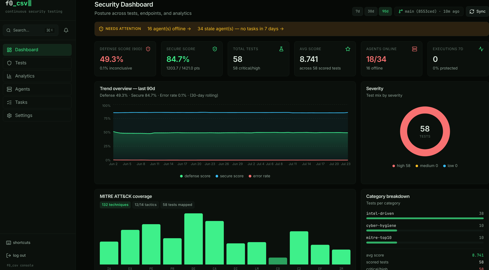
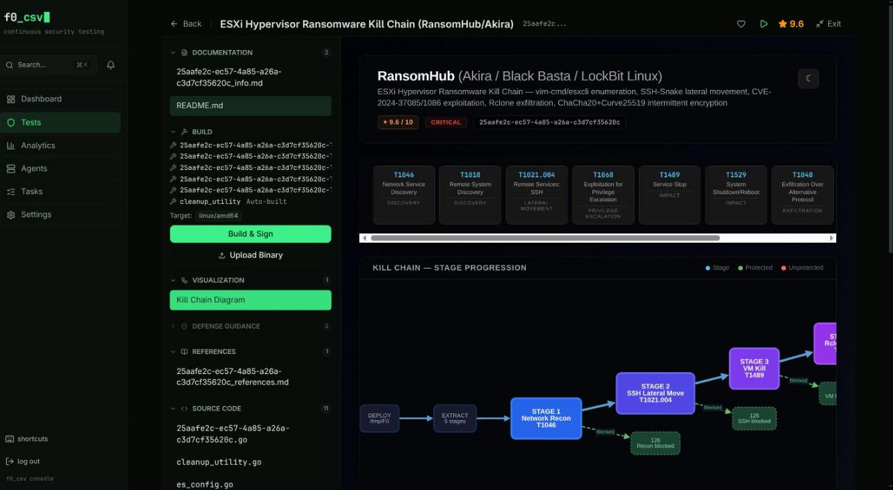
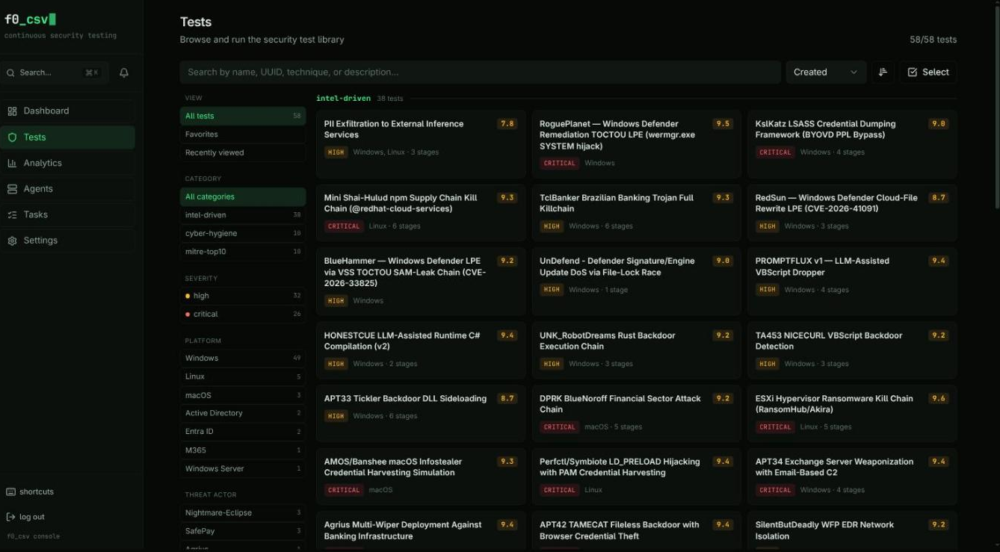
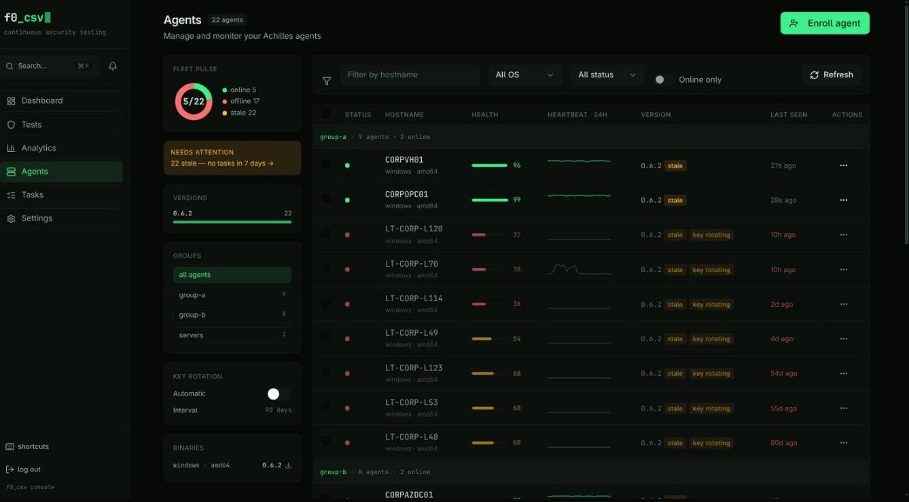
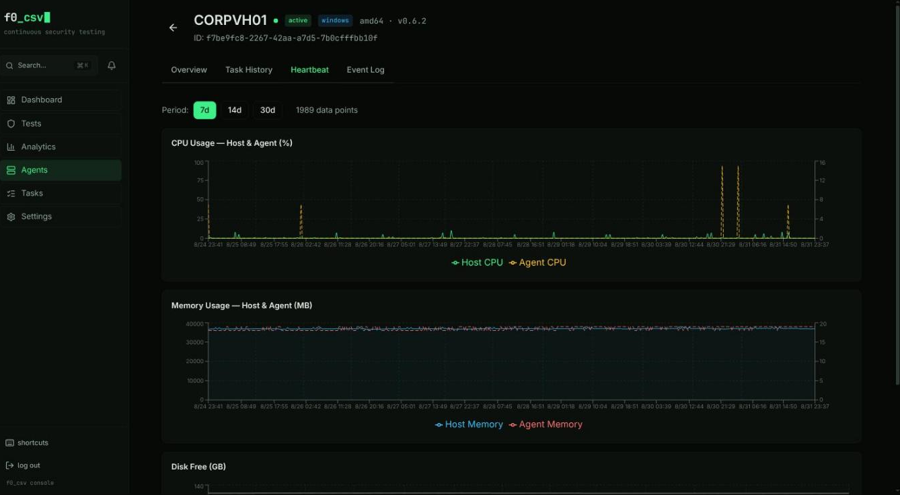
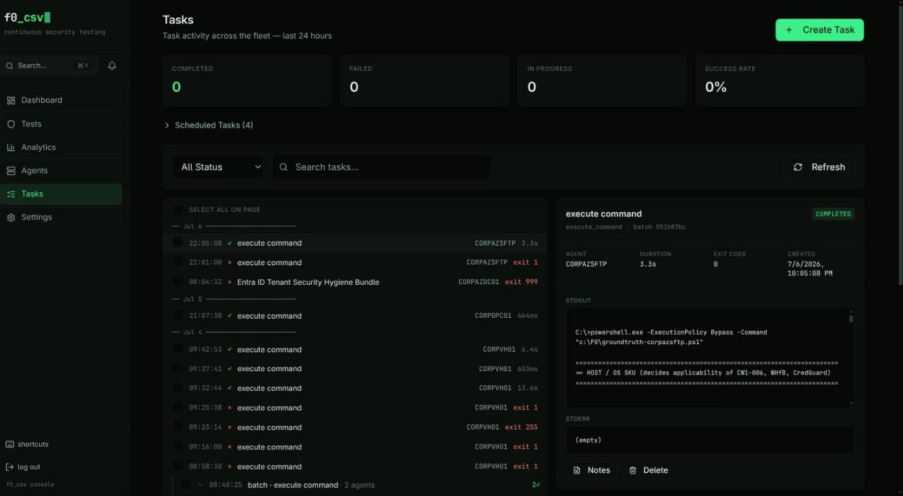
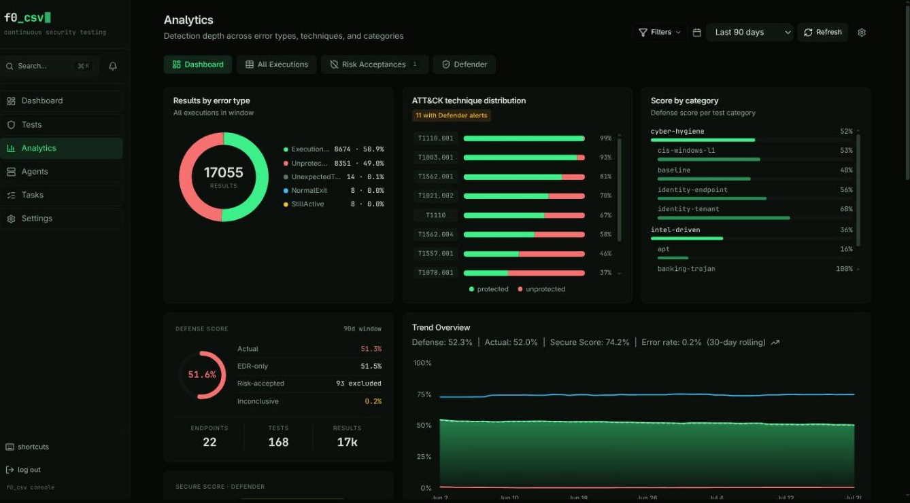
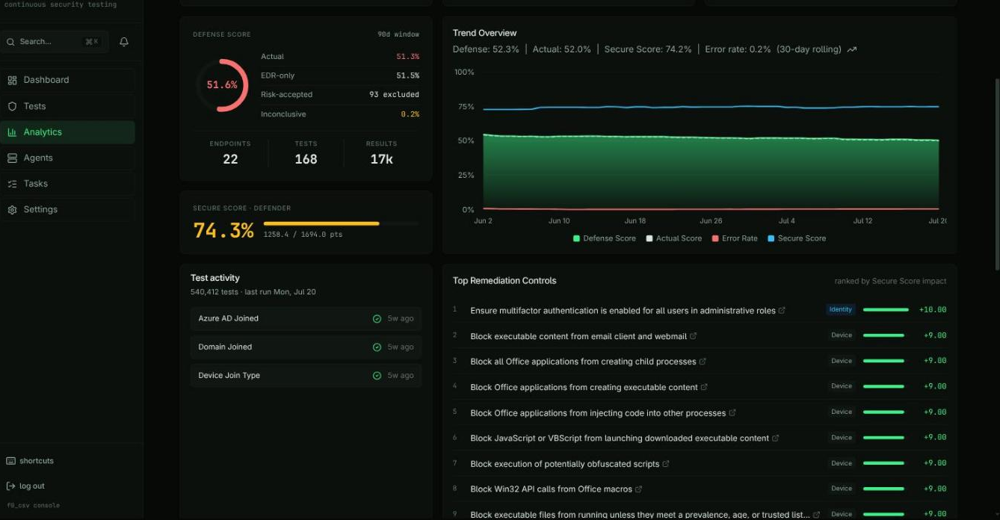
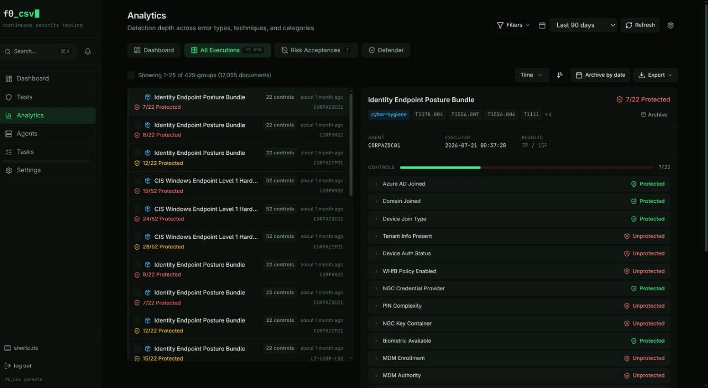
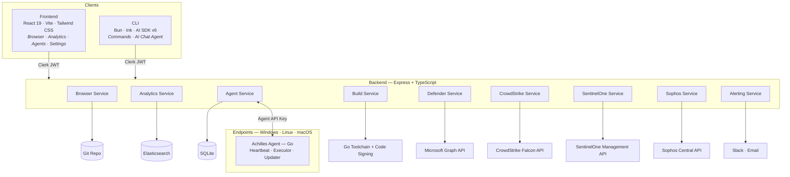

# ProjectAchilles

<div align="center">


[](https://github.com/projectachilles/ProjectAchilles/actions/workflows/ci.yml)
[](https://github.com/projectachilles/ProjectAchilles/actions/workflows/security-review.yml)
[](https://github.com/projectachilles/ProjectAchilles/actions/workflows/security-review.yml)
[](LICENSE)
[](https://www.typescriptlang.org/)
[](https://react.dev/)
[](https://go.dev/)
[](https://bun.sh/)

**Continuous Security Validation — From Threat Intelligence to Defense Readiness**

Stop hoping your defenses work. Start proving it.

[Install on Linux](#recommended-linux-server-in-one-command) · [Quick Start](#quick-start) · [Features](#features) · [Architecture](#architecture) · [Documentation](#documentation) · [Roadmap](docs/ROADMAP.md) · [Contributing](#contributing)

</div>


---

## Why ProjectAchilles

Most organizations invest heavily in security tools but struggle to answer a simple question: *are our defenses actually working?*

Threat intelligence reports pile up unread. Compliance checklists are checked once and forgotten. Security teams deploy EDR, SIEM, and endpoint hardening — then hope for the best. When a breach happens, the post-mortem reveals gaps that were always there but never measured.

**ProjectAchilles exists to close this loop.**

The platform turns threat intelligence into executable security tests, deploys them to your endpoints through a lightweight agent framework, and measures whether your defenses detect, prevent, or miss each technique. The result is not an opinion — it's a score backed by evidence, broken down by technique, host, and control, tracked over time.

You don't need a red team certification to use it. You don't need to write exploit code. You need to know what threats matter to your organization, and whether you're defended against them.

### What It Measures

- **Defense Readiness** — For each threat technique, did your endpoint defenses detect it, block it, or miss it entirely?
- **Controls Compliance** — Are your security configurations (endpoint hardening, identity policies, cloud settings) actually in place?
- **Security ROI** — Which investments are driving measurable protection, and where are the gaps that still need funding?

### Two Modes of Operation

| Mode | Purpose | Input | Output |
|------|---------|-------|--------|
| **Threat-Informed Validation** | Test defenses against real-world attack techniques | Threat intel mapped to MITRE ATT&CK | Per-technique defense score with detection/prevention evidence |
| **Controls Compliance** | Verify security baselines across your fleet | Standards-based control frameworks | Per-control compliance status with remediation guidance |

## Overview

ProjectAchilles is a continuous security validation platform with four core components:

1. **AI-Powered Test Development** — An agentic pipeline that transforms threat intelligence articles into complete, deployable security test packages — source code, detection rules, hardening scripts, and documentation — without manual test development.

2. **Execution Framework** — A lightweight Go agent deployed to endpoints (Windows, Linux, macOS) that executes security tests on demand or on schedule, reports results with cryptographic integrity, and self-updates without downtime.

3. **Analytics & Measurement** — An Elasticsearch-backed dashboard that quantifies defense readiness with scores, heatmaps, trend analysis, and MITRE ATT&CK coverage matrices — turning raw test results into actionable intelligence for security teams and leadership.

4. **CLI & AI Agent** — A Bun-powered command-line tool (`achilles`) with 18 command modules for platform management — including a unified `achilles deploy` TUI — and an AI conversational agent mode powered by Vercel AI SDK for natural-language fleet operations.

All four are driven from one console: a flat six-destination interface — Dashboard, Tests, Analytics, Agents, Tasks, Settings — with a single unified Security Dashboard as the landing page.

The platform is open-source and installs on a Linux server with one command: a terminal wizard handles DNS, certificates, and agent enrollment for LAN deployments. It also runs anywhere Docker Compose does, and integrates with Microsoft Defender, CrowdStrike Falcon, SentinelOne and Sophos Intercept X for cross-correlation between your internal validation results and your EDR's own security posture data.

## Quick Start

### Recommended: Linux server in one command

Run this **on the Linux server** that will host ProjectAchilles (Ubuntu 22.04 or 24.04, root or sudo):

```bash
curl -fsSL https://raw.githubusercontent.com/projectachilles/ProjectAchilles/main/scripts/install-onprem.sh | sudo bash
```

Prefer to read a script before running it as root (recommended for production)?

```bash
curl -fsSLO https://raw.githubusercontent.com/projectachilles/ProjectAchilles/main/scripts/install-onprem.sh
less install-onprem.sh
sudo bash install-onprem.sh
```

That one command:

1. clones the latest release into `/opt/projectachilles`;
2. downloads the `achilles-installer` binary for your architecture (amd64 or arm64) and **verifies it against the release's `SHA256SUMS`**, refusing to run on a mismatch;
3. opens a ten-screen terminal wizard: preflight, network and DNS name, certificates, Clerk login, analytics, organisation, review, live install, and done.

<p align="center">
  
</p>

The wizard automates every step of an install, on a LAN server or a cloud server with a public IP:

| Step | What `achilles-installer` does for you |
|------|----------------------------------------|
| **Preflight** | Checks root, OS, RAM, disk, free ports 80/443, outbound reach to Docker Hub/GitHub/Clerk, and clock sync. The install step installs Docker if it is missing |
| **Name and DNS** | Works with internal DNS. Detects whether the hostname is under a public domain or a private-only zone, and prints the exact A record plus the AD DNS PowerShell line to create it. Can add an optional `/etc/hosts` entry |
| **Certificates** | On a LAN, defaults to a **ProjectAchilles CA name-constrained to your DNS zone** (server-auth only, so a GPO-distributed root can't impersonate other sites or sign code); a root-owned timer renews the intermediate. On a public IP (DigitalOcean, Hetzner), defaults to **Let's Encrypt HTTP-01**. Also supports an Enterprise CA request (CSR), your own certificate files, or Let's Encrypt DNS-01, which needs no inbound internet |
| **Clerk and the first admin** | Checks offline that the keys match each other and your domain before anything is installed, then invites the first admin through the Clerk API (or promotes an existing account), so there's someone who can manage the install |
| **Network exposure** | Binds Caddy to the one IP you pick, because Docker-published ports bypass `ufw`. Optional LAN-scoped `ufw`/`firewalld` rules never touch SSH |
| **Agent enrollment** | On a LAN, renders fingerprint-pinned bootstrap scripts for Windows (PowerShell 5.1) and Linux/macOS; GPO or Intune pushes **only the root certificate**, never enrollment tokens. With Let's Encrypt, agents enroll with the standard command |
| **Day 2** | `achilles-installer status`, `upgrade`, `backup`, `restore`, `ca renew` / `ca export` / `ca bootstrap` |

**Needs:** 2 GiB RAM (4 GiB with the bundled Elasticsearch), 20 GiB free disk, outbound internet, and a terminal. A public IP is not required, and works too: on a cloud server the wizard switches to Let's Encrypt. Installer options: `--ref vX.Y.Z` to pin a release, `--dir` to change the install directory, and `--no-run` to install the binary only. For automation, use `achilles-installer install --config deploy.config.env --yes`.

The full walkthrough covers DNS and Clerk choices, the first admin, the CA model, GPO rollout to Windows endpoints, cloud servers, backups and troubleshooting: **[Server installer guide (on-prem LAN or cloud)](docs/deployment/SERVER_INSTALLER.md)**.

> Prefer a script to a wizard? [`scripts/deploy-server.sh`](docs/deployment/SELF_HOSTED_SERVER.md) is the engine the wizard drives (and `scripts/deploy-do.sh` creates a DigitalOcean droplet first).

### Local development

```bash
git clone https://github.com/projectachilles/ProjectAchilles.git
cd ProjectAchilles

# Start the full stack (installs deps, finds available ports)
./scripts/start.sh -k --daemon
```

Configure Clerk authentication (see [Configuration](#configuration)), then open http://localhost:5173.

### Docker Compose (laptop or evaluation)

```bash
# Clone and run the setup wizard (choose Docker). It writes backend/.env and
# copies the Clerk publishable key into the root .env, which is where Docker
# Compose reads it from (frontend/.env is not used in Docker).
git clone https://github.com/projectachilles/ProjectAchilles.git
cd ProjectAchilles
./scripts/setup.sh

# Only if you'll open the UI somewhere other than http://localhost:
#   echo 'CORS_ORIGIN=http://localhost:9090' >> .env

# Start services, then open http://localhost
docker compose up -d

# Optional: include local Elasticsearch with synthetic data
docker compose --profile elasticsearch up -d
```

### Windows (PowerShell)

```powershell
git clone https://github.com/projectachilles/ProjectAchilles.git
cd ProjectAchilles
powershell -ExecutionPolicy Bypass -File .\scripts\Install-ProjectAchilles.ps1
```

`-ExecutionPolicy Bypass` applies only to that one PowerShell process. Windows blocks unsigned scripts by default ("running scripts is disabled on this system"), and this leaves your system policy unchanged. Windows PowerShell 5.1, built into Windows 10 and 11, is enough.

The PowerShell script checks prerequisites, fixes line endings, configures `backend/.env` interactively (and copies the Clerk publishable key into the root `.env` that Docker Compose reads), builds Docker images, and opens the dashboard. See [Windows Docker Installation](docs/deployment/WINDOWS_DOCKER_INSTALL.md) for the full manual guide.

### Deployment Targets

| Target | Install with | Database | Agent Builds | Guide |
|--------|--------------|----------|-------------|-------|
| **On-prem LAN or cloud server (recommended for self-hosting)** | `install-onprem.sh` → `achilles-installer` wizard | SQLite (volume) | Yes | [Server Installer Guide](docs/deployment/SERVER_INSTALLER.md) |
| **Public server (VPS/droplet)** | `scripts/deploy-server.sh` or `scripts/deploy-do.sh` | SQLite (volume) | Yes | [Public Server Guide](docs/deployment/SELF_HOSTED_SERVER.md) |
| **On-prem server over SSH** | `scripts/deploy-remote.sh user@host` | SQLite (volume) | Yes | [On-Prem Guide](docs/deployment/ON_PREM_SERVER.md) |
| **Docker Compose** | `scripts/setup.sh` + `docker compose up -d` | SQLite (volume) | Yes | [docker-compose.yml](docker-compose.yml) |
| **Railway** | Railway dashboard | SQLite (volume) | Partial | [Railway Guide](docs/deployment/RAILWAY.md) |
| **Render** | Blueprint (`render.yaml`) | SQLite (persistent disk) | Partial | [Render Guide](docs/deployment/RENDER.md) |
| **Fly.io** | `flyctl` | SQLite (volume) | Yes | [Fly.io Guide](docs/deployment/FLY.md) |
| **Vercel** | Two Vercel projects (`backend-serverless/` + `frontend/`) | Turso (libSQL) | No | [Vercel Guide](docs/deployment/VERCEL.md) |

The three server targets share one engine (`scripts/deploy-server.sh` + `docker-compose.server.yml` + Caddy), so a single origin serves the UI at `/`, the API at `/api`, and agents on the same host. Every target except Vercel runs `backend/`.

## Features

### Unified Security Dashboard

One landing page for posture across the test library, the endpoint fleet, and Elasticsearch analytics — replacing the three separate module dashboards.

<p align="center">
  
</p>

- **Attention banner** — derived, never stored: offline agents, stale agents, failed tasks in the last 24 h, outdated binaries, and git sync failures, each linking to the page that resolves it
- **KPI strip** — Defense Score, Secure Score, total tests, average score, agents online, executions in the window
- **Scores what is true now** — the Defense Score counts the **latest result per test × endpoint pair**, so an old failure that has since been fixed stops dragging the score down; the tile and the trend share that basis
- **Cards** — trend overview, testing cadence, ATT&CK outcome matrix (prevented / detected / missed per technique), threat-actor readiness, top remediation controls, fleet health, recent executions
- **Shared time range** with Analytics (24 h, 7 d, 30 d, 90 d, All; default 30 days), remembered across pages
- **Per-card degradation** — an unconfigured integration greys out its own card with a "Configure →" link; the dashboard never redirects you away

### Console & Navigation

A single dark **f0 design language** across every screen — terminal-green accent on near-black surfaces, Inter for prose, JetBrains Mono for anything machine-shaped (hostnames, versions, exit codes, IDs).

| Destination | What lives there |
|-------------|------------------|
| **Dashboard** | Unified posture across tests, endpoints, and analytics |
| **Tests** | The test library with a faceted browse rail |
| **Analytics** | Defense Score, executions, risk acceptances, Defender, CrowdStrike, SentinelOne, Sophos |
| **Agents** | Fleet table plus the fleet-pulse utility rail |
| **Tasks** | Live task stream, scheduled tasks, task detail |
| **Settings** | Integrations, tests, agent binaries, users, API keys |

Keyboard shortcuts: `1`–`6` jump between destinations, `/` focuses page search, `⌘K` opens global search, `?` lists every shortcut. Every pre-2.1 URL (`/browser`, `/endpoints/*`, `/favorites`, …) redirects, so existing bookmarks keep working.

### AI-Powered Test Development

Security tests are built by a multi-agent AI pipeline that converts threat intelligence into complete test packages. Each test includes ~19 artifacts generated autonomously.

**How it works:**

```
Threat Intelligence Article
    ↓ Phase 1: Analysis & Implementation
    Extracts TTPs → generates Go source → compiles & signs binary
    ↓ Phase 2: Parallel Artifact Generation
    Detection Rules (5 formats) │ Defense Guidance │ Documentation │ Kill Chain Diagrams
    ↓ Phase 3: Validation & Deployment
    Verifies all artifacts → syncs catalog → deploys to endpoints
```

**What each test package contains:**

| Artifact | Formats | Purpose |
|----------|---------|---------|
| Test binary | Go (Windows, Linux, macOS) | Executes the simulated technique on the endpoint |
| Detection rules | KQL, YARA, Sigma, Elastic EQL, LimaCharlie | Import directly into your SIEM/EDR |
| Hardening scripts | PowerShell, Bash (Linux + macOS) | Remediate gaps found by the test |
| Documentation | Markdown (README + info card) | MITRE mapping, severity, threat actor context |
| Kill chain diagram | Interactive HTML | Visualizes multi-stage attack flow |

<p align="center">
  
</p>

**Test categories:**

| Category | Description | Example |
|----------|-------------|---------|
| **Intel-Driven** | Real-world attack techniques from APT reports and ransomware analysis | Lazarus group TTPs, Emotet delivery chains |
| **MITRE Top 10** | Most common ransomware techniques from MITRE ATT&CK | Process injection, defense evasion, lateral movement |
| **Cyber-Hygiene** | Configuration validation for endpoint, identity, and cloud security | Defender settings, ASR rules, LSASS protection, MFA |

> The test development pipeline lives in a companion repository. Tests are synced to ProjectAchilles via Git for browsing, building, and execution.

### CLI (`achilles`)

A Bun-powered command-line interface for managing the entire platform from the terminal — or through an AI conversational agent.

**Two modes of operation:**

| Mode | Command | Description |
|------|---------|-------------|
| **Commands** | `achilles <command> [args]` | Direct platform management with rich terminal output |
| **AI Chat** | `achilles chat` | Conversational agent powered by AI SDK v6 with full tool access |

**What it covers:**

- **Agent fleet** — List, inspect, tag, and manage enrolled agents
- **Enrollment tokens** — Create, revoke, and audit tokens
- **Task management** — Create, assign, and monitor task execution
- **Scheduling** — CRUD for recurring schedules
- **Test browser** — Search, inspect, and build tests
- **Analytics** — Query defense scores, trends, and execution history
- **Defender** — Secure Score, alerts, controls, cross-correlation
- **CrowdStrike** — ZTA posture score, alerts, cross-correlation
- **Build system** — Trigger cross-compilation, manage certificates
- **Risk acceptance** — Accept/revoke risk on individual controls
- **User management** — List and inspect Clerk users
- **Deployment** — Unified `achilles deploy` TUI that walks through multi-target deployments (interactive or headless)

**Key features:**
- `--json` flag on every command for structured output (scripts, LLM consumption)
- Multi-profile server configuration (`achilles config profile`)
- Clerk device-flow authentication (`achilles login`)
- AI chat mode with Ink TUI (interactive) or readline fallback (piped)
- AI agent has tool access to all platform APIs with approval tiers (read/write/destructive)

### Test Browser

Browse the full test library with rich metadata and execute tests directly from the UI.

<p align="center">
  
</p>

- **Facet rail** — category, platform, threat actor, and a "not run yet" toggle, with live counts and client-side filtering
- **Grid or list view** — tests grouped by category; the list view adds per-test fleet results (techniques, platform, stages, score) with columns that appear as the screen widens
- View source code, detection rules, hardening scripts, and attack flow diagrams
- Build, sign, and download test binaries directly from test detail pages
- Dispatch a test to selected agents, now or on a schedule
- Favorite tests, track recent views, view version history and Git modification dates

### Execution Framework

Deploy a lightweight Go agent to endpoints for remote test execution with full lifecycle management.

<p align="center">
  
</p>

- **Enrollment** — Token-based registration with configurable TTL and max uses
- **Heartbeat Monitoring** — Real-time online/offline status with CPU, memory, disk, and uptime metrics
- **Secure Execution** — Download, verify (SHA256 + Ed25519 signature), execute, and report results
- **Self-Updating** — Agents poll for new versions and auto-apply cryptographically signed updates
- **Cross-Platform** — Windows, Linux, and macOS (amd64 + arm64) with native service integration
- **Bundle Results** — Per-control results from compliance tests fan out to individual ES documents for granular tracking
- **Zero-Downtime Key Rotation** — API keys rotated automatically via heartbeat with dual-key grace period
- **Encrypted Config** — Agent credentials encrypted at rest with AES-256-GCM using machine-bound keys
- **Remote Uninstall** — Two-phase agent removal (stop service + cleanup) initiated from admin UI
- **Pre-execution blocks recorded, not failed** — when Defender ASR or application control denies launch of a fresh test binary, agent 0.7.0+ reports exit code `260` (inconclusive, excluded from the Defense Score) with the remedy, instead of leaving the task stuck
- **Per-stage descriptions** — each stage's plain-language "what this does" travels with the result into run detail
- **Pinned LAN enrollment** — on `achilles-installer` deployments, one bootstrap script verifies the root CA fingerprint, trusts it, installs the agent into a locked-down `C:\F0`, and enrolls

- **Fleet utility rail** — online/offline/stale ring, version rollout, groups, key-rotation settings, and per-platform binary downloads beside the agent table
- **Live task stream** — chronological view with date markers, collapsible batch rows, a detail panel, an expanded stdout/stderr view, and one-click retry for failed test tasks

<details>
<summary>More: heartbeat monitoring &amp; task stream</summary>
<br>
<p align="center">
  
</p>
<p align="center">
  
</p>
</details>

### Analytics & Measurement

Quantify your security posture with 30+ query endpoints powered by Elasticsearch.

<p align="center">
  
</p>

- **Defense Score** — Latest-result score (`basis=latest`) or per-execution score, with breakdowns by test, technique, category, hostname, and severity
- **Run Detail** — bundle stages in execution order with plain-language verdicts, ATT&CK technique names, and an attack-chain strip
- **Chain Depth** — how far each multi-stage attack got before something stopped it, split into detected / undetected chains, pre-execution blocks, and stage errors
- **Execution Report** — a print-ready PDF report (executive verdict, kill chain, timeline, findings) at `/analytics/report`, named for your organisation via the console identity (Settings → General) or `ORGANIZATION_NAME`
- **Compliance Export** — SB-PC-2026-001 JSON export (with JSON Schema) that honours the analytics scope filters
- **Trend Analysis** — Rolling-window defense score and error rate trends over time
- **MITRE ATT&CK Heatmaps** — Host-test matrix showing protection status across your fleet
- **Coverage Treemaps** — Hierarchical category/subcategory coverage visualization
- **Executions Master-Detail** — grouped runs on the left, per-control Protected/Unprotected results on the right; keyboard selection, bulk archive / accept-risk, CSV + JSON export, and a deep-linkable `?expanded=<id>`
- **Risk Acceptance** — Accept risk on individual controls with audit tracking
- **Microsoft Defender Integration** — Sync Secure Score, alerts, and control profiles with cross-correlation analytics; dedicated Defender tab with alert drill-down drawer, correlation timeline, per-execution detection rate with MITRE roll-up, and control ↔ alert linking
- **CrowdStrike Falcon Integration** — Sync ZTA posture score and alerts with cross-correlation analytics; dedicated CrowdStrike tab with alert drill-down drawer (Falcon console links), correlation timeline, and per-execution detection rate; optional auto-resolve closes correlated alerts with an audit-trail comment
- **SentinelOne Integration** — Sync threats and detection alerts (read-only by default) with cross-correlation analytics; dedicated SentinelOne tab with agent health, policy and path-exclusion gap views; opt-in auto-resolve (re-checks the console before acting) and opt-in automatic kill / quarantine of unmitigated test threats, never counted as SentinelOne prevention. Docker-style backends only (not Vercel)
- **Sophos Integration** — Sophos Central tenant credential: Common Alerts, SIEM prevention evidence (24 h window, with a visible sync-gap warning), XDR detections (ATT&CK techniques) and the Account Health Check as the posture score (labelled as an Achilles average); dedicated Sophos tab with endpoint health, policy and exclusion / allow-list gap views (flags an allowed certificate or `C:\F0` exclusion that would exempt every test); opt-in auto-resolve (acknowledge / TRUE_POSITIVE_BENIGN, re-checks Sophos before acting). Read-only by default. Docker-style backends only (not Vercel)
- **Vendor-Confirmed Prevention** — a stage that CrowdStrike, SentinelOne, Sophos or Defender reports as prevented is credited as protected; the EDR tabs share one layout with source/severity filters and evidence-based technique coverage (prevented / detected only / missed)
- **Trend Alerting** — Threshold-based Slack and email notifications with in-app notification bell
- **Write-Index Rollover** — Results ingest into dated write indices (`achilles-results-YYYY.MM.DD`) with daily, monthly, or static rollover; per-task index targeting for isolated result sets

<details>
<summary>More: the posture section</summary>
<br>
<p align="center">
  
</p>
<p align="center">
  
</p>

The Defense Score renders as a **ledger** — a ring gauge beside four reconciling lines (Actual, EDR-only, Risk-accepted, Inconclusive) — rather than one big number with the reconciliation left implicit. Secure Score and Top Remediation Controls appear only when Microsoft Defender is configured; without it the remaining cards reflow to fill the row. A CrowdStrike ZTA score card follows the same pattern when CrowdStrike Falcon is configured.
</details>

### Build System

Compile and sign test binaries on demand with Go cross-compilation.

- **Cross-Compilation** — Build for Linux/Windows/macOS × amd64/arm64 from any host OS
- **Code Signing** — Windows Authenticode (osslsigncode) and macOS ad-hoc signing (rcodesign)
- **Multi-Certificate Management** — Upload PFX/P12 or generate self-signed certs (up to 5)
- **Embed Dependencies** — Detects `//go:embed` directives and manages required files
- **Build Caching** — Previously built binaries cached for instant download
- **Background Builds** — builds run asynchronously with progress polling and resume after a page refresh; Build All runs one test at a time

### Task Scheduling

Automate test execution across agent pools with flexible scheduling.

- **Schedule Types** — Once, daily, weekly (specific days), monthly (specific day)
- **Randomized Timing** — Optional randomization within office hours, fleet-wide or per-machine (each agent gets an independent next-run time)
- **Per-Task ES Index** — Target specific Elasticsearch indices per task for result isolation
- **Priority Queue** — Higher-priority tasks assigned first

### Security Test Campaigns

Save a test plan, run it with one click, and hand the result to an auditor.

- **Saved plans** — up to 100 tests crossed with a set of agents, scoped to your organization, with an optional framework label (e.g. "CIS v8")
- **Preflight** — before launch, every test × host pair is checked (not built, no binary for the host's OS, agent offline); you confirm "Run the rest" or fix the plan, so a run never silently does less than the campaign says
- **Evidence page** — a matrix with the same outcome labels as Analytics (Protected, Prevented, Detected, Unprotected, Error), a reason for every cell, per-stage results, per-host and per-test totals, % protected on the Defense Score basis, who started it, and the pre-execution notice record
- **Export** — CSV with one row per pair (outcome, exit code, reason, stages, EDR result) and a print layout for PDF
- **Immutable evidence** — each run snapshots its tests and hosts, so editing or deleting a campaign never rewrites past runs

### Pre-execution Notices

Tell the SOC before every test runs, so simulated attacks are not triaged as real ones.

- **Email before every run** — Run Now, retries, schedules and campaigns; tests are held until the mail server accepts the notice, then start after a 0–5 minute lead
- **What the SOC gets** — run reference, time window, who started it, each test with its UUID and stage count, the hosts, the EDR auto-resolve status, where the activity shows up on the hosts, and a calendar file
- **Loud failures** — retries with backoff, a console banner and Slack alert; tests that never get a notice are marked "Not run", never run unannounced
- **Release without notice** — during a mail outage, release a held run from Settings with a recorded reason
- **Finished email** — outcome counts with the same labels as Analytics once the run is over
- **Per organization**, off by default; not available on the Vercel (serverless) deployment

### Programmatic Access (API Keys)

Automate the platform from scripts and CI without a browser session.

- **`pa_` Bearer Tokens** — Create and revoke keys in Settings → API Keys; hashed at rest, shown only once at creation
- **Permission Scoping** — `read`, `read-write`, or `admin` permission sets enforced per key; `admin` is the only scope with remote command execution
- **Full Read Coverage** — Query analytics, agents, tasks, and schedules with `Authorization: Bearer pa_...`
- See the [Programmatic Access guide](wiki/docs/api-reference/programmatic-access.md) for recipes and endpoint reference

### Agent Communication Security

The agent-server communication channel has been hardened through an internal security audit covering 9 findings. All HIGH and MEDIUM findings are resolved. See [Agent Security Findings](docs/agent-security-findings.md) for full details.

| Protection | Description |
|------------|-------------|
| **TLS Enforcement** | `skip_tls_verify` blocked for non-localhost servers; explicit `--allow-insecure` override required |
| **API Key Rotation** | Zero-downtime rotation via heartbeat delivery with 5-minute dual-key grace period |
| **Replay Protection** | `X-Request-Timestamp` header with 5-minute skew window; payload-level timestamp validation |
| **Timing Oracle Prevention** | Constant-time bcrypt comparison on enrollment and auth (dummy hash on miss) |
| **Update Signatures** | Ed25519 detached signatures on agent binaries; verified before applying updates |
| **Rate Limiting** | Principal-keyed budgets: agent device (30/min, keyed by agent ID), enrollment & download (300/15min), key rotation (3/15min) — see [Rate Limiting](docs/rate-limiting.md) |
| **Encrypted Credentials** | Agent API key encrypted at rest with AES-256-GCM; key derived from machine ID (non-portable) |
| **Least-Privilege Permissions** | Binary `0700` / Windows SYSTEM+Admins ACL; config `0600`; work dirs `0700` |

## Architecture



### Tech Stack

| Layer | Technology | Version |
|-------|------------|---------|
| Frontend | React | 19.3 |
| Build Tool | Vite | 8.3 |
| Styling | Tailwind CSS | 4.1 |
| State Management | Redux Toolkit | 2.13 |
| Routing | React Router | 7.18 |
| Authentication | Clerk | 5.x |
| Backend | Express | 4.22 |
| Language | TypeScript | 5.9 |
| CLI Runtime | Bun | 1.3 |
| CLI UI | Ink | 6.8 |
| AI SDK | Vercel AI SDK | 6.0 |
| Agent | Go | 1.26 |
| Server Installer | Go + Bubble Tea / Huh / Lip Gloss | 1.26 / v2 |
| Reverse Proxy & TLS | Caddy | 2.10 |
| Analytics Store | Elasticsearch | 8.x |
| Agent Database | SQLite | 3.x |
| Code Signing | osslsigncode | — |
| Containerization | Docker Compose | — |

### Project Structure

```
ProjectAchilles/
├── frontend/                  # React 19 + TypeScript + Vite
│   └── src/
│       ├── components/        # Shared UI primitives
│       ├── pages/             # Module pages (browser, analytics, agents, settings)
│       ├── services/api/      # API client modules
│       ├── hooks/             # Custom hooks (useAuthenticatedApi, etc.)
│       └── store/             # Redux slices
├── backend/                   # Express + TypeScript (ES modules)
│   └── src/
│       ├── api/               # Route handlers (*.routes.ts)
│       ├── services/          # Business logic by module
│       ├── middleware/         # Auth, error handling, rate limiting
│       └── types/             # TypeScript definitions
├── cli/                       # Bun + TypeScript CLI with AI chat agent
│   └── src/
│       ├── commands/          # Command modules (agents, tasks, browser, analytics, ...)
│       ├── chat/              # AI chat agent (AI SDK v6, Ink TUI, tool definitions)
│       ├── api/               # API client for backend communication
│       ├── auth/              # Clerk device-flow token management
│       ├── config/            # Multi-profile configuration store
│       └── output/            # Formatters (table, JSON, colors)
├── agent/                     # Go agent source
│   ├── main.go                # CLI entry point (--enroll, --run, --install)
│   └── internal/              # Agent modules (poller, executor, updater, sysinfo)
├── installer/                 # achilles-installer: Go + Bubble Tea TUI for Linux server installs
│   └── internal/              # Wizard (tui), CA, DNS/Clerk checks, preflight, engine runner, day-2
├── blog/                      # Next.js 16 + MDX blog (blog.projectachilles.io, ES/EN i18n)
├── wiki/                      # Docusaurus documentation site
├── deploy/caddy/              # Caddy config for single-server installs (TLS modes, CA endpoints)
├── scripts/                   # Shell scripts and PowerShell bootstrap
│   ├── install-onprem.sh      # One-command Linux bootstrap (verified installer download + wizard)
│   ├── deploy-server.sh       # Server install engine (used by the wizard and the scripts below)
│   ├── deploy-remote.sh       # Install on a remote host over SSH
│   ├── deploy-do.sh           # Create a DigitalOcean droplet, then install
│   ├── start.sh               # Development startup script
│   ├── setup.sh               # Interactive setup wizard (Linux/macOS)
│   └── Install-ProjectAchilles.ps1 # Bootstrap script (Windows)
├── docs/                      # Documentation
│   ├── deployment/            # Deployment guides (on-prem LAN, server, Fly, Railway, Render, Vercel)
│   └── security/              # Security audit and remediation docs
├── docker-compose.yml         # Multi-service deployment (local / evaluation)
├── docker-compose.server.yml  # Single-origin server deployment behind Caddy
└── CLAUDE.md                  # AI assistant development guidance
```

## Configuration

### Authentication (Required)

All modules require [Clerk](https://clerk.com) authentication. Create a Clerk application and configure your keys:

```bash
# frontend/.env (local dev server only)
VITE_CLERK_PUBLISHABLE_KEY=pk_test_...

# backend/.env
CLERK_PUBLISHABLE_KEY=pk_test_...
CLERK_SECRET_KEY=sk_test_...

# .env in the project root (Docker Compose only)
CLERK_PUBLISHABLE_KEY=pk_test_...
CORS_ORIGIN=http://localhost
```

In Docker Compose, the frontend container ignores `frontend/.env` and reads the publishable key from the root `.env` when it starts.

### Environment Variables

#### Frontend

| Variable | Description | Default |
|----------|-------------|---------|
| `VITE_CLERK_PUBLISHABLE_KEY` | Clerk publishable key | — (required) |
| `VITE_BACKEND_PORT` | Backend port for Vite proxy | `3000` |
| `VITE_API_URL` | Full backend URL (production) | — |

#### Backend

| Variable | Description | Default |
|----------|-------------|---------|
| `CLERK_PUBLISHABLE_KEY` | Clerk publishable key | — (required) |
| `CLERK_SECRET_KEY` | Clerk secret key | — (required) |
| `PORT` | Server port | `3000` |
| `SESSION_SECRET` | Session signing key | — (required in prod) |
| `CORS_ORIGIN` | Allowed CORS origin | `http://localhost:5173` |
| `TESTS_REPO_URL` | Git URL for test library | — |
| `GITHUB_TOKEN` | PAT for private repos | — |
| `TESTS_SOURCE_PATH` | Local fallback path for tests | `./tests_source` |
| `AGENT_SERVER_URL` | External URL for agent communication | — |
| `ENCRYPTION_SECRET` | Encryption key for settings at rest | Machine-derived |

#### Elasticsearch (optional)

| Variable | Description |
|----------|-------------|
| `ELASTICSEARCH_CLOUD_ID` | Elastic Cloud deployment ID |
| `ELASTICSEARCH_API_KEY` | API key for authentication |
| `ELASTICSEARCH_NODE` | Direct node URL (e.g., `http://localhost:9200`) |
| `ELASTICSEARCH_INDEX_PATTERN` | Read index pattern (default: `achilles-results-*`) |
| `ELASTICSEARCH_WRITE_INDEX_PREFIX` | Write index prefix (default: `achilles-results-`) |
| `ELASTICSEARCH_WRITE_INDEX_ROLLOVER` | Write index rollover: `none`, `daily`, or `monthly` |
| `ELASTICSEARCH_USERNAME` / `ELASTICSEARCH_PASSWORD` | Basic auth (alternative to API key) |
| `ELASTICSEARCH_CA_CERT` | Custom CA certificate for self-signed clusters |

#### Docker

| Variable | Description |
|----------|-------------|
| `NGROK_FRONTEND_DOMAIN` | ngrok domain for frontend tunnel |
| `NGROK_BACKEND_DOMAIN` | ngrok domain for backend/agent tunnel |

## Data Storage & Clean Reset

Runtime state (agents, tokens, settings, certificates, compiled binaries) is stored **outside the repository** — in the user's home directory. This is intentional: it protects your data from `git pull`, re-clones, or accidental deletion of the repo folder.

### Where state lives

| Platform | Data directory |
|----------|----------------|
| Linux / macOS (local) | `~/.projectachilles/` |
| Windows | `C:\Users\<user>\.projectachilles\` |
| Docker / Render / Fly.io | `/root/.projectachilles/` (inside container, backed by a volume) |
| Vercel (serverless) | Turso database + Vercel Blob store (no filesystem state) |

### What's inside

| Path | Contents |
|------|----------|
| `agents.db` | SQLite database: agents, enrollment tokens, tasks, schedules, agent_versions |
| `analytics.json` | Encrypted Elasticsearch credentials (AES-256-GCM) |
| `integrations.json` | Encrypted Defender, CrowdStrike, Slack, and email credentials |
| `tests.json` | Test library configuration |
| `certs/cert-*/` | Code-signing PFX certificates (max 5, active cert tracked in `active-cert.txt`) |
| `binaries/<os>-<arch>/` | Compiled Go agents ready to download |
| `builds/<test-uuid>/` | Per-test compiled binaries |
| `signing/` | Agent API key signing keypair |
| `custom-tests/` | User-authored tests outside the git-synced library |

Additionally, test results and EDR alerts are stored in **Elasticsearch** (`achilles-results-*`, `achilles-defender`, `achilles-crowdstrike` indices) — that data lives in your ES cluster, not on the local filesystem.

> **Why this matters**: deleting or renaming `/ProjectAchilles` and doing a fresh `git clone` does **not** reset your installation. The backend will start up against the same `agents.db` and show the same agents, tokens, schedules, and settings.

### Clean reset (start from scratch)

Stop services and remove the data directory. The next startup will create an empty database.

**Linux / macOS (local install):**

```bash
./scripts/start.sh --stop
rm -rf ~/.projectachilles
# optional: also wipe Elasticsearch test results
curl -X DELETE "$ELASTICSEARCH_NODE/achilles-results-*"
```

**Windows (PowerShell):**

```powershell
.\scripts\start.sh --stop   # or stop backend/frontend processes manually
Remove-Item -Recurse -Force $HOME\.projectachilles
```

**Docker Compose:**

```bash
docker compose down --volumes   # removes the achilles-data volume
docker compose up -d
```

**Render / Fly.io:** delete and recreate the persistent disk/volume via the provider dashboard or CLI (`flyctl volumes destroy`, Render → Disk → Delete), then redeploy.

**Vercel (serverless):** drop the Turso database (`turso db destroy <name>` and recreate) and clear the Blob store (delete objects via `vercel blob` CLI or Dashboard).

### Selective reset (keep install, clear agents only)

If you want to keep your Clerk config, certificates, and ES credentials but remove all enrolled agents:

```bash
sqlite3 ~/.projectachilles/agents.db <<'SQL'
DELETE FROM tasks;
DELETE FROM schedules;
DELETE FROM agents;
DELETE FROM enrollment_tokens;
SQL
```

Restart the backend afterwards so it reopens the database cleanly.

## API Reference

> All endpoints require Clerk JWT authentication unless noted. Include `Authorization: Bearer <token>` header.

### Browser

| Method | Endpoint | Description |
|--------|----------|-------------|
| `GET` | `/api/browser/tests` | List all security tests |
| `GET` | `/api/browser/tests/:uuid` | Get test details with metadata |
| `GET` | `/api/browser/tests/:uuid/files` | List test files |
| `GET` | `/api/browser/tests/:uuid/files/:filename` | Get file contents |

### Analytics

| Method | Endpoint | Description |
|--------|----------|-------------|
| `GET` | `/api/analytics/defense-score` | Aggregate defense score |
| `GET` | `/api/analytics/defense-score/trend` | Score trend over time |
| `GET` | `/api/analytics/host-test-matrix` | Host × test heatmap data |
| `GET` | `/api/analytics/technique-distribution` | Technique coverage breakdown |
| `GET` | `/api/analytics/executions/paginated` | Paginated results with filters |
| `POST` | `/api/analytics/settings` | Configure Elasticsearch connection |

### Agent (Admin)

| Method | Endpoint | Description |
|--------|----------|-------------|
| `GET` | `/api/agent/admin/agents` | List agents with filters |
| `POST` | `/api/agent/admin/tokens` | Create enrollment token |
| `POST` | `/api/agent/admin/tasks` | Create task for agent(s) |
| `GET` | `/api/agent/admin/schedules` | List schedules |
| `POST` | `/api/agent/admin/schedules` | Create recurring schedule |

### Agent (Device)

| Method | Endpoint | Auth |
|--------|----------|------|
| `POST` | `/api/agent/enroll` | Enrollment token |
| `POST` | `/api/agent/heartbeat` | Agent key |
| `GET` | `/api/agent/tasks` | Agent key |
| `POST` | `/api/agent/tasks/:id/result` | Agent key |
| `GET` | `/api/agent/update` | Agent key |

> `POST /api/agent/tasks/:id/result` accepts an optional `bundle_results` field. When present, each control is indexed as an independent ES document for per-control analytics.

### Build & Settings

| Method | Endpoint | Description |
|--------|----------|-------------|
| `GET` | `/api/tests/builds` | List test UUIDs with built binaries |
| `POST` | `/api/tests/builds/:uuid` | Trigger cross-compilation |
| `GET` | `/api/tests/builds/:uuid/download` | Download built binary |
| `GET` | `/api/tests/certificates` | List certificates |
| `POST` | `/api/tests/certificates/upload` | Upload PFX/P12 certificate |
| `POST` | `/api/tests/certificates/generate` | Generate self-signed certificate |

### Defender Integration

| Method | Endpoint | Description |
|--------|----------|-------------|
| `GET` | `/api/analytics/defender/secure-score` | Current Secure Score with category breakdown |
| `GET` | `/api/analytics/defender/secure-score/trend` | Secure Score trend over time |
| `GET` | `/api/analytics/defender/alerts` | Defender alerts with filtering |
| `GET` | `/api/analytics/defender/controls` | Control profiles with compliance status |
| `GET` | `/api/analytics/defender/cross-correlation` | Defense Score vs Secure Score correlation |
| `GET` | `/api/integrations/defender/config` | Defender configuration status |
| `POST` | `/api/integrations/defender/config` | Save Defender credentials |
| `POST` | `/api/integrations/defender/sync` | Trigger manual data sync |

### CrowdStrike Integration

| Method | Endpoint | Description |
|--------|----------|-------------|
| `GET` | `/api/analytics/crowdstrike/zta-score` | Current Zero Trust Assessment posture score |
| `GET` | `/api/analytics/crowdstrike/zta-score/trend` | ZTA score trend over time |
| `GET` | `/api/analytics/crowdstrike/alerts` | CrowdStrike alerts with filtering |
| `GET` | `/api/analytics/crowdstrike/alerts/summary` | Alert counts by severity and status |
| `GET` | `/api/analytics/crowdstrike/alerts/trend` | Alert volume over time |
| `GET` | `/api/analytics/crowdstrike/correlation/scores` | Defense Score vs ZTA score correlation |
| `GET` | `/api/analytics/crowdstrike/correlation/techniques` | MITRE technique overlap |
| `GET` | `/api/analytics/crowdstrike/correlation/detection-rate` | Per-execution detection rate |
| `GET` | `/api/analytics/crowdstrike/correlation/alerts-for-test` | Alerts matched to a test execution |
| `GET` | `/api/integrations/crowdstrike` | CrowdStrike configuration status (secrets masked) |
| `POST` | `/api/integrations/crowdstrike` | Save CrowdStrike credentials |
| `DELETE` | `/api/integrations/crowdstrike` | Remove CrowdStrike configuration |
| `POST` | `/api/integrations/crowdstrike/test` | Validate credentials against the Falcon API |
| `POST` | `/api/integrations/crowdstrike/sync` | Trigger manual data sync |
| `GET` | `/api/integrations/crowdstrike/sync/status` | Last sync timestamps and ZTA licensing status |
| `GET` | `/api/integrations/crowdstrike/auto-resolve/status` | Auto-resolve mode and receipt counts |
| `PUT` | `/api/integrations/crowdstrike/auto-resolve/mode` | Set auto-resolve mode (`disabled`/`dry_run`/`enabled`) |
| `GET` | `/api/integrations/crowdstrike/auto-resolve/receipts` | Paginated auto-resolve receipt history |

### SentinelOne Integration

Backend (Docker-style deployments) only; `GET /api/capabilities` reports `sentinelone: false` on Vercel.

| Method | Endpoint | Description |
|--------|----------|-------------|
| `GET` | `/api/analytics/sentinelone/alerts` | Threats and detection alerts with filtering (`sourceType=threats\|cloud_detection_alerts`) |
| `GET` | `/api/analytics/sentinelone/alerts/summary` | Alert counts by severity and status |
| `GET` | `/api/analytics/sentinelone/alerts/trend` | Alert volume over time |
| `GET` | `/api/analytics/sentinelone/correlation/scores` | Defense Score series (no vendor posture score) |
| `GET` | `/api/analytics/sentinelone/correlation/techniques` | MITRE technique overlap |
| `GET` | `/api/analytics/sentinelone/correlation/technique-coverage` | Evidence-based technique coverage |
| `GET` | `/api/analytics/sentinelone/correlation/detection-rate` | Per-execution detection rate |
| `GET` | `/api/analytics/sentinelone/correlation/alerts-for-test` | Alerts matched to a test execution |
| `GET` | `/api/analytics/sentinelone/posture/policies` | Account / site / group policy snapshot |
| `GET` | `/api/analytics/sentinelone/posture/agent-health` | Agent health counts and trend |
| `GET` | `/api/analytics/sentinelone/posture/exclusion-gaps` | Missed tests on hosts covered by a path exclusion |
| `GET` | `/api/integrations/sentinelone` | SentinelOne configuration (token masked) |
| `POST` | `/api/integrations/sentinelone` | Save SentinelOne settings |
| `DELETE` | `/api/integrations/sentinelone` | Remove SentinelOne configuration |
| `POST` | `/api/integrations/sentinelone/test` | Validate the token against the console |
| `POST` | `/api/integrations/sentinelone/sync` | Start a background sync (202); poll `/sync/status` |
| `GET` | `/api/integrations/sentinelone/sync/status` | Checkpoints, last result and error |
| `GET` | `/api/integrations/sentinelone/auto-resolve/status` | Auto-resolve mode and receipt counts |
| `PUT` | `/api/integrations/sentinelone/auto-resolve/mode` | Set auto-resolve mode (`disabled`/`dry_run`/`enabled`) |
| `GET` | `/api/integrations/sentinelone/auto-resolve/receipts` | Paginated auto-resolve receipt history |
| `GET` | `/api/integrations/sentinelone/auto-mitigation/status` | Automatic-mitigation settings and receipt counts |
| `PUT` | `/api/integrations/sentinelone/auto-mitigation` | Set automatic-mitigation mode / action (Response mode only) |
| `GET` | `/api/integrations/sentinelone/auto-mitigation/receipts` | Paginated automatic-mitigation receipts |
| `GET` | `/api/integrations/sentinelone/actions/history` | Automatic-mitigation audit trail |

### Sophos Integration

Backend (Docker-style deployments) only; `GET /api/capabilities` reports `sophos: false` on Vercel.

| Method | Endpoint | Description |
|--------|----------|-------------|
| `GET` | `/api/analytics/sophos/alerts` | Alerts, XDR detections and SIEM events with filtering (`sourceType=alert\|xdr_detection\|siem_event`) |
| `GET` | `/api/analytics/sophos/alerts/summary` | Counts by severity and status |
| `GET` | `/api/analytics/sophos/alerts/trend` | Volume over time |
| `GET` | `/api/analytics/sophos/correlation/scores` | Defense Score series with the Health Check headline (`ztaScore`) |
| `GET` | `/api/analytics/sophos/correlation/techniques` | MITRE technique overlap |
| `GET` | `/api/analytics/sophos/correlation/technique-coverage` | Evidence-based technique coverage |
| `GET` | `/api/analytics/sophos/correlation/detection-rate` | Per-execution detection rate |
| `GET` | `/api/analytics/sophos/correlation/alerts-for-test` | Alerts matched to a test execution |
| `GET` | `/api/analytics/sophos/posture/health-check` | Latest Health Check snapshot and trend |
| `GET` | `/api/analytics/sophos/posture/endpoint-health` | Endpoint flag counts |
| `GET` | `/api/analytics/sophos/posture/policies` | Threat-protection policy deviations |
| `GET` | `/api/analytics/sophos/posture/exclusion-gaps` | Critical allow-list findings and missed tests under an exclusion |
| `GET` | `/api/integrations/sophos` | Sophos configuration (secret masked) |
| `POST` | `/api/integrations/sophos` | Save Sophos settings |
| `DELETE` | `/api/integrations/sophos` | Remove Sophos configuration |
| `POST` | `/api/integrations/sophos/test` | Authenticate and probe each API surface |
| `POST` | `/api/integrations/sophos/sync` | Start a background sync (202); poll `/sync/status` |
| `GET` | `/api/integrations/sophos/sync/status` | Checkpoints, sync gap, last result and error |
| `GET` | `/api/integrations/sophos/auto-resolve/status` | Auto-resolve mode and receipt counts |
| `PUT` | `/api/integrations/sophos/auto-resolve/mode` | Set auto-resolve mode (`disabled`/`dry_run`/`enabled`) |
| `GET` | `/api/integrations/sophos/auto-resolve/receipts` | Paginated auto-resolve receipt history |

### Reports

| Method | Endpoint | Description |
|--------|----------|-------------|
| `GET` | `/api/reports/executions` | Payload for the print-ready execution report |
| `GET` | `/api/reports/sb-pc-2026-001` | SB-PC-2026-001 compliance export (JSON) |

### Alerting

| Method | Endpoint | Description |
|--------|----------|-------------|
| `GET` | `/api/integrations/alerts/config` | Get alert threshold configuration |
| `POST` | `/api/integrations/alerts/config` | Save alert thresholds and notification channels |

### API Keys

| Method | Endpoint | Description |
|--------|----------|-------------|
| `POST` | `/api/api-keys` | Create a scoped API key (token shown once) |
| `GET` | `/api/api-keys` | List keys (metadata only, no tokens) |
| `DELETE` | `/api/api-keys/:id` | Revoke a key |

> API keys are `pa_`-prefixed bearer tokens for programmatic access with per-key permission scoping. Managing keys requires Clerk authentication; using them does not.

## Documentation

### Getting Started
- **[Server Installer: On-Prem LAN or Cloud](docs/deployment/SERVER_INSTALLER.md)** — the one-command Linux install: `achilles-installer` wizard, first admin through Clerk, name-constrained ProjectAchilles CA with GPO trust for Windows agents on a LAN, or Let's Encrypt on a cloud server, backups and day-2
- [Quick Start Deployment](docs/deployment/QUICK_START_DEPLOYMENT.md) — 50-minute production deployment
- [Windows Docker Installation](docs/deployment/WINDOWS_DOCKER_INSTALL.md) — Complete guide for Windows with Docker Desktop
- [Docker Compose guide](docker-compose.yml) — Local deployment with optional Elasticsearch
- [Documentation site](wiki/docs/) — user guide, API reference, and deployment docs (Docusaurus)

### Deployment
- [Public Server Deployment](docs/deployment/SELF_HOSTED_SERVER.md) — Publicly-reachable single-server install (DigitalOcean or any VPS) with Caddy auto-TLS
- [On-Prem Deployment](docs/deployment/ON_PREM_SERVER.md) — On-premises install over SSH with internal CA, DNS-01, or bring-your-own certificate
- [Railway Deployment](docs/deployment/RAILWAY.md) — Railway with private networking
- [Render Deployment](docs/deployment/RENDER.md) — Render with persistent disk and Blueprint
- [Fly.io Deployment](docs/deployment/FLY.md) — Fly.io with custom domains and volumes
- [Vercel Deployment](docs/deployment/VERCEL.md) — Serverless with Turso and Vercel Blob
- [Production Deployment Guide](docs/deployment/PRODUCTION_DEPLOYMENT.md) — Comprehensive Railway deployment
- [Deployment Checklist](docs/deployment/DEPLOYMENT_CHECKLIST.md) — Interactive pre-flight checklist
- [LAN Development Agents](docs/deployment/LAN_DEV_AGENTS.md) — Running the backend on your LAN for real-device agent testing

### Architecture & Internals
- [Interactive Architecture Diagrams](docs/architecture/) — System architecture, data model, execution flows, MITRE coverage, and ops timeline (open the HTML files in a browser)
- [Rate Limiting](docs/rate-limiting.md) — Principal-keyed rate-limiter architecture and tuning rationale

### Development
- [CLAUDE.md](CLAUDE.md) — AI-assisted development guidance
- [Contributing Guide](.github/CONTRIBUTING.md) — Contribution guidelines and code standards
- [Changelog](docs/CHANGELOG.md) — Version history
- [Blog](https://blog.projectachilles.io) — Announcements and quick-start series (English/Spanish)

### Security & Community
- [Security Policy](.github/SECURITY.md) — Vulnerability reporting and security model
- [Security Audit Report](docs/security/SECURITY-AUDIT.md) — Comprehensive audit: 47 findings
- [Agent Security Findings](docs/agent-security-findings.md) — Internal audit: 9 findings, 8 fixed
- [Code of Conduct](.github/CODE_OF_CONDUCT.md) — Community guidelines
- [Roadmap](docs/ROADMAP.md) — Planned features and direction

## Contributing

We welcome contributions across all modules — frontend, backend, CLI (Bun), agent (Go), and documentation. See [CONTRIBUTING.md](.github/CONTRIBUTING.md) for guidelines on setup, coding standards, and the PR process.

## Security

For security vulnerabilities, please report via [GitHub Security Advisories](https://github.com/projectachilles/ProjectAchilles/security/advisories) or review our [Security Policy](.github/SECURITY.md).

## Acknowledgments

- [MITRE ATT&CK](https://attack.mitre.org) framework by MITRE Corporation — technique taxonomy and coverage mapping
- [Elasticsearch](https://www.elastic.co/elasticsearch) — analytics and result storage engine
- [Clerk](https://clerk.com) — authentication and user management
- [Semgrep](https://semgrep.dev) — static analysis in CI
- [Trail of Bits](https://trailofbits.com) — security analysis plugins for Claude Code
- [Claude Code](https://claude.ai/code) by Anthropic — AI-assisted development and release automation
- [LimaCharlie](https://limacharlie.io) — cloud SecOps platform that inspired the original endpoint management module
- Purple team methodology inspired by [DORA](https://www.digital-operational-resilience-act.com/) and [TIBER-EU](https://www.ecb.europa.eu/paym/cyber-resilience/tiber-eu/html/index.en.html) frameworks

Special thanks to:
- [@topher-lo](https://github.com/topher-lo) (Chris Lo) — ideas and inspiration
- [@crpol](https://github.com/crpol) (Cesar Rosa) — continuous support and great ideas
- [@msum83](https://github.com/msum83) (Michal Sumega) — continuous support and great ideas
- [@kmazara89](https://github.com/kmazara89) (Kendra Mazara) — testing and quality
- [@javierdiplan04](https://github.com/javierdiplan04) (Javier Diplan) — testing and quality
- [@Yamilithia](https://github.com/Yamilithia) (Yamilet Cruz) — testing and quality
- [@Albert2707](https://github.com/Albert2707) (Albert Agramonte) — testing and quality
- [@MarcosxDeveloper](https://github.com/MarcosxDeveloper) (Marcos Gonzalez) — testing and quality

## License

This project is licensed under the Apache License 2.0 — see the [LICENSE](LICENSE) file for details.

---

<div align="center">

**Stop hoping your defenses work. Start proving it.**

</div>
