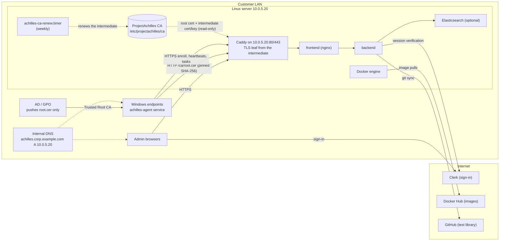

# Server Installer: On-Prem or Cloud (`achilles-installer`)

The recommended way to self-host ProjectAchilles: this guide installs it on one
Linux server with the `achilles-installer` wizard, in either of two setups. The wizard detects which
one it is on from the server's IP address and adapts its questions and defaults.

| | **On-prem LAN** | **Cloud server** |
|---|---|---|
| Server | An **internal DNS name** (e.g. `achilles.corp.example.com`), outbound internet, **no public IP** | A **public IPv4** on its own interface (DigitalOcean, Hetzner and similar) and a public DNS A record |
| HTTPS certificates | A **ProjectAchilles CA** that the installer creates and manages, limited to your DNS zone (or your Enterprise CA, or your own files) | **Let's Encrypt** HTTP-01 (default) or DNS-01, renewed automatically |
| Agents | Mostly **Windows**; they trust the CA through **GPO** (or Intune) and enroll with a fingerprint-pinned bootstrap script | Any OS, anywhere on the internet; the standard enroll command, no extra trust setup |
| Read | Sections 2–14 | [Section 15](#15-cloud-servers-digitalocean-hetzner) first, then 3–5 and 9–13 |

Both setups get the same platform, the same day-2 commands (`status`,
`upgrade`, `backup`, `restore`) and the same Clerk sign-in, including the first
admin the installer invites for you
([section 4.1](#41-the-first-admin-and-roles)).

It shares its engine (`scripts/deploy-server.sh`, `docker-compose.server.yml`,
Caddy) with the other server installs. For SSH-driven installs, Let's Encrypt
DNS-01 or your own certificate without the wizard, see
[`ON_PREM_SERVER.md`](./ON_PREM_SERVER.md). For the shared architecture,
configuration reference and day-2 basics, see
[`SELF_HOSTED_SERVER.md`](./SELF_HOSTED_SERVER.md).

## 1. Who this is for

| Reader | Sections to read |
|--------|------------------|
| **IT admin** installing the server | 2–6, then 9–14 |
| **AD / GPO team** distributing trust to Windows endpoints | 6 (what the CA can and cannot sign), 7, 14 |
| **Linux / macOS endpoint owners** | 8 |
| **Admin installing on a cloud server** (public IP) | 15 first, then 3–5 and 9–10 |

You need root on the server, about an hour, and the items in
[section 3](#3-before-you-start) ready before you begin.

## 2. Architecture



- **One origin.** Caddy terminates TLS and proxies everything to the frontend,
  which proxies `/api` to the backend. Only Caddy publishes ports, and only on
  the LAN IP you pick (`CADDY_BIND_IP`).
- **The CA lives on the host.** The root key stays in `/etc/projectachilles/ca`
  and is never mounted into Caddy. Caddy sees only the root certificate and the
  intermediate certificate and key, and issues short-lived leaf certificates for
  the server name from the intermediate.
- **Plain HTTP serves one thing:** the root certificate at `/ca/root.cer` (DER)
  and `/ca/root.crt` (PEM), so an endpoint that does not trust the CA yet can
  fetch it and check it against a pinned fingerprint. Every other HTTP path
  redirects (308) to HTTPS. The bootstrap scripts are never served.
- **Clerk is in the cloud.** Browsers sign in through Clerk, so both the server
  and the admins' browsers need internet access to Clerk.

## 3. Before you start

Collect these from IT before running the installer.

| Item | Who | Why | Example |
|------|-----|-----|---------|
| **Linux server** | IT | Ubuntu 22.04, 24.04 or 26.04 (Debian 12 and RHEL-family 9 are best-effort). At least 2 GiB RAM, **4 GiB for self-hosted Elasticsearch**; **20 GiB free disk** for a fresh install; root or sudo; ports 80 and 443 free; clock NTP-synchronised. | 4 vCPU, 8 GiB RAM, 40 GiB disk |
| **Static IP** (or DHCP reservation) | Network | Caddy binds to this one address. A new IP needs a re-run of the installer. | `10.0.5.20` |
| **DNS record** in your internal DNS | DNS / AD | Browsers and agents use the name. The installer prints the exact record and the AD DNS PowerShell line. | `achilles.corp.example.com A 10.0.5.20` |
| **Subnets and network firewalls** | Network | Endpoints and browsers must reach **TCP 80, TCP 443 and UDP 443** on the server. Port 80 carries the root download and the HTTPS redirect. | `10.0.0.0/16` |
| **GPO owner** | AD / GPO | Imports `root.cer` into a GPO linked to the endpoint OUs (section 7). | |
| **Clerk app** | You + whoever edits public DNS | Production keys need a public domain you own and Clerk's DNS records in its public zone; private-only names use development keys (section 4). | `pk_live_XXX` / `pk_test_XXX` |
| **Outbound internet** from the server | Network | Image pulls and builds, GitHub, Clerk: see the allow-list below. Browsers need to reach Clerk too. | |
| **Software distribution** (optional) | Endpoint team | Intune, SCCM or an RMM tool to run the bootstrap script at scale, with the enrollment token passed at run time. | |

**Outbound allow-list for the server** (HTTPS unless noted):

| Host | Used for |
|------|----------|
| `registry-1.docker.io`, `auth.docker.io`, `production.cloudflare.docker.com` | Docker Hub image pulls (the registry redirects layer downloads to its CDN) |
| `docker.elastic.co` | The Elasticsearch image (`ES_MODE=self`) |
| `get.docker.com`, `download.docker.com` | Installing Docker when it is missing: the engine runs the `get.docker.com` script, which installs from Docker's package repository |
| `github.com` | `install-onprem.sh` (clone, release tags, and release downloads from `github.com/projectachilles/ProjectAchilles/releases/download/…`), and the test library's git sync |
| `release-assets.githubusercontent.com` (older: `objects.githubusercontent.com`) | GitHub redirects those release downloads to its asset host |
| `raw.githubusercontent.com` | Downloading `install-onprem.sh` itself (section 5.1) |
| `proxy.golang.org`, `sum.golang.org` | Go modules when the installer is built from source (`--ref main`, or a tag without a release asset), and for agent and test builds. A Go 1.21 or later that is older than the version in `installer/go.mod` downloads the required toolchain through the same proxy (default `GOTOOLCHAIN=auto`) |
| `go.dev`, `dl.google.com` | The backend image build downloads Go from `go.dev/dl`, which redirects to `dl.google.com` |
| `registry.npmjs.org`, `deb.debian.org`, `dl-cdn.alpinelinux.org` | npm and OS packages during the image builds |
| `api.clerk.com`, your Clerk Frontend API host | Session verification; the installer also probes the Frontend API host (section 4) |

The server's own package mirrors (for `git`, `curl`, `make`) come on top.

> **Defender ASR:** if attack surface reduction rule `01443614` runs in block
> mode, add a per-rule exclusion for exactly `C:\F0\achilles-agent.exe` (the
> path the bootstrap installs the agent to) before rollout. See
> [Self-updates](../../wiki/docs/user-guide/agent-management/self-updates.md).

## 4. DNS and Clerk: pick your situation

The installer classifies the hostname as you type it on the **Network & name**
screen. The class decides which Clerk keys it accepts and whether Let's Encrypt
(DNS-01 or HTTP-01) is offered.

| | **Under a public domain you own** | **Private-only name** |
|---|---|---|
| Example | `achilles.corp.example.com`, where `example.com` has public name servers | `achilles.corp.lan`, `pa.internal`, `achilles.home.arpa` |
| How the installer decides | The registrable domain (public suffix list + 1 label) has public NS records | The name is under `.local`, `.lan`, `.internal`, `.home.arpa`, `.corp`, `.intranet` or `.localdomain`, or its registrable domain has no public NS records, or the NS lookup failed (treated as private-only, with a warning) |
| Clerk keys | **Production** (`pk_live_` + `sk_live_`) expected. Development keys (`pk_test_`) work, with a warning: they show a "Development mode" banner and have lower usage limits. | **Development keys only** (`pk_test_` + `sk_test_`). A `pk_live_` key is an error. |
| Clerk app domain | The key's Frontend API host must be `clerk.<D>`, where D is the hostname or one of its parents **down to and including the registrable domain**. For `achilles.corp.example.com`: `clerk.achilles.corp.example.com`, `clerk.corp.example.com` or `clerk.example.com`. | n/a (development instances use a `*.clerk.accounts.dev` host) |
| DNS records | Add the records Clerk's dashboard (Domains) lists to the **public** zone; sign-in fails until Clerk shows them verified. The server's own A record stays **internal-only**. | Only the internal A record. |
| Certificates | ProjectAchilles CA (default on a LAN IP), Enterprise CA, your own files, **or Let's Encrypt (DNS-01, or HTTP-01 with inbound port 80)** | ProjectAchilles CA (default), Enterprise CA or your own files. Let's Encrypt is not offered. |

Both situations need browsers with internet access to Clerk.

Other key checks, in both situations: the publishable and secret keys must
come from the same Clerk instance (`pk_live_` with `sk_live_`, `pk_test_` with
`sk_test_`), and the installer checks that the Frontend API host is reachable
from the server.

> **Keep the internal hostname out of public DNS:** Clerk's CNAMEs reveal the
> label D in your public zone. Create the Clerk app on a parent domain (e.g.
> `clerk.example.com`) if `achilles.corp` must not appear there.

> **Avoid `.local`.** It is reserved for multicast DNS: macOS and many Linux
> clients resolve `.local` names over mDNS instead of your DNS server, which
> breaks browsers and agents. The installer warns about it. Prefer a name under a
> domain you own, or `.lan` / `.internal`.

### 4.1 The first admin and roles

Every person signs in through Clerk. What they may do comes from a **role** in
their Clerk user's **public metadata**, for example `{"role": "admin"}`. The
roles are `admin`, `operator`, `analyst` and `explorer`; a signed-in user with
no role gets read-only (`explorer`) access. Two settings in the Clerk app make
this work, on LAN and cloud installs alike (the wiki's
[Clerk Setup](https://docs.projectachilles.io/docs/deployment/clerk-setup) guide
shows every Clerk Dashboard step with screenshots). Set the first before you install
(required on servers older than v2.5.0, and still the recommended setup); the
installer does the second for you.

**1. Session token claim (in the Clerk Dashboard, before you install).** Open
**Configure → Sessions**. Under **Customize session token**, leave the name
(`__session`) as it is, set the **Claims** to the following, and select **Save**:

```json
{
  "metadata": "{{user.public_metadata}}"
}
```

This puts the role into every session token. Clerk keeps the setting per
instance, so set it again when you move from development to production keys.
Clerk has no API for it, so the installer can't set it. If it's missing, servers
from v2.5.0 look the role of each signed-in browser session up in Clerk instead
(cached for a minute per user); older releases treated everyone as read-only, admins included, and every
admin action failed with "Insufficient permissions" (section 13).

**2. The first admin's role (the installer does this).** The Login screen asks
for the **first admin email** (`ADMIN_EMAIL`). Once the stack is up, the
installer uses the Clerk secret key to either:

- **invite** the address: Clerk emails a link to `https://<hostname>/sign-up`,
  and the account created from it has the admin role; or
- **promote** an account that already exists in this Clerk app, by adding
  `"role": "admin"` to its public metadata (other keys, such as `org_id`, stay).

It leaves an existing admin or a pending admin invitation alone, so running the
installer again doesn't send another email. The Done screen (or, unattended, the
terminal) says which of these happened.

**By hand**, when you left the field blank or the Clerk call failed (the Done
screen shows Clerk's error): sign up at `https://<hostname>/sign-up`, then in
the Clerk Dashboard open **Users →** the user **→ Metadata**, select **Edit**
next to **Public**, and set it to:

```json
{
  "role": "admin"
}
```

Then sign out of ProjectAchilles and in again, so the session picks up the role.

**More people:** an admin invites them, with a role, from **Settings → Users**
in the web UI.

**Restrict sign-ups on a cloud server.** Anyone who can reach
`https://<hostname>/sign-up` can create an account, and an account with no role
can still read the dashboards. On a server reachable from the internet, set
Clerk's sign-up mode to **Invite-only** under **Configure → Access mode**; the
installer's invitation and **Settings → Users** still work.

## 5. Install

### 5.1 Get the installer onto the server

> **The installer ships with v2.3.0 and later.** Releases up to and including
> v2.2.0 have no `installer/` directory, so `--ref` must name v2.3.0 or newer (or
> a branch such as `main`, which builds from source and needs Go 1.26 or later and
> `make` on the server).

`scripts/install-onprem.sh` is the one-command bootstrap. As root, it:

1. checks the OS (Linux) and architecture (x86_64 or aarch64);
2. installs `git`, `curl` and `ca-certificates` if missing (apt-get or dnf);
3. clones the repository into `/opt/projectachilles` (or `--dir`) at the latest
   release tag (or `--ref`);
4. downloads the matching `achilles-installer-linux-amd64` / `-arm64` release
   asset and verifies it against the release's `SHA256SUMS`, refusing to install
   on a mismatch;
5. launches the wizard on your terminal.

Download, inspect, run (recommended):

```bash
curl -fsSLO https://raw.githubusercontent.com/projectachilles/ProjectAchilles/main/scripts/install-onprem.sh
less install-onprem.sh
sudo bash install-onprem.sh
```

Convenience form, if your policy allows piping to a shell:

```bash
curl -fsSL https://raw.githubusercontent.com/projectachilles/ProjectAchilles/main/scripts/install-onprem.sh | sudo bash
```

| Option | Meaning |
|--------|---------|
| `--ref REF` | Release tag (`vX.Y.Z`) or branch. Default: the highest `vX.Y.Z` tag. A branch skips the release download and builds from source. |
| `--dir DIR` | Install directory (absolute). Default: `/opt/projectachilles`. |
| `--no-run` | Stop after installing the binary at `<dir>/achilles-installer`. |

- **No release asset for the tag?** The script falls back to building the
  installer from source, which needs `go` (the version in `installer/go.mod`)
  and `make`. Releases up to and including v2.2.0 do not include the installer
  at all (no asset and no `installer/` directory); use v2.3.0 or later.
- **Existing checkout:** the script refuses a directory that is not a
  ProjectAchilles git checkout, and refuses local changes. The one exception is
  `deploy/caddy/tls.caddy`, which older engines modified: it is restored
  automatically.
- **No terminal** (e.g. run from automation): the script prints the
  interactive and unattended commands instead of launching the wizard.

To start the wizard again later:

```bash
cd /opt/projectachilles && sudo ./achilles-installer install
```

The wizard needs a real terminal (TTY); it works best at 80×24 or larger. With
`TERM=dumb` or no TTY it exits and points you to the unattended form
(section 12).

### 5.2 The ten screens

Keys: **enter** next, **esc** back, **ctrl+c** quit. Nothing on the server
changes until you confirm on **Review**; quitting before that prints
"cancelled; nothing on this server was changed".

#### 1/10 Welcome

A first run lists the steps. On a server with an existing
`/opt/projectachilles/deploy.config.env`, it shows the installed name and
certificate mode and offers:

| Choice | Effect |
|--------|--------|
| **Reconfigure** | Change settings and re-apply; keeps data and the CA. |
| **Upgrade** | Leaves the wizard and runs `upgrade` (section 10). |
| **Status** | Leaves the wizard and runs `status` (section 10). |
| **Fresh install** | Starts from blank answers after you type the installed hostname to confirm. Data volumes, the CA and the generated secrets are kept. |

#### 2/10 Preflight checks

Read-only checks, all shown at once as PASS / WARN / FAIL. A FAIL blocks
**Next**; fix it and press **r** to re-run.

| Check | Fails when | Warns when |
|-------|-----------|-----------|
| Running as root | not root | |
| Supported operating system | not Ubuntu 22.04/24.04/26.04, Debian 12 or RHEL-family 9 | Debian 12 or RHEL-family 9 (best-effort) |
| Memory | < 2 GiB | < 4 GiB (self-hosted Elasticsearch is then disabled) |
| Free disk space (`/var/lib/docker`, else `/`) | < 20 GiB on a fresh install; < 5 GiB on an existing one | < 20 GiB on an existing install |
| Port 80 available / Port 443 available | in use (on an existing install, our own Caddy is accepted) | |
| Docker registry reachable, GitHub reachable, Clerk API reachable | | unreachable |
| Docker | | installed, but the daemon isn't answering (`systemctl start docker`). Not installed yet passes: the engine installs it from get.docker.com |
| Clock synchronised | | not NTP-synchronised |

#### 3/10 Network & name

1. **Interface.** Pick the LAN interface; Caddy publishes 80/443 on its address
   only. Loopback, Docker, bridge and VPN interfaces are not listed. A public
   address is marked `public` (a cloud server, section 15).
2. **Server hostname.** The full name browsers and agents use. Its DNS situation
   (section 4) is shown live under the field.
3. **DNS check.** The installer checks that the name resolves **on this server**
   to the chosen IP. If it does not, it shows the record to create, for example:

   ```text
   achilles.corp.example.com.  A  10.0.5.20
   ```

   and the Active Directory DNS form, to run on a DNS server:

   ```powershell
   Add-DnsServerResourceRecordA -ZoneName "corp.example.com" -Name "achilles" -IPv4Address "10.0.5.20"
   ```

   Then choose **Re-check DNS**, **Add an /etc/hosts entry on this server and
   continue** (`HOSTS_ENTRY=true`: the engine keeps one
   `10.0.5.20 achilles.corp.example.com # projectachilles` line in `/etc/hosts`),
   or **Continue without a record for now**. The hosts entry helps only the
   server itself: endpoints still need the DNS record.

   On a public address the screen asks for the record at your DNS provider
   instead, without the Active Directory form. When the interface has a private
   address but the name resolves to public addresses only, it explains that
   this is expected behind 1:1 NAT (AWS, Azure, Google Cloud, a DigitalOcean
   reserved IP): choose **Continue without a record for now**.
4. **LAN subnets allowed to reach HTTPS** (`LAN_SUBNETS`), comma-separated
   CIDRs, prefilled with the interface's subnet. Used only if ufw or firewalld is
   already active (section 13). Not asked on a public address: `LAN_SUBNETS`
   is left empty and the firewall phase is skipped.

#### 4/10 Certificates

| Option | `TLS_MODE` | What you get |
|--------|-----------|--------------|
| **ProjectAchilles CA (recommended)** | `achilles-ca` | A private, name-constrained CA managed by the installer (section 6), plus the endpoint bootstrap scripts. |
| **Enterprise CA** | `byo` | The installer writes a private key and a certificate request (`deploy/caddy/certs/request.csr`) for the hostname. Your CA signs it as a TLS server certificate (serverAuth); you then give the path to the signed PEM chain. |
| **Bring your own certificate and key files** | `byo` | Paths to a PEM chain (server certificate first) and an unencrypted PEM key. They are validated (key matches, name matches, not expired) and copied to `deploy/caddy/certs/`. |
| **Let's Encrypt DNS-01** | `acme-dns` | Publicly trusted certificates; asks for an email, the Caddy DNS plugin name and an API token that can edit TXT records. Offered only for names under a public domain. |
| **Let's Encrypt HTTP-01** | `acme-http` | Publicly trusted certificates; asks for an email only. Let's Encrypt fetches `http://<name>/.well-known/acme-challenge/` from the internet, so the name must resolve publicly to the server and port 80 must be open to the internet. Offered only for names under a public domain. |

On a LAN address the ProjectAchilles CA is listed first and recommended. On a
public address (a cloud server) the two Let's Encrypt options come first, with
HTTP-01 recommended; choosing HTTP-01 on a private address warns that the public
IP must forward ports 80 and 443 to it.

The rest of this guide assumes the ProjectAchilles CA. With Enterprise CA or
your own files, endpoints must already trust your CA, and no bootstrap scripts
are rendered.

For the ProjectAchilles CA the screen then asks:

- **Which DNS zone may the CA issue certificates for?** The choices are the
  hostname's parents, nearest first, down to the registrable domain (e.g.
  `corp.example.com`, `example.com`). The zone is fixed into the root and
  can't be widened later without a new root on every endpoint, so pick the
  narrowest zone (`CA_ZONE`).
- **Also allow the IP in certificates?** (`CA_INCLUDE_IP`). No (the default)
  means the CA can't issue for any IP address. Yes permits exactly the LAN IP.
  Neither makes the site reachable by IP: it answers on its DNS name only.
- **An existing CA that doesn't match** the chosen zone or IP policy: **Keep the
  existing CA**, or **Rotate** (`CA_ROTATE=true`: a new root, which every
  endpoint must re-trust). If the hostname is outside the existing CA's zone,
  keeping it isn't possible.

On an existing install, changing the certificate mode shows a warning: browsers
and enrolled agents must trust the new issuer before they can connect again.

#### 5/10 Login (Clerk)

Paste the **Clerk publishable key** and **Clerk secret key** (from the Clerk
dashboard, API Keys). The screen decodes the publishable key offline, checks it
against section 4's rules, and probes the Frontend API host from the server
("Frontend API: … · reachable from this server"). An error blocks Next; a
warning does not. For a production key it then asks whether you have published
the DNS records Clerk lists (sign-in fails until they are verified).

The third field, **First admin email (optional: invited as admin)**, is the
person the installer makes an admin after the install (section 4.1). Leave it
blank if this Clerk app already has an admin.

#### 6/10 Analytics

**Self-hosted on this server** (an Elasticsearch container; unavailable when the
memory check did not pass) or **Elastic Cloud** (Cloud ID plus an API key with
read and write access to the `achilles-*` indices).

With self-hosted Elasticsearch, the wizard then asks **Load demo data?**
(`SEED_ES`, default **No**): about 1000 synthetic results from the last 30 days,
so the dashboards and the Executions table have something to show on a trial
install. Leave it off for production. The data goes into its own index,
`achilles-results-synthetic`, and is loaded once: running the installer again
doesn't add another batch. To remove it later:

```bash
sudo docker exec achilles-server-elasticsearch-1 \
  curl -s -X DELETE 'localhost:9200/achilles-results-synthetic'
```

#### 7/10 Organisation

- **Organisation name** (`ORGANIZATION_NAME`, at most 56 characters), printed on
  execution reports.
- **Test library repository** and **branch** (default
  `https://github.com/ubercylon8/f0_library.git`, `main`).
- **GitHub token**, only for a private test library (scope `repo`).

#### 8/10 Review

Every setting with secrets masked, the settings file
(`/opt/projectachilles/deploy.config.env`, mode 600), and the unattended
equivalent command. **Yes, install** writes the file and starts the install.


#### 9/10 Install

A phase checklist plus a live log. **esc** stops the engine after a
confirmation; after a stop or a failure, **r** re-runs the whole install (every
phase is idempotent), **q** quits, and the last 30 log lines are shown.

| Phase id | Checklist title | Runs for |
|----------|-----------------|----------|
| `config` | Loading configuration | always (also writes the `/etc/hosts` entry when `HOSTS_ENTRY=true`) |
| `validate` | Validating settings | always |
| `docker` | Checking Docker | always (installs Docker if missing) |
| `ca` | Preparing the ProjectAchilles CA | `achilles-ca` |
| `caddy-render` | Configuring Caddy TLS | always (writes `deploy/caddy/rendered/`) |
| `backend-env` | Writing backend/.env | always |
| `root-env` | Writing root .env | always |
| `firewall` | Opening 80/443 to the LAN subnets | when `LAN_SUBNETS` is set |
| `up` | Building and starting the stack | always (several minutes on the first run) |
| `ca-export` | Exporting Caddy's internal root CA | `internal` only (skipped here) |
| `bootstrap` | Rendering endpoint bootstrap scripts | `achilles-ca` |
| `renew-timer` | Installing the weekly CA renewal timer | `achilles-ca` |

If the wizard ends with a failed install, your answers are saved: run the
wizard again (Reconfigure) or the unattended command it prints.

#### 10/10 Done

The hand-over screen (also printed to the terminal when you leave):

- the URL and IP;
- the root CA files, `/etc/projectachilles/ca/public/root.cer` (DER, for GPO)
  and `root.crt` (PEM);
- the root's **SHA-256** fingerprint and its **Windows thumbprint** (SHA-1),
  which is how the root appears in `Cert:\LocalMachine\Root`;
- the bootstrap scripts, `/opt/projectachilles/deploy/onprem/bootstrap-windows.ps1`
  and `bootstrap-unix.sh`, with the commands to run them;
- the GPO path for the root (section 7) and the next steps: the first admin
  (the invitation it sent, or the steps to do by hand; section 4.1), register
  an agent version, create an enrollment token;
- the day-2 commands.


*Example from a render-only run with placeholder values; the fingerprints belong to a throwaway CA and differ on every install.*

**Save the SHA-256 and the thumbprint**: the GPO team uses them to verify the
file they import. `sudo /opt/projectachilles/achilles-installer ca export --out <dir>`
prints both again at any time.

### 5.3 First sign-in and agent version

1. Accept the invitation emailed to the first admin, or make the admin by hand
   (section 4.1). The link opens `https://achilles.corp.example.com/sign-up`, so
   use a machine that trusts the root (section 7). Then sign in at
   `https://achilles.corp.example.com`.
2. Register an agent version under **Settings → Agent** (build or upload); it
   must appear under **Registered Versions**. Until then the agent download
   returns 404 and the bootstrap fails at "Downloading agent".
3. Create an enrollment token in the web UI. Give it a short TTL and a
   **Max Uses** that matches the batch you are enrolling.

> The web UI's enrollment one-liners download the agent over HTTPS from the
> start, so they fail on an endpoint that doesn't trust the root yet. For this
> setup, use the bootstrap scripts below.

## 6. The ProjectAchilles CA

`achilles-installer ca init` (run by the engine's `ca` phase) creates a
two-level CA under `/etc/projectachilles/ca`:

| | Root CA | Intermediate CA |
|---|---|---|
| Name | `ProjectAchilles Root CA – <org or hostname>` | `ProjectAchilles Intermediate CA – <org or hostname>` |
| Key | ECDSA P-256 | ECDSA P-256 |
| Validity | 10 years | 2 years (never past the root) |
| Path length | 1 | 0 (cannot sign further CAs) |
| Key usage | Certificate Sign, CRL Sign | Certificate Sign, CRL Sign |
| Extended key usage | serverAuth only | serverAuth only |
| Name constraints (critical) | DNS: the chosen zone and its subdomains. IP: all excluded, or exactly the LAN IP when allowed | same as the root |

Caddy issues the server's leaf certificate from the intermediate (`tls internal`
with Caddy's `pki` pointed at the installer's intermediate) and renews it on its
own. Leaves are short-lived (Caddy's default is 12 hours).

### What the constraints cover

The CA keys can technically sign anything. The constraints and the EKU limit what
**clients that enforce name constraints and EKU chaining** (Windows CryptoAPI,
Go, OpenSSL, .NET, current browsers) **accept**: certificates this CA signs are
accepted only as TLS server certificates, only for names in its zone, and for no
IP address unless you allowed the LAN IP.

- **DNS names.** Those clients reject any certificate from this CA for a name
  outside the zone. A leaf for `login.microsoftonline.com` signed with the real
  intermediate key fails validation on Windows and Linux.
- **IP addresses.** By default every IP SAN is excluded (`0.0.0.0/0` and `::/0`),
  because an absent IP constraint would leave IPs unconstrained. With the LAN IP
  allowed, only that single address is permitted.
- **Usage.** With the serverAuth EKU on both CA certificates, those clients
  accept certificates under them only for TLS server authentication: not for
  code signing, client authentication or email.
- **Depth.** The intermediate cannot create further CAs (path length 0).

### What they don't cover

- **Anything inside the zone.** Whoever holds the intermediate or root key can
  mint a valid server certificate for **any** name in the zone (for example
  `mail.corp.example.com`) for every client that trusts the root. Pick the
  narrowest zone; if `corp.example.com` hosts other important services, consider
  a dedicated subdomain for the server (e.g. `achilles.pa.corp.example.com`
  with zone `pa.corp.example.com`).
- **Clients that ignore name constraints or EKU chaining.** Old or embedded TLS
  stacks may enforce neither, and then accept what the keys sign for any name or
  purpose. On Windows, DNS constraints are applied to a certificate with no
  SAN (CN only) in a server-auth context, which every TLS client uses; custom
  code that builds an `X509Chain` without the serverAuth policy would accept it.
- **Revocation.** There is no CRL or OCSP. A compromised CA is handled by
  rotating it ([Rotating after a suspected key compromise](#rotating-after-a-suspected-key-compromise))
  and removing the old root from every endpoint
  ([Removing the old root from endpoints](#removing-the-old-root-from-endpoints)).
- **The server itself.** Anyone with root on the server can use the CA keys.

### Key custody

| Path (under `/etc/projectachilles/ca`) | Contents | Who sees it |
|------|----------|------------|
| `root.key`, `root.crt` | Root key and certificate | Host only (dir 0700, key 0600); **never mounted into Caddy** |
| `caddy/root.crt`, `caddy/intermediate.crt`, `caddy/intermediate.key` | What Caddy needs | Mounted read-only into the Caddy container |
| `public/root.crt` (PEM), `public/root.cer` (DER) | The root certificate only | Served over plain HTTP at `/ca/root.crt` and `/ca/root.cer` |

The renewal job runs as root from root-owned copies of the installer and
`ca-renew.sh` in `/usr/local/lib/projectachilles/`, never from the repository
checkout, which the install user may be able to write.

### Intermediate renewal

The engine installs `achilles-ca-renew.timer` (weekly, persistent). Its service
runs `ca-renew.sh`, which:

1. runs `achilles-installer ca renew --if-expiring 180d`: a new intermediate,
   with the root's constraints, once fewer than 180 days remain;
2. restarts Caddy when the intermediate on disk is newer than the running
   container, after deleting Caddy's cached leaf certificates so the next leaf
   chains to the current intermediate.

Endpoints are unaffected: leaves keep chaining to the same root. `status` warns
when the intermediate has fewer than 90 days left, or the root less than a year.

```bash
systemctl list-timers achilles-ca-renew.timer         # next run
sudo systemctl start achilles-ca-renew.service        # run the check now
journalctl -u achilles-ca-renew.service               # its output
```

A manual `sudo /opt/projectachilles/achilles-installer ca renew` renews if due
(fewer than 180 days left by default; `--if-expiring` changes the threshold) but
does not restart Caddy. A plain `docker compose restart caddy` is not enough:
Caddy keeps serving its cached leaf, which chains to the old intermediate, until
that leaf nears expiry (up to about 12 hours). Instead run
`sudo systemctl start achilles-ca-renew.service`, which deletes the cached leaves
(`/data/caddy/certificates/local`) and restarts Caddy because the intermediate
is newer than the container, or re-run the install (section 12), which does the
same check. When an install run itself changes the CA (creation or rotation),
the engine restarts Caddy and clears its leaf cache unconditionally.

### Rotation

Rotation is never automatic. A new root means every endpoint must re-trust it.
Until an endpoint has the new root, it does not trust the server, and its agent
stays offline. To add the new root without re-enrolling, see
[7.4](#74-manual-trust-only).

**Before you rotate, record the old root's Windows thumbprint (SHA-1).** Rotation
overwrites the old root on the server, and you need its thumbprint to remove it
from endpoints. `status` prints only the SHA-256; `ca export` prints both and
keeps a copy of the old root:

```bash
sudo /opt/projectachilles/achilles-installer ca export --out /root/achilles-root-old
```

#### Changing the zone or IP policy

1. In the wizard choose **Reconfigure**, pick the new zone or IP policy, then
   **Rotate** on the Certificates screen (or set `CA_ZONE` / `CA_INCLUDE_IP` and
   `CA_ROTATE=true` in `deploy.config.env` and run the unattended install).
   `CA_ROTATE=true` replaces only a root whose constraints differ from `CA_ZONE` /
   `CA_INCLUDE_IP`, so leaving it set does not rotate on every run.
2. The engine creates the new CA, re-renders the bootstrap scripts with the new
   pin, and, because its own `ca` phase changed the CA, clears Caddy's leaf cache
   and restarts it.
3. Replace the root in the GPO (import the new `root.cer`, delete the old one),
   update any copies of the bootstrap script, and remove the old root from the
   endpoints that got it outside GPO
   ([Removing the old root from endpoints](#removing-the-old-root-from-endpoints)).

#### Rotating after a suspected key compromise

The wizard offers **Rotate** only when the zone or IP policy changes, and
`CA_ROTATE=true` is a no-op when they match. To replace a root with the same
constraints, rotate by hand. As root, in `/opt/projectachilles`:

1. Record the old root's SHA-1 thumbprint (it prints `SHA-1 thumbprint: …`):

   ```bash
   sudo ./achilles-installer ca export --out /root/achilles-root-old
   ```
2. Create the new root and intermediate with the same values the engine uses:
   `CA_ZONE`, `CADDY_BIND_IP`, `--include-ip` only if `CA_INCLUDE_IP=true`, and
   `ORGANIZATION_NAME` (or, if that is empty, `ACHILLES_DOMAIN`) as the label:

   ```bash
   sudo ./achilles-installer ca init --dir /etc/projectachilles/ca --zone corp.example.com --ip 10.0.5.20 --label 'Acme Corp' --rotate
   ```

   It prints a warning, the new root's SHA-256 and its SHA-1 thumbprint.
3. Move Caddy onto the new CA, clearing its cached leaves:

   ```bash
   sudo systemctl start achilles-ca-renew.service
   ```

   Its renewal step reports "not due" (the intermediate is new). Its restart step
   sees an intermediate newer than the running container, so it deletes
   `/data/caddy/certificates/local` and restarts Caddy.
4. Re-render the bootstrap scripts with the new pin:

   ```bash
   sudo ./achilles-installer install --config /opt/projectachilles/deploy.config.env --yes
   ```

   The engine keeps the new root (same zone), so its own `ca` phase sees no
   change. Doing step 3 first matters: on its own, the engine restarts Caddy only
   if the intermediate is newer than the container. If `up` recreates Caddy in
   that run, that check passes without a restart while the `caddy-data` volume
   still holds leaves from the old CA.
5. Check with `status` (the Root CA row shows the new SHA-256), replace the root
   in the GPO (import the new `root.cer`, delete the old one), and re-trust the
   endpoints outside GPO (7.4). Re-running the bootstrap script also works, but
   enrolls each machine again under a new agent ID.
6. Remove the old root from every endpoint
   ([Removing the old root from endpoints](#removing-the-old-root-from-endpoints)):
   deleting it from the GPO is not enough.
7. Take a fresh backup (`sudo ./achilles-installer backup`), then destroy or
   quarantine every older backup, in `/var/backups/projectachilles/` and off the
   server: they contain the compromised CA keys, and `restore` would bring the
   old CA back.

#### Removing the old root from endpoints

Rotating the CA changes nothing on endpoints: every copy of the old root stays
trusted until you remove it. Each way of adding the root needs its own removal.
**Removing the root from a GPO removes only the Group Policy copy**; it does not
remove the copies that `bootstrap-windows.ps1` (which adds the root to
`LocalMachine\Root` directly when it is not already trusted) or a manual
`Import-Certificate` (7.4) added.

| Added by | Removed by |
|----------|------------|
| GPO (7.1) | Deleting the old root from the GPO; endpoints drop it at the next policy refresh. |
| Intune (7.2) | Replacing the profile's certificate; then check with the command below. |
| `bootstrap-windows.ps1` or `Import-Certificate` | The PowerShell command below. |
| `bootstrap-unix.sh` on macOS | `sudo security delete-certificate -Z <old SHA-1 thumbprint> /Library/Keychains/System.keychain` |
| `bootstrap-unix.sh` on Linux | Overwritten: the script always writes the root to the same file (`achilles-root-ca.crt`, see section 8) and rebuilds the trust store, so re-running it, or copying the new `root.crt` to that file and running `update-ca-certificates` / `update-ca-trust`, replaces the old root. |

On Windows, elevated (it can run through SCCM or an RMM tool, and is harmless
next to GPO and on machines that never had the old root):

```powershell
Get-ChildItem Cert:\LocalMachine\Root | Where-Object Thumbprint -eq '<old SHA-1 thumbprint>' | Remove-Item
```

If you no longer have the old thumbprint: an old copy of `root.cer` gives it
(`openssl x509 -inform der -in root.cer -noout -fingerprint -sha1`, without the
colons), or list the ProjectAchilles roots on an endpoint and keep only the new
thumbprint:

```powershell
Get-ChildItem Cert:\LocalMachine\Root | Where-Object Subject -like '*ProjectAchilles Root CA*' | Format-List Subject, Thumbprint, NotBefore
```

## 7. Distributing trust and enrolling Windows endpoints

**No trust, no agents.** Every Windows endpoint, and every machine people open
the web UI from, must trust the ProjectAchilles root CA in
`Cert:\LocalMachine\Root`. The agent verifies the server against the Windows
trust store **when it enrolls**, and it has no other way to trust the server at
that point. On a machine without the root:

- enrollment fails with `x509: certificate signed by unknown authority`, before
  the token is sent, and the agent never appears in the web UI;
- browsers show a certificate warning.

Never work around this with the agent's `skip_tls_verify` / `--allow-insecure`
override. It turns off certificate checks for an agent that runs commands as
SYSTEM: anyone who can intercept its traffic could pose as the server. Get the
root onto the machine instead.

**Two ways to get the root onto a machine.** Either one is enough for the agent:

| Way | Covers | Use it for |
|-----|--------|------------|
| **GPO** (7.1) or **Intune** (7.2) | Every computer in the linked OUs or device groups, browsers included | The fleet, and every machine people browse to the UI from |
| **The bootstrap script** (7.3) | The one machine it runs on; it imports the root, then enrolls the agent | Machines outside GPO, or a handful of endpoints. When GPO has already put the root there, it skips the import. |

Enrolling the agent is a separate job: the bootstrap script does it, one machine
at a time, with an enrollment token.

With **Enterprise CA** (`byo`) certificates, your own root is already trusted:
skip 7.1 and 7.2. With **Let's Encrypt** none of this section applies.

> **GPO distributes the root only.** Never put enrollment tokens, or a script
> that contains one, in a GPO, a startup script or SYSVOL: every domain computer
> and user can read SYSVOL.

### 7.1 GPO: push the root

**What this changes in your domain: one certificate, nothing else.** The
installer never connects to Active Directory and changes no Group Policy: the AD
admin makes the change below by hand. Roots from different GPOs add up on each
computer, so importing this one doesn't remove, replace or reorder any root
already trusted, and no other policy setting changes. To keep it that way, use a
**new GPO that holds only this root**. Don't edit the Default Domain Policy or a
GPO someone else owns: a dedicated GPO can be piloted, filtered and undone on its
own.

1. **Get `root.cer` and check it.** On the server:

   ```bash
   sudo /opt/projectachilles/achilles-installer ca export --out /root/achilles-root
   ```

   This writes `root.cer` and `root.crt` and prints the SHA-256 and the SHA-1
   (Windows) thumbprint. Copy `root.cer` to the GPO admin workstation and compare:

   ```powershell
   (Get-FileHash -Algorithm SHA256 .\root.cer).Hash
   ```

   The hash must equal the installer's SHA-256 with the colons removed. If it
   doesn't, stop: don't import the file.
2. **Create a dedicated GPO.** In Group Policy Management, right-click **Group
   Policy Objects → New** and give it a name that says what it is, for example
   `ProjectAchilles - Trusted Root CA`. Don't link it yet.
3. **Import the root into it.** Edit the new GPO and go to **Computer
   Configuration → Policies → Windows Settings → Security Settings → Public Key
   Policies → Trusted Root Certification Authorities**. Right-click, **Import**,
   select `root.cer` and keep the store the wizard offers (Trusted Root
   Certification Authorities). Change nothing else in the GPO. The setting is
   under *Computer* Configuration, so it applies to computers, not users: the
   root goes into the machine store, which is the one the agent and the browsers
   read.
4. **Pilot it.** Link the GPO to an OU with a few test machines (right-click the
   OU → **Link an Existing GPO**). On one of them run `gpupdate /force`, then the
   checks in 7.5. If your domain uses **Certificate Path Validation Settings**
   (in the same Public Key Policies area) to limit which root CAs computers
   trust, this is where you confirm the new root is accepted.
5. **Roll it out.** Link the same GPO to the OUs that hold the endpoints and the
   machines people browse to the UI from. To limit it to certain computers,
   replace **Authenticated Users** under **Security Filtering** with a computer
   group. Computers pick it up at the next policy refresh (every 90 minutes or so), at
   a reboot, or right away with `gpupdate /force`.

Only the root is needed: Caddy sends the intermediate with every handshake.

**Undo.** Unlinking or deleting the GPO removes the copy Group Policy added at
the next refresh. Copies the bootstrap script or a manual import put in
`LocalMachine\Root` stay until you delete them
([Removing the old root from endpoints](#removing-the-old-root-from-endpoints)).

**Your other policies still apply.** Nothing in ProjectAchilles changes them, and
some can stop a rollout until you make a deliberate exception:

| Existing policy | Effect | What to decide |
|-----------------|--------|----------------|
| Defender ASR rule `01443614` in block mode | Blocks the agent binary | A per-rule exclusion for exactly `C:\F0\achilles-agent.exe` (section 3). Never the `C:\F0` folder: tests must stay subject to ASR. |
| PowerShell execution policy set by GPO | The bootstrap script won't run (`-ExecutionPolicy Bypass` doesn't override it) | Sign the script, or run it through SCCM or an RMM tool (section 13). |
| AppLocker or WDAC | Can block the agent | An allow rule for the agent. |
| Network firewalls | No root download (TCP 80) or no connection (TCP 443) | Allow both from the endpoints to the server (section 3). |

### 7.2 Intune alternative

Create a **Trusted certificate** profile (Devices → Manage devices →
Configuration → Create; platform Windows 10 and later; Templates → Trusted
certificate), upload `root.cer`, and set **Destination Store** to **Computer
certificate store - Root**. Assign it to the device groups.

### 7.3 Enroll with the bootstrap script

The script is generated on the server at
`/opt/projectachilles/deploy/onprem/bootstrap-windows.ps1` with the hostname and
the root's SHA-256 pinned inside. It is not served over HTTP: copy it from the
server over a channel you trust (SSH/SCP, or a share only admins can write),
because its pin is what makes the plain-HTTP root download safe.

Run it from an **elevated** PowerShell (Windows PowerShell 5.1 or later), in the
folder that holds it:

```powershell
powershell -ExecutionPolicy Bypass -File .\bootstrap-windows.ps1 -Token "<enrollment-token>"
```

Replace `<enrollment-token>` (and its quotes, if you like) with a token from the
web UI; tokens need no quoting. Use double quotes, not single quotes:
`powershell.exe -File` started from `cmd.exe`, SCCM or an RMM tool passes single
quotes through literally, and enrollment then fails with HTTP 401.

It runs these steps, aborting at the first failure:

1. **Locks `C:\F0`**: owner Administrators; a protected DACL with full control for
   SYSTEM and Administrators, and ReadPermissions for OWNER RIGHTS.
2. **Normalizes everything already under `C:\F0`**: each item gets owner
   Administrators and inherited-only permissions, then a second walk verifies it.
   It **aborts on any junction, symbolic link or other reparse point** under
   `C:\F0`. All of this happens before anything is downloaded.
3. **Downloads the root** from `http://achilles.corp.example.com/ca/root.cer`
   into memory and aborts unless its SHA-256 equals the pinned value ("Root CA
   fingerprint mismatch … Aborting; nothing was trusted.").
4. **Trusts those same verified bytes** in `Cert:\LocalMachine\Root`, or prints
   "Root CA already trusted (e.g. via GPO); skipping import." No file is written.
5. **Downloads the agent over HTTPS** (`/api/agent/download?os=windows&arch=amd64`)
   into memory and writes it to a new file in `C:\F0` created with owner
   Administrators and a SYSTEM + Administrators DACL. If the AchillesAgent service
   is running, it stops it and waits for its process to exit, then renames the
   file to `C:\F0\achilles-agent.exe`.
6. **Enrolls and installs the service:** `--enroll <token> --server https://… --install`.
   The script's exit code is the agent's.

Nothing is staged in `%TEMP%` or any folder the user's unelevated token can
write to.

> **Operator note: existing `C:\F0` content becomes SYSTEM + Administrators only.**
> Anything already in `C:\F0` (earlier test artifacts, logs, `bundle_results.json`)
> loses its own permissions and inherits the locked DACL; non-administrators can
> no longer list or read the folder. The agent runs as SYSTEM, so it is
> unaffected. A junction or symbolic link anywhere under `C:\F0` stops the install
> before any download: remove it and run the script again. The lock and
> normalization run even when the script later aborts (for example on a
> fingerprint mismatch).

**At scale:** run the same command through SCCM or an RMM tool that runs it
elevated, passing the token at run time. Intune platform scripts take no
parameters, so with Intune the token would have to be embedded in the uploaded
script: prefer SCCM, an RMM tool or a manual run. Whatever the tool, use a token
with a short TTL and a Max Uses sized to the batch, and don't store it where
everyone can read it.

**Re-runs:** running the script again on an enrolled machine replaces the binary
and enrolls the machine again, as a new agent ID (one more token use). If that
re-enrollment fails, the previously installed agent is left stopped; start it
with `Start-Service AchillesAgent`.

### 7.4 Manual, trust only

To add a root without enrolling (a machine outside GPO, or a CA rotation), copy
`root.cer` to the machine by your usual means and, elevated (to remove an old
root, see [Removing the old root from endpoints](#removing-the-old-root-from-endpoints)):

```powershell
(Get-FileHash -Algorithm SHA256 .\root.cer).Hash
Import-Certificate -FilePath .\root.cer -CertStoreLocation Cert:\LocalMachine\Root
```

Import only if the hash equals the installer's SHA-256 (without colons).

### 7.5 Verify on an endpoint

```powershell
# GPO applied? (computer section, elevated)
gpresult /r /scope computer

# Root present? Use the Windows thumbprint (SHA-1) from the Done screen or `ca export`.
Get-ChildItem Cert:\LocalMachine\Root | Where-Object Thumbprint -eq '<SHA-1 thumbprint>'

# Name resolves and HTTPS validates (no certificate error).
# The SecurityProtocol line enables TLS 1.2, which older Windows PowerShell 5.1 hosts don't offer by default.
Resolve-DnsName achilles.corp.example.com
[Net.ServicePointManager]::SecurityProtocol = [Net.ServicePointManager]::SecurityProtocol -bor [Net.SecurityProtocolType]::Tls12
(Invoke-WebRequest -UseBasicParsing -Uri 'https://achilles.corp.example.com/api/health').StatusCode

# Agent installed and running
Get-Service AchillesAgent
```

**Browsers:** Edge and Chrome use the Windows store. Firefox 120 and later
import roots from the Windows (and macOS) store by default (Settings → Privacy &
Security → Certificates); if that was turned off, or on older versions, enable
it, or set the `ImportEnterpriseRoots` enterprise policy.

## 8. Linux and macOS endpoints

`bootstrap-unix.sh` is rendered next to the Windows script, with the same pin.
Copy it from the server over a trusted channel and run it as root:

```bash
sudo bash bootstrap-unix.sh <enrollment-token>
# or read the token without echo and pass it in the environment:
read -rs ACHILLES_TOKEN && export ACHILLES_TOKEN
sudo -E bash bootstrap-unix.sh
```

The environment form keeps the token out of your shell history and the
bootstrap command line (the script still passes it to the agent's `--enroll`).
`sudo -E` keeps `ACHILLES_TOKEN` only when sudoers allows it (the `SETENV` tag,
implied for rules that allow `ALL` commands); otherwise use
`sudo env ACHILLES_TOKEN="$ACHILLES_TOKEN" bash bootstrap-unix.sh`, which puts the
token on the `sudo` command line but still not in your history.

It downloads `root.cer` over HTTP, aborts unless its SHA-256 matches the pin,
then trusts it system-wide:

| Platform | Trust store |
|----------|-------------|
| Debian / Ubuntu | `/usr/local/share/ca-certificates/achilles-root-ca.crt` + `update-ca-certificates` |
| Fedora / RHEL | `/etc/pki/ca-trust/source/anchors/achilles-root-ca.crt` + `update-ca-trust` |
| macOS | System keychain (`security add-trusted-cert`) |

It then downloads the agent over HTTPS for the machine's OS and architecture,
installs it at `/opt/f0/achilles-agent`, and enrolls it with `--install`. It
needs `curl`, `sha256sum` or `shasum`, and on Linux `openssl`.

Browsers on Linux may keep their own certificate store; import `root.crt` there
if they show a warning.

## 9. Verify

On the server:

```bash
sudo /opt/projectachilles/achilles-installer status
sudo curl -s --cacert /etc/projectachilles/ca/public/root.crt https://achilles.corp.example.com/api/health
curl -sI http://achilles.corp.example.com/ca/root.cer    # 200
curl -sI http://achilles.corp.example.com/                # 308 to https://
sudo ss -ltnup | grep -E ':(80|443) '                     # only 10.0.5.20
sudo docker compose -f /opt/projectachilles/docker-compose.server.yml port caddy 443   # 10.0.5.20:443
```

The `ss` check lists `docker-proxy` listeners only while Docker's userland proxy
is enabled (the default). With `"userland-proxy": false` in
`/etc/docker/daemon.json` it shows nothing for 80/443; use the
`docker compose … port` line, which prints the published address either way.

`status` reports the containers, the HTTPS health check (verified against the
ProjectAchilles root), the server certificate's issuer and expiry, the
intermediate and root expiry with the root's SHA-256, free disk, and the last
backup. It exits non-zero when anything warns or fails. Right after an install,
Caddy may show "health starting" for about a minute.

From endpoints: section 7.5, then check that the agent appears in the web UI
and sends heartbeats.

## 10. Day-2

Run the installer as root from the checkout. Without root, `status`, `upgrade`,
`backup` and `restore` stop and print the `sudo` command to use: the
configuration files and the Docker socket are root-only.

```bash
cd /opt/projectachilles
sudo ./achilles-installer <command>
```

| Command | What it does |
|---------|--------------|
| `status` | Health, certificates, disk, last backup (section 9). |
| `upgrade [--ref TAG] [--yes]` | Moves the checkout to the highest release tag (or `--ref`) and re-runs the engine with the existing config. Shows `Upgrade: <from> -> <to>` and the changelog link, and asks for confirmation unless `--yes`. Refuses a working tree with uncommitted changes (it restores an old-engine `deploy/caddy/tls.caddy` first). On failure it prints the rollback steps. |
| `backup [--out DIR]` | Stops the stack briefly and writes `/var/backups/projectachilles/<UTC timestamp>.tar.gz` (or `.tar.zst` when available), mode 0600: the `achilles-data`, `caddy-data` and `esdata` volumes, the CA directory **including the root key**, `deploy.config.env`, `.env` and `backend/.env`. Restarts the stack afterwards, even on failure. |
| `restore FILE [--yes]` | Overwrites the volumes, configuration, `.env` files and CA with the backup's, then re-runs the engine on the restored `deploy.config.env` to start the stack. The engine regenerates `backend/.env` and `.env` from that config: the secrets (`SESSION_SECRET`, `ENCRYPTION_SECRET`, `CLI_AUTH_SECRET`) are kept from the restored `backend/.env`, but keys you added to `backend/.env` by hand are not carried over (put them in `deploy.config.env` or add them again). When neither the backup nor the server has a `deploy.config.env`, it runs `docker compose up -d` instead. Asks you to type the hostname unless `--yes`. Works on a server that was never installed (see [Restoring onto a new server](#restoring-onto-a-new-server)). |
| `ca export --out DIR` | Writes `root.crt` and `root.cer` and prints the SHA-256 and SHA-1 thumbprint. |
| `ca bootstrap --host NAME --out DIR` | Re-renders the bootstrap scripts (the engine does this on every run, into `deploy/onprem/`). |
| `ca renew [--if-expiring 180d]` | Renews the intermediate if due (prints `renewed` or `not due`); then run `sudo systemctl start achilles-ca-renew.service` so Caddy drops its cached leaves and restarts (section 6). |
| `ca init --zone ZONE [--ip IP --include-ip] [--rotate]` | Low-level CA creation, normally run by the engine. `--rotate` replaces the root. |
| `version` | Prints the installer version. |

`status`, `upgrade`, `backup` and `restore` accept `--repo DIR` and `--ca-dir DIR`;
the `ca` commands take `--dir DIR` (default `/etc/projectachilles/ca`).

### Upgrading

- **Use `upgrade`, or re-run the engine after any `git pull`.** Caddy's
  configuration is rendered into `deploy/caddy/rendered/` from the checkout, so a
  pulled checkout needs `./scripts/deploy-server.sh` (or `achilles-installer
  upgrade`) to apply it.
- **The installer binary is updated separately.** `upgrade` checks out the new
  release but keeps running the existing binary, and prints the command to update
  it, for example:

  ```bash
  sudo /opt/projectachilles/scripts/install-onprem.sh --dir /opt/projectachilles --ref <tag> --no-run
  ```

  Then run the unattended install once (section 12) so the engine and the
  renewal timer's root-owned copy in `/usr/local/lib/projectachilles/` use the
  new binary.
- **Re-runs reuse images that are already current.** The engine labels the
  backend and frontend images with the commit they were built from. When both
  labels match the checked-out commit and nothing under `backend/` or
  `frontend/` is modified, the `up` phase starts them without rebuilding and
  logs `Using the pre-built images for <commit>`. After an upgrade the commit
  changes, so they are rebuilt. Images built while `backend/` or `frontend/` had
  local changes carry no commit, so they are never reused once the changes are
  reverted. To rebuild anyway, run with `ACHILLES_FORCE_BUILD=1`.

### Backups

The backup file holds every secret of the install (Clerk keys, session and
encryption secrets, API keys) **and the CA private keys**. Anyone who reads it
can impersonate your CA within its zone. Store it encrypted and off the server.

Container and volume names start with the compose project name, which the
engine pins in the root `.env` as `COMPOSE_PROJECT_NAME` (`achilles-server` on a
new install; an older install keeps its directory's name, for example
`projectachilles`). Restoring a backup from another install keeps the live
project name, so the data lands in this install's volumes. A server that was
never installed has no live project, so it takes the one the backup's `.env`
names (else `achilles-server`).

The backup includes `deploy.config.env`, which the install always keeps in the
checkout: `install --config FILE` copies `FILE` to
`/opt/projectachilles/deploy.config.env` (mode 0600) and installs from that
copy. An install from before that change may not have it there. `backup` then
warns `this backup has no deploy.config.env; it can be restored only onto this
server`. Restoring such a backup onto a server that has no `deploy.config.env`
of its own only runs `docker compose up -d`. Onto a server that has one (the
same server, restoring an older backup), the restore keeps that file and
re-runs the engine on it, with the restored `.env` files and data. To fix that,
copy the config you installed from to `/opt/projectachilles/deploy.config.env`
and take a new backup.

#### Restoring onto a new server

`restore` works on a server where `install` never ran: a freshly imported
appliance, or new hardware for a hand-built server.

Before you start, the new server needs:

- **Docker** with the Compose v2 plugin, running. The restore uses Docker to
  re-create the volumes before the engine runs, so it can't install Docker for
  you the way `install` does. An appliance has it already.
- **The checkout and the installer binary**, `/opt/projectachilles` and
  `/opt/projectachilles/achilles-installer`, at the release the backup came
  from. An appliance has both. On new hardware, run `install-onprem.sh`
  (section 5.1) with `--ref <that release> --no-run`, so it installs the
  binary without starting the wizard.
- **The backup file**, copied over (it holds every secret: use `scp`, not a
  share).

Then:

```bash
sudo /opt/projectachilles/achilles-installer restore /path/to/<timestamp>.tar.gz
```

With no ProjectAchilles containers on the server there is nothing to stop. The
restore puts back the volumes, the CA, `deploy.config.env` and the `.env`
files, then re-runs the engine on the restored config. That also re-creates
what the backup doesn't hold: `deploy/caddy/rendered/`, the `/etc/hosts` entry
(`HOSTS_ENTRY=true`) and the CA renewal timer. If that engine run fails, the
data is already restored: fix the reported problem and finish with
`sudo /opt/projectachilles/achilles-installer install --config /opt/projectachilles/deploy.config.env --yes`
(restore prints the command with your paths).

**A backup with another project name.** An appliance ships its images as
`achilles-server-backend` and `achilles-server-frontend`. A backup from an
older hand-built server can carry another `COMPOSE_PROJECT_NAME` (those
installs used their directory name, for example `projectachilles`), and its
volumes are named after it. When both `achilles-server-*` images were built
from the checked-out commit, the engine tags them with the project's names and
logs `Tagging the appliance's pre-built achilles-server-* images as <project>-*`,
so the stack starts without a rebuild (which needs internet access and takes
10 minutes or more). Images from another commit are not tagged: the engine
rebuilds and says why.

A `CADDY_BIND_IP` of `0.0.0.0` or `::` (every address) always counts as on
this server.

**A new address.** Before starting anything, the restore checks that the
config's `CADDY_BIND_IP` is an address of this server. If it isn't, it stops
after restoring the data, exits non-zero and prints:

```text
The backup's server address <ip> is not on this server. Run `sudo /opt/projectachilles/achilles-installer install` and choose Reconfigure to set this server's address (your data and CA are kept).
```

Do that: the wizard keeps the restored data, secrets and CA, and starts the
stack on the new address. Then point the DNS record at the new address. If you
can give the new server the old address instead, do that and run `restore`
again.

## 11. Moving to a public IP later

Switching certificate source is a re-run with different answers, not a
reinstall. The data and the hostname stay.

- **Same name, publicly trusted certificate, still no inbound access:** if the
  name is under a public domain, run the wizard, choose **Reconfigure**, and pick
  **Let's Encrypt DNS-01** on the Certificates screen.
- **Public IP with inbound 80/443:** publish a public A record, keep the
  internal A record pointing at the LAN IP, then run the wizard, choose
  **Reconfigure**, and pick **Let's Encrypt HTTP-01** (or edit
  `deploy.config.env`: `TLS_MODE=acme-http` and `ACME_EMAIL`, and run the
  unattended install, section 12). For `CADDY_BIND_IP`:
  - **Public address NATed or port-forwarded to the server** (the usual on-prem
    case): keep the LAN IP, where the forwarded traffic arrives, or leave it
    empty to publish on every host address.
  - **Public address assigned to the server itself:** bind to it only if LAN
    clients reach the server on that address too; if internal DNS still answers
    with the LAN IP, leave `CADDY_BIND_IP` empty so Caddy listens on both.

  `HOSTS_ENTRY=true` needs `CADDY_BIND_IP` set. Empty publishes 80/443 on every
  interface, and Docker-published ports bypass ufw and firewalld (section 13).
  The engine adds firewall rules only for `LAN_SUBNETS`; opening 80/443 to the
  internet is up to you.

In both cases:

- Use production Clerk keys for the public domain.
- Enrolled agents keep working when the hostname stays the same, since a
  publicly trusted certificate validates through the OS store. A new hostname
  means re-enrolling them.
- The ProjectAchilles CA stays in `/etc/projectachilles/ca`, and the root stays
  trusted on endpoints until you remove it from the GPO and from the copies the
  bootstrap scripts or manual imports added
  ([Removing the old root from endpoints](#removing-the-old-root-from-endpoints)).
  If you no longer use the CA, also stop its timer:
  `sudo systemctl disable --now achilles-ca-renew.timer`.

## 12. Unattended install

The wizard's answers are a plain `deploy.config.env`, so an install can run
without prompts, for automation or a second identical server. Get the binary
first (`sudo bash install-onprem.sh --no-run`), then write
`/opt/projectachilles/deploy.config.env` (see `deploy.config.env.example` for
every key) and `chmod 600` it:

```ini
ACHILLES_DOMAIN='achilles.corp.example.com'
ORGANIZATION_NAME='Acme Corp'
TLS_MODE='achilles-ca'
CADDY_BIND_IP='10.0.5.20'
LAN_SUBNETS='10.0.5.0/24'
CA_ZONE='corp.example.com'
CA_INCLUDE_IP='false'
CA_ROTATE='false'
HOSTS_ENTRY='false'
CLERK_PUBLISHABLE_KEY='pk_live_XXX'
CLERK_SECRET_KEY='sk_live_XXX'
ADMIN_EMAIL='it-admin@example.com'
ES_MODE='self'
SEED_ES='false'
```

`ADMIN_EMAIL` is optional: after a successful install the command invites (or
promotes) that address as described in section 4.1 and prints the outcome. If
the Clerk call fails, the install still exits 0 and prints a warning with the
manual steps.

Then:

```bash
cd /opt/projectachilles
sudo ./achilles-installer install --config /opt/projectachilles/deploy.config.env        # dry run
sudo ./achilles-installer install --config /opt/projectachilles/deploy.config.env --yes  # install
```

| Exit status | Meaning |
|-------------|---------|
| 0 | Installed. |
| 1 | The config failed validation (each problem is printed by key; nothing changed), or another error. |
| 2 | Without `--yes`: printed what would run; nothing changed. |
| 130 | Interrupted; running the same command again is safe. |
| other | The engine's own exit status; fix the reported problem and re-run. |

With `--yes`, a `--config` file outside the checkout is first copied to
`<checkout>/deploy.config.env` (mode 0600, replacing any file there), and the
engine runs on that copy, so `backup` and `upgrade` use the config the install
really used.

The engine runs with `ACHILLES_PROGRESS=1` and `ACHILLES_NONINTERACTIVE=1`, so it
never prompts and prints one line per phase. Leave `SESSION_SECRET`,
`ENCRYPTION_SECRET` and `CLI_AUTH_SECRET` empty: the first run generates them and
later runs reuse the values in `backend/.env`.

The unattended path validates required keys but does **not** run the wizard's
Clerk key and DNS checks (section 4): check the key fit yourself.

## 13. Troubleshooting

### Docker-published ports bypass ufw and firewalld

Docker publishes container ports through its own iptables NAT chains, which
handle the traffic before the host firewall's input rules see it. A ufw "deny"
therefore does not stop a published port. That is why the installer binds Caddy
to the LAN IP (`CADDY_BIND_IP`) instead of relying on the host firewall: the
other interfaces of the server don't listen on 80/443 at all.

The firewall phase still adds allow rules for 80/tcp, 443/tcp and 443/udp from
each `LAN_SUBNETS` entry when ufw or firewalld is **already active**. It never
enables an inactive firewall and never touches port 22. To restrict which
subnets can reach the LAN IP, use your network firewall (or Docker's
`DOCKER-USER` chain).

### Symptoms

| Symptom | Cause and fix |
|---------|---------------|
| Browser shows a certificate warning | The root is not trusted on that machine: check GPO (`gpresult /r /scope computer`) and the root (7.5). Firefox: see 7.5. |
| Bootstrap: `Root CA fingerprint mismatch: expected …, got …. Aborting; nothing was trusted.` | The script belongs to a different CA (rotated, or another install), or something on the network substituted the file. Take the current script from `deploy/onprem/` and compare `status`'s SHA-256 with `curl -s http://<name>/ca/root.cer \| sha256sum` on the server. |
| Bootstrap: `… is a junction, symbolic link or other reparse point …` | A link under `C:\F0`. Remove it and re-run. |
| Bootstrap: `This script must run as Administrator (elevated PowerShell).` | Start PowerShell with Run as administrator. |
| Bootstrap fails at "Downloading root CA" | Name does not resolve, or TCP 80 is blocked between the endpoint and the server. `Resolve-DnsName`, then `Test-NetConnection achilles.corp.example.com -Port 80`. |
| Bootstrap fails at "Downloading agent" with 404 | No agent version is registered for Windows amd64: **Settings → Agent → Registered Versions** (5.3). |
| Agent enrollment: `x509: certificate signed by unknown authority` | The root is not in `LocalMachine\Root` on that machine: push it by GPO (7.1) or run the bootstrap script (7.3), then check with 7.5. Don't use `--allow-insecure`. |
| `Could not establish trust relationship for the SSL/TLS secure channel` | The root is not in `LocalMachine\Root`, or the name is outside the CA's zone. |
| `Could not create SSL/TLS secure channel` | The PowerShell session doesn't offer TLS 1.2 (older Windows PowerShell 5.1 hosts); the server requires TLS 1.2 or later. Run the `[Net.ServicePointManager]::SecurityProtocol` line from 7.5 first. The bootstrap script sets it itself. |
| `… cannot be loaded … is not digitally signed` (or `… running scripts is disabled on this system`) | A Group Policy execution policy (AllSigned, RemoteSigned, or scripts disabled) overrides `-ExecutionPolicy Bypass`. Sign the script with a code-signing certificate your endpoints trust (re-sign it after every re-render), or deploy it through SCCM or an RMM tool with its execution-policy bypass setting (ConfigMgr: client setting **PowerShell execution policy** = **Bypass**). |
| Enrollment: `invalid token (HTTP 401)` | Token expired, revoked or out of uses. Create a new one. |
| Users can no longer open `C:\F0` | By design: the bootstrap restricts it to SYSTEM and Administrators (7.3). |
| LAN clients can't connect, the server can | Wrong interface chosen (`CADDY_BIND_IP`), a network firewall between VLANs, or the host firewall: `sudo ufw status` should list the `projectachilles` rules for your subnets. |
| Host firewall active but LAN still blocked (e.g. on a **localized host**) | The firewall phase parses English tool output (`Status: active`), so it runs `ufw` / `firewall-cmd` as root with `LC_ALL=C` (finding them on root's PATH, which on Debian holds `/usr/sbin`), and skips IPv6 subnets with a warning when ufw has `IPV6=no`. If the install log says `No active host firewall` on a host whose firewall is active, or `sudo ufw status` lacks the `projectachilles` rules, re-run the install and check the `firewall` phase output. |
| Engine: `ACHILLES_DOMAIN '…' is outside CA_ZONE '…'` | The hostname must be the zone or under it. Fix `CA_ZONE` or the name. |
| Login (Clerk) screen: `This production key belongs to …` | The production app's domain doesn't fit the hostname (section 4): use an app on one of the listed `clerk.<D>` hosts. |
| Login (Clerk) screen: `Production Clerk keys (pk_live_) need a public domain that you own …` | Private-only name: use development keys, or a name under a domain you own. |
| Sign-in fails with production keys | Clerk's DNS records are not yet verified in the public zone. |
| Signed in, but actions fail with `Insufficient permissions` (403) | The account has no role (read-only): give it `{"role": "admin"}` (section 4.1), then sign out and in again. On older releases this also happened to admins until the session token claim was set (section 4.1). |
| Done screen: `Could not make … an admin: Clerk API …` | The install itself succeeded. Fix what Clerk reports (for example a revoked secret key), then make the admin by hand (section 4.1) or run the installer again (Reconfigure). |
| No invitation email | Check spam, and the Clerk dashboard's **Users → Invitations** list. A pending admin invitation is not sent again; revoke it there and re-run the installer to send a new one. |
| Demo data: dashboards show results but **Analytics → All Executions** says `0 groups (N documents)` | Installs from releases that mapped the demo index wrongly. Delete it and load it again: `sudo docker exec achilles-server-elasticsearch-1 curl -s -X DELETE 'localhost:9200/achilles-results-synthetic,achilles-results-'`, then run the installer again (Reconfigure, demo data **Yes**). |
| `status`: `caddy running (health starting)` | Normal for about a minute after a start. |
| Server still presents the old intermediate after `ca renew` | Caddy reads the CA only at start, and a plain restart keeps its cached leaf (up to about 12 hours). Run `sudo systemctl start achilles-ca-renew.service` (clears the cache, then restarts), or re-run the install. |
| `upgrade`: `… has uncommitted changes; refusing to upgrade over them` | Commit, stash or discard the changes shown, then run it again. |
| `install-onprem.sh`: `… has local changes` | Same: stash them (`git -C /opt/projectachilles stash`) or keep running `deploy-server.sh` as before. |
| Engine: `Compose project '…' already belongs to <dir>` | Another checkout on this host (a dev clone, an earlier install) runs containers under the same project name, and `up` would take over its containers and volumes. Install from that directory, or set another `COMPOSE_PROJECT_NAME` in `deploy.config.env` and re-run. |
| Engine: `COMPOSE_PROJECT_NAME is '…' but this install runs as '…'` | The project name can't change after the first install: the data is in the old name's volumes. Remove `COMPOSE_PROJECT_NAME` from `deploy.config.env`. |
| Preflight: `Port 443 available` fails | Another service holds the port. Stop it, then press **r**. |
| A `.local` name works on some machines only | mDNS conflict (section 4). Use another name. |

## 14. Security notes

- **Plain HTTP is safe for the root because of the pin.** The bootstrap scripts
  carry the SHA-256 of the root and reach endpoints over a channel you trust; the
  scripts are never served. An attacker on the LAN can replace the file served at
  `/ca/root.cer`, but can't produce a different certificate with the same SHA-256,
  so the script aborts before trusting anything. Protect the script's integrity
  in transit and at rest (admin-only shares), not the root's confidentiality,
  which is public.
- **The constraints limit, they don't eliminate.** Certificates the CA signs are
  accepted only as TLS server certificates for names in its zone (and no IPs
  unless allowed) by clients that enforce name constraints and EKU chaining
  (Windows CryptoAPI, Go, OpenSSL, .NET, current browsers). Inside that zone, the
  CA keys are as powerful as any CA for clients that trust the root (section 6).
  Choose the narrowest zone.
- **Key custody.** The root key is never mounted into Caddy; it leaves the host
  only inside backups (see below). `/etc/projectachilles/ca` is root-only (0700,
  keys 0600), and Caddy gets only the intermediate. Limit root access to the
  server accordingly.
- **Backups contain the CA keys and every secret.** Encrypt them and keep them off
  the server (section 10).
- **Tokens never go into GPO or SYSVOL.** GPO distributes the root only; tokens
  are passed at run time, with a short TTL and limited uses.
- **Exposure.** Caddy listens only on the chosen LAN IP. Backend, frontend and
  Elasticsearch are not published. The installer never enables a host firewall
  and never touches port 22.
- **`C:\F0` hardening.** The bootstrap leaves `C:\F0` writable only by SYSTEM and
  Administrators, with no links and no foreign owners, before the agent binary is
  written. It does not police what administrators, SYSTEM or the agent create
  there later.
- **No revocation.** If the CA keys may have leaked, rotate with the same
  constraints ([Rotating after a suspected key compromise](#rotating-after-a-suspected-key-compromise)),
  remove the old root from every endpoint, not only from the GPO
  ([Removing the old root from endpoints](#removing-the-old-root-from-endpoints)),
  and destroy the older backups, which hold the compromised keys.

## 15. Cloud servers (DigitalOcean, Hetzner)

The wizard also installs on a cloud server whose public IP is assigned to its
own network interface, as on DigitalOcean Droplets and Hetzner Cloud servers.
There is no LAN, no GPO and no private CA: browsers and agents reach the server
over the internet and trust a Let's Encrypt certificate.

### 15.1 Before you start

| Item | Notes |
|------|-------|
| **Server** | Ubuntu 26.04, 24.04 or 22.04, the same minimums as section 3: 2 GiB RAM (4 GiB for self-hosted Elasticsearch; DigitalOcean 4 GB or Hetzner CX32 and up), 20 GiB free disk. |
| **Public DNS name** | An A record for the hostname pointing at the server's public IPv4, under a domain you own (e.g. `achilles.example.com`). Create it before you run the wizard, so the DNS check passes and Let's Encrypt can validate. Don't add an AAAA record: Caddy listens on the IPv4 address only, and Let's Encrypt validates over IPv6 when one exists. |
| **Provider firewall** | A DigitalOcean Cloud Firewall or Hetzner Firewall must allow **TCP 80, TCP 443 and UDP 443** inbound from anywhere (agents connect from wherever they are), plus SSH for you. The installer can't see these firewalls. |
| **Clerk** | Production keys (`pk_live_`) for the public domain, with Clerk's DNS records added to your public zone (section 4). Development keys (`pk_test_`) work too, for a trial, with Clerk's "Development mode" banner. Decide who the first admin is (section 4.1). |
| **Outbound email** | DigitalOcean blocks SMTP ports 25, 465 and 587 on new accounts; Hetzner blocks 25 and 465. Alerts and pre-execution notices need a mail relay on a port that's open (Hetzner: 587), or the provider must lift the block. With notices on, a server that can't send mail **holds every test run** until the maximum wait, then marks it Not run. |

### 15.2 Install

Run the one-command bootstrap (section 5.1) on the server, then, on the wizard:

1. **Network & name:** pick the interface marked `public` (`eth0`, listed first
   because it carries the default route), type the hostname. The DNS check
   should show it resolving to the public IP. The LAN-subnets question is
   skipped.
2. **Certificates:** keep **Let's Encrypt HTTP-01 (recommended)** and enter an
   email for expiry notices. If port 80 must stay closed, pick **Let's Encrypt
   DNS-01** instead; Caddy has DNS plugins for both providers (`digitalocean`,
   `hetzner`).
3. **Login (Clerk):** the keys, and the first admin's email (section 4.1).
4. The rest of the wizard is the same as on a LAN; demo data stays off unless
   you want a trial install with sample results.

Caddy fetches the certificate on first start and renews it on its own. The Done
screen shows the first admin's invitation and the agent enroll command; there
is no root CA to distribute and no bootstrap script.

### 15.3 Enroll agents

Sign in as the first admin, register an agent version (section 5.3), create a
token in the web UI, download the agent, and run it as Administrator/root:

```text
achilles-agent --enroll <TOKEN> --server https://achilles.example.com --install
```

The certificate is publicly trusted, so no `ca_cert` is needed.

### 15.4 Providers that NAT the public IP

On AWS, Azure and Google Cloud, and with a DigitalOcean reserved IP, the
public address is not on the server's interface: the provider translates it to
a private one. Pick the private interface, and on the DNS check choose
**Continue without a record for now** (the screen explains why). Let's Encrypt
HTTP-01 still works when the provider forwards ports 80 and 443; the
Certificates screen then lists the ProjectAchilles CA first, so pick
**Let's Encrypt HTTP-01** yourself.

### 15.5 Exposure

Caddy publishes 80/443 on the public IP, so the web UI and the agent API are on
the internet; both require authentication (Clerk for people, per-agent keys
for agents). Elasticsearch, the backend and the frontend have no published
ports. Restrict the provider firewall to known source ranges if your agents
connect from fixed addresses; a host firewall (ufw) does not filter
Docker-published ports (section 13). Set Clerk's sign-up mode to **Invite-only** (section 4.1) so
strangers can't create read-only accounts.
