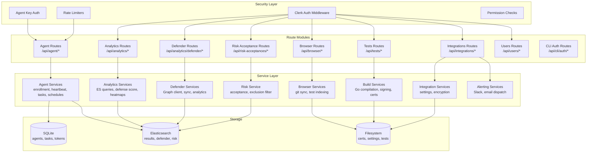

# Overview & Authentication

All endpoints are served from the backend at `/api/*`.

## Authentication

### Web Endpoints (Clerk JWT)

Most endpoints require a Clerk JWT in the Authorization header:

```bash
curl -H 'Authorization: Bearer <clerk-jwt>' https://backend.example.com/api/browser/tests
```

### API Keys (Programmatic Access)

For external applications that need long-lived programmatic access to the API, generate an API key in **Settings → API Keys** (admin only). Keys are `pa_`-prefixed bearer tokens:

```bash
curl -H 'Authorization: Bearer pa_<token>' https://backend.example.com/api/analytics/executions
```

Three scopes are available:

- **`read`** — every `*:read` permission (analytics, agents, tasks, schedules, test library, integrations status). Cannot mutate any resource.
- **`read-write`** — the `operator` permission set (create builds, tasks, schedules; no destructive actions, no user or cert management).
- **`admin`** — the `admin` permission set minus `settings:users:manage`, including `endpoints:tasks:command` (arbitrary shell command execution as root/SYSTEM on any enrolled agent). The only scope with remote command execution; use with caution.

Keys are hashed at rest (SHA-256); the full plaintext is shown **once** at creation and is never retrievable again. Revoke a key from the Settings tab at any time — revocation is immediate.

A key created by a user signed in to a Clerk organization belongs to that organization and is limited to it (see [Organization scope](#organization-scope)).

API keys do not exist on the Vercel (serverless) backend.

### Routes that need a browser session \{#browser-session-only}

An API key and a CLI token are bearer credentials: whoever holds one holds everything it grants. So these routes accept only a signed-in browser session, and return `403` (`This action requires a signed-in user session`) to every API key (the `admin` scope included) and every CLI token:

| Routes | What they do |
|--------|--------------|
| `/api/api-keys/*` | Create, list and revoke API keys |
| `POST`, `PUT`, `DELETE` under `/api/users/*` | Invite a user, set or remove a role, delete a user, revoke an invitation |
| `POST /api/cli/auth/verify` | Approve a CLI sign-in |
| `PUT`, `DELETE /api/settings/identity` | Change or reset the console identity |

An admin's CLI session can still list users and invitations (`GET /api/users`, `GET /api/users/invitations`). An `admin` API key cannot: it has no `settings:users:manage`.

### CLI Tokens

The [CLI](../user-guide/cli/authentication) signs in with a device flow under `/api/cli/auth` and then sends a short-lived token as `Authorization: Bearer <token>`. The token carries the user's role, lasts 1 hour and is renewed with a refresh token. It is bound to the deployment that issued it (its audience is the backend's `AGENT_SERVER_URL`), so another deployment refuses it even with the same `CLI_AUTH_SECRET`. Not available on the Vercel backend.

:::tip[End-to-end usage walkthrough]
For curl recipes, alerting integrations (CI gates, SIEM forwarders), and explanations of the gotchas you'll hit when scripting against the API, read the [Programmatic Access guide](./programmatic-access.md).
:::

### Agent Device Endpoints

Agent endpoints use the agent key issued during enrollment (an `ak_`-prefixed bearer token), the agent id and a request timestamp:

```bash
curl -X POST \
  -H 'Authorization: Bearer ak_<agent-key>' \
  -H 'X-Agent-ID: <agent-id>' \
  -H "X-Request-Timestamp: $(date -u +%Y-%m-%dT%H:%M:%SZ)" \
  https://backend.example.com/api/agent/heartbeat
```

## Response Format

### Success
```json
{ "success": true, "data": { ... } }
```

### Error
```json
{ "success": false, "error": "Error message" }
```

## Rate Limits

| Endpoint Group | Limit |
|---------------|-------|
| All `/api/*` except agent device routes | 1000 / 15 min per user or API key (per IP when unauthenticated) |
| API key authentication (`Bearer pa_...`) | 60 / min per IP |
| CLI token authentication | 60 / min per IP |
| Agent enrollment (`POST /api/agent/enroll`) | 300 / 15 min per IP |
| Agent download (`GET /api/agent/download`) | 300 / 15 min per IP |
| Agent device routes (heartbeat, tasks, results, updates) | 30 / min per agent (IP + agent id) |
| Key rotation | 3 / 15 min per IP |
| CLI sign-in: device code and token refresh | 10 / 15 min per IP each |
| CLI sign-in: poll | 60 / min per IP |

A limited request returns `429` with `{ "success": false, "error": "..." }` and the standard `RateLimit-*` headers.

## Response Headers

Responses that queried Elasticsearch carry a `Server-Timing` header, visible in the browser's developer tools:

```
Server-Timing: es;dur=412.3;desc="Elasticsearch wait (6 calls)", es-took;dur=380;desc="Elasticsearch took"
```

`es` is the time the request spent waiting on Elasticsearch and `es-took` the time Elasticsearch reports. The backend also logs one `[es-timing]` line per such request unless `ES_TIMING_LOG=off`.

## Organization Scope \{#organization-scope}

A caller with an organization (a Clerk organization session, a CLI session of such a user, or an API key created in one) only reads and changes that organization's data:

- **Agents, tasks, schedules, enrollment tokens** (`/api/agent/admin/*`): lists return only the caller's organization. A row of another organization returns `404`, the same as an unknown id. An `org_id` in the query or body that is not the caller's returns `403`.
- **Analytics and reports** (`/api/analytics/*`, `/api/reports/*`): `org` is always the caller's organization. Omitted means its own; any other value returns `403`.
- **Campaigns and pre-execution notices**: the same rule; another organization's id is a `404`.
- **Install-wide settings** (Elasticsearch connection, index creation, agent versions, key auto-rotation) belong to no organization. A caller signed in to an organization gets `403` when it tries to change them.
- **EDR integrations** (Defender, CrowdStrike, SentinelOne, Sophos) are deployment-wide. With `REQUIRE_ORG_ISOLATION=true` their settings are read-only through the API (`403` on writes); set them with environment variables.

A caller without an organization (a single-organization install) sees everything. With `REQUIRE_ORG_ISOLATION=true` such a caller gets `403` (`Organization isolation required. Configure Clerk Organizations.`) on the organization-scoped routes.

## Route Groups

| Prefix | Auth | Purpose |
|--------|------|---------|
| `/api/health` | None | Liveness: `status`, `version`, `commit`, `branch`, `timestamp` |
| `/api/capabilities` | None | Feature flags for this backend (see below) |
| `/api/browser/*` | Clerk | [Test browser](./browser) |
| `/api/analytics/*` | Clerk | [Elasticsearch analytics](./analytics) |
| `/api/analytics/defender/*` | Clerk | [Defender analytics](./defender) |
| `/api/analytics/crowdstrike/*` | Clerk | [CrowdStrike analytics](./crowdstrike) |
| `/api/analytics/sentinelone/*` | Clerk | [SentinelOne analytics](./sentinelone) (not on Vercel) |
| `/api/analytics/sophos/*` | Clerk | [Sophos analytics](./sophos) (not on Vercel) |
| `/api/agent/admin/*` | Clerk | [Agent management](./agent-admin) |
| `/api/agent/*` | Agent key | [Device endpoints](./agent-device) |
| `/api/tests/*` | Clerk | [Build system, certificates](./build-certificates) |
| `/api/integrations/*` | Clerk | Defender, CrowdStrike, SentinelOne, Sophos, Azure and [alerting](./alerting) config |
| `/api/campaigns/*` | Clerk | [Campaigns](./campaigns): saved test plans, runs, evidence matrix, CSV (not on Vercel) |
| `/api/notices/*` | Clerk | [Pre-execution notices](./alerting#pre-execution-notices): settings, status, list, release (not on Vercel) |
| `/api/reports/*` | Clerk | Execution report and SB-PC-2026-001 export payloads |
| `/api/risk-acceptances/*` | Clerk | Risk acceptance management |
| `/api/users/*` | Clerk (admin; writes need a browser session) | User management, invitations |
| `/api/api-keys/*` | Clerk (admin, browser session only) | API key management: create, list, revoke (not on Vercel) |
| `/api/settings/identity` | Clerk (writes need a browser session) | Console identity: code, name, colour (not on Vercel) |
| `/api/cli/auth/*` | None/Clerk | CLI device flow sign-in (not on Vercel) |

"Clerk" means a Clerk session, a CLI token or an API key, each checked against the route's permission.

### Capabilities

`GET /api/capabilities` needs no authentication and returns one boolean per optional feature plus `platform`. The console hides what a backend does not have. On the Docker backend every flag is `true`: `build`, `buildUpload`, `certGenerate`, `certUpload`, `gitSync`, `agentBuild`, `preExecutionNotices`, `campaigns`, `consoleIdentity`, `outcomeBreakdown`, `sentinelone`, `sophos`, `alerting`, `randomizedOnce`, `testFleet`, `stageCoverage`, `coverageMatrix`, `activityStrip`, `scoreMovement`, `testRunRecency`. The Vercel backend reports `false` (or omits the flag) for the features it lacks.

### Routes without their own page

**Risk acceptances** (`/api/risk-acceptances`). Reads need `analytics:risk:read`, writes `analytics:risk:write`.

| Method | Path | Notes |
|--------|------|-------|
| `GET` | `/` | List acceptances |
| `GET` | `/:id` | One acceptance |
| `POST` | `/` | Accept a risk |
| `POST` | `/:id/revoke` | Revoke an acceptance |
| `POST` | `/lookup` | Body: `{ "test_names": [...] }`. Returns the acceptances that cover those tests or controls |

**Reports** (`/api/reports`). Both need `analytics:dashboards:read` and follow the [organization scope](#organization-scope).

| Method | Path | Notes |
|--------|------|-------|
| `GET` | `/executions` | Payload of the print-ready execution report. Takes the Analytics filters (`org`, `from`, `to`, `result`, `hostnames`, `tests`, `techniques`, `categories`, `severities`, `threatActors`, `tags`, `errorNames`, `errorCodes`, `bundleNames`) and `tz` (default `UTC`). An unknown `result` returns `400` |
| `GET` | `/sb-pc-2026-001` | SB-PC-2026-001 JSON export. Query: `from`, `to`, `org`, `org_code`, `vendor`, `bundle_uuid`, `tags`, `hostnames`, `tests`, `bundle_names` |

**Console identity** (`/api/settings/identity`, not on Vercel).

| Method | Path | Notes |
|--------|------|-------|
| `GET` | `/` | Any signed-in caller. Returns the code, name and colour shown on every page |
| `PUT` | `/` | `settings:platform:write`, browser session only. `code` is 2 to 6 letters or digits; `name` is up to 80 characters |
| `DELETE` | `/` | `settings:platform:write`, browser session only. Resets the identity |

**Users** (`/api/users`). Every route needs `settings:users:manage`; every write also needs a browser session.

| Method | Path | Notes |
|--------|------|-------|
| `GET` | `/` | List users with their roles |
| `GET` | `/invitations` | List pending invitations |
| `POST` | `/invite` | Invite a user |
| `POST` | `/invitations/:invitationId/revoke` | Revoke an invitation |
| `PUT` | `/:userId/role` | Set a role |
| `DELETE` | `/:userId/role` | Remove a role |
| `DELETE` | `/:userId` | Delete a user. Deleting your own account returns `400` |

**API keys** (`/api/api-keys`, not on Vercel). `settings:users:manage`, browser session only.

| Method | Path | Notes |
|--------|------|-------|
| `POST` | `/` | Body: `name` (1 to 100 characters), `scope` (`read`, `read-write`, `admin`), optional `expires_at` (ISO-8601). Returns `201` with the key, shown once |
| `GET` | `/` | List keys (never the key value) |
| `DELETE` | `/:id` | Revoke a key. `404` when unknown or already revoked |

**CLI sign-in** (`/api/cli/auth`, not on Vercel). Needs `CLI_AUTH_SECRET` on the backend.

| Method | Path | Auth | Notes |
|--------|------|------|-------|
| `POST` | `/device-code` | None | Starts a sign-in. Returns a device code, a user code and `poll_interval`; the codes expire after 10 minutes |
| `POST` | `/verify` | Browser session | Approves the user code the signed-in user typed. `400` for an invalid or expired code |
| `POST` | `/poll` | None | `202` while approval is pending, `410` when the device code expired, `404` when unknown; on approval, the access token (1 hour) and a refresh token |
| `POST` | `/refresh` | None | Exchanges a refresh token for a new access token. `401` when the refresh token is invalid or expired, or the user was removed, locked, or lost access to the organization |

**Azure / Entra ID credentials** (`/api/integrations/azure`). Per organization. Reads need `integrations:read`, writes `integrations:write`.

| Method | Path | Notes |
|--------|------|-------|
| `GET` | `/api/integrations/azure` | Masked settings |
| `POST` | `/api/integrations/azure` | Save. The first save needs `tenant_id`, `client_id` and either `client_secret` or a certificate (`auth_method: "certificate"`, `cert_thumbprint`, `private_key_pem`) |
| `DELETE` | `/api/integrations/azure` | `400` when the credentials come from `AZURE_*` environment variables |
| `POST` | `/api/integrations/azure/test` | Tests the saved credentials |
| `POST` | `/api/integrations/azure/parse-pfx` | Multipart `pfx` and `passphrase`; returns the thumbprint and private key of a PFX file |

## Route Architecture

The API is organized into domain-specific route modules, each backed by dedicated services:



## Cross-Module Integration Patterns

The route modules are not isolated — several critical workflows span multiple modules:

### Test Execution Pipeline

```
Browser Routes → Tests Routes → Agent Routes → Analytics Routes → Alerting
```

1. **Browse**: User discovers tests via Browser Routes
2. **Build**: Tests Routes compile and sign the binary
3. **Dispatch**: Agent admin routes create tasks for target agents
4. **Execute**: Agent device routes receive tasks and report results
5. **Analyze**: Analytics Routes query Elasticsearch for defense metrics
6. **Alert**: If thresholds are breached, Integration Routes trigger notifications

### Agent Lifecycle

```
Enrollment → Heartbeat → Task Polling → Result Ingestion → Key Rotation
```

All managed through Agent Routes with different auth strategies per sub-route:
- **Public**: Enrollment and agent binary downloads (rate-limited, no auth)
- **Agent-authenticated**: Heartbeat, task fetch, test binary download (only for a test the agent holds a task for), result submission (agent key)
- **Admin**: Fleet management, task creation, scheduling (Clerk JWT, CLI token or API key)

### EDR Elasticsearch readiness \{#edr-elasticsearch-readiness}

```
GET /api/integrations/edr/:vendor/elasticsearch[?fresh=1]
```

`integrations:read`. `:vendor` is `defender`, `crowdstrike`, `sentinelone` or
`sophos` (`404` otherwise). Says whether the Elasticsearch API key can do what
that EDR integration needs (see
[API key privileges for EDR integrations](../user-guide/integrations/elasticsearch.md#edr-api-key-privileges)).
Without `fresh`, it returns the last stored result (from a save or from
startup; `null` before any), re-checking a not-ready one at most once a
minute. With `?fresh=1` it runs a new read-only check (what **Test
Connection** shows). Nothing is created on either path. Not available on the Vercel backend.

```json
{
  "elasticsearch": {
    "status": "not_ready",
    "checked_at": "2026-10-29T10:00:00.000Z",
    "privileges_checked": true,
    "missing": [{ "index": "achilles-sophos", "privileges": ["create_index"] }],
    "recommended": [{ "index": "achilles-sophos", "privileges": ["manage"] }]
  }
}
```

`privileges_checked` is `false` where the cluster can't report privileges
(security disabled); then only reachability was checked. `error` is set when
Elasticsearch isn't configured, rejects the key, is unreachable, or refuses to
create an index.

Each EDR's save route (`POST /api/integrations/defender`, `/crowdstrike`,
`/sentinelone`, `/sophos`) checks the key and creates the indices before it
responds, and returns the result as `elasticsearch` beside `success`. The
credentials are saved either way.

### Configuration Flow

```
Integration Routes → Defender Routes → Analytics Routes
```

Defender credentials saved via Integration Routes enable the Defender sync service, which populates data queried by Defender Analytics Routes.

## Security Architecture

### Authentication Tiers

| Tier | Mechanism | Endpoints | Key Generator |
|------|-----------|-----------|---------------|
| **Public** | Rate limiting only | Agent downloads, enrollment | IP address |
| **Agent device** | `Authorization: Bearer ak_<key>` + `X-Agent-ID` + `X-Request-Timestamp` headers | Heartbeat, tasks, results | `<ip>:<agent-id>` composite |
| **API key** | `Authorization: Bearer pa_<token>` | Programmatic access (scope-gated) | Key id (IP address for the authentication attempt limiter) |
| **CLI token** | `Authorization: Bearer <token>` | The CLI, with the user's role | User ID |
| **Clerk JWT** | `Authorization: Bearer <jwt>` | All admin endpoints; the only tier accepted by the [browser-session-only routes](#browser-session-only) | User ID |
| **Cron secret** | `CRON_SECRET` header (Vercel only) | Scheduled jobs | N/A |

### Input Validation

All routes validate inputs before passing to services:
- **UUID format checks** prevent path traversal in ID parameters
- **Platform validation** (`os` must be `windows`, `linux`, or `darwin`)
- **Payload size limits** protect against oversized uploads
- **Type coercion** via `extractFilterParams()` normalizes query string types

## Response Format Details

### Standard Success

```json
{
  "success": true,
  "data": { ... }
}
```

### Paginated Lists

```json
{
  "success": true,
  "data": [ ... ],
  "total": 142,
  "page": 1,
  "pageSize": 50
}
```

### Error Responses

```json
{
  "success": false,
  "error": "Human-readable error message"
}
```

HTTP status codes follow standard conventions: `400` for validation errors, `401` for authentication failures, `403` for authorization failures (a missing permission, another organization, or a route that needs a browser session), `404` for missing resources (including rows of another organization), `409` for conflicts (for example deleting an unfinished task), `429` for rate limits, and `500` for server errors.

:::tip[Error Handling Pattern]
All async route handlers are wrapped with `asyncHandler()`, which catches rejected promises and forwards them to the global error middleware. Throw `AppError` with an HTTP status code for structured error responses:
```typescript
throw new AppError('Resource not found', 404);
```
:::
