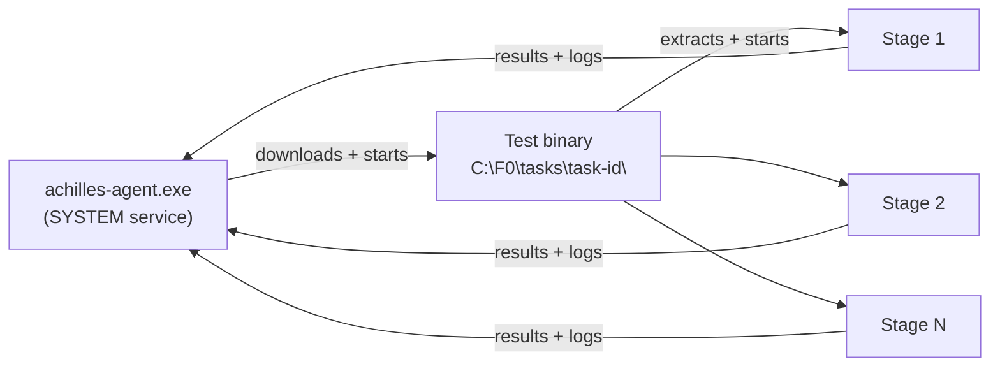

# Endpoint Prerequisites

ProjectAchilles measures what your defenses do while a security test runs. That
only works if the test gets to run. On Windows, several controls can refuse to
start a test binary **before its first instruction**, for reasons that have
nothing to do with what the test does. A test blocked that early produces no
stage results and no logs, so you learn nothing about your detection coverage.

This page is the checklist an organization works through before the first run:
what to set up on the endpoints, why, who usually owns each step, and how to
check it. Linux and macOS need much less; see [Linux and macOS](#linux-and-macos).

## Why endpoints need preparing

The agent is the orchestrator. On every run it:

1. downloads the signed test binary into `C:\F0\tasks\task-<id>\` and checks its
   SHA-256;
2. starts it as SYSTEM. A multi-stage test then extracts its own signed **stage
   binaries** into `C:\F0` and launches them one by one;
3. collects each stage's result and logs and reports them to ProjectAchilles.



Every binary in that chain is built for your tenant, so **no endpoint in the
world has seen it before**. Controls that judge files by reputation treat it as
unknown and block it. Two different things can stop a test:

| | Blocked **before** it runs (early block) | Stopped **while** it runs |
|---|---|---|
| What reacts | A reputation gate or an application-control policy refusing to start an unknown file | Antivirus, EDR or ASR reacting to what the technique does |
| What you get | Exit `260` (*inconclusive*), or a stage that never started. No stage telemetry | A per-stage **Protected**, **Detected** or **Unprotected** result, with logs |
| What it tells you | Nothing about the technique | Your real detection and prevention coverage |

The prerequisites below remove the early blocks and leave every control that
reacts to behavior in place. On the first tenants that went through this, code
signing plus the ASR exclusion in step 3 was what turned blocked runs into
measured ones.

## Checklist

| # | Step | Usually owned by |
|---|------|------------------|
| 1 | [Choose and activate a code-signing certificate](#1-code-signing-certificate) | ProjectAchilles admin |
| 2 | [Distribute the public certificate to the endpoints](#2-distribute-the-certificate) | Intune or GPO admin |
| 3 | [Add a per-rule ASR exclusion for `C:\F0`](#3-defender-asr-per-rule-exclusion-for-cf0) | Intune or GPO admin |
| 4 | [Make sure `C:\F0` is locked to SYSTEM and Administrators](#4-the-cf0-folder-lock) | ProjectAchilles admin |
| 5 | [Add a publisher rule, if you run WDAC or AppLocker](#5-application-control-wdac-and-applocker) | Application-control owner |
| 6 | [Brief the SOC; add no EDR exclusions](#6-edr-expectations) | Security team |
| 6a | [Sophos Intercept X: add nothing by default](#sophos-intercept-x) | Sophos admin |
| 7 | [Verify on a pilot endpoint](#7-verify-on-a-pilot-endpoint) | ProjectAchilles admin |

## 1. Code-signing certificate

ProjectAchilles signs the agent, every test binary and every stage binary
(Windows Authenticode) with the **active certificate** at build time. Multi-binary
bundles sign each validator before embedding it. Manage certificates in
**Settings → Tests → Certificates** ([Certificates & Signing](../user-guide/settings/certificates)).

| Option | How | Notes |
|--------|-----|-------|
| **Generated by ProjectAchilles** | **Generate Certificate** in Settings | Self-signed, RSA-4096, valid 5 years. Its key usage allows **code signing only**. Endpoints must trust it ([step 2](#2-distribute-the-certificate)). |
| **Issued by your organization's CA** | Issue a code-signing certificate (for AD CS, from a Code Signing template), export it **with its private key** as a PFX, then **Upload Certificate** | Domain-joined endpoints already trust an enterprise root, so step 2 is often already done. Revocation goes through your CA. |
| **Public CA** | Not supported | Since June 2023, public CAs only issue code-signing keys on hardware tokens or HSMs, so the key can't be exported as the PFX ProjectAchilles signs with. A public certificate also wouldn't satisfy the ASR rule in step 3: new binaries still have no reputation. |

:::warning[One certificate signs everything]
The agent and every test share the active certificate. Treat its PFX like a
credential. **Download** in Settings returns the PFX *with the private key*:
don't send that file to the endpoint team. [Step 2](#export-the-public-certificate)
shows how to get the public part only.
:::

Binaries keep the signature they were built with. After you activate a new
certificate, rebuild the tests and publish a newly built or re-signed agent
([Self-updates](../user-guide/agent-management/self-updates)).

### What signing does, and what it doesn't

Signing is not a general "allow" switch. Windows has two kinds of gates, and your
certificate only counts for one of them:

| Control | Does your signature help? | Why |
|---------|---------------------------|-----|
| **Application control** (WDAC / App Control for Business, AppLocker) | **Yes** | A publisher rule trusts your certificate and keeps working across rebuilds ([step 5](#5-application-control-wdac-and-applocker)). |
| **Provenance** | **Yes** | The SOC and app-control owners can tell a ProjectAchilles binary by its signer, and a modified binary fails the signature check (on top of the agent's SHA-256 check). |
| **EDR and antivirus heuristics** | Probably, a little | Some engines score "unsigned and brand new" as more suspicious. Not measurable from our side. |
| **Defender ASR rule `01443614`** (prevalence, age, trusted list) | **No** | Microsoft's cloud decides from global reputation; your certificate store plays no part. Use the [per-rule exclusion](#3-defender-asr-per-rule-exclusion-for-cf0). |
| **Smart App Control** | **No** | Only accepts certificates from CAs in Microsoft's Trusted Root Program. It switches itself off within 48 hours on enterprise-managed devices, so it rarely matters. |
| **SmartScreen** | **No**, and usually not involved | SmartScreen checks files that carry the *Mark of the Web* (downloaded by a browser or mail client). The agent writes its files without it. |
| **EDR "allow by certificate"** (Defender certificate indicator, Falcon or S1 allowlists) | Would work, **don't** | Every test shares the certificate, so trusting it lets every test through and the run measures nothing. |

## 2. Distribute the certificate

Endpoints need the **public certificate** (`.cer`) only, never the PFX.

### Export the public certificate

The simplest source is any binary ProjectAchilles built after you activated the
certificate, for example a test binary under `C:\F0\tasks\` on an endpoint, or a
binary downloaded from the test's **Build** section:

```powershell
$sig = Get-AuthenticodeSignature '<path to a ProjectAchilles-built .exe>'
$sig.SignerCertificate | Export-Certificate -FilePath .\achilles-signing.cer -Type CERT
$sig.SignerCertificate.Thumbprint   # record it for verification
```

Or, on the ProjectAchilles admin's machine, from the downloaded PFX:

```bash
openssl pkcs12 -in cert.pfx -clcerts -nokeys -legacy | openssl x509 -outform der -out achilles-signing.cer
```

### Where it goes

| Certificate | Store on the endpoint | Why |
|-------------|----------------------|-----|
| Generated by ProjectAchilles | **Trusted Root Certification Authorities** (`LocalMachine\Root`) | It is self-signed, so it is its own root. Until it is trusted, Windows reports the signature as `UnknownError` instead of `Valid`. Its key usage limits that trust to code signing. |
| Issued by your organization's CA | Usually nothing | Domain-joined endpoints already trust an enterprise root. For Intune-only or workgroup devices, push your root (and any intermediates). |

`Trusted Publishers` is not needed to run executables. Add the certificate there
only if a policy of yours asks for it.

**Intune.** **Devices → Configuration → Create → Windows 10 and later →
Templates → Trusted certificate.** Upload `achilles-signing.cer`, set
**Destination store** to **Computer certificate store - Root**, and assign the
profile to the device groups that hold your test endpoints.

**Group Policy.** In a **dedicated GPO** linked to the endpoint OUs:
**Computer Configuration → Policies → Windows Settings → Security Settings →
Public Key Policies → Trusted Root Certification Authorities → Import**. Pilot it
on a test OU first. The server installer guide walks through the same pattern
for its TLS root: [GPO: push the root](./server-installer#gpo-push-the-root).

**Rotating.** Push the new certificate before you activate it in ProjectAchilles,
rebuild, and remove the old one only after every endpoint runs binaries signed
with the new one.

## 3. Defender ASR: per-rule exclusion for `C:\F0`

The attack surface reduction rule **"Block executable files from running unless
they meet a prevalence, age, or trusted list criterion"**
(`01443614-cd74-433a-b99e-2ecdc07bfc25`) blocks any file that doesn't yet have a
good reputation in Microsoft's cloud. Organizations can't tune its criteria.
Every ProjectAchilles build is new, so in **Block** mode this rule stops the
agent's updates and every test, whatever the signature
(Defender event **1121**, exit `260`). For benign files the rule doesn't
recognize, Microsoft's own guidance is a per-rule exclusion.

Exclude the **agent folder, `C:\F0`, from this rule only.** It covers the agent
binary, the task folders and the stage binaries the tests extract.

**Intune.** **Endpoint security → Attack surface reduction →** the policy that
sets the rule **→ Edit →** the rule above **→ ASR Only Per Rule Exclusions → Add:**

```
C:\F0
```

If several ASR policies set this rule for the same devices (for example one for
workstations and one for servers), add the exclusion to each of them.

**Group Policy.** **Computer Configuration → Administrative Templates → Windows
Components → Microsoft Defender Antivirus → Microsoft Defender Exploit Guard →
Attack Surface Reduction → Apply a list of exclusions to specific attack surface
reduction (ASR) rules → Enabled → Show**:

| Value name | Value |
|------------|-------|
| `01443614-cd74-433a-b99e-2ecdc07bfc25` | `C:\F0` |

The setting needs the Windows 11 24H2 (or later) administrative templates in
your Central Store.

### Why this exclusion is safe

- **It turns off one rule for one folder.** The other ASR rules, Defender
  Antivirus real-time and cloud protection, and your EDR still judge every test
  binary and every stage.
- **Only SYSTEM and Administrators can write to `C:\F0`** ([step 4](#4-the-cf0-folder-lock)).
  A standard user can't drop a file there to use the exclusion; someone who
  already has administrator rights doesn't need it.

### What you give up

On these endpoints the Defense Score does **not** measure rule `01443614`. In a
real attack this rule could block a freshly dropped binary; the score measures
the layers behind it. Say so when you report coverage.

:::danger[Keep it to this one rule]
- **Never use the global "Attack Surface Reduction Only Exclusions" list.** It
  exempts the folder from **every** ASR rule, and the tests would no longer be
  judged by them.
- **Never add a Defender Antivirus exclusion** for `C:\F0` or for the agent
  process. Every ASR rule honors antivirus process exclusions, and antivirus
  would stop scanning the tests.
- **Never use a certificate "Allow" indicator** (see the
  [signing table](#what-signing-does-and-what-it-doesnt)).
:::

## 4. The `C:\F0` folder lock

Under `C:\`, a new folder inherits **Modify** for every signed-in user. With the
ASR exclusion in place, that would let any user run unknown binaries from
`C:\F0`. ProjectAchilles restricts the folder to SYSTEM and Administrators:

- the [bootstrap script](./server-installer#enroll-with-the-bootstrap-script)
  locks it at install;
- **agent 0.7.1 and later** lock it at every startup, which also fixes folders
  created by older installs once the agent updates.

Before you add the exclusion, make sure every endpoint runs agent 0.7.1 or later,
or was installed with the bootstrap script. [Step 7](#7-verify-on-a-pilot-endpoint)
shows the check.

The lock, the exclusion and every exact-path rule only help if the agent itself
runs from `C:\F0\achilles-agent.exe`. The install command shown in
**Agents → Enrollment** downloads it there, and the bootstrap script installs it
there.

Any signed-in user can create a folder under `C:\`, and its owner can always
change its permissions. A `C:\F0` created by a non-administrator would let that
user swap the agent binary for one the service then runs as SYSTEM. So before it
downloads anything, the enrollment command:

- stops if `C:\F0` already exists and is a link, or is not owned by SYSTEM or
  Administrators;
- makes Administrators the owner and locks the folder (the same `icacls` calls,
  by SID, as the agent and the bootstrap script);
- stops if anything directly inside it is a link or has another owner;
- deletes any old `achilles-agent.exe`, so the download is a new file that
  inherits the lock.

Agents later than 0.7.1 make the same checks themselves on `--install`, before
enrolling. If the command stops, look at what is in `C:\F0`, remove the folder
(or anything not yours), and run it again. The
[bootstrap script](./server-installer#enroll-with-the-bootstrap-script) goes
further and normalizes every item already in the folder.

### Agent outside C:\F0 \{#agent-outside-cf0}

Older versions of the **Agents → Enrollment** command downloaded the agent into
PowerShell's current folder, and `--install` registered the service wherever the
binary was. An elevated PowerShell starts in `C:\Windows\System32`, so those
agents can run from there, outside the lock and the exclusion. Check which file
the service runs; it should print `"C:\F0\achilles-agent.exe" --run`:

```powershell
(Get-CimInstance Win32_Service -Filter "Name='AchillesAgent'").PathName
```

Agents later than 0.7.1 also log this line at startup when they run from
anywhere else:

```text
WARNING: the agent is running from <path>, not C:\F0\achilles-agent.exe.
```

The agent never moves itself. To fix an endpoint, from an elevated PowerShell:

- **Agent later than 0.7.1** (its log shows the warning above): run the
  binary the service uses with `--install`. It copies itself to
  `C:\F0\achilles-agent.exe`, re-registers the `AchillesAgent` service there and
  keeps its enrollment.

  ```powershell
  & 'C:\Windows\System32\achilles-agent.exe' --install
  ```

- **Any agent version**: generate a token and run the current Windows command
  from **Agents → Enrollment**. It downloads into `C:\F0` and replaces the
  service. This enrolls the endpoint again as a new agent; delete the old,
  offline entry from **Agents** afterwards.

Then check the `PathName` again and delete the old binary (for example
`C:\Windows\System32\achilles-agent.exe`). If an agent is already running from
`C:\F0` and you re-run the enrollment command, stop it first with
`Stop-Service AchillesAgent`, or the command can't delete the running file.

## 5. Application control (WDAC and AppLocker)

Skip this step if you don't enforce application control. If you do, allow
ProjectAchilles binaries by **signer**, not by hash or path:

| Rule type | Verdict |
|-----------|---------|
| **Publisher / signer rule** on your signing certificate | **Use this.** Survives every rebuild while the certificate stays the same. |
| File hash | Breaks on every build and test-library sync. |
| Path (`C:\F0\*`) | Lets anything in the folder run, signed or not. Weakest option. |

- **WDAC / App Control for Business:** add a signer rule from a ProjectAchilles-built
  reference file at the **PcaCertificate** or **LeafCertificate** level. For a
  self-signed certificate both resolve to the certificate itself.
- **AppLocker:** **Executable Rules → Create New Rule → Allow → Publisher**, using a
  ProjectAchilles-built binary as the reference, with the slider at
  **Publisher** (no product, file name or version). Distribute the certificate
  first ([step 2](#2-distribute-the-certificate)).

Blocks show up as CodeIntegrity events **3077** (WDAC, enforced; **3076** in audit)
and AppLocker events **8004** (enforced; **8003** in audit).

## 6. EDR expectations

| EDR | Typical behavior | What ProjectAchilles does |
|-----|------------------|---------------------------|
| Microsoft Defender for Endpoint | Judges each stage binary | Per-stage verdicts, alert correlation ([Microsoft Defender](../user-guide/integrations/microsoft-defender)) |
| CrowdStrike Falcon | Judges each stage binary | Per-stage verdicts, alert correlation ([CrowdStrike](../user-guide/integrations/crowdstrike)) |
| Sophos Intercept X | Judges file content (Deep Learning, reputation) and behaviour per binary | Per-stage verdicts, alert correlation, Health Check posture ([Sophos](../user-guide/integrations/sophos)). Add nothing by default; see [Sophos Intercept X](#sophos-intercept-x). |
| SentinelOne | Scores the whole process tree and can kill its root, **the agent** | The task fails with `Agent went offline during execution`; with a matching alert the run counts as **Protected**, stages unknown ([SentinelOne](../user-guide/integrations/sentinelone#when-the-edr-kills-the-agent)). Windows restarts the agent service after 10 seconds (service recovery). |

- **Add no EDR exclusion for the agent or for `C:\F0`.** The agent launches the
  tests, so an exclusion that applies to child processes exempts the tests too,
  and the run stops measuring your protection.
- **Tell the SOC before runs start.** Test activity raises real alerts.
  [Pre-execution notices](../user-guide/integrations/pre-execution-notices) email
  them before every run, and the auto-resolve features can close matched alerts
  for you.

## Sophos Intercept X \{#sophos-intercept-x}

Skip this section if you don't run Sophos. It sits beside the Defender step:
Defender has a prevalence gate (ASR rule `01443614`) that needs an exclusion;
Sophos documents no equivalent gate (pending validation on a live tenant).

### Default: add nothing

Defender has a prevalence and age gate (ASR `01443614`) that needs an
exclusion. Sophos documents no equivalent gate, so we expect a freshly built
binary to be judged on what it is and does, like any other file, and not
blocked just for being new. Sophos does use reputation and file-content
analysis (Deep Learning, Live Protection lookups), so a detection of a new
agent build is possible; this is pending validation (see the box below).
**Pilot one endpoint first** ([step 7](#7-verify-on-a-pilot-endpoint)): run a
multi-stage test and check that the agent keeps running and the stages report
their own results.

Remember that Sophos reacting to a test is the point. If Sophos blocks a stage,
that is a **result** (Prevented), not a prerequisite failure.

### Only if Sophos convicts the agent itself

If a Sophos detection names the agent's own file (path
`C:\F0\achilles-agent.exe` or `C:\F0\achilles-update-*`, typically a machine-learning
`ML/PE-...` detection) the agent can't run, and nothing else works. Then, and
only then:

1. In Sophos Central open that detection and choose to **allow** the file by its
   **SHA-256**. Do **not** allow it by **certificate**, even if Central offers
   that option first: every Achilles test shares the agent's signing
   certificate, so a certificate allow trusts every test.
2. **Allow each new agent version's SHA-256 before you roll it out.** A hash
   allows one exact file, so every agent update has a new hash.
3. Fallback, if hashes are impractical: allow the application by **exact path**
   `C:\F0\achilles-agent.exe`, and only together with the `C:\F0` lock from
   [step 4](#4-the-cf0-folder-lock) (agent 0.7.1 and later), so nobody but
   SYSTEM and Administrators can place a file at that path.

**Check that the agent really lives in `C:\F0`** before relying on any path
rule:

```powershell
(Get-CimInstance Win32_Service -Filter "Name='AchillesAgent'").PathName
```

It should print `C:\F0\achilles-agent.exe`. An agent installed from another
folder is outside the lock and outside every exact-path rule on this page; see
[Agent outside C:\F0](#agent-outside-cf0) to move it.

### What you give up

We expect the allow to exempt that one file (the agent) from Sophos'
file-content and reputation verdict, while Sophos keeps monitoring what the
agent does and judging every test binary and stage in full; whether an allowed
file is still subject to behavioural monitoring is pending validation. In
ProjectAchilles terms, the Defense Score doesn't measure whether Sophos would
convict a new agent build on its content alone.

:::danger[Never do these]
Each of these makes Sophos stop judging the tests, so the run measures nothing.
- **Never allow by certificate.** The agent and all tests share the active
  signing certificate; trusting it trusts every test. ProjectAchilles flags such
  an entry as a critical gap in the Sophos tab.
- **Never add a process exclusion for the agent.** It covers every file the
  agent writes or opens, which is every test.
- **Never add any `C:\F0` folder exclusion**, of any kind: scanning, AMSI,
  ransomware protection, file hashing or data collection. Also flagged as
  critical.
- **Never add Server Lockdown "allowed files/folders" for the agent**; it would
  trust the files the agent creates.
- **Never allow a PUA by a generic name.**
- **Never add exploit-mitigation or behavioural exclusions** for the agent or
  the tests.
- **Never lower Deep Learning or turn off hooks** for the test hosts.
:::

### Servers with Server Lockdown

Server Lockdown only runs approved files, and it will refuse the tests. Don't
loosen it for the agent: use a **lockdown-free test group** of servers instead
(same policies otherwise), and read those servers' results as the baseline.

### Linux and macOS

Linux and macOS need no extra step here. Check your Sophos policy for what
on-access scanning does on Linux; we expect it to be off by default, which is
pending validation.

:::note[Pending validation]
These Sophos behaviours are being confirmed on a proof-of-concept tenant before
this page is final, and are expectations, not claims: whether a fresh agent or
test binary gets an `ML/PE-...` detection on the default policy, and whether
Sophos applies any prevalence or age check; which Windows error a
Sophos-blocked launch returns (so whether it shows as exit `260` or as a bare
failed task); whether Sophos quarantines a file as it is written; whether an
allowed hash or path changes behavioural monitoring of the agent's children;
whether Sophos ever ends the agent during a test; whether the agent's update or
uninstall paths raise behaviour detections; whether Linux on-access scanning is
off by default; and the exact Sophos Central menu labels for allowing a file
(Sophos Central, also branded Sophos Fusion). If you see any of these, the
Sophos tab's feed and the
[Executions](../user-guide/analytics/exit-codes-and-outcomes) view show what
Sophos reported.
:::

## What ProjectAchilles changes on an endpoint

- Installs the `AchillesAgent` service (LocalSystem) with its binary at
  `C:\F0\achilles-agent.exe`.
- Restricts `C:\F0` to SYSTEM and Administrators.
- Writes test binaries, stage binaries and results under `C:\F0`.
- With the server installer's `achilles-ca` or `internal` TLS modes, the
  bootstrap script imports that **server's TLS root** into `LocalMachine\Root`
  (see [Server installer](./server-installer#distributing-trust-and-enrolling-windows-endpoints)).

It changes no Defender, ASR, firewall or EDR setting. Steps 2 and 3 are made by
your administrators, through your own tools.

### Earlier tests installed a root certificate \{#f0rtika-root-cleanup}

:::danger[Check your endpoints for the F0RT1KA root]
Until October 2026, some tests in the test library installed the **F0RT1KA
Security Testing Framework** certificate into `LocalMachine\Root` on the endpoint
where they ran, without asking. That certificate is a root CA **with no usage
restrictions**, so Windows trusts it for any purpose, including website (TLS)
certificates. ProjectAchilles never needed it: binaries are signed with *your*
certificate. The install code has been removed from the test library.
:::

| | |
|---|---|
| Subject | `CN=F0RT1KA Security Testing Framework, O=F0RT1KA, C=US` |
| SHA-1 thumbprint | `CAE0B62C1BEB703F5A2C34BC841E806D6AC8F3B4` |
| Valid | 2025-10-25 to 2030-10-24 |
| Tests that installed it | *Star Blizzard RedFlick CosmicPulse Espionage Chain* (`c3b4301e-b502-43a4-9f01-66a874239d1b`), *Multi-Stage Ransomware Killchain Simulation* (`5ed12ef2-5e29-49a2-8f26-269d8e9edcea`), and earlier versions of other tests between October 2025 and March 2026 |

Because earlier test versions installed it too, **check every Windows endpoint
that has run tests**, not only those that ran the two tests above.

**Across the fleet, from ProjectAchilles.** Create a **Shell Command** task
([Task Execution](../user-guide/agent-management/task-execution#task-types)) for
your Windows agents. It runs as SYSTEM through `cmd.exe`:

```bat
certutil -delstore Root CAE0B62C1BEB703F5A2C34BC841E806D6AC8F3B4
```

`certutil` reports success where it deleted the root and an error where the
root wasn't there; both outcomes are fine. Read the task output per host to see
which endpoints had it.

**On one endpoint** (elevated PowerShell):

```powershell
$path = 'Cert:\LocalMachine\Root\CAE0B62C1BEB703F5A2C34BC841E806D6AC8F3B4'
if (Test-Path $path) { Remove-Item $path; 'Removed' } else { 'Not present' }
```

To make sure it can't come back, export it from an affected endpoint before you
delete it, then import that file into **Untrusted Certificates** with your
Intune or GPO tooling.

## 7. Verify on a pilot endpoint

Run these in an elevated PowerShell on one endpoint before rolling out widely.

```powershell
# 1. The signature validates (needs step 2 for a ProjectAchilles-generated certificate).
#    Use a binary built after the certificate was activated.
Get-AuthenticodeSignature '<path to a ProjectAchilles-built .exe>' |
  Format-List Status, StatusMessage, @{ n = 'Signer'; e = { $_.SignerCertificate.Subject } }

# 2. The agent runs from C:\F0, and the folder lock: only SYSTEM and BUILTIN\Administrators.
(Get-CimInstance Win32_Service -Filter "Name='AchillesAgent'").PathName
icacls C:\F0

# 3. The per-rule exclusion arrived. Depending on how the policy was delivered it
#    lands under one of these two keys.
$rule = '01443614-cd74-433a-b99e-2ecdc07bfc25'
$sub  = 'Windows Defender\Windows Defender Exploit Guard\ASR\ASROnlyPerRuleExclusions'
foreach ($root in 'HKLM:\SOFTWARE\Policies\Microsoft', 'HKLM:\SOFTWARE\Microsoft') {
  (Get-ItemProperty -Path "$root\$sub" -ErrorAction SilentlyContinue).$rule
}
```

Expected: `Status : Valid`; the service path is `"C:\F0\achilles-agent.exe" --run`
(otherwise see [Agent outside C:\F0](#agent-outside-cf0)); `icacls` lists only `NT AUTHORITY\SYSTEM` and
`BUILTIN\Administrators`; the last command prints a value that contains `C:\F0`
(several paths are separated by `>`).

Then run a multi-stage test on the pilot endpoint:

- The result is **not** exit `260`, and the stages report their own results.
- Defender event 1121 no longer names a file under `C:\F0` for rule
  `01443614`. Other rules may still fire, which is the point:

```powershell
Get-WinEvent -FilterHashtable @{
  LogName = 'Microsoft-Windows-Windows Defender/Operational'; Id = 1121, 1122
  StartTime = (Get-Date).AddHours(-1) } -ErrorAction SilentlyContinue |
  Select-Object TimeCreated, Message | Format-List
```

## Linux and macOS

No certificate or exclusion is needed to get past platform gates:

- **macOS:** ProjectAchilles ad-hoc signs binaries, which Apple silicon requires
  before any code runs. Gatekeeper only assesses files that carry the quarantine
  attribute, and the agent's downloads don't.
- **Linux:** binaries are not signed.

Your EDR still judges each binary, and the guidance in
[step 6](#6-edr-expectations) applies.

## Troubleshooting

| Symptom | Likely cause | Fix |
|---------|--------------|-----|
| Exit `260` *BlockedPreExecution*, Defender event 1121 for rule `01443614` | The ASR exclusion hasn't reached the endpoint | Check the registry value from step 7; force a policy sync; check that every ASR policy that sets the rule has the exclusion |
| Exit `260`, no event 1121 | Application control | CodeIntegrity 3077 or AppLocker 8004 events; add the [publisher rule](#5-application-control-wdac-and-applocker) |
| Tests still blocked by rule `01443614` (event 1121) although the exclusion is in place; or the agent log says "the agent is running from …, not C:\F0\achilles-agent.exe" | The agent was installed from another folder, often `C:\Windows\System32` | [Move it into C:\F0](#agent-outside-cf0) |
| Agent update rolled back: "failed its launch check" | The same ASR rule blocked the new agent binary | The `C:\F0` exclusion covers it; the next update check retries ([Self-updates](../user-guide/agent-management/self-updates)) |
| `Get-AuthenticodeSignature` says `UnknownError` | The generated certificate isn't trusted on that endpoint | Step 2 |
| `Get-AuthenticodeSignature` says `NotSigned` | The binary was built before a certificate was active, or signing failed | Rebuild; check the build log for signing errors |
| `Agent went offline during execution` during a test | The EDR killed the process tree (typical of SentinelOne) | Expected; see [EDR expectations](#6-edr-expectations) |
| A Sophos detection names `C:\F0\achilles-agent.exe` and the agent won't start | Sophos convicted the agent file | [Allow that SHA-256](#only-if-sophos-convicts-the-agent-itself), never the certificate |
| Sophos tab shows a **Certificate allowed** or **Folder exclusion** critical box | A Sophos allow or exclusion exempts every test | Remove it; see the danger box in [Sophos Intercept X](#sophos-intercept-x) |
| Stages blocked or missing on a Sophos server | Server Lockdown refuses unapproved files | Use a lockdown-free [test group](#servers-with-server-lockdown) |

See also: [Exit Codes & Outcomes](../user-guide/analytics/exit-codes-and-outcomes).

## References (Microsoft Learn)

- [ASR rule reference: Block executable files from running unless they meet a prevalence, age, or trusted list criterion](https://learn.microsoft.com/defender-endpoint/attack-surface-reduction-rules-reference#block-executable-files-from-running-unless-they-meet-a-prevalence-age-or-trusted-list-criterion)
- [ASR FAQ: the rule's criteria can't be configured; use the exclusion list](https://learn.microsoft.com/defender-endpoint/attack-surface-reduction-faq)
- [Configure ASR rules and per-rule exclusions (Intune, Group Policy)](https://learn.microsoft.com/defender-endpoint/attack-surface-reduction-rules-configure)
- [File and folder exclusions for ASR rules](https://learn.microsoft.com/defender-endpoint/attack-surface-reduction-rules-overview#file-and-folder-exclusions-for-asr-rules)
- [Trusted certificate profiles in Intune](https://learn.microsoft.com/intune/device-configuration/certificates/trusted-root-profiles)
- [App Control for Business and Smart App Control](https://learn.microsoft.com/windows/security/application-security/application-control/app-control-for-business/appcontrol#app-control-and-smart-app-control)
- [App Control file rule levels](https://learn.microsoft.com/windows/security/application-security/application-control/app-control-for-business/design/select-types-of-rules-to-create#app-control-for-business-file-rule-levels)
- [AppLocker publisher rule condition](https://learn.microsoft.com/windows/security/application-security/application-control/app-control-for-business/applocker/understanding-the-publisher-rule-condition-in-applocker)
