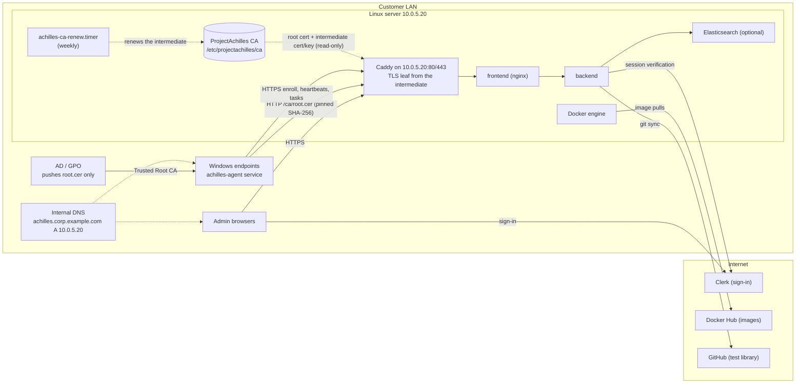

# Server Installer: On-Prem or Cloud

The recommended way to self-host ProjectAchilles: one command installs the whole
platform on one Linux server with the `achilles-installer` wizard, on your own
network or on a cloud server. The wizard detects which one it is on from the
server's IP address and adapts its questions and defaults; everything else (the
install, the Clerk sign-in and first admin, day-2 commands, upgrades and
backups) is the same.

| | **On-prem LAN** | **Cloud server** |
|---|---|---|
| Server | An **internal DNS name** (e.g. `achilles.corp.example.com`), outbound internet, **no public IP** | A **public IPv4** on its own interface (DigitalOcean, Hetzner and similar) and a public DNS A record |
| HTTPS certificates | A **ProjectAchilles CA** that the installer creates and manages, limited to your DNS zone (or your Enterprise CA, or your own files) | **Let's Encrypt** HTTP-01 (default) or DNS-01, renewed automatically |
| Agents | Mostly **Windows**; they trust the CA through **GPO** (or Intune) and enroll with a fingerprint-pinned bootstrap script | Any OS, anywhere on the internet; the standard enroll command, no extra trust setup |
| Read | Every section except those marked **Cloud server** | Every section except those marked **On-prem LAN** |

It shares its engine (`scripts/deploy-server.sh`, `docker-compose.server.yml`,
Caddy) with the other server installs. To drive that engine yourself without
the wizard, see [Public Server](./public-server) (a VPS, or a DigitalOcean
droplet created for you) and [On-Prem Server](./on-prem-server) (over SSH,
Let's Encrypt DNS-01 or your own certificate).

:::info[Full reference]
The complete guide, with every screen, flag and troubleshooting row, is
[`docs/deployment/SERVER_INSTALLER.md`](https://github.com/projectachilles/ProjectAchilles/blob/main/docs/deployment/SERVER_INSTALLER.md).
:::

You need root on the server, about an hour, and the items under
[Before you start](#before-you-start) ready.

## Architecture



- **One origin.** Caddy terminates TLS and proxies to the frontend, which proxies
  `/api` to the backend. Only Caddy publishes ports, and only on the LAN IP you
  pick (`CADDY_BIND_IP`).
- **The CA lives on the host.** The root key stays in `/etc/projectachilles/ca`
  and is never mounted into Caddy. Caddy sees only the root certificate and the
  intermediate certificate and key, and issues short-lived leaf certificates from
  the intermediate.
- **Plain HTTP serves one thing:** the root certificate at `/ca/root.cer` (DER)
  and `/ca/root.crt` (PEM), so an endpoint that does not trust the CA yet can
  fetch it and check it against a pinned fingerprint. Every other HTTP path
  redirects (308) to HTTPS. The bootstrap scripts are never served.
- **Clerk is in the cloud.** The server and the admins' browsers both need
  internet access to Clerk.

The diagram shows an on-prem LAN. A **cloud server** is the same stack without
the internal DNS, the GPO and the CA: Caddy listens on the public IP and gets a
Let's Encrypt certificate, and agents connect over the internet.

## Before you start

### On-prem LAN

| Item | Who | Why |
|------|-----|-----|
| **Linux server** | IT | Ubuntu 22.04, 24.04 or 26.04 (Debian 12 and RHEL-family 9 are best-effort). At least 2 GiB RAM, **4 GiB for self-hosted Elasticsearch**; **20 GiB free disk** for a fresh install; root or sudo; ports 80 and 443 free; NTP-synchronised clock. |
| **Static IP** (or DHCP reservation) | Network | Caddy binds to this one address (`10.0.5.20`). A new IP needs a re-run of the installer. |
| **DNS record** in internal DNS | DNS / AD | `achilles.corp.example.com A 10.0.5.20`. The installer prints the exact record and the AD DNS PowerShell line. |
| **Network firewalls** | Network | Endpoints and browsers must reach **TCP 80, TCP 443 and UDP 443** on the server. Port 80 carries the root download and the HTTPS redirect. |
| **GPO owner** | AD / GPO | Imports `root.cer` into a GPO linked to the endpoint OUs. |
| **Clerk app** | You + whoever edits public DNS | Production keys need a public domain you own; private-only names use development keys. |
| **Outbound internet** from the server | Network | Image pulls and builds, GitHub, Clerk: see the allow-list below. Browsers need to reach Clerk too. |

**Outbound allow-list for the server** (HTTPS unless noted):

| Host | Used for |
|------|----------|
| `registry-1.docker.io`, `auth.docker.io`, `production.cloudflare.docker.com` | Docker Hub image pulls (the registry redirects layer downloads to its CDN) |
| `docker.elastic.co` | The Elasticsearch image (`ES_MODE=self`) |
| `get.docker.com`, `download.docker.com` | Installing Docker when it is missing: the engine runs the `get.docker.com` script, which installs from Docker's package repository |
| `github.com` | `install-onprem.sh` (clone, release tags, and release downloads from `github.com/projectachilles/ProjectAchilles/releases/download/…`), and the test library's git sync |
| `release-assets.githubusercontent.com` (older: `objects.githubusercontent.com`) | GitHub redirects those release downloads to its asset host |
| `raw.githubusercontent.com` | Downloading `install-onprem.sh` itself |
| `proxy.golang.org`, `sum.golang.org` | Go modules when the installer is built from source (`--ref main`, or a tag without a release asset), and for agent and test builds. A Go 1.21 or later that is older than the version in `installer/go.mod` downloads the required toolchain through the same proxy (default `GOTOOLCHAIN=auto`) |
| `go.dev`, `dl.google.com` | The backend image build downloads Go from `go.dev/dl`, which redirects to `dl.google.com` |
| `registry.npmjs.org`, `deb.debian.org`, `dl-cdn.alpinelinux.org` | npm and OS packages during the image builds |
| `api.clerk.com`, your Clerk Frontend API host | Session verification; the installer also probes the Frontend API host |

The server's own package mirrors (for `git`, `curl`, `make`) come on top.

### Cloud server

The server's public IP must be on its own network interface, as on DigitalOcean
Droplets and Hetzner Cloud servers (for providers that NAT it, see
[NAT](#cloud-server-install)).

| Item | Notes |
|------|-------|
| **Server** | Ubuntu 26.04, 24.04 or 22.04 with the usual minimums: 2 GiB RAM (4 GiB for self-hosted Elasticsearch; DigitalOcean 4 GB or Hetzner CX32 and up), 20 GiB free disk. |
| **Public DNS name** | An A record pointing at the server's public IPv4, under a domain you own. Create it first, so the DNS check passes and Let's Encrypt can validate. Don't add an AAAA record: Caddy listens on the IPv4 address only, and Let's Encrypt validates over IPv6 when one exists. |
| **Provider firewall** | A DigitalOcean Cloud Firewall or Hetzner Firewall must allow **TCP 80, TCP 443 and UDP 443** inbound from anywhere, plus SSH. The installer can't see these firewalls. |
| **Clerk** | Production keys (`pk_live_`) for the public domain; development keys (`pk_test_`) work for a trial, with Clerk's "Development mode" banner. Decide who the [first admin](#the-first-admin-and-roles) is. |
| **Outbound email** | DigitalOcean blocks SMTP ports 25, 465 and 587 on new accounts; Hetzner blocks 25 and 465. Use a relay on an open port (Hetzner: 587) or have the block lifted. With [pre-execution notices](../user-guide/integrations/pre-execution-notices) on, a server that can't send mail **holds every test run** until the maximum wait, then marks it Not run. |

### Both

- A **Clerk application** and its two keys ([DNS and Clerk](#dns-and-clerk-pick-your-situation)
  says which kind), with the **session token claim** set (recommended; required
  before v2.5.0, see [Clerk: roles and the first admin](#the-first-admin-and-roles)).
- The **email of the first admin**, whom the installer invites.

:::warning[Defender ASR]
If attack surface reduction rule `01443614` runs in block mode, add a per-rule
exclusion for exactly `C:\F0\achilles-agent.exe` before rollout. See
[Self-updates](../user-guide/agent-management/self-updates).
:::

## DNS and Clerk: pick your situation

The installer classifies the hostname as you type it on the **Network & name**
screen. The class decides which Clerk keys it accepts and whether Let's Encrypt
(DNS-01 or HTTP-01) is offered.

| | **Under a public domain you own** | **Private-only name** |
|---|---|---|
| Example | `achilles.corp.example.com`, where `example.com` has public name servers | `achilles.corp.lan`, `pa.internal`, `achilles.home.arpa` |
| How it decides | The registrable domain (public suffix list + 1 label) has public NS records | The name is under `.local`, `.lan`, `.internal`, `.home.arpa`, `.corp`, `.intranet` or `.localdomain`, or its registrable domain has no public NS records, or the NS lookup failed (treated as private-only, with a warning) |
| Clerk keys | **Production** (`pk_live_` + `sk_live_`) expected. Development keys (`pk_test_`) work with a warning (a "Development mode" banner, lower limits). | **Development keys only** (`pk_test_` + `sk_test_`). A `pk_live_` key is an error. |
| Clerk app domain | The key's Frontend API host must be `clerk.<D>`, where D is the hostname or one of its parents **down to and including the registrable domain**. For `achilles.corp.example.com`: `clerk.achilles.corp.example.com`, `clerk.corp.example.com` or `clerk.example.com`. | n/a (development instances use a `*.clerk.accounts.dev` host) |
| DNS records | Add the records Clerk's dashboard lists to the **public** zone; sign-in fails until Clerk shows them verified. The server's own A record stays **internal-only**. | Only the internal A record. |
| Certificates | ProjectAchilles CA (default on a LAN IP), Enterprise CA, your own files, **or Let's Encrypt (DNS-01, or HTTP-01 with inbound port 80)** | ProjectAchilles CA (default), Enterprise CA or your own files. Let's Encrypt is not offered. |

The publishable and secret keys must come from the same Clerk instance, and the
installer checks that the Frontend API host is reachable from the server.

A **cloud server** is always in the first column, except that its own A record
is in public DNS too.

:::tip[Keep the internal hostname out of public DNS]
Clerk's CNAMEs reveal the label D in your public zone. Create the Clerk app on a
parent domain (e.g. `clerk.example.com`) if `achilles.corp` must not appear there.
:::

:::warning[Avoid `.local`]
It is reserved for multicast DNS: macOS and many Linux clients resolve `.local`
names over mDNS instead of your DNS server, which breaks browsers and agents. The
installer warns about it. Prefer a name under a domain you own, or `.lan` /
`.internal`.
:::

## Clerk: roles and the first admin \{#the-first-admin-and-roles}

Every person signs in through Clerk. What they may do comes from a **role** in
their Clerk user's **public metadata**, for example `{"role": "admin"}`. The
roles are `admin`, `operator`, `analyst` and `explorer`; a signed-in user with
no role gets read-only (`explorer`) access. Two settings in the Clerk app make
this work, on LAN and cloud installs alike ([Clerk Setup](./clerk-setup) shows
every Clerk Dashboard step with screenshots). Set the first before you install
(required on servers older than v2.5.0, and still the recommended setup); the
installer does the second for you.

**1. Session token claim (in the Clerk Dashboard, before you install).** Open
**Configure → Sessions**. Under **Customize session token**, leave the name
(`__session`) as it is, set the **Claims** to the following, and select **Save**:

```json
{
  "metadata": "{{user.public_metadata}}"
}
```

This puts the role into every session token. Clerk keeps the setting per
instance, so set it again when you move from development to production keys.
Clerk has no API for it, so the installer can't set it. If it's missing, servers
from v2.5.0 look the role of each signed-in browser session up in Clerk instead
(cached for a minute per user); older releases treated everyone as read-only, admins included, and every
admin action failed with "Insufficient permissions".

**2. The first admin's role (the installer does this).** The Login screen asks
for the **first admin email** (`ADMIN_EMAIL`). Once the stack is up, the
installer uses the Clerk secret key to either:

- **invite** the address: Clerk emails a link to `https://<hostname>/sign-up`,
  and the account created from it has the admin role; or
- **promote** an account that already exists in this Clerk app, by adding
  `"role": "admin"` to its public metadata (other keys, such as `org_id`, stay).

It leaves an existing admin or a pending admin invitation alone, so running the
installer again doesn't send another email. The Done screen (or, unattended, the
terminal) says which of these happened.

**By hand**, when you left the field blank or the Clerk call failed: sign up at
`https://<hostname>/sign-up`, then in the Clerk Dashboard open **Users →** the
user **→ Metadata**, select **Edit** next to **Public**, and set it to:

```json
{
  "role": "admin"
}
```

Then sign out of ProjectAchilles and in again, so the session picks up the role.

**More people:** an admin invites them, with a role, from **Settings → Users**
in the web UI.

:::tip[Restrict sign-ups on a cloud server]
Anyone who can reach `https://<hostname>/sign-up` can create an account, and an
account with no role can still read the dashboards. On a server reachable from
the internet, set Clerk's sign-up mode to **Invite-only** under **Configure →
Access mode**; the installer's invitation and **Settings → Users** still work.
See [Restrict sign-ups](./clerk-setup#restrict-sign-ups).
:::

## Install

### Get the installer onto the server

:::note[The installer ships with v2.3.0 and later]
Releases up to and including v2.2.0 have no `installer/` directory, so `--ref`
must name v2.3.0 or newer (or a branch such as `main`, which builds from source
and needs Go 1.26 or later and `make` on the server).
:::

`scripts/install-onprem.sh` is the one-command bootstrap. As root, it checks the
OS and architecture (x86_64 or aarch64), installs `git`, `curl` and
`ca-certificates` if missing, clones the repository into `/opt/projectachilles`
(or `--dir`) at the latest release tag (or `--ref`), downloads the matching
`achilles-installer-linux-amd64` / `-arm64` release asset and verifies it against
the release's `SHA256SUMS` (refusing a mismatch), then launches the wizard.

Download, inspect, run (recommended):

```bash
curl -fsSLO https://raw.githubusercontent.com/projectachilles/ProjectAchilles/main/scripts/install-onprem.sh
less install-onprem.sh
sudo bash install-onprem.sh
```

| Option | Meaning |
|--------|---------|
| `--ref REF` | Release tag (`vX.Y.Z`) or branch. Default: the highest `vX.Y.Z` tag. A branch skips the release download and builds from source. |
| `--dir DIR` | Install directory (absolute). Default: `/opt/projectachilles`. |
| `--no-run` | Stop after installing the binary at `<dir>/achilles-installer`. |

With no release asset for the tag, the script builds from source (needs `go` and
`make`). It refuses a directory that is not a ProjectAchilles checkout and
refuses local changes (except `deploy/caddy/tls.caddy`, which it restores). With
no terminal it prints the interactive and unattended commands instead of
launching the wizard. To start the wizard later:

```bash
cd /opt/projectachilles && sudo ./achilles-installer install
```

The wizard needs a real terminal (TTY), best at 80×24 or larger. Keys:
**enter** next, **esc** back, **ctrl+c** quit. Nothing on the server changes until
you confirm on **Review**.

### The ten screens

**1/10 Welcome.** A first run lists the steps. On a server that already has
`/opt/projectachilles/deploy.config.env` it offers **Reconfigure** (change and
re-apply, keeping data and the CA), **Upgrade**, **Status**, or **Fresh install**
(blank answers after you type the hostname; data volumes, the CA and generated
secrets are kept).


**2/10 Preflight checks.** Read-only PASS / WARN / FAIL checks. A FAIL blocks
**Next**; fix it and press **r**.

| Check | Fails when | Warns when |
|-------|-----------|-----------|
| Running as root | not root | |
| Supported operating system | not Ubuntu 22.04/24.04/26.04, Debian 12 or RHEL-family 9 | Debian 12 or RHEL-family 9 |
| Memory | < 2 GiB | < 4 GiB (self-hosted Elasticsearch is then disabled) |
| Free disk space | < 20 GiB fresh; < 5 GiB existing | < 20 GiB existing |
| Port 80 / 443 available | in use (our own Caddy is accepted on an existing install) | |
| Docker registry, GitHub, Clerk API reachable | | unreachable |
| Docker | | installed, but the daemon isn't answering (`systemctl start docker`). Not installed yet passes: the install adds it from get.docker.com |
| Clock synchronised | | not NTP-synchronised |


**3/10 Network & name.** Pick the LAN interface (Caddy publishes 80/443 on its
address only), type the server hostname, and the installer checks that the name
resolves **on this server** to that IP. If not, it shows the record to create and
the Active Directory form:

```powershell
Add-DnsServerResourceRecordA -ZoneName "corp.example.com" -Name "achilles" -IPv4Address "10.0.5.20"
```

Then choose **Re-check DNS**, **Add an /etc/hosts entry on this server and
continue** (helps only the server itself; endpoints still need the DNS record),
or **Continue without a record for now**. Finally set the **LAN subnets allowed to
reach HTTPS** (`LAN_SUBNETS`), used only if ufw or firewalld is already active.

A public address is marked `public` in the interface list. On it, the DNS check
asks for the record at your DNS provider (no Active Directory form) and the
LAN-subnets question is skipped. With a private interface address and a name
that resolves to public addresses only, the screen explains that this is
expected behind 1:1 NAT (AWS, Azure, Google Cloud, a DigitalOcean reserved IP):
choose **Continue without a record for now**.


**4/10 Certificates.**

| Option | `TLS_MODE` | What you get |
|--------|-----------|--------------|
| **ProjectAchilles CA (recommended)** | `achilles-ca` | A private, name-constrained CA managed by the installer, plus the endpoint bootstrap scripts. |
| **Enterprise CA** | `byo` | The installer writes a key and a certificate request (`deploy/caddy/certs/request.csr`); your CA signs it as a serverAuth certificate, then you give the path to the signed PEM chain. |
| **Bring your own certificate and key files** | `byo` | Paths to a PEM chain (server certificate first) and an unencrypted PEM key, validated and copied to `deploy/caddy/certs/`. |
| **Let's Encrypt DNS-01** | `acme-dns` | Publicly trusted certificates; needs an email, the Caddy DNS plugin name and a TXT-capable API token. Offered only for names under a public domain. |
| **Let's Encrypt HTTP-01** | `acme-http` | Publicly trusted certificates; needs an email only. The name must resolve publicly to the server and port 80 must be open to the internet. Offered only for names under a public domain. |

On a LAN address the ProjectAchilles CA comes first and is recommended. On a
public address the Let's Encrypt options come first, with HTTP-01 recommended.

This page assumes the ProjectAchilles CA. With Enterprise CA or your own files,
endpoints must already trust your CA and no bootstrap scripts are rendered. For
the ProjectAchilles CA the screen also asks:

- **Which DNS zone may the CA issue for?** The hostname's parents, nearest first,
  down to the registrable domain. The zone is fixed into the root and can't be
  widened later without a new root on every endpoint, so pick the narrowest zone
  (`CA_ZONE`).
- **Also allow the IP in certificates?** (`CA_INCLUDE_IP`) No (default) means
  no IP address can be certified; yes permits exactly the LAN IP. Neither makes
  the site reachable by IP.
- **An existing CA that doesn't match:** **Keep** it, or **Rotate**
  (`CA_ROTATE=true`: a new root every endpoint must re-trust).


**5/10 Login (Clerk).** Paste the publishable and secret keys. The screen decodes
the publishable key offline, checks it against the rules above, and probes the
Frontend API host from the server. An error blocks Next; a warning does not.
The third field, **First admin email**, is the person the installer makes an
admin after the install ([The first admin and roles](#the-first-admin-and-roles));
leave it blank if this Clerk app already has an admin.


*The "Frontend API … not reachable" warning comes from the placeholder `clerk.example.com` key used for this screenshot.*

**6/10 Analytics.** Self-hosted Elasticsearch on this server (unavailable when the
memory check did not pass) or Elastic Cloud (Cloud ID plus an API key with read
and write access to the `achilles-*` indices). With self-hosted Elasticsearch
it then asks **Load demo data?** (`SEED_ES`, default **No**): about 1000
synthetic results from the last 30 days, for a trial install. Leave it off for
production. The data goes into its own index, `achilles-results-synthetic`, and
is loaded once (running the installer again doesn't add another batch). To
remove it later:
`sudo docker exec achilles-server-elasticsearch-1 curl -s -X DELETE 'localhost:9200/achilles-results-synthetic'`.

**7/10 Organisation.** Organisation name (`ORGANIZATION_NAME`, at most 56
characters, printed on execution reports), test library repository and branch
(default `https://github.com/ubercylon8/f0_library.git`, `main`), and a GitHub
token only for a private library.

**8/10 Review.** Every setting with secrets masked, the settings file
(`/opt/projectachilles/deploy.config.env`, mode 600) and the unattended
equivalent command. **Yes, install** writes the file and starts the install.


**9/10 Install.** A phase checklist plus a live log (`config`, `validate`,
`docker`, `ca`, `caddy-render`, `backend-env`, `root-env`, `firewall`, `up`,
`bootstrap`, `renew-timer`). **esc** stops the engine after a confirmation; after a
stop or failure, **r** re-runs the whole install (every phase is idempotent) and
**q** quits. The first `up` takes several minutes.


*Recorded in render-only mode, so Docker, the firewall, the stack and the renewal timer show as skipped; a real install runs them. Exporting Caddy's internal root CA belongs to another TLS mode and stays skipped.*

**10/10 Done.** The hand-over screen: the URL and IP, the root CA files
(`/etc/projectachilles/ca/public/root.cer` for GPO and `root.crt`), the root's
**SHA-256** fingerprint and its **Windows thumbprint** (SHA-1), the bootstrap
scripts (`/opt/projectachilles/deploy/onprem/bootstrap-windows.ps1` and
`bootstrap-unix.sh`) and the next steps, starting with the first admin's
invitation (or what to do by hand).


*Example from a render-only run with placeholder values; the fingerprints belong to a throwaway CA and differ on every install.*

:::tip[Save the SHA-256 and the thumbprint]
The GPO team uses them to verify the file they import.
`sudo /opt/projectachilles/achilles-installer ca export --out <dir>` prints both
again at any time.
:::

### On a cloud server \{#cloud-server-install}

Run the one-command bootstrap, then on the wizard pick the interface
marked `public`, type the hostname (the DNS check should show the public IP), and
keep **Let's Encrypt HTTP-01 (recommended)** on the Certificates screen. If port 80
must stay closed, pick **Let's Encrypt DNS-01**; Caddy has plugins for both
providers (`digitalocean`, `hetzner`). On the Login screen, give the first
admin's email. Caddy fetches and renews the certificate on its own; the Done
screen shows the first admin's invitation and the enroll command.

**Providers that NAT the public IP** (AWS, Azure, Google Cloud, a DigitalOcean
reserved IP): pick the private interface, choose **Continue without a record for
now** on the DNS check, and pick **Let's Encrypt HTTP-01** yourself (the
ProjectAchilles CA is listed first on a private address).

### First sign-in and agent version

1. Accept the invitation emailed to the first admin, or make the admin by hand
   ([Clerk: roles and the first admin](#the-first-admin-and-roles)), then sign in
   at `https://<hostname>`. On a LAN, use a machine that trusts the root.
2. Register an agent version under **Settings → Agent** (build or upload); it must
   appear under **Registered Versions**. Until then the agent download returns 404
   and the bootstrap fails at "Downloading agent".
3. Create an enrollment token in the web UI with a short TTL and a **Max Uses**
   that matches the batch you are enrolling.

:::info[On-prem LAN: use the bootstrap scripts, not the UI one-liners]
The web UI's enrollment one-liners download the agent over HTTPS from the start,
so they fail on an endpoint that doesn't trust the root yet.
:::

## Verify the server

```bash
sudo /opt/projectachilles/achilles-installer status
curl -s https://achilles.example.com/api/health    # {"status":"ok",...}
curl -sI http://achilles.example.com/              # 308 to https://
```

On an **on-prem LAN** with the ProjectAchilles CA, the health check needs the
root, and port 80 also serves the root certificate:

```bash
sudo curl -s --cacert /etc/projectachilles/ca/public/root.crt https://achilles.corp.example.com/api/health
curl -sI http://achilles.corp.example.com/ca/root.cer    # 200
sudo docker compose -f /opt/projectachilles/docker-compose.server.yml port caddy 443   # 10.0.5.20:443
```

`status` reports the containers, the HTTPS health check, the server certificate's
issuer and expiry (and with the ProjectAchilles CA, intermediate and root expiry
with the root's SHA-256), free disk and the last backup. It exits non-zero when
anything warns or fails. Right after an install, Caddy may show "health starting"
for about a minute. From endpoints, run the checks above, then confirm the agent
appears in the web UI and sends heartbeats.

## Cloud server: enroll agents

Sign in as the first admin, register an agent version under **Settings → Agent**,
and create an enrollment token in the web UI. The certificate is publicly
trusted, so no `ca_cert` is needed, and the web UI's enrollment one-liners work
as they are:

```text
achilles-agent --enroll <TOKEN> --server https://achilles.example.com --install
```

The next three sections are for on-prem LAN installs; cloud readers continue at
[Day-2](#day-2).

## On-prem LAN: the ProjectAchilles CA \{#the-projectachilles-ca}

`achilles-installer ca init` (run by the engine's `ca` phase) creates a two-level
CA under `/etc/projectachilles/ca`:

| | Root CA | Intermediate CA |
|---|---|---|
| Key | ECDSA P-256 | ECDSA P-256 |
| Validity | 10 years | 2 years (never past the root) |
| Path length | 1 | 0 (cannot sign further CAs) |
| Key usage | Certificate Sign, CRL Sign | Certificate Sign, CRL Sign |
| Extended key usage | serverAuth only | serverAuth only |
| Name constraints (critical) | DNS: the chosen zone and its subdomains. IP: all excluded, or exactly the LAN IP when allowed | same as the root |

Caddy issues the server's leaf certificate from the intermediate and renews it on
its own. Leaves are short-lived (Caddy's default is 12 hours).

### What the constraints cover

The CA keys can technically sign anything. The constraints and the EKU limit what
**clients that enforce name constraints and EKU chaining** (Windows CryptoAPI, Go,
OpenSSL, .NET, current browsers) **accept**: certificates this CA signs are
accepted only as TLS server certificates, only for names in its zone, and for no
IP address unless you allowed the LAN IP.

- **DNS names.** Those clients reject any certificate from this CA for a name
  outside the zone. A leaf for `login.microsoftonline.com` signed with the real
  intermediate key fails validation on Windows and Linux.
- **IP addresses.** By default every IP SAN is excluded (`0.0.0.0/0` and `::/0`).
  With the LAN IP allowed, only that single address is permitted.
- **Usage.** Not for code signing, client authentication or email.
- **Depth.** The intermediate cannot create further CAs.

### What they don't cover

:::warning[Limits of the constraints]
- **Anything inside the zone.** Whoever holds the intermediate or root key can
  mint a valid server certificate for **any** name in the zone (for example
  `mail.corp.example.com`) for every client that trusts the root. Pick the
  narrowest zone; if `corp.example.com` hosts other important services, give the
  server a dedicated subdomain (e.g. `achilles.pa.corp.example.com` with zone
  `pa.corp.example.com`).
- **Clients that ignore name constraints or EKU chaining.** Old or embedded TLS
  stacks may enforce neither. On Windows, custom code that builds an `X509Chain`
  without the serverAuth policy would accept a CN-only certificate.
- **Revocation.** There is no CRL or OCSP. A compromised CA is handled by
  rotating it and [removing the old root from every endpoint](#removing-the-old-root-from-endpoints).
- **The server itself.** Anyone with root on the server can use the CA keys.
:::

### Key custody

| Path (under `/etc/projectachilles/ca`) | Contents | Who sees it |
|------|----------|------------|
| `root.key`, `root.crt` | Root key and certificate | Host only (dir 0700, key 0600); **never mounted into Caddy** |
| `caddy/root.crt`, `caddy/intermediate.crt`, `caddy/intermediate.key` | What Caddy needs | Mounted read-only into Caddy |
| `public/root.crt` (PEM), `public/root.cer` (DER) | The root certificate only | Served over plain HTTP at `/ca/root.crt` and `/ca/root.cer` |

The renewal job runs as root from root-owned copies of the installer and
`ca-renew.sh` in `/usr/local/lib/projectachilles/`, never from the repository
checkout.

### Intermediate renewal

The engine installs `achilles-ca-renew.timer` (weekly, persistent). Its service
runs `ca-renew.sh`, which renews the intermediate (same constraints) once fewer
than 180 days remain, then restarts Caddy when the intermediate on disk is newer
than the running container, after deleting Caddy's cached leaf certificates.
Endpoints are unaffected: leaves keep chaining to the same root. `status` warns
when the intermediate has fewer than 90 days left, or the root less than a year.

```bash
systemctl list-timers achilles-ca-renew.timer         # next run
sudo systemctl start achilles-ca-renew.service        # run the check now
journalctl -u achilles-ca-renew.service               # its output
```

:::tip[Renewal troubleshooting]
A manual `ca renew` does not restart Caddy, and a plain
`docker compose restart caddy` is not enough: Caddy keeps serving its cached leaf,
which chains to the old intermediate, for up to about 12 hours. Run
`sudo systemctl start achilles-ca-renew.service`, which deletes the cached leaves
(`/data/caddy/certificates/local`) and restarts Caddy, or re-run the install.
:::

### Rotation

Rotation is never automatic. A new root means every endpoint must re-trust it;
until it does, its agent stays offline.

:::warning[Record the old root's thumbprint before you rotate]
Rotation overwrites the old root on the server, and you need its Windows
thumbprint (SHA-1) to remove it from endpoints. `status` prints only the
SHA-256; `ca export` prints both and keeps a copy of the old root:

```bash
sudo /opt/projectachilles/achilles-installer ca export --out /root/achilles-root-old
```
:::

**Changing the zone or IP policy.** In the wizard choose **Reconfigure**, pick the
new zone or IP policy, then **Rotate** on the Certificates screen (or set
`CA_ZONE` / `CA_INCLUDE_IP` and `CA_ROTATE=true` in `deploy.config.env` and run
the unattended install). `CA_ROTATE=true` replaces only a root whose constraints
differ, so leaving it set does not rotate on every run. The engine re-renders the
bootstrap scripts with the new pin and restarts Caddy with a clean leaf cache.
Then replace the root in the GPO, update any copies of the bootstrap script, and
remove the old root from the endpoints that got it outside GPO
([Removing the old root from endpoints](#removing-the-old-root-from-endpoints)).

#### Rotating after a suspected key compromise

The wizard offers **Rotate** only when the zone or IP policy changes, so to
replace a root with the same constraints, rotate by hand. As root, in
`/opt/projectachilles`:

1. Record the old root's SHA-1 thumbprint (it prints `SHA-1 thumbprint: …`):

   ```bash
   sudo ./achilles-installer ca export --out /root/achilles-root-old
   ```

2. Create the new root and intermediate with the same values the engine uses:
   `CA_ZONE`, `CADDY_BIND_IP`, `--include-ip` only if `CA_INCLUDE_IP=true`, and
   `ORGANIZATION_NAME` (or, if empty, `ACHILLES_DOMAIN`) as the label. It prints a
   warning, the new root's SHA-256 and its SHA-1 thumbprint.

   ```bash
   sudo ./achilles-installer ca init --dir /etc/projectachilles/ca --zone corp.example.com --ip 10.0.5.20 --label 'Acme Corp' --rotate
   ```

3. Move Caddy onto the new CA, clearing its cached leaves:

   ```bash
   sudo systemctl start achilles-ca-renew.service
   ```

4. Re-render the bootstrap scripts with the new pin:

   ```bash
   sudo ./achilles-installer install --config /opt/projectachilles/deploy.config.env --yes
   ```

   Do step 3 first: the engine keeps the new root (same zone), so its own `ca`
   phase sees no change, and if `up` recreates Caddy in that run the `caddy-data`
   volume would still hold leaves from the old CA.
5. Check `status` (the Root CA row shows the new SHA-256), replace the root in the
   GPO (import the new `root.cer`, delete the old one) and re-trust endpoints
   outside GPO. Re-running the bootstrap script also works, but enrolls each
   machine again under a new agent ID.
6. [Remove the old root from every endpoint](#removing-the-old-root-from-endpoints):
   deleting it from the GPO is not enough.
7. Take a fresh backup (`sudo ./achilles-installer backup`), then destroy or
   quarantine every older backup, in `/var/backups/projectachilles/` and off the
   server: they contain the compromised CA keys, and `restore` would bring the old
   CA back.

#### Removing the old root from endpoints

Rotating the CA changes nothing on endpoints: every copy of the old root stays
trusted until you remove it, and each way of adding the root needs its own removal.

:::warning[Removing the root from a GPO removes only the Group Policy copy]
It does not remove the copies that `bootstrap-windows.ps1` (which adds the root to
`LocalMachine\Root` directly when it is not already trusted) or a manual
`Import-Certificate` added.
:::

| Added by | Removed by |
|----------|------------|
| GPO | Deleting the old root from the GPO; endpoints drop it at the next policy refresh. |
| Intune | Replacing the profile's certificate; then check with the command below. |
| `bootstrap-windows.ps1` or `Import-Certificate` | The PowerShell command below. |
| `bootstrap-unix.sh` on macOS | `sudo security delete-certificate -Z <old SHA-1 thumbprint> /Library/Keychains/System.keychain` |
| `bootstrap-unix.sh` on Linux | Overwritten: the script always writes the root to the same file (`achilles-root-ca.crt`) and rebuilds the trust store, so re-running it, or copying the new `root.crt` to that file and running `update-ca-certificates` / `update-ca-trust`, replaces the old root. |

On Windows, elevated (it can run through SCCM or an RMM tool, and is harmless next
to GPO and on machines that never had the old root):

```powershell
Get-ChildItem Cert:\LocalMachine\Root | Where-Object Thumbprint -eq '<old SHA-1 thumbprint>' | Remove-Item
```

If you no longer have the old thumbprint: an old copy of `root.cer` gives it
(`openssl x509 -inform der -in root.cer -noout -fingerprint -sha1`, without the
colons), or list the ProjectAchilles roots on an endpoint and keep only the new
thumbprint:

```powershell
Get-ChildItem Cert:\LocalMachine\Root | Where-Object Subject -like '*ProjectAchilles Root CA*' | Format-List Subject, Thumbprint, NotBefore
```

## On-prem LAN: distributing trust and enrolling Windows endpoints \{#distributing-trust-and-enrolling-windows-endpoints}

Two separate jobs:

- **Trust:** the root must be in `Cert:\LocalMachine\Root` **before** the agent
  enrolls, because enrollment verifies the server against the OS trust store. GPO
  or Intune does this for the fleet; the bootstrap script does it per machine (and
  skips it when the root is already there).
- **Enrollment:** the bootstrap script, run per machine with an enrollment token.

:::warning[GPO distributes the root only]
Never put enrollment tokens, or a script that contains one, in a GPO, a startup
script or SYSVOL: every domain computer and user can read SYSVOL.
:::

### GPO: push the root

1. Get `root.cer` and check it. On the server:

   ```bash
   sudo /opt/projectachilles/achilles-installer ca export --out /root/achilles-root
   ```

   Copy `root.cer` to the GPO admin workstation and compare:

   ```powershell
   (Get-FileHash -Algorithm SHA256 .\root.cer).Hash
   ```

   The hash must equal the installer's SHA-256 with the colons removed.
2. In Group Policy Management, edit (or create) a GPO linked to the OUs that hold
   the endpoints and browser machines.
3. Go to **Computer Configuration → Policies → Windows Settings → Security
   Settings → Public Key Policies → Trusted Root Certification Authorities**,
   right-click, **Import**, and select `root.cer`.
4. Endpoints apply it at the next policy refresh, or with `gpupdate /force`.

Only the root is needed: Caddy sends the intermediate with every handshake.

**Intune alternative.** Create a **Trusted certificate** profile (platform Windows
10 and later), upload `root.cer`, and set **Destination Store** to **Computer
certificate store - Root**. Assign it to the device groups.

### Enroll with the bootstrap script

The script is generated on the server at
`/opt/projectachilles/deploy/onprem/bootstrap-windows.ps1` with the hostname and
the root's SHA-256 pinned inside. It is not served over HTTP: copy it from the
server over a channel you trust (SSH/SCP, or a share only admins can write),
because its pin is what makes the plain-HTTP root download safe.

Run it from an **elevated** PowerShell (Windows PowerShell 5.1 or later), in the
folder that holds it:

```powershell
powershell -ExecutionPolicy Bypass -File .\bootstrap-windows.ps1 -Token "<enrollment-token>"
```

:::warning[Use double quotes around the token]
`powershell.exe -File` started from `cmd.exe`, SCCM or an RMM tool passes single
quotes through literally, and enrollment then fails with HTTP 401.
:::

It runs these steps, aborting at the first failure:

1. **Locks `C:\F0`**: owner Administrators; a protected DACL with full control for
   SYSTEM and Administrators, and ReadPermissions for OWNER RIGHTS.
2. **Normalizes everything already under `C:\F0`** (owner Administrators,
   inherited-only permissions, then a verifying second walk). It **aborts on any
   junction, symbolic link or other reparse point**, before anything is downloaded.
3. **Downloads the root** from `http://achilles.corp.example.com/ca/root.cer` into
   memory and aborts unless its SHA-256 equals the pinned value.
4. **Trusts those same verified bytes** in `Cert:\LocalMachine\Root`, or skips the
   import when the root is already trusted (e.g. via GPO).
5. **Downloads the agent over HTTPS** into memory and writes it to a new file in
   `C:\F0` with a SYSTEM + Administrators DACL, stopping a running AchillesAgent
   service first, then renames it to `C:\F0\achilles-agent.exe`.
6. **Enrolls and installs the service** (`--enroll <token> --server https://… --install`).
   The script's exit code is the agent's.

Nothing is staged in `%TEMP%` or any folder the user's unelevated token can write
to.

:::warning[Existing `C:\F0` content becomes SYSTEM + Administrators only]
Anything already in `C:\F0` (earlier test artifacts, logs, `bundle_results.json`)
loses its own permissions and inherits the locked DACL; non-administrators can no
longer list or read the folder. The agent runs as SYSTEM, so it is unaffected. A
junction or symbolic link anywhere under `C:\F0` stops the install before any
download: remove it and run the script again. The lock and normalization run even
when the script later aborts (for example on a fingerprint mismatch).
:::

**At scale:** run the same command through SCCM or an RMM tool that runs it
elevated, passing the token at run time. Intune platform scripts take no
parameters, so with Intune the token would have to be embedded in the uploaded
script: prefer SCCM, an RMM tool or a manual run. Use a token with a short TTL and
a Max Uses sized to the batch, and don't store it where everyone can read it.

**Re-runs:** running the script again on an enrolled machine replaces the binary
and enrolls it again as a new agent ID (one more token use). If that
re-enrollment fails, the previously installed agent is left stopped; start it with
`Start-Service AchillesAgent`.

### Manual, trust only

To add a root without enrolling (a machine outside GPO, or a CA rotation), copy
`root.cer` to the machine and, elevated (to remove an old root, see
[Removing the old root from endpoints](#removing-the-old-root-from-endpoints)):

```powershell
(Get-FileHash -Algorithm SHA256 .\root.cer).Hash
Import-Certificate -FilePath .\root.cer -CertStoreLocation Cert:\LocalMachine\Root
```

Import only if the hash equals the installer's SHA-256 (without colons).

### Verify on an endpoint

```powershell
# GPO applied? (computer section, elevated)
gpresult /r /scope computer

# Root present? Use the Windows thumbprint (SHA-1) from the Done screen or `ca export`.
Get-ChildItem Cert:\LocalMachine\Root | Where-Object Thumbprint -eq '<SHA-1 thumbprint>'

# Name resolves and HTTPS validates (no certificate error).
# The SecurityProtocol line enables TLS 1.2, which older Windows PowerShell 5.1 hosts don't offer by default.
Resolve-DnsName achilles.corp.example.com
[Net.ServicePointManager]::SecurityProtocol = [Net.ServicePointManager]::SecurityProtocol -bor [Net.SecurityProtocolType]::Tls12
(Invoke-WebRequest -UseBasicParsing -Uri 'https://achilles.corp.example.com/api/health').StatusCode

# Agent installed and running
Get-Service AchillesAgent
```

**Browsers:** Edge and Chrome use the Windows store. Firefox 120 and later import
roots from the Windows (and macOS) store by default; if that was turned off, or on
older versions, enable it, or set the `ImportEnterpriseRoots` enterprise policy.

## On-prem LAN: Linux and macOS endpoints \{#linux-and-macos-endpoints}

`bootstrap-unix.sh` is rendered next to the Windows script, with the same pin.
Copy it from the server over a trusted channel and run it as root:

```bash
sudo bash bootstrap-unix.sh <enrollment-token>
# or read the token without echo and pass it in the environment:
read -rs ACHILLES_TOKEN && export ACHILLES_TOKEN
sudo -E bash bootstrap-unix.sh
```

The environment form keeps the token out of your shell history and the bootstrap
command line (the script still passes it to the agent's `--enroll`). `sudo -E`
keeps `ACHILLES_TOKEN` only when sudoers allows it (the `SETENV` tag, implied for
rules that allow `ALL` commands); otherwise use
`sudo env ACHILLES_TOKEN="$ACHILLES_TOKEN" bash bootstrap-unix.sh`, which puts the
token on the `sudo` command line but still not in your history.

It downloads `root.cer` over HTTP, aborts unless its SHA-256 matches the pin, and
trusts it system-wide (Debian/Ubuntu: `update-ca-certificates`; Fedora/RHEL:
`update-ca-trust`; macOS: System keychain). It then downloads the agent over HTTPS,
installs it at `/opt/f0/achilles-agent` and enrolls it with `--install`. It needs
`curl`, `sha256sum` or `shasum`, and on Linux `openssl`. Browsers on Linux may keep
their own store; import `root.crt` there if they show a warning.

## Day-2

Run the installer as root from the checkout. Without root, `status`, `upgrade`,
`backup` and `restore` stop and print the `sudo` command to use: the
configuration files and the Docker socket are root-only.

```bash
cd /opt/projectachilles
sudo ./achilles-installer <command>
```

| Command | What it does |
|---------|--------------|
| `status` | Health, certificates, disk, last backup. |
| `upgrade [--ref TAG] [--yes]` | Moves the checkout to the highest release tag (or `--ref`) and re-runs the engine with the existing config. Asks for confirmation unless `--yes`. Refuses a working tree with uncommitted changes. On failure it prints the rollback steps. |
| `backup [--out DIR]` | Stops the stack briefly and writes `/var/backups/projectachilles/<UTC timestamp>.tar.gz` (or `.tar.zst`), mode 0600: the data volumes, the CA directory **including the root key**, `deploy.config.env`, `.env` and `backend/.env`. |
| `restore FILE [--yes]` | Overwrites the volumes, configuration and CA with the backup's. Asks you to type the hostname unless `--yes`. |
| `ca export --out DIR` | Writes `root.crt` and `root.cer` and prints the SHA-256 and SHA-1 thumbprint. |
| `ca bootstrap --host NAME --out DIR` | Re-renders the bootstrap scripts (the engine does this on every run). |
| `ca renew [--if-expiring 180d]` | Renews the intermediate if due; then run `sudo systemctl start achilles-ca-renew.service` so Caddy drops its cached leaves and restarts. |
| `ca init --zone ZONE [--ip IP --include-ip] [--rotate]` | Low-level CA creation, normally run by the engine. |
| `version` | Prints the installer version. |

### Upgrading

:::warning[Upgrade order, and re-run the engine after any pull]
Caddy's configuration is rendered into `deploy/caddy/rendered/` from the checkout,
so after any `git pull` re-run `./scripts/deploy-server.sh` (or use
`achilles-installer upgrade`) to apply it.

`upgrade` checks out the new release but keeps running the existing binary. Do it
in this order: **upgrade**, then update the binary with the command `upgrade`
prints (`install-onprem.sh --no-run`), then run the unattended install once
(`install --config … --yes`) so the engine and the renewal timer's root-owned
copy in `/usr/local/lib/projectachilles/` use the new binary:

```bash
sudo /opt/projectachilles/scripts/install-onprem.sh --dir /opt/projectachilles --ref <tag> --no-run
sudo /opt/projectachilles/achilles-installer install --config /opt/projectachilles/deploy.config.env --yes
```
:::

:::warning[Backups hold every secret and the CA private keys]
Anyone who reads a backup can impersonate your CA within its zone. Store it
encrypted and off the server.
:::

Container and volume names start with the compose project name, which the
engine pins in the root `.env` as `COMPOSE_PROJECT_NAME` (`achilles-server` on a
new install; an older install keeps its directory's name, for example
`projectachilles`). Restoring a backup from another install keeps the live
project name, so the data lands in this install's volumes.

## On-prem LAN: moving to a public IP later \{#moving-to-a-public-ip-later}

Switching certificate source is a re-run with different answers, not a reinstall.
The data and the hostname stay.

- **Same name, publicly trusted certificate, still no inbound access:** if the name
  is under a public domain, run the wizard, choose **Reconfigure**, and pick
  **Let's Encrypt DNS-01**.
- **Public IP with inbound 80/443:** publish a public A record, keep the
  internal A record pointing at the LAN IP, then run the wizard, choose
  **Reconfigure** and pick **Let's Encrypt HTTP-01** (or set `TLS_MODE=acme-http`
  and `ACME_EMAIL` in `deploy.config.env` and run the unattended install). For
  `CADDY_BIND_IP`:
  - **Public address NATed or port-forwarded to the server** (the usual on-prem
    case): keep the LAN IP, where the forwarded traffic arrives, or leave it empty
    to publish on every host address.
  - **Public address assigned to the server itself:** bind to it only if LAN
    clients reach the server on that address too; if internal DNS still answers
    with the LAN IP, leave `CADDY_BIND_IP` empty so Caddy listens on both.

  `HOSTS_ENTRY=true` needs `CADDY_BIND_IP` set. Empty publishes 80/443 on every
  interface, and Docker-published ports bypass ufw and firewalld. The engine adds
  firewall rules only for `LAN_SUBNETS`; opening 80/443 to the internet is up to you.

In both cases use production Clerk keys for the public domain. Enrolled agents
keep working when the hostname stays the same; a new hostname means re-enrolling
them. The CA stays in `/etc/projectachilles/ca` and the root stays trusted until
you remove it from the GPO and from the copies the bootstrap scripts or manual
imports added ([Removing the old root from endpoints](#removing-the-old-root-from-endpoints));
if you no longer use the CA, also run
`sudo systemctl disable --now achilles-ca-renew.timer`.

## Unattended install

The wizard's answers are a plain `deploy.config.env`, so an install can run
without prompts. Get the binary first (`sudo bash install-onprem.sh --no-run`),
then write `/opt/projectachilles/deploy.config.env` and `chmod 600` it:

```ini
ACHILLES_DOMAIN='achilles.corp.example.com'
ORGANIZATION_NAME='Acme Corp'
TLS_MODE='achilles-ca'
CADDY_BIND_IP='10.0.5.20'
LAN_SUBNETS='10.0.5.0/24'
CA_ZONE='corp.example.com'
CA_INCLUDE_IP='false'
CA_ROTATE='false'
HOSTS_ENTRY='false'
CLERK_PUBLISHABLE_KEY='pk_live_XXX'
CLERK_SECRET_KEY='sk_live_XXX'
ADMIN_EMAIL='it-admin@example.com'
ES_MODE='self'
SEED_ES='false'
```

On a **cloud server**, swap the network and certificate lines for:

```ini
ACHILLES_DOMAIN='achilles.example.com'
TLS_MODE='acme-http'
ACME_EMAIL='it-admin@example.com'
CADDY_BIND_IP='203.0.113.10'
```

and drop `LAN_SUBNETS` and the `CA_*` lines.

`ADMIN_EMAIL` is optional: after a successful install the command invites (or
promotes) that address and prints the outcome. If the Clerk call fails, the
install still exits 0 and prints a warning with the manual steps.

```bash
cd /opt/projectachilles
sudo ./achilles-installer install --config /opt/projectachilles/deploy.config.env        # dry run
sudo ./achilles-installer install --config /opt/projectachilles/deploy.config.env --yes  # install
```

| Exit status | Meaning |
|-------------|---------|
| 0 | Installed. |
| 1 | The config failed validation (each problem printed by key; nothing changed), or another error. |
| 2 | Without `--yes`: printed what would run; nothing changed. |
| 130 | Interrupted; running the same command again is safe. |
| other | The engine's own exit status; fix the reported problem and re-run. |

Leave `SESSION_SECRET`, `ENCRYPTION_SECRET` and `CLI_AUTH_SECRET` empty: the first
run generates them and later runs reuse them. The unattended path does **not** run
the wizard's Clerk key and DNS checks: check the key fit yourself.

## Troubleshooting

:::info[Docker-published ports bypass ufw and firewalld]
Docker publishes container ports through its own iptables NAT chains, so a ufw
"deny" does not stop a published port. That is why the installer binds Caddy to the
LAN IP (`CADDY_BIND_IP`). The firewall phase still adds allow rules for 80/tcp,
443/tcp and 443/udp from each `LAN_SUBNETS` entry when ufw or firewalld is already
active; it never enables an inactive firewall and never touches port 22.
:::

| Symptom | Cause and fix |
|---------|---------------|
| Browser shows a certificate warning | The root is not trusted on that machine: check GPO (`gpresult /r /scope computer`) and the root. |
| Bootstrap: `Root CA fingerprint mismatch … Aborting; nothing was trusted.` | The script belongs to a different CA (rotated, or another install), or something on the network substituted the file. Take the current script from `deploy/onprem/` and compare `status`'s SHA-256 with `curl -s http://<name>/ca/root.cer \| sha256sum` on the server. |
| Bootstrap: `… is a junction, symbolic link or other reparse point …` | A link under `C:\F0`. Remove it and re-run. |
| Bootstrap: `This script must run as Administrator (elevated PowerShell).` | Start PowerShell with Run as administrator. |
| Bootstrap fails at "Downloading root CA" | Name does not resolve, or TCP 80 is blocked. `Resolve-DnsName`, then `Test-NetConnection achilles.corp.example.com -Port 80`. |
| Bootstrap fails at "Downloading agent" with 404 | No agent version is registered for Windows amd64: **Settings → Agent → Registered Versions**. |
| `Could not establish trust relationship for the SSL/TLS secure channel` | The root is not in `LocalMachine\Root`, or the name is outside the CA's zone. |
| `Could not create SSL/TLS secure channel` | The PowerShell session doesn't offer TLS 1.2 (older Windows PowerShell 5.1 hosts); the server requires TLS 1.2 or later. Run the `[Net.ServicePointManager]::SecurityProtocol` line from the endpoint checks first. The bootstrap script sets it itself. |
| `… cannot be loaded … is not digitally signed` (or `… running scripts is disabled on this system`) | A Group Policy execution policy (AllSigned, RemoteSigned, or scripts disabled) overrides `-ExecutionPolicy Bypass`. Sign the script with a code-signing certificate your endpoints trust (re-sign it after every re-render), or deploy it through SCCM or an RMM tool with its execution-policy bypass setting (ConfigMgr: client setting **PowerShell execution policy** = **Bypass**). |
| Enrollment: `invalid token (HTTP 401)` | Token expired, revoked or out of uses (or single quotes around the token, see above). Create a new one. |
| Users can no longer open `C:\F0` | By design: the bootstrap restricts it to SYSTEM and Administrators. |
| LAN clients can't connect, the server can | Wrong interface chosen (`CADDY_BIND_IP`), a network firewall between VLANs, or the host firewall: `sudo ufw status` should list the `projectachilles` rules for your subnets. |
| Engine: `ACHILLES_DOMAIN '…' is outside CA_ZONE '…'` | The hostname must be the zone or under it. Fix `CA_ZONE` or the name. |
| Login screen: `This production key belongs to …` | The production app's domain doesn't fit the hostname: use an app on one of the listed `clerk.<D>` hosts. |
| Login screen: `Production Clerk keys (pk_live_) need a public domain that you own …` | Private-only name: use development keys, or a name under a domain you own. |
| Sign-in fails with production keys | Clerk's DNS records are not yet verified in the public zone. |
| Signed in, but actions fail with `Insufficient permissions` (403) | The account has no role (read-only): give it `{"role": "admin"}` ([The first admin and roles](#the-first-admin-and-roles)), then sign out and in again. On older releases this also happened to admins until the session token claim was set. |
| Done screen: `Could not make … an admin: Clerk API …` | The install itself succeeded. Fix what Clerk reports (for example a revoked secret key), then make the admin by hand or run the installer again (Reconfigure). |
| No invitation email | Check spam, and the Clerk dashboard's **Users → Invitations**. A pending admin invitation is not sent again; revoke it there and re-run the installer to send a new one. |
| Demo data: dashboards show results but **Analytics → All Executions** says `0 groups (N documents)` | Installs from releases that mapped the demo index wrongly. Delete it and load it again: `sudo docker exec achilles-server-elasticsearch-1 curl -s -X DELETE 'localhost:9200/achilles-results-synthetic,achilles-results-'`, then run the installer again (Reconfigure, demo data **Yes**). |
| Server still presents the old intermediate after `ca renew` | Run `sudo systemctl start achilles-ca-renew.service` (clears Caddy's leaf cache, then restarts), or re-run the install. |
| `upgrade`: `… has uncommitted changes; refusing to upgrade over them` | Commit, stash or discard the changes shown, then run it again. |
| Engine: `Compose project '…' already belongs to <dir>` | Another checkout on this host (a dev clone, an earlier install) runs containers under the same project name, and `up` would take over its containers and volumes. Install from that directory, or set another `COMPOSE_PROJECT_NAME` in `deploy.config.env` and re-run. |
| Engine: `COMPOSE_PROJECT_NAME is '…' but this install runs as '…'` | The project name can't change after the first install: the data is in the old name's volumes. Remove `COMPOSE_PROJECT_NAME` from `deploy.config.env`. |
| Preflight: `Port 443 available` fails | Another service holds the port. Stop it, then press **r**. |
| A `.local` name works on some machines only | mDNS conflict. Use another name. |

## Security notes

All notes except the last apply to on-prem LAN installs.

- **Plain HTTP is safe for the root because of the pin.** The bootstrap scripts
  carry the SHA-256 of the root and reach endpoints over a channel you trust; the
  scripts are never served. An attacker on the LAN can replace the file served at
  `/ca/root.cer`, but can't produce a different certificate with the same SHA-256,
  so the script aborts before trusting anything. Protect the script's integrity,
  not the root's confidentiality, which is public.
- **The constraints limit, they don't eliminate.** Inside the zone, the CA keys are
  as powerful as any CA for clients that trust the root. Choose the narrowest zone.
- **Key custody.** The root key is never mounted into Caddy and leaves the host
  only inside backups. Limit root access to the server accordingly.
- **Tokens never go into GPO or SYSVOL.** GPO distributes the root only; tokens are
  passed at run time, with a short TTL and limited uses.
- **Exposure (on-prem LAN).** Caddy listens only on the chosen LAN IP. Backend,
  frontend and Elasticsearch are not published. The installer never enables a host
  firewall and never touches port 22.
- **`C:\F0` hardening.** The bootstrap leaves `C:\F0` writable only by SYSTEM and
  Administrators, with no links and no foreign owners, before the agent binary is
  written. It does not police what administrators, SYSTEM or the agent create there
  later.
- **No revocation.** If the CA keys may have leaked, rotate with the same
  constraints (see above), remove the old root from every endpoint, not only from
  the GPO ([Removing the old root from endpoints](#removing-the-old-root-from-endpoints)),
  and destroy the older backups, which hold the compromised keys.
- **Exposure (cloud server).** The web UI and agent API are on the internet,
  behind Clerk and per-agent keys; Elasticsearch, the backend and the frontend
  publish no ports. Restrict the provider firewall to known source ranges when you
  can: a host firewall (ufw) does not filter Docker-published ports. Set Clerk's
  sign-up mode to **Invite-only** so strangers can't create read-only accounts
  ([Restrict sign-ups](./clerk-setup#restrict-sign-ups)).
