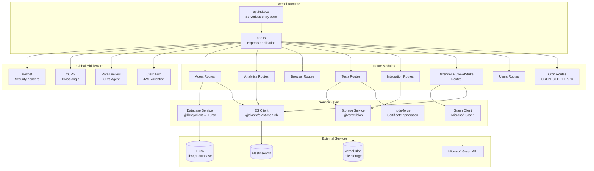

# Backend Serverless

## Overview

`backend-serverless/` is a separate codebase (not a build target of `backend/`) adapted for Vercel's serverless runtime.

## Key Differences

| Component | `backend/` | `backend-serverless/` |
|-----------|-----------|----------------------|
| Database | better-sqlite3 (sync) | @libsql/client (async, Turso) |
| DB helper | `getDatabase()` → sync `Database` | `getDb()` → async `DbHelper` |
| Storage | `fs` (filesystem) | `@vercel/blob` |
| Signing | Filesystem keypair | `SIGNING_PRIVATE_KEY_B64` env vars |
| Entry point | `server.ts` (Express listen) | `app.ts` (export) + `api/index.ts` |
| Scheduling | `setInterval` | Vercel Crons → `cron.routes.ts` |
| Test library | Runtime git sync | Build-time clone |
| Build system | Go cross-compilation | Stubbed (returns 503) |
| Cert generation | OpenSSL CLI | `node-forge` (pure JS) |

:::warning[Independent Codebases]
Changes to `backend/` do **not** propagate to `backend-serverless/`. If modifying shared logic (types, API contracts, ES mappings), update both codebases.
:::

## Features Not Available on Vercel

The serverless backend is a subset of `backend/`. New features are often built for `backend/` only. `GET /api/capabilities` tells the frontend what the running backend supports, and the frontend hides the matching navigation entries, tabs and settings cards.

| Capability flag | `backend/` | `backend-serverless/` | What is missing on Vercel |
|-----------------|-----------|----------------------|---------------------------|
| `build`, `agentBuild` | `true` | `false` | Go builds of tests and of the agent (upload a binary instead) |
| `gitSync` | `true` | `false` | Runtime sync of the test library (updated at deploy time) |
| `campaigns` | `true` | `false` | Saved campaigns and the evidence matrix |
| `preExecutionNotices` | `true` | `false` | Pre-execution notices and the advance digest (no email stack) |
| `alerting` | `true` | `false` | Threshold alerts by Slack and email |
| `consoleIdentity` | `true` | `false` | Console identity (Settings → General) |
| `sentinelone`, `sophos` | `true` | `false` | SentinelOne and Sophos integrations |
| `outcomeBreakdown`, `stageCoverage` | `true` | `false` | Outcome breakdown and Stage coverage cards |
| `coverageMatrix` | `true` | `false` | Coverage matrix endpoint (latest result per test and host) |
| `scoreMovement` | `true` | `false` | What moved the score card on the Dashboard |
| `randomizedOnce`, `testFleet`, `testRunRecency` | `true` | not reported | Randomized Once schedules, per-test fleet results, last-run recency |
| `buildUpload`, `certGenerate`, `certUpload` | `true` | `true` | |

Also not on Vercel, with no flag: API keys, CLI sign-in (`/api/cli/auth/*`), the EDR-killed-agent and EDR launch-block passes, and task archiving (`deleted_tasks`). Microsoft Defender and CrowdStrike are implemented in both backends.

When you add a backend-only feature, add a capability flag to both `/api/capabilities` handlers (`backend/src/server.ts`, `backend-serverless/src/app.ts`) and gate the UI on it through `useCapabilities`.

## Architecture

The serverless backend is a layered Express.js application exported as a Vercel serverless function. Unlike the standard backend which calls `app.listen()`, the serverless variant exports the Express app and lets Vercel handle HTTP serving.



## Core Component Differences

### Database (`@libsql/client`)

The standard backend uses `better-sqlite3` with synchronous calls. The serverless backend uses `@libsql/client` which is fully async and connects to Turso's hosted libSQL service.

```typescript
// Standard backend (sync)
const db = getDatabase();
const row = db.prepare('SELECT * FROM agents WHERE id = ?').get(id);

// Serverless backend (async)
const db = getDb();
const row = await db.get('SELECT * FROM agents WHERE id = ?', [id]);
```

The `DbHelper` wrapper normalizes the libSQL client's API to match common patterns, but every database call requires `await`.

### Storage (`@vercel/blob`)

All file operations (certificates, settings, binaries) use Vercel Blob instead of the local filesystem:

| Operation | Standard Backend | Serverless Backend |
|-----------|-----------------|-------------------|
| Read file | `fs.readFileSync(path)` | `await blobRead(key)` / `blobReadText(key)` |
| Write file | `fs.writeFileSync(path, data)` | `await blobWrite(key, data)` |
| Delete file | `fs.unlinkSync(path)` | `await blobDelete(key)` |
| List files | `fs.readdirSync(dir)` | `await blobList(prefix)` |

The helpers live in `src/services/storage.ts` and wrap `@vercel/blob` (`put`, `del`, `list`, `head`).

### Certificate Generation (`node-forge`)

The standard backend shells out to OpenSSL for certificate operations. The serverless backend uses `node-forge` (pure JavaScript) since native binaries are unavailable:

:::warning[Performance Note]
RSA-4096 key generation in pure JS takes 2-8 seconds. This is fine for Vercel Pro (60s timeout) but tight for Vercel Hobby (10s timeout). Certificate generation is a rare operation so this is acceptable in practice.
:::

### Scheduling (Vercel Cron)

Background tasks that run via `setInterval` in the standard backend are replaced with Vercel Cron routes:

| Task | Standard Backend | Serverless Backend |
|------|-----------------|-------------------|
| Schedule processing | `setInterval` | `GET /api/cron/schedules` (every minute) |
| Key rotation | `setInterval` | `GET /api/cron/auto-rotation` (every minute) |
| Retry of failed Elasticsearch ingestion | Ingestion worker | `GET /api/cron/retry-ingestion` (every 5 minutes) |
| CrowdStrike sync | `setInterval` (5 min) | `GET /api/cron/crowdstrike-sync` (every 5 minutes) |
| Defender sync | `setInterval` (5 min / 6 h) | `GET /api/cron/defender-sync` |

The schedules are in `backend-serverless/vercel.json`. Cron routes check `Authorization: Bearer <CRON_SECRET>`, which Vercel sends when the `CRON_SECRET` environment variable is set.

:::warning[Defender sync is not scheduled in vercel.json]
The `/api/cron/defender-sync` route exists, but `vercel.json` has no cron entry for it. Add one to your deployment's `vercel.json`, or call the route from an external scheduler, if you use Microsoft Defender on Vercel.
:::

### Test Library (Build-time Clone)

The standard backend syncs the test library from Git at runtime. The serverless backend clones it once during the Vercel build step (`vercel-build` script) and bundles it into the deployment:

```json
{
  "scripts": {
    "vercel-build": "rm -rf data/f0_library && git clone --depth 1 <repo> data/f0_library && npm run build"
  }
}
```

The repository comes from `TESTS_REPO_URL`; `GITHUB_TOKEN` is used for a private repository. The `includeFiles` setting in `vercel.json` ensures the cloned data directory is included in the deployment bundle.

### Stubbed Features

Features that require native toolchains or long-running processes return HTTP 503:

| Feature | Reason | Response |
|---------|--------|----------|
| Go cross-compilation of tests | No Go toolchain in serverless | `503 "Go compilation not available on serverless — use Upload Binary instead"` |
| Agent build from source | No Go toolchain in serverless | `503` |
| Git sync (runtime) | No persistent filesystem | `503 "Git sync not available on serverless. Redeploy to update test library."` |

## Security Model

The serverless backend has four kinds of endpoint:

1. **Public endpoints** — Agent downloads, enrollment (rate-limited)
2. **Agent device endpoints** — `Authorization: Bearer ak_…` + `X-Agent-ID` authentication
3. **Admin endpoints** — Clerk JWT with permission checks
4. **Cron endpoints** — `Authorization: Bearer <CRON_SECRET>` validation

It has no API-key and no CLI-token authentication.

### Environment Variables

Required environment variables for the serverless deployment:

| Variable | Purpose |
|----------|---------|
| `CLERK_SECRET_KEY` | Clerk JWT validation |
| `CLERK_PUBLISHABLE_KEY` | Clerk frontend key |
| `TURSO_DATABASE_URL` | Turso connection string |
| `TURSO_AUTH_TOKEN` | Turso authentication |
| `BLOB_READ_WRITE_TOKEN` | Vercel Blob access |
| `ENCRYPTION_SECRET` | AES-256-GCM key for settings |
| `CRON_SECRET` | Protects the cron routes |
| `SIGNING_PRIVATE_KEY_B64` | Ed25519 private key (base64) |
| `SIGNING_PUBLIC_KEY_B64` | Ed25519 public key (base64) |

## Serverless Optimizations

### Cold Start Mitigation
- Lazy initialization of Elasticsearch client and test indexer
- Minimal top-level imports
- Service singletons created on first use, not at module load

### Stateless Design
- No in-memory caching across requests (each invocation is independent)
- Database connections created per request via Turso's HTTP protocol
- File operations go through Vercel Blob (no local state)

### Resource Constraints
- Request body size limits appropriate for serverless functions
- Timeout-aware operations (long-running tasks chunked or deferred to cron)
- Memory-efficient file processing (streaming where possible)

## Testing

```bash
cd backend-serverless && npm test
```

Tests use the same patterns as the standard backend but mock `@libsql/client` instead of `better-sqlite3` and `@vercel/blob` instead of `fs`.
