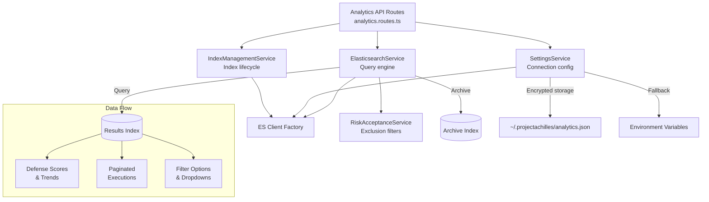
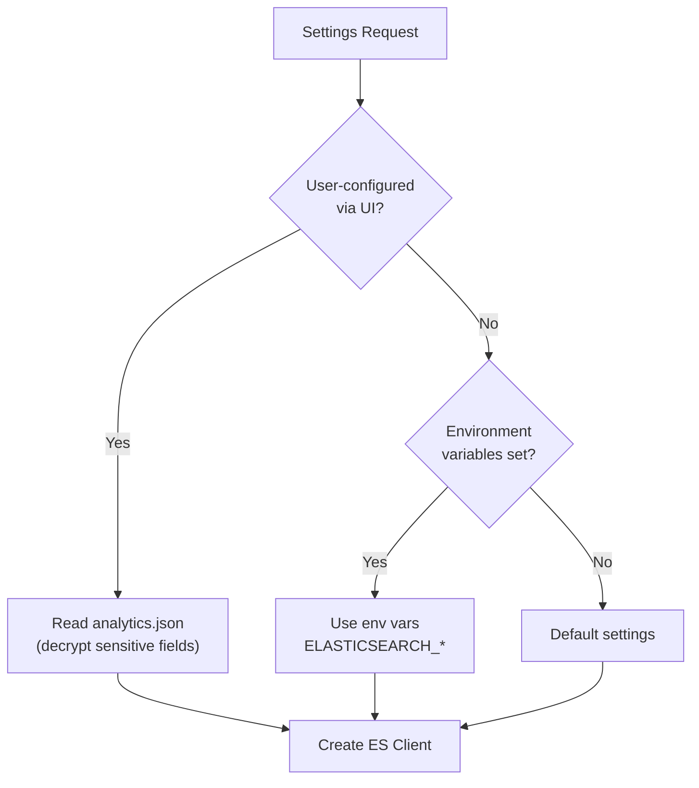
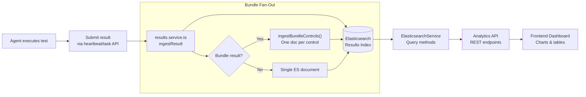

# Analytics Service

The Analytics module provides Elasticsearch-based analytics for security test execution data. It calculates defense scores, tracks trends over time, manages data lifecycle, and supports comprehensive filtering across all test dimensions.

**Key source files:** `backend/src/services/analytics/`

## Architecture

## Core Services

### ElasticsearchService

The primary analytics engine. All query methods accept a common filter set and return structured results for the frontend dashboard.

#### Defense Score Analytics

The defense score measures how effectively endpoint defenses detect and block security tests. The `basis` query parameter (`executions` by default, or `latest`) selects one of two calculations:

- **`executions`**: `(protected_or_detected_executions / conclusive_executions) * 100` over the window. This is the API default, and the basis used by the PDF execution report. The Defense Score alert uses the latest basis (`getLatestScoreSummary()`: any-stage, fixed last 30 days), the same number the dashboard shows.
- **`latest`**: the share of test × endpoint pairs whose most recent conclusive result in the window was blocked or detected. The Dashboard and Analytics UI always request this.
  - **Pair key:** `org | test_uuid | hostname`. In `any-stage` mode a non-cyber-hygiene bundle on a host is one pair, protected if any stage of its latest run was.
  - **Window:** the range is the freshness window, capped at 365 days. Trend points are the same calculation as of each UTC day end (weekly beyond 90 days), and the last point is the tile.

| Method | Purpose |
|--------|---------|
| `getDefenseScore()` | Overall protection effectiveness for a time range (executions basis) |
| `getDefenseScoreTrend()` / `getDefenseScoreTrendRolling()` | Executions-basis trend. Histograms extend to `to ?? now`, and empty windows return `score: null`. |
| `getDefenseScoreLatest()` / `getDefenseScoreTrendLatest()` | Latest-basis tile and trend. Both read one cached series snapshot, so the tile always equals the trend's last point. |
| `getLatestPairs()` | Latest-basis pair set with metadata. It feeds the four `*Latest` breakdowns: category/subcategory, hostname, technique distribution and test coverage. |
| `getLatestScoreSummary()` | Latest-basis score for the Defense Score alert |
| `getOutcomeBreakdown()` | Protected / Prevented / Detected / Silent split of the latest pairs (attack tests only) |
| `getTechniqueOutcomes()` | Per-technique outcomes, latest basis, per stage |
| `getChainDepth()` | How far each attack chain got on its latest run per host |
| `getStageCoverage()` | Stage coverage card: stages blocked, detected and through per chain's latest run |
| `getDefenseScoreByTest()` | Breakdown by individual test |
| `getDefenseScoreByTechnique()` | Breakdown by MITRE ATT&CK technique |
| `getDefenseScoreByOrg()` | Breakdown by organization |
| `getDefenseScoreBySeverity()` | Breakdown by test severity level |
| `getDefenseScoreByCategory()` | Breakdown by test category |
| `getDefenseScoreByHostname()` | Breakdown by endpoint hostname |

#### Test Execution Analysis

| Method | Purpose |
|--------|---------|
| `getPaginatedExecutions()` | Paginated test results with full filter support |
| `getGroupedPaginatedExecutions()` | Groups by bundle or standalone test for the Executions table |
| `getRecentExecutions()` | Latest test activity for the dashboard overview |
| `getTestResults()` | Per-test results across the fleet, for the Tests list and test pages |
| `getExecutionActivity()` | Execution counts over time |

#### Error Rate and Coverage

| Method | Purpose |
|--------|---------|
| `getErrorRate()` | Proportion of inconclusive test outcomes |
| `getErrorRateTrendRolling()` | Error rate trends over time |
| `getTestCoverage()` | Protected vs unprotected counts per test |
| `getThreatActorCoverage()` | Coverage analysis by threat actor |
| `getCanonicalTestCount()` | Stable test count for coverage percentage calculations |

#### Data Management

| Method | Purpose |
|--------|---------|
| `archiveByGroupKeys()` | Archive specific test executions by composite key |
| `archiveByDateRange()` | Archive all executions before a given date |

### Key Features

**Latest-result posture (`basis=latest`):** the rules live in a pure module, `services/analytics/posture.ts`: pair selection, freshness window, series, grouping and outcome filters. It has no imports and is kept **byte-identical** in `backend/` and `backend-serverless/`.
- **Fetching:** `ElasticsearchService` fetches pair runs with paginated composite aggregations, converting each page as it arrives.
- **Caching:** `services/analytics/postureCache.ts`, also byte-identical in both forks, keeps per-instance snapshots for 30 s with in-flight de-duplication. There are two snapshot shapes: the series (tile + trend) and the metadata (breakdowns). A dashboard load therefore issues ~2 pair fetches, not one per card.
- **Cache key:** index pattern, raw `from`/`to`, scoring mode, org, the filter-bar clauses and the risk-acceptance exclusion JSON.
- **Outcome filters:** `result`, `errorCodes` and `errorNames` are applied after the cache, to each pair's latest result. `result` follows the pair's protected verdict.
- **Validation:** an invalid `basis`, an unparseable date range or a reversed date range returns 400.

**Risk acceptance integration:** Defense scores automatically exclude risk-accepted findings via the `RiskAcceptanceService`. The service supports dual-query mode to return both:
- **Adjusted score** -- with risk-accepted tests excluded (shown by default)
- **Real score** -- without exclusions (available on hover/toggle)

**Flexible filtering:** All query methods accept a common filter interface supporting:
- Tests, techniques, hostnames, categories, severities
- Threat actors, tags, error codes, result types
- OR logic for multiple values within a filter (e.g., `severities=critical,high`)

**Bundle vs standalone grouping:** The Executions table groups related results using Painless scripts in Elasticsearch:
- Bundle controls: `bundle::<bundle_id>::<hostname>`
- Standalone tests: `standalone::<test_uuid>::<hostname>`

**Rolling window analysis:** Time-series endpoints support configurable rolling windows for smoothed trend visualization, reducing noise from day-to-day variance.

### SettingsService

Manages Elasticsearch connection configuration with AES-256-GCM encryption for sensitive fields.

#### Configuration Priority

**Encrypted fields:** `cloudId`, `apiKey`, and `password` are encrypted using AES-256-GCM before writing to `analytics.json`. Encrypted values use the `enc:` prefix for detection on read.

#### Environment Variable Reference

| Variable | Purpose |
|----------|---------|
| `ELASTICSEARCH_CLOUD_ID` | Elastic Cloud deployment ID |
| `ELASTICSEARCH_NODE` | Self-hosted ES node URL |
| `ELASTICSEARCH_API_KEY` | API key authentication |
| `ELASTICSEARCH_USERNAME` | Basic auth username |
| `ELASTICSEARCH_PASSWORD` | Basic auth password |
| `ELASTICSEARCH_INDEX_PATTERN` | Index pattern for queries (e.g., `achilles-results-*`) |
| `ENCRYPTION_SECRET` | Key for AES-256-GCM field encryption |

:::tip[Cloud vs self-hosted]
The settings service supports both Elastic Cloud (via `cloudId` + `apiKey`) and self-hosted deployments (via `node` + username/password). The client factory automatically selects the correct connection method based on which fields are populated.
:::

### IndexManagementService

Handles Elasticsearch index creation, listing, and mapping management.

| Method | Purpose |
|--------|---------|
| `createResultsIndex()` | Create a new index with the canonical field mapping |
| `listResultsIndices()` | List existing indices with document counts and sizes |
| `missingMappingProperties()` | Compare an existing index's mapping with the canonical one |

The **canonical mapping** (`RESULTS_INDEX_MAPPING`) defines the standard field structure for test execution documents. Key field groups include:

| Field Group | Example Fields | Purpose |
|-------------|---------------|---------|
| `routing.*` | `event_time`, `oid`, `hostname` | When, which organization, which endpoint |
| `event.*` | `ERROR` (exit code, `long`), `ERROR_raw` | Test outcome |
| `f0rtika.*` | `test_uuid`, `test_name`, `category`, `techniques`, `tactics`, `threat_actor`, `tags` | Test identification and metadata |
| `f0rtika.*` (bundles) | `bundle_id`, `bundle_name`, `control_id`, `control_validator`, `is_bundle_control`, `skipped` | Per-control and per-stage documents |
| `f0rtika.<vendor>_*` | `<vendor>_detected`, `<vendor>_stage_detected`, `<vendor>_stage_prevented` | EDR correlation flags, added to result documents by the EDR enrichment passes |
| `f0rtika.launch_block.*`, `f0rtika.edr_terminated` | `original_exit_code`, `vendors` | EDR launch blocks and EDR-killed agent runs |

## Error Code Classification

The analytics service uses a canonical error code system to classify test outcomes. These codes are used for defense score calculations, filtering, and trend analysis.

| Exit Code | Name | Category | Counts Toward Score? |
|-----------|------|----------|---------------------|
| 0 | `NormalExit` | inconclusive | No |
| 1 | `BinaryNotRecognized` | contextual | No |
| 101 | `Unprotected` | failed | Yes (unprotected) |
| 105 | `FileQuarantinedOnExtraction` | protected | Yes (protected) |
| 126 | `ExecutionPrevented` | protected | Yes (protected) |
| 127 | `QuarantinedOnExecution` | protected | Yes (protected) |
| 200 | `NoOutput` | inconclusive | No |
| 259 | `StillActive` | inconclusive | No |
| 260 | `BlockedPreExecution` | inconclusive | No, until an EDR alert proves the block. The launch-block pass then rewrites the document to 126 |
| 999 | `UnexpectedTestError` | error | No |

**Key metrics derived from these codes:**

- **Defense Score:** `(protected / conclusive) * 100` where conclusive = codes `[101, 105, 126, 127]`, plus an error-coded stage whose own EDR alert carried a confirmed action (`EDR_PREVENTED_ERROR_STAGE`). `buildConclusiveResultsFilter` applies this everywhere in `backend/`; `backend-serverless/` uses the exit codes only
- **Error Rate:** `(error_count / total_activity) * 100` where error = codes `[0, 1, 259, 999]`, except a skipped stage (exit 0 on an attack bundle stage, after the chain was stopped) and an error stage the EDR prevented

:::warning[Conclusive vs inconclusive]
Only conclusive exit codes (101, 105, 126, 127) contribute to the defense score. Inconclusive codes (0, 200, 259) and errors (999) are tracked separately via the error rate metric. This prevents test infrastructure issues from artificially deflating the defense score.
:::

## Data Flow: Ingestion to Dashboard

The complete data flow from test execution to dashboard visualization:

## API Routes

The analytics services are exposed through `analytics.routes.ts`:

| Endpoint | Method | Purpose |
|----------|--------|---------|
| `/api/analytics/defense-score` | GET | Current defense score |
| `/api/analytics/defense-score/trend` | GET | Defense score time series |
| `/api/analytics/defense-score/by-test` | GET | Per-test breakdown |
| `/api/analytics/defense-score/by-technique` | GET | Per-technique breakdown |
| `/api/analytics/defense-score/by-hostname` | GET | Per-endpoint breakdown |
| `/api/analytics/defense-score/by-severity` | GET | Per-severity breakdown |
| `/api/analytics/defense-score/by-category` | GET | Per-category breakdown |
| `/api/analytics/defense-score/by-category-subcategory` | GET | Category and subcategory breakdown |
| `/api/analytics/defense-score/by-org` | GET | Per-organization breakdown |
| `/api/analytics/outcome-breakdown` | GET | Protected / Prevented / Detected / Silent split (backend only) |
| `/api/analytics/chain-depth` | GET | Attack chain depth |
| `/api/analytics/stage-coverage` | GET | Stage coverage (backend only) |
| `/api/analytics/technique-distribution`, `/technique-outcomes` | GET | Technique views |
| `/api/analytics/threat-actor-coverage` | GET | Threat actor coverage |
| `/api/analytics/test-coverage` | GET | Protected vs unprotected counts per test |
| `/api/analytics/host-test-matrix` | GET | Host by test matrix |
| `/api/analytics/test-results`, `/test-results/:uuid/stages` | GET | Per-test fleet results and per-stage results |
| `/api/analytics/executions` | GET | Recent test activity |
| `/api/analytics/executions/paginated` | GET | Paginated executions (bundle-aware grouping) |
| `/api/analytics/execution-activity` | GET | Execution counts over time |
| `/api/analytics/error-rate` | GET | Current error rate |
| `/api/analytics/error-rate/trend` | GET | Error rate time series |
| `/api/analytics/results-by-error-type` | GET | Results by exit code |
| `/api/analytics/canonical-test-count` | GET | Canonical test count |
| `/api/analytics/filter-options`, `/available-*`, `/unique-*`, `/organizations` | GET | Values for the filter bar |
| `/api/analytics/settings` | GET/POST | Connection settings (encrypted) |
| `/api/analytics/settings/test` | POST | Test a connection |
| `/api/analytics/indices` | GET | List result indices |
| `/api/analytics/index/create` | POST | Create new result index |
| `/api/analytics/executions/archive` | POST | Archive selected executions |
| `/api/analytics/executions/archive-by-date` | POST | Archive executions before a date |

The full request and response reference is in the [Analytics API reference](../../api-reference/analytics).

## Integration Points

### Results Ingestion Pipeline

The `results.service.ts` (in the agent services module) writes test results into Elasticsearch. It maintains schema compatibility with the canonical mapping defined by `IndexManagementService`. Bundle results are fanned out into individual documents -- one per control -- for granular analytics.

### Risk Acceptance Service

The `RiskAcceptanceService` provides a list of risk-accepted test UUIDs. The `ElasticsearchService` uses these to build exclusion filters for defense score queries, ensuring accepted risks do not penalize the score.

### Client Factory

A shared function creates Elasticsearch clients from `AnalyticsSettings` objects. It supports:
- **Elastic Cloud** connections (via `cloudId` + `apiKey`)
- **Direct** connections (via `node` URL + username/password or API key)
- Automatic authentication method selection

:::info[Elasticsearch version compatibility]
The backend uses `@elastic/elasticsearch` client v8.x, which must match the Elasticsearch server v8.x. The v9 client sends `compatible-with=9` headers that ES 8.x rejects with HTTP 400. Watch for npm/Dependabot updates bumping the client to v9.
:::

## Performance Considerations

- **Index patterns** -- use specific patterns (e.g., `achilles-results-2026.*`) to limit query scope when data volume is high
- **Rolling windows** -- configure window sizes based on data volume; larger windows smooth trends but increase query cost
- **Query timing** -- every `/api` response carries a `Server-Timing` header with the time spent in Elasticsearch; slow queries are also logged unless `ES_TIMING_LOG=off`
- **Aggregation limits** -- terms aggregations have a fixed `size`; check it if the cardinality of a dimension grows very large
- **Archive strategy** -- use `archiveByDateRange()` to move old data to a separate archive index, keeping the active index fast
