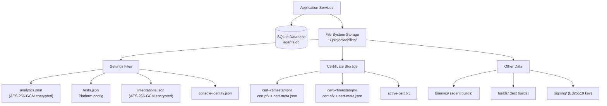

# Database & Migrations

## Database Location

- **Docker/PaaS**: `~/.projectachilles/agents.db` (better-sqlite3, WAL mode)
- **Vercel**: Turso (`@libsql/client`, async)

## Schema

Tables are created via `CREATE TABLE IF NOT EXISTS` in `database.ts` with incremental migrations.

### Tables

| Table | Purpose |
|-------|---------|
| `agents` | Enrolled agents with status, OS, tags |
| `enrollment_tokens` | Registration tokens with TTL and max uses |
| `tasks` | Task queue with status lifecycle |
| `deleted_tasks` | Archive of deleted tasks: the full row as JSON with `deleted_at` / `deleted_by`. Task lists never read it |
| `agent_versions` | Registered agent binary versions per platform |
| `schedules` | Recurring execution schedules |
| `heartbeat_history` | Heartbeat samples per agent |
| `agent_events` | Agent lifecycle events (went offline, key rotation, and so on) |
| `agent_key_digests` | HMAC-SHA256 digest of an agent key that already passed bcrypt, so later requests skip bcrypt |
| `run_notices` | Pre-execution notices (`tasks.notice_id` points here) |
| `notice_digests` | Advance (day-before) notice digests |
| `campaigns` | Saved test campaigns |
| `campaign_runs` | Campaign runs with a JSON snapshot of the campaign (`tasks.campaign_run_id` points here; no foreign key to `campaigns`) |
| `api_keys` | API keys (hashed) with their scope |
| `cli_auth_codes` | CLI device authorization codes with short TTL |
| `cli_refresh_tokens` | CLI refresh tokens |
| `cli_session_revocations` | Revoked CLI sessions |

The serverless backend has its own schema and does not have the campaign, notice, API key or archive tables.

## Table Recreation Migrations

SQLite has no `ALTER COLUMN`, so changing a CHECK constraint means recreating the table: create `<table>_new` with the new definition, copy every row, drop the old table, rename. Five tables have such a migration: `agents`, `agent_versions`, `tasks`, `agent_events` and `api_keys`.

All of them go through one function in `database.ts`, and a new one must too:

```typescript
function migrateAgentVersionsOs(database: Database.Database): void {
  recreateIfOutdated(database, 'agent_versions', ["'darwin'"], () => recreateAgentVersionsTable(database));
}
```

`recreateIfOutdated(database, table, values, recreate)` does four things:

1. **It decides from the table's definition.** It reads the `CREATE TABLE` text from `sqlite_master` and looks for the values today's CHECK names. It never tries a test row.
2. **It turns foreign-key checks off** with `database.pragma('foreign_keys = OFF')`, and back on in a `finally`.
3. **It runs `recreate` in one `BEGIN IMMEDIATE` transaction**, and decides again once it holds the write lock.
4. **On an up-to-date table it warns about a leftover `<table>_new`** and does not delete it.

The `recreate` function holds only the statements: `DROP TABLE IF EXISTS <table>_new`, `CREATE TABLE <table>_new (...)`, `INSERT INTO <table>_new (<cols>) SELECT <cols> FROM <table>`, `DROP TABLE <table>`, `ALTER TABLE <table>_new RENAME TO <table>`, then the table's indexes.

:::danger[Do not write a recreation as separate statements]
Earlier releases did, and decided with a test insert. Each rule above exists because of a failure:

- **A test insert fails for reasons that have nothing to do with the CHECK.** The `tasks` probe pointed at an agent that does not exist, so the table was recreated on every start of every install. Any insert fails with `SQLITE_BUSY` while another process holds the write lock, which started a recreation of a table that was up to date.
- **Separate statements interleave.** Two processes starting within a fraction of a second of each other lost the `tasks` table (one dropped the table the other had just renamed into place), and a failure after the `DROP` lost every row.
- **Without the second look**, a process that decided before another one finished recreates the table again.
- **Without the lock taken first**, another process's write between the decision and the first statement ends the recreation with `SQLITE_BUSY_SNAPSHOT`.
:::

### Key Gotchas

1. **A recreation keeps only the columns it lists.** A column added later by `ALTER TABLE` must be added to the recreate function too: to its `optionalCols` (`recreateAgentsTable`, `recreateAgentVersionsTable`, `recreateTasksTable`) or to its `CREATE TABLE` (`recreateAgentEventsTable`, `recreateApiKeysTable`), and its index to the index statements. Otherwise the recreation fails on a database that has the column (`table tasks_new has no column named ...`). `checkRecreations.test.ts` and `tasksRecreation.test.ts` rebuild each table with today's columns and an old CHECK, and fail when a column is missing.
2. **Use `database.pragma()`**, not `database.exec('PRAGMA ...')`, and only outside a transaction: SQLite ignores `PRAGMA foreign_keys` inside one. With the checks on, SQLite refuses to drop a table other tables reference.
3. **Never drop a `<table>_new` you did not just create.** Beside an up-to-date table it can be the only copy of the rows after an interrupted upgrade of an earlier release.
4. **`agents` is backed up first**, to `agents.db.bak` beside the database (`VACUUM INTO`, a consistent copy). Pass `{ backUpFirst: true }` for a table whose loss would cut off the fleet.

### Adding a Column

Check `PRAGMA table_info(<table>)` and add the column with `addColumn(database, 'ALTER TABLE ... ADD COLUMN ...')`. `addColumn` accepts `duplicate column name`: when two processes start together on a database that lacks the column, both find it missing and the slower one's `ALTER` fails with that error.

### A Failed Start-Up

`getDatabase()` keeps its connection only after `initializeTables()` has returned. If a migration throws, the connection is closed and the next call opens the database and runs the set-up again. A process never serves requests on a database whose migrations stopped part-way.

## Storage Architecture

Beyond the SQLite database, the backend persists configuration, certificates, and binary artifacts to a file-system-based storage layer. On serverless (Vercel), an equivalent Blob storage layer is used instead.



### File System Layout (Docker/PaaS)

```
~/.projectachilles/
├── agents.db                    # SQLite database (WAL mode)
├── agents.db.bak                # Copy made before the agents table is recreated (old installs only)
├── analytics.json               # ES connection config (encrypted fields)
├── tests.json                   # Platform/arch build settings
├── integrations.json            # EDR integrations, alerting, pre-execution notices (encrypted fields)
├── console-identity.json        # Console identity (code, name, colour)
├── certs/
│   ├── active-cert.txt          # ID of active signing certificate
│   ├── cert-1709234567/
│   │   ├── cert.pfx             # PKCS#12 certificate bundle
│   │   └── cert-meta.json       # Label, subject, expiry, source, encrypted password
│   └── cert-1709345678/
│       ├── cert.pfx
│       └── cert-meta.json
├── binaries/<os>-<arch>/        # Registered agent binaries
├── builds/<test-uuid>/          # Test build output + build-meta.json
└── signing/                     # Ed25519 key that signs agent update binaries
```

### Vercel Blob Layout (Serverless)

On the serverless backend, the same logical structure is mirrored in Vercel Blob with hierarchical key prefixes:

```
settings/analytics.json
settings/tests.json
settings/agent-settings.json
certs/cert-<timestamp>/cert.pfx
certs/cert-<timestamp>/cert-meta.json
certs/active-cert.txt
binaries/<os>-<arch>/<filename>
builds/<uuid>/build-meta.json
```

## Encrypted Settings Management

Sensitive configuration fields are encrypted at rest using **AES-256-GCM**. This applies to both the Docker backend (file system) and the serverless backend (Vercel Blob).

### How It Works

1. The `ENCRYPTION_SECRET` environment variable provides the secret the key is derived from (HKDF-SHA256). It is required and must be at least 32 characters; encryption throws without it.
2. Sensitive fields (Elasticsearch `cloudId`, `apiKey`, `password`; EDR client secrets and API tokens; alerting webhook URLs and SMTP password; certificate passwords) are encrypted before being written to JSON files.
3. Encrypted values are stored with an `enc:` prefix so the settings service can distinguish encrypted from plaintext values.
4. On read, the service detects the `enc:` prefix and decrypts transparently.

### Configuration Priority (Analytics Settings)

The `SettingsService` resolves Elasticsearch connection config in this order:

1. **User-configured settings** (via UI) -- stored in `analytics.json` with encrypted fields
2. **Environment variables** -- `ELASTICSEARCH_CLOUD_ID`, `ELASTICSEARCH_NODE`, `ELASTICSEARCH_API_KEY`, etc.
3. **Default settings** -- last resort

:::warning[Keep ENCRYPTION_SECRET stable]
Settings encrypted with one `ENCRYPTION_SECRET` cannot be read with another. Generate it once (`openssl rand -base64 32`), keep it in your secret store and reuse it when the application moves to a different machine or container. Values written by old versions (keyed by a plain hash of the secret, or by a machine-derived key) are still decrypted for backward compatibility, but nothing is written with those keys any more.
:::

### Settings Files Reference

| File | Encrypted Fields | Purpose |
|------|-----------------|---------|
| `analytics.json` | `cloudId`, `apiKey`, `password` | Elasticsearch connection |
| `integrations.json` | Client secrets, API tokens, webhook URLs, SMTP password | EDR integration and alerting credentials, pre-execution notice settings |
| `tests.json` | None | Build platform config |
| `certs/<id>/cert-meta.json` | `password` | Signing certificate metadata |
| `console-identity.json` | None | Console identity |

### Serverless Storage Differences

| Aspect | Docker/PaaS (`backend/`) | Serverless (`backend-serverless/`) |
|--------|--------------------------|--------------------------------------|
| Storage layer | `fs` (file system) | `@vercel/blob` (Vercel Blob API) |
| Read operation | `fs.readFileSync()` | `blobReadText(key)` -- returns `null` on error |
| Write operation | `fs.writeFileSync()` | `blobWrite(key, data)` -- returns public URL |
| Existence check | `fs.existsSync()` | `blobExists(key)` -- HEAD request |
| List operation | `fs.readdirSync()` | `blobList(prefix)` -- key/URL/size array |
| Delete operation | `fs.unlinkSync()` | `blobDelete(key)` -- silently ignores missing keys |
| Caching | None (reads from disk) | None (reads from Blob API) |
| Access model | Process-local file access | Public URLs with `BLOB_READ_WRITE_TOKEN` |

:::info[Blob storage error handling]
The serverless storage module follows a "fail-safe" philosophy: read operations return `null` on any error (network, missing file, permission), and delete operations silently succeed even for non-existent keys. This prevents cascading failures in calling services.
:::
