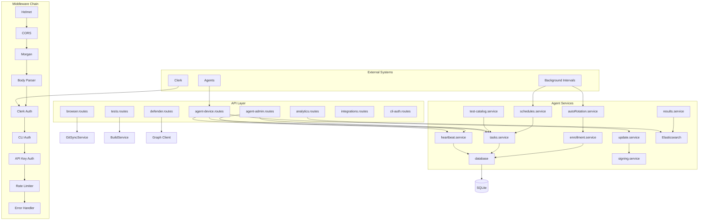
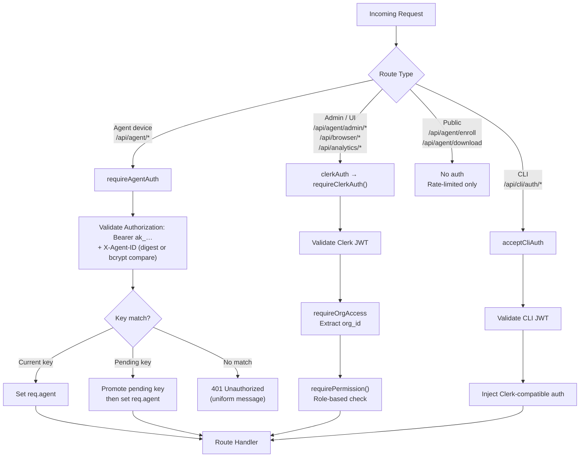

# Routes & Middleware

## Service Architecture

The backend is organized around several service domains that coordinate through a shared database layer. The diagram below shows how the major components connect:

## Route Organization

Routes are organized by module in `backend/src/api/`:

| File | Auth | Purpose |
|------|------|---------|
| `browser.routes.ts` | Clerk | Security test browser |
| `analytics.routes.ts` | Clerk | Elasticsearch analytics |
| `agent/enrollment.routes.ts` | None (public) | Agent enrollment, binary download |
| `agent/heartbeat.routes.ts` | Agent key / Clerk | Heartbeat + admin agent management |
| `agent/tasks.routes.ts` | Agent key / Clerk | Task distribution + admin task CRUD |
| `agent/update.routes.ts` | Agent key / Clerk | Agent updates + admin version management |
| `agent/schedules.routes.ts` | Clerk | Schedule management |
| `agent/catalog.routes.ts` | Clerk | Test catalog administration |
| `agent/binary.routes.ts` | Agent key | Binary download for test execution |
| `tests.routes.ts` | Clerk | Build system, certificates |
| `defender.routes.ts`, `crowdstrike.routes.ts` | Clerk | Defender and CrowdStrike analytics (`/api/analytics/defender`, `/api/analytics/crowdstrike`) |
| `sentinelone-analytics.routes.ts`, `sophos-analytics.routes.ts` | Clerk | SentinelOne and Sophos analytics (`/api/analytics/sentinelone`, `/api/analytics/sophos`) |
| `integrations.routes.ts` | Clerk | Defender and CrowdStrike credentials, alerting config, EDR Elasticsearch readiness |
| `sentinelone.routes.ts`, `sophos.routes.ts` | Clerk | SentinelOne and Sophos settings, sync, auto-resolve (`/api/integrations/sentinelone`, `/api/integrations/sophos`) |
| `campaigns.routes.ts` | Clerk | Saved test campaigns, runs, evidence matrix |
| `notices.routes.ts` | Clerk | Pre-execution notice settings, status, release |
| `reports.routes.ts` | Clerk | Report payloads (JSON export, execution report) |
| `risk-acceptance.routes.ts` | Clerk | Risk acceptance management |
| `consoleIdentity.routes.ts` | Clerk (writes: browser session only) | Console identity (`/api/settings/identity`) |
| `cli-auth.routes.ts` | Mixed | CLI device authorization flow |
| `api-keys.routes.ts` | Clerk browser session only | API key management |
| `users.routes.ts` | Clerk (writes: browser session only) | User management |

"Clerk" in this table means any principal the global chain turns into a Clerk-style `req.auth`: a browser session, a CLI token or an API key, each limited by its role or scope. `/api/health` and `/api/capabilities` are defined in `server.ts`.

:::info[Agent routes use a two-tier split]
Agent endpoints live under `/api/agent/`. Admin endpoints (Clerk-authenticated) are mounted at `/api/agent/admin/*`, while device endpoints (API-key-authenticated) are mounted directly at `/api/agent/*`. The parent router in `agent/index.ts` applies the correct auth middleware at mount time.
:::

## Middleware Chain

Every request passes through the middleware stack in the order shown below. The chain is configured in `server.ts`:

### 1. Helmet — Security Headers

Configures Content Security Policy with directives for Clerk SDK (`'unsafe-inline'` for scripts), Tailwind (`'unsafe-inline'` for styles), and Clerk domains for `connectSrc`. Cross-origin embedder policy is disabled.

### 2. CORS

Origin is set via `CORS_ORIGIN` env var (defaults to `http://localhost:5173`). Credentials are enabled. `Authorization` and `Content-Disposition` headers are exposed for Clerk auth flows and file downloads.

### 3. Morgan — Request Logging

Uses `dev` format for colorized, concise HTTP logs during development. Right after it, `esTimingMiddleware()` is mounted on `/api`; it reports the time a request spent in Elasticsearch in the `Server-Timing` response header.

### 4. Body Parser

`express.json()` with a 10 MB limit (required for binary uploads and large test payloads). URL-encoded parsing is enabled with `extended: true`.

### 5. Clerk Auth (global)

`clerkAuth` from `@clerk/express` runs on every request. It parses the JWT from the `Authorization` header and populates `req.auth` but does **not** reject unauthenticated requests. Route-level guards (`requireClerkAuth()`, `requireOrgAccess`, `requirePermission()`) enforce access on specific endpoints.

**Role lookup fallback.** `hydrateClaimsFromClerk()` (`middleware/clerkClaimsFallback.middleware.ts`, in both `backend/` and `backend-serverless/`) runs right after `clerkAuth`. Roles and `org_id` are read from `sessionClaims.metadata`, which a session token carries only when the Clerk instance's session token is customised with `{"metadata": "{{user.public_metadata}}"}`, and Clerk has no API to set that. When a Clerk **browser session** (`tokenType === 'session_token'`) has **no `metadata` claim at all**, the middleware loads the user's public metadata from Clerk (cached 60 s per user, one shared lookup for concurrent requests, 3 s timeout) and replaces `req.auth` with the same auth plus `sessionClaims.metadata`. A token that has the claim, even an empty one, is trusted as is. Machine tokens that `@clerk/express` also accepts (a user-owned Clerk API key, an OAuth access token) carry a `user_…` id too but never get the fallback: they stay roleless (read-only), so user and key management remain session-only. A failed lookup yields no role, and the middleware never rejects.

### 6. CLI Auth (global)

`acceptCliAuth()` checks for a CLI-issued JWT when Clerk has not already authenticated the request. If valid, it injects Clerk-compatible properties into `req.auth` so downstream `requireClerkAuth()` middleware works transparently. A limiter in front of it allows 60 unverified Bearer tokens per minute per IP.

### 7. API Key Auth (global)

`acceptApiKey()` accepts `Authorization: Bearer pa_…` and builds a `req.auth` whose permissions come from the key's scope (`permissionsForScope()` in `apiKeyAuth.middleware.ts`). It runs after Clerk and CLI auth, so those take precedence. A limiter in front of it allows 60 API key attempts per minute per IP. The serverless backend has no API keys.

### 8. Global API Rate Limiter

Applied to all `/api` routes except agent device endpoints (which have their own dedicated limiter). 1000 requests per 15-minute window, keyed by the authenticated Clerk user (falling back to IP for unauthenticated requests).

### 9. Error Handlers

`notFoundHandler` catches unmatched routes with a 404 response. `errorHandler` catches thrown `AppError` instances and unhandled errors, returning the standard `{ success: false, error: "message" }` format. Development mode includes stack traces.

### Route-Level Guards

These are applied per router or per route, after the global chain:

| Guard | File | What it does |
|-------|------|--------------|
| `requireClerkAuth()` | `clerk.middleware.ts` | Rejects requests with no authenticated principal |
| `requireOrgAccess` | `clerk.middleware.ts` | Refuses an `org_id` in the query or body that is not the caller's |
| `requirePermission(...)` | `clerk.middleware.ts` | Role or scope permission check |
| `requireUserSession()` | `userSession.middleware.ts` | Allows only a Clerk browser session. Refuses API keys and CLI tokens. Used on `/api/api-keys/*`, writes on `/api/users/*`, `POST /api/cli/auth/verify` and console identity writes |
| `callerOrg()`, `listOrgScope()`, `assertAgentsInOrg()`, `assertRowInOrg()` | `orgScope.ts` | Organization scoping of agent, task and schedule admin routes. A caller with no organization sees everything, unless `REQUIRE_ORG_ISOLATION=true` |
| `requireInstallOperator` | `installScope.ts` | Install-wide configuration (agent versions, the Elasticsearch connection, key auto-rotation) can only be changed by a caller without an organization |
| `requireDeploymentScopeForEdrWrite` | `edrScope.middleware.ts` | With `REQUIRE_ORG_ISOLATION=true`, EDR settings writes return 403; configure them with environment variables instead |
| `validate()`, `validateQuery()` | `validation.ts` | Zod validation of body and query (schemas in `src/schemas/`) |

## Authentication Flow

The backend supports four authentication methods depending on who is calling: an agent key, a Clerk session, a CLI token and an API key (`Bearer pa_…`, handled by `acceptApiKey()` as described above and then treated like a Clerk principal with the key's scope).

### Agent Authentication Details

The `requireAgentAuth` middleware (`agentAuth.middleware.ts`) implements:

- **In-memory cache** — Avoids repeated database lookups for frequently authenticating agents. Falls back to DB on cache miss.
- **Key digests** — After a key has passed `bcrypt.compare` once, an HMAC-SHA256 digest of it is stored in `agent_key_digests`, bound to the `api_key_hash` it was proven against. Later requests with the same key skip bcrypt, also after a restart. A digest is never trusted while a key rotation is pending.
- **Failed-auth guard** — `agentFailedAuthGuard` answers 429 once an IP has made 60 requests in a minute with unknown agent IDs, so random IDs cannot force unlimited bcrypt compares.
- **Timing-attack protection** — Always runs `bcrypt.compare` against a dummy hash when the agent is not found, preventing enumeration via response timing.
- **Key rotation support** — During rotation, agents may present either the current or pending key. If the pending key matches, it is promoted atomically to become the new current key.
- **Replay protection** — Validates the `X-Request-Timestamp` header with a 5-minute clock skew tolerance.
- **Uniform error responses** — All failure modes return an identical `401 Unauthorized` message to prevent information leakage.

### User Authentication Details

Clerk integration (`clerk.middleware.ts`) provides:

- **`requireClerkAuth()`** — Rejects requests without a valid Clerk session.
- **`requireOrgAccess`** — Extracts the organization ID from multiple JWT claim locations (`auth.orgId`, `sessionClaims.org_id`, `sessionClaims.metadata.org_id`) and validates access.
- **`requireAgentOrgAccess`** — Verifies the requesting user belongs to the same organization as the target agent.
- **`requirePermission(...permissions)`** — Middleware factory that checks role-based permissions. Supported roles: `admin`, `operator`, `analyst`, `explorer`.

### CLI Authentication Details

The CLI device flow (`cliAuth.middleware.ts`) uses JWT tokens with `type: 'cli'`, signed with `CLI_AUTH_SECRET`. This env var is mandatory — there is no fallback. A token's audience (`aud`) is the deployment's `AGENT_SERVER_URL`, set when signing and checked when verifying, so two deployments that share a secret do not accept each other's tokens. A CLI token cannot approve another device code: `POST /api/cli/auth/verify` requires a browser session. The `acceptCliAuth()` middleware only activates when Clerk has not already authenticated the request, ensuring zero interference with normal web auth.

## Rate Limiting Strategy

Rate limiting uses `express-rate-limit` with separate budgets for different endpoint types. Limiters are keyed by **principal** where one exists — the Clerk user for UI traffic, the composite `<ip>:<agent-id>` for agent device traffic — so tenants behind a shared NAT or proxy do not exhaust each other's budgets (see `middleware/rateLimitKeys.ts` and [docs/rate-limiting.md](https://github.com/projectachilles/ProjectAchilles/blob/main/docs/rate-limiting.md) for the full rationale).

| Endpoint Group | Limit | Window | Key | Rationale |
|---------------|-------|--------|-----|-----------|
| Global API | 1000 req | 15 min | Clerk user (IP fallback) | General UI/dashboard traffic, per analyst |
| Enrollment | 300 req | 15 min | IP | Sized for fleet rollouts behind one NAT |
| Binary download | 300 req | 15 min | IP | Sized for fleet rollouts behind one NAT |
| Agent device | 30 req | 1 min | `<ip>:<agent-id>` | Per-agent budget (heartbeat + polling) |
| Key rotation | 3 req | 15 min | IP | Expensive bcrypt operations |
| Agent failed auth | 60 req | 1 min | IP | Requests with unknown agent IDs only |
| CLI bearer / API key | 60 req | 1 min | IP | Programmatic access ceiling |
| CLI device code | 10 req | 15 min | IP | Device code generation |
| CLI polling | 60 req | 1 min | IP | Frequent polling during auth flow |
| CLI token refresh | 10 req | 15 min | IP | Refresh token exchange |

:::tip[Agent device rate limiting]
The agent device limiter keys on the composite `<normalized-ip>:<agent-id>`. Each enrolled agent gets its own budget even when a whole fleet shares one NAT IP, while an unauthenticated probe (no `X-Agent-ID`) still cannot escape its IP bucket.
:::

:::warning[Global limiter skips agent routes]
The global `apiLimiter` (1000/15min) explicitly skips paths starting with `/api/agent/` (excluding `/api/agent/admin/`). Agent device endpoints rely solely on their own dedicated limiter. This ensures agent traffic and UI traffic are rate-limited independently.
:::

## Backend vs Serverless Differences

The middleware module exists in both `backend/` and `backend-serverless/` with key differences:

| Aspect | `backend/` (Docker/PaaS) | `backend-serverless/` (Vercel) |
|--------|--------------------------|-------------------------------|
| Database operations | Synchronous (better-sqlite3) | Async (Turso `@libsql/client`) |
| Agent auth cache | In-memory cache for performance | No caching (stateless functions) |
| DB queries | Prepared statements | Promise-based queries |
| Background tasks | `setInterval` (schedules, auto-rotation) | Vercel Cron routes |
| CLI auth | `acceptCliAuth()`, SQLite `cli_auth_codes` table | Not available (no CLI routes or middleware) |
| API keys | `acceptApiKey()` and `/api/api-keys/*` | Not available |
| Routes | All of the above | No campaigns, notices, SentinelOne, Sophos, console identity or API key routes |
