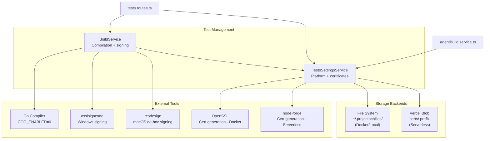
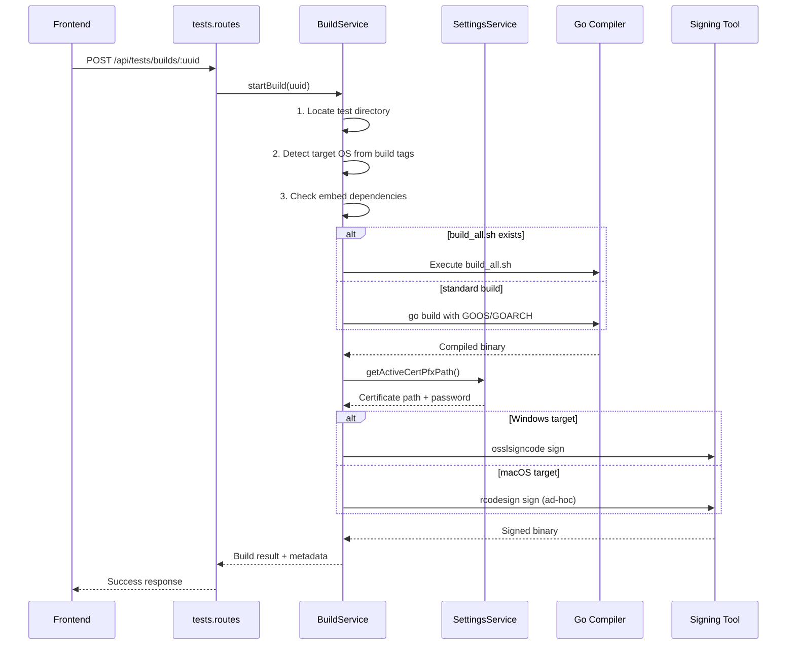
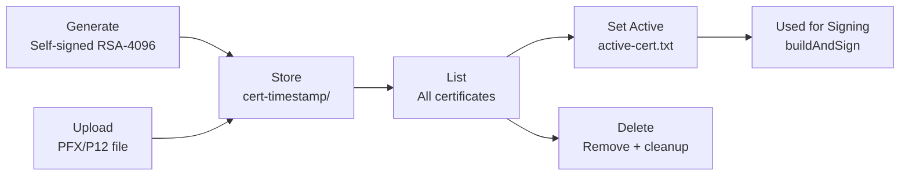

# Test Management Service

The Test Management module handles cross-platform compilation of Go-based security tests, code signing with certificates, and secure certificate storage. It provides the build pipeline that turns test source code into signed, deployable binaries.

**Key source files:** `backend/src/services/tests/`

## Architecture



## BuildService

The `BuildService` handles the complete build pipeline from Go source code to signed binary. It supports standard single-binary tests, multi-binary bundles (with `build_all.sh`), and direct binary uploads.

### Build Process Flow



### Key Methods

| Method | Purpose |
|--------|---------|
| `startBuild(uuid)` | Starts a build job (or joins the one already running for that test) and returns the job plus a promise |
| `buildAndSign(uuid)` | Complete build pipeline: compile, sign, store metadata |
| `getBuildJob(uuid)` / `isBuilding(uuid)` | State of the latest build job for a test |
| `getEmbedDependencies(uuid)` | Analyze `//go:embed` directives, detect missing files |
| `uploadBinary(uuid, buffer)` | Direct binary upload with PE header validation |
| `saveUploadedFile(uuid, filename, buffer)` | Upload embed dependencies with security checks |

### Build Jobs

A Go build can run for minutes, longer than a reverse proxy waits for a response (nginx: 60 s). `BuildJobs` (`buildJobs.ts`) tracks the latest job per test UUID in memory:

- `POST /api/tests/builds/:uuid` waits for the build and returns the build info. A `BuildError` becomes a 422.
- `POST /api/tests/builds/:uuid?async=true` returns 202 with the job at once. The client polls `GET /api/tests/builds/:uuid`, which includes `job` while one exists.
- A second request for a test that is already building joins the running job. Uploads and deletes for that test return 409 until it finishes.
- Job state lives in the backend process only. A restart forgets every job, and also kills the build.

### Platform Detection

The build service automatically detects the target OS by scanning for Go build tags in the source files:

```go
//go:build windows    // Target: windows
//go:build darwin     // Target: darwin (macOS)
//go:build linux      // Target: linux
```

If no build tag is found, the global platform setting from `TestsSettingsService` is used as the fallback. Architecture (amd64/arm64) always comes from the global setting.

### Embed Dependency Management

Tests that use `//go:embed` directives may require pre-built binary dependencies. The build service distinguishes between two types:

| Type | Detection | Build Button | Upload |
|------|-----------|-------------|--------|
| **Source-built** | Has matching `.go` source or listed in `build_all.sh` | Enabled (wrench icon, "Auto-built" label) | Rejected |
| **External (pre-built)** | No matching source found | Blocked until uploaded | Allowed |

Source-built detection uses four heuristics in order:

1. **Direct match** -- `foo.exe` has a corresponding `foo.go`
2. **Hyphen-to-underscore** -- `validator-defender.exe` matches `validator_defender.go`
3. **UUID-prefix stage** -- `<uuid>-T1486.exe` strips UUID, checks `stage-T1486.go` or prefix patterns
4. **Fallback** -- parses `build_all.sh` for literal `go build -o <filename>` commands

### Multi-Binary Bundle Builds

Some tests use a multi-binary architecture with a `build_all.sh` orchestrator script. When detected, the build service:

1. Passes the active signing certificate via environment variables (`F0_SIGN_CERT_PATH`, `F0_SIGN_CERT_PASS_FILE`)
2. Executes `build_all.sh` which compiles and signs each validator binary
3. The password file uses mode `0o600` and is deleted in a `finally` block

:::warning[Signing certificate required for bundle builds]
Multi-binary bundles that include Windows validators need an active signing certificate. Without one, `build_all.sh` will produce unsigned binaries, which may be quarantined by endpoint protection during testing.
:::

### Build Environment

Build subprocesses (`go build`, `go mod`, `build_all.sh`) do not inherit the backend's environment. They get an allowlist (`services/tests/buildEnv.ts`): `PATH`, `HOME`, temp and locale variables, the Go toolchain variables (`GOCACHE`, `GOPROXY`, `GOFLAGS`, ...), proxy and CA variables for module downloads, `JAVA_HOME`, and `DOTNET_*` / `NUGET_*`. `GOOS`, `GOARCH`, `CGO_ENABLED` and the signing variables above are added per build.

So a build script never sees the Clerk secret key, `ENCRYPTION_SECRET`, Elasticsearch credentials or `GITHUB_TOKEN`. If a build needs another variable, list its name in `BUILD_ENV_PASSTHROUGH` (comma-separated).

:::warning[This is not a sandbox]
A build script still runs as the backend user and can read the files that user can read, and it receives the signing certificate on purpose. Only sync test libraries you trust: their code runs on your endpoints with full privileges anyway.
:::

### Code Signing

| Platform | Tool | Method | Certificate Required |
|----------|------|--------|---------------------|
| Windows | `osslsigncode` | Authenticode (PFX certificate) | Yes |
| macOS | `rcodesign` | Ad-hoc (`--code-signature-flags adhoc`) | No |
| Linux | -- | No signing | -- |

:::info[Signing failures are non-fatal]
If the signing tool is not installed or the certificate is unavailable, the build completes with an unsigned binary. The build result metadata includes a `signed: false` flag so the UI can display a warning.
:::

## TestsSettingsService

Manages platform configuration and code-signing certificates with encrypted storage.

### Platform Management

Stores the target platform (OS + architecture) used when no build tag is present in the source code. Invalid combinations like `darwin/386` are rejected at validation time.

### Certificate Management

The service supports up to 5 certificates simultaneously, with one designated as "active" for signing operations.

**Certificate lifecycle:**



**Certificate sources:**

| Source | Method | Key Generation | Notes |
|--------|--------|---------------|-------|
| Generated | `generateCertificate()` | RSA-4096 | Docker: OpenSSL CLI. Serverless: `node-forge` (pure JS, 2-8s) |
| Uploaded | `uploadCertificate()` | User-provided | PFX password validated on import |

**Storage structure:** Each certificate is stored in an isolated directory:

```
certs/
├── active-cert.txt                  # Contains ID of active cert
├── cert-1709234567/
│   ├── cert.pfx                     # PKCS#12 bundle (private key + cert chain)
│   └── cert-meta.json               # Label, subject, expiry, source, created
└── cert-1709345678/
    ├── cert.pfx
    └── cert-meta.json
```

**Security features:**
- Certificate passwords are encrypted at rest using **AES-256-GCM** (key derived from `ENCRYPTION_SECRET`)
- Temporary password files for `osslsigncode` use restrictive permissions (`0o600`) and are deleted immediately after use
- Path traversal protection on all file operations
- Maximum of 5 certificates enforced (uploaded + generated combined)

### Legacy Migration

On the Docker backend, certificates stored in the old flat-file layout (`~/.projectachilles/certs/cert.pfx`) are automatically migrated to the subdirectory structure on the first call to `listCertificates()`.

### Docker vs Serverless Differences

| Aspect | Docker (`backend/`) | Serverless (`backend-serverless/`) |
|--------|--------------------|------------------------------------|
| Certificate generation | OpenSSL CLI (`openssl req`, `openssl pkcs12`) | `node-forge` (pure JavaScript) |
| PFX parsing | OpenSSL CLI | `node-forge` (try/catch with graceful fallback) |
| Storage | File system (`~/.projectachilles/certs/`) | Vercel Blob (`certs/` prefix) |
| Key generation time | Sub-second (native OpenSSL) | 2-8 seconds (pure JS RSA-4096) |
| External dependencies | `openssl`, `osslsigncode`, `rcodesign` | None (pure JS) |

:::tip[node-forge compatibility]
`node-forge` uses `3des` (not AES) for PKCS#12 encoding to maintain compatibility with OpenSSL's default PFX parsing. X.509 validity times have second precision only -- always truncate milliseconds before setting `notAfter`.
:::

## API Routes

The test management services are exposed through `tests.routes.ts`:

| Endpoint | Method | Purpose |
|----------|--------|---------|
| `/api/tests/builds` | GET | List the UUIDs of tests that have a binary |
| `/api/tests/builds/:uuid` | GET | Build info, detected platform and the current build job |
| `/api/tests/builds/:uuid` | POST | Build and sign a test binary (`?async=true` returns 202 and a job) |
| `/api/tests/builds/:uuid` | DELETE | Delete a build |
| `/api/tests/builds/:uuid/download` | GET | Download the binary |
| `/api/tests/builds/:uuid/dependencies` | GET | List embed dependencies |
| `/api/tests/builds/:uuid/upload` | POST | Upload an embed dependency |
| `/api/tests/builds/:uuid/upload-binary` | POST | Direct binary upload |
| `/api/tests/platform` | GET | Get current platform settings |
| `/api/tests/platform` | POST | Update platform settings |
| `/api/tests/certificates` | GET | List all certificates |
| `/api/tests/certificates/upload` | POST | Upload a PFX certificate |
| `/api/tests/certificates/generate` | POST | Generate a self-signed certificate |
| `/api/tests/certificates/:id/active` | PUT | Set active certificate |
| `/api/tests/certificates/:id` | PATCH | Update a certificate's label |
| `/api/tests/certificates/:id` | DELETE | Delete a certificate |
| `/api/tests/certificates/:id/download` | GET | Download a certificate |

The older single-certificate routes at `/api/tests/certificate` (GET, POST, DELETE) still exist.

## Error Handling

Build failures throw a `BuildError`. Its message names the failing command and includes the `stderr` (or `stdout`) output of the build process. The build route returns it as a 422.

Certificate operations include validation and rollback mechanisms to prevent partial failures from leaving the system in an inconsistent state (e.g., a certificate directory created but metadata write failed).

## Agent Build Integration

`agentBuild.service.ts` (`AgentBuildService`) compiles and signs agent binaries. It is a separate class that mirrors `BuildService`: it reads the active certificate from the same `TestsSettingsService` and signs the same way, so test builds and agent builds behave alike. Before every build it refreshes the agent source clone, and it registers the result through `registerVersion()`, which rejects a binary whose embedded version differs from the version being registered.
