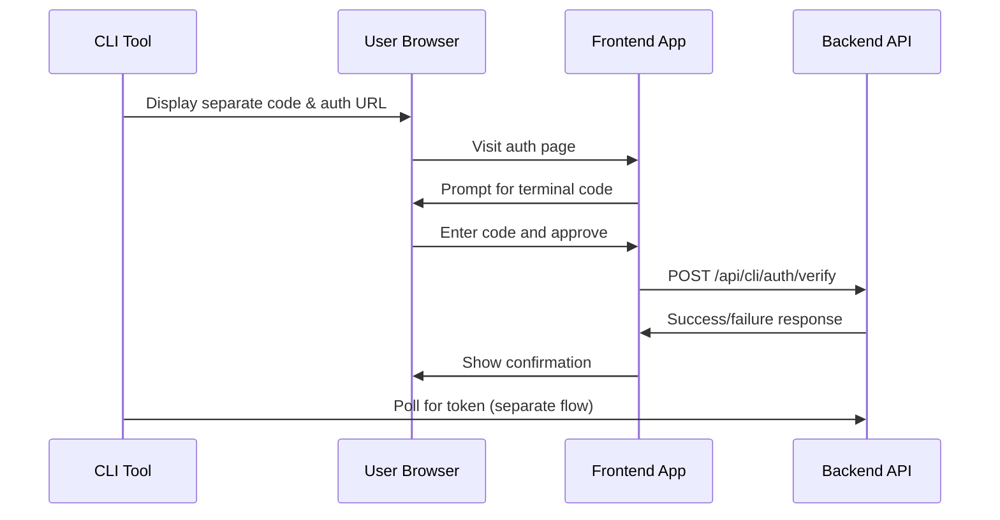
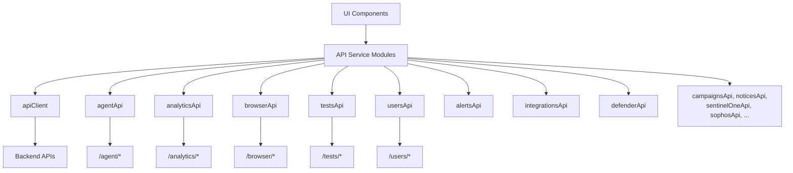

# Auth Hooks

## useAuthenticatedApi

The hook that makes API calls authenticated. It is called once, in `AppContent`, and returns nothing: it registers Clerk's `getToken` with the shared Axios instance `apiClient`, whose request interceptor adds the JWT to every request.

```typescript
// App.tsx
function AppContent() {
  useAuthenticatedApi(); // set up the JWT interceptor
  // ...
}

// Anywhere else: use apiClient, or better, a service module
import { apiClient } from '@/hooks/useAuthenticatedApi';

// baseURL already ends in /api; the request carries Authorization: Bearer <jwt>
const response = await apiClient.get('/browser/tests');
```

## Three-Tier Auth Model

1. **Clerk (global)** — All web routes require Clerk authentication
2. **Analytics** — `AnalyticsAuthProvider` context knows whether Elasticsearch is configured; the Analytics route guard sends the user to Settings when it is not
3. **Agent admin** — Clerk JWT required; agent device endpoints use agent API key

## AnalyticsAuthProvider

Wraps the whole app (inside `AppContent`) and holds the Elasticsearch configuration state. It does not redirect by itself. The `AnalyticsProtectedRoute` guard in `AppRouter.tsx` reads it: when Elasticsearch is not configured, a user with settings access is redirected to `/settings`, and other users see a message. The old `/analytics/setup` path now redirects to `/settings`.

The companion hook `useAnalyticsAuth` exposes the configuration state:

```typescript
const { configured, loading, settings, checkConfiguration } = useAnalyticsAuth();
```

---

## Clerk Integration Details

All authentication flows are powered by Clerk's React SDK. The integration provides:

- **`useAuth()`** -- Token management and session state
- **Pre-built UI** -- `<SignIn>`, `<SignUp>`, `<UserProfile>` components for consistent UX
- **Automatic session management** -- Token refresh handled transparently
- **Environment-aware keys** -- `VITE_CLERK_PUBLISHABLE_KEY` (Vite prefix required)

### Auth Pages

| Page | Route | Purpose |
|------|-------|---------|
| `SignInPage` | `/sign-in/*` | Login flow, cross-links to sign-up |
| `SignUpPage` | `/sign-up/*` | Registration flow, cross-links to sign-in |
| `UserProfilePage` | `/user-profile` | Self-service account management |

All auth pages redirect to `/dashboard` after successful authentication.

### CLI Device Flow

The `CliAuthPage` implements an OAuth2-style device flow for authenticating CLI tools:



**Flow steps:**
1. CLI requests a device code and displays the auth URL and code separately
2. User visits the URL and manually enters the code shown in their terminal
3. Frontend verifies the code only after explicit approval using the user's Clerk browser session
4. CLI receives authentication confirmation via a separate polling mechanism

:::info
Device codes are automatically uppercased on input. Verification links never contain or submit a code, and CLI or API-key credentials cannot approve one. A device code is valid for 10 minutes. A CLI access token lasts 1 hour and the CLI renews it with its refresh token. The serverless backend has no CLI sign-in.
:::

## Role-Based Access Control

Roles are stored in Clerk's public metadata and exposed through three hooks:

| Hook | Purpose | Example |
|------|---------|---------|
| `useAppRole()` | Get current role | `'admin'`, `'operator'`, `'analyst'`, `'explorer'`, or `undefined` |
| `useHasPermission(perm)` | Check specific permission | `useHasPermission('endpoints:agents:write')` |
| `useCanAccessModule(mod)` | Check module access | `useCanAccessModule('analytics')` |

```typescript
// Check if user can access a specific module
const canViewAnalytics = useCanAccessModule('analytics');

// Check for specific permissions
const canManageAgents = useHasPermission('endpoints:agents:write');

// Get current role
const role = useAppRole();
```

:::note
Users without a role get the `explorer` permission set (read-only), in the frontend hooks and in the backend alike. Every deployment needs one admin; see [Make the first admin](../../deployment/clerk-setup#first-admin).
:::

### Route Protection Pattern

```tsx
// Basic authentication requirement
<RequireAuth>
  <DashboardPage />
</RequireAuth>

// Module-specific access control (layered)
<RequireAuth>
  <RequireModule module="analytics">
    <AnalyticsPage />
  </RequireModule>
</RequireAuth>
```

`RequireModule` redirects unauthorized users to `/dashboard` (not a hard block).

---

## API Client Architecture

All backend communication flows through a centralized `apiClient` instance created by the `useAuthenticatedApi` hook. Domain-specific service objects wrap this client with typed methods.



### How the API Client Works

The `useAuthenticatedApi` hook (called once in `AppContent`) creates a module-level Axios instance with interceptors that:

1. **Attach JWT tokens** from Clerk's `getToken()` on every request
2. **Extract error messages** from backend `{ success: false, error: "..." }` responses
3. **Detect auth failures** disguised as HTML redirects (Clerk redirect pages)

```
UI Action --> API Service --> apiClient --> Token Validation --> Backend Request
```

:::warning
The token is registered synchronously during render to eliminate race conditions. Do not call API services before `useAuthenticatedApi` has run (it runs in `AppContent`, which is inside `ClerkProvider`).
:::

## Service Module Catalog

All services live in `frontend/src/services/api/` and re-export their TypeScript interfaces.

### Agent API (`agentApi`)

| Category | Methods |
|----------|---------|
| **Agent management** | `listAgents()`, `getAgent()`, `updateAgent()`, `deleteAgent()`, `rotateAgentKey()` |
| **Task operations** | `createTasks()`, `createCommandTasks()`, `triggerUpdate()`, `createUninstallTasks()`, `listTasks()`, `listTasksGrouped()`, `cancelTask()` |
| **Scheduling** | `createSchedule()`, `updateSchedule()`, `deleteSchedule()` |

### Analytics API (`analyticsApi`)

| Category | Methods |
|----------|---------|
| **Defense score** | `getDefenseScore()`, `getDefenseScoreTrend()`, `getDefenseScoreByTest()`, `getDefenseScoreBySeverity()` |
| **Executions** | `getPaginatedExecutions()`, `getGroupedPaginatedExecutions()`, `getErrorRate()`, `getErrorRateTrend()` |
| **Risk management** | `acceptRisk()`, `revokeRisk()`, `listAcceptances()` |

### Browser API (`browserApi`)

`getAllTests()`, `syncTests()`, `getTestDetails()`, `getFileContent()`, `getAttackFlow()`

### Tests API (`testsApi`)

| Category | Methods |
|----------|---------|
| **Certificates** | `listCertificates()`, `generateCertificateWithLabel()`, `uploadCertificate()`, `setActiveCertificate()` |
| **Builds** | `buildTest()`, `getBuildInfo()`, `downloadBuild()`, `uploadEmbedFile()` |

### Integration APIs

| Service | Key Methods |
|---------|-------------|
| `integrationsApi` | `saveAzureSettings()`, `testAzureConnection()` |
| `defenderApi` | `getSecureScore()`, `getAlerts()`, `getDetectionRate()` |
| `alertsApi` | `getAlertSettings()`, `testAlertChannels()` |
| `crowdstrikeApi` | CrowdStrike analytics |
| `sentinelOneApi`, `sentineloneAnalyticsApi` | SentinelOne settings and analytics (backend only) |
| `sophosApi`, `sophosAnalyticsApi` | Sophos settings and analytics (backend only) |
| `edrReadinessApi` | EDR Elasticsearch readiness check |

### Other Services

| Service | Purpose |
|---------|---------|
| `campaignsApi` | Saved campaigns, runs, evidence matrix (backend only) |
| `noticesApi` | Pre-execution notices (backend only) |
| `reportsApi` | Report payloads |
| `consoleIdentityApi` | Console identity (backend only) |
| `apiKeysApi` | API key management (backend only) |
| `usersApi` | User management |

"Backend only" services call routes that the serverless backend does not have. Gate their UI on the matching `useCapabilities` flag.

### Backend Route Mapping

| Backend route prefix | Frontend service |
|---------------------|-----------------|
| `/agent/*` | `agentApi` |
| `/analytics/*` | `analyticsApi` |
| `/browser/*` | `browserApi` |
| `/tests/*` | `testsApi` |
| `/users/*` | `usersApi` |
| `/integrations/*` | `alertsApi`, `integrationsApi`, `sentinelOneApi`, `sophosApi`, `edrReadinessApi` |
| `/analytics/defender/*`, `/analytics/crowdstrike/*`, `/analytics/sentinelone/*`, `/analytics/sophos/*` | `defenderApi`, `crowdstrikeApi`, `sentineloneAnalyticsApi`, `sophosAnalyticsApi` |
| `/campaigns/*` | `campaignsApi` |
| `/notices/*` | `noticesApi` |
| `/reports/*` | `reportsApi` |
| `/settings/identity` | `consoleIdentityApi` |
| `/api-keys/*` | `apiKeysApi` |

## Error Handling Patterns

### Graceful Degradation

Services that power optional features return safe defaults on failure:

```typescript
// From alertsApi — returns unconfigured state if backend is unreachable
async getAlertSettings(): Promise<AlertSettingsMasked> {
  try {
    const response = await apiClient.get('/integrations/alerts');
    return response.data;
  } catch {
    return { configured: false }; // Safe default
  }
}
```

### Type-Safe Responses

All services export TypeScript interfaces for request/response types:

```typescript
export interface CreateTasksRequest {
  org_id: string;
  agent_ids: string[];
  task_type: string;
}

export interface AgentTask {
  id: string;
  status: 'pending' | 'running' | 'completed' | 'failed';
  created_at: string;
}
```

### Usage in Components vs Redux

```typescript
// Direct usage in components
import { agentApi } from '@/services/api/agent';

useEffect(() => {
  agentApi.listAgents({ status: 'active' })
    .then(setAgents)
    .catch(handleError);
}, []);

// Usage in Redux async thunks
const fetchAgents = createAsyncThunk(
  'agents/fetchAgents',
  async (params: ListAgentsRequest) => {
    return await agentApi.listAgents(params);
  }
);
```
