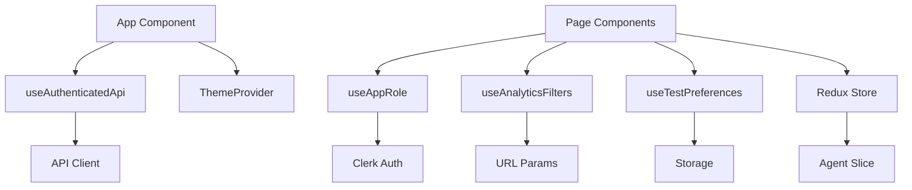

# Redux State

## Redux Toolkit Setup

State management uses Redux Toolkit with typed hooks.

### Typed Hooks

Always use the typed hooks instead of raw `useDispatch`/`useSelector`:

```typescript
// Correct
import { useAppDispatch, useAppSelector } from '@/store';

// Incorrect
import { useDispatch, useSelector } from 'react-redux';
```

### Slices

The store has one slice today, `agent` (`store/agentSlice.ts`). Most other state lives in hooks and contexts (see [Where State Lives](#where-state-lives)). A new slice follows the usual Redux Toolkit shape:

```typescript
import { createSlice, createAsyncThunk } from '@reduxjs/toolkit';

export const fetchTests = createAsyncThunk('browser/fetchTests', async (_, { getState }) => {
  // API call
});

const browserSlice = createSlice({
  name: 'browser',
  initialState,
  reducers: { /* sync reducers */ },
  extraReducers: (builder) => {
    builder.addCase(fetchTests.fulfilled, (state, action) => {
      state.tests = action.payload;
    });
  },
});
```

---

## State Management Architecture

The state management layer spans Redux (global async state), React hooks (local/domain state), and browser APIs (persistence). Here is how they connect:



### Where State Lives

| State category | Mechanism | Persistence |
|----------------|-----------|-------------|
| Agent list, tasks, metrics | Redux (`agentSlice`) | None (refetched) |
| Analytics filters | `useAnalyticsFilters` hook + URL params | URL (shareable) |
| Test favorites & recents | `useTestPreferences` hook | localStorage (per-user key) |
| Theme | `useTheme` hook | None (always dark) |
| Flash notifications, report options | `lib/flashNotifications.ts`, report `persist.ts` | localStorage |
| Auth tokens | Clerk SDK | Clerk session |
| Analytics config | `AnalyticsAuthProvider` context | Backend settings |
| Feature flags | `useCapabilities` hook | None (fetched once per page load, cached in memory) |
| Console identity | `ConsoleIdentityProvider` context (`useConsoleIdentity`) | Backend settings |

## Agent Slice (Deep Dive)

The `agentSlice` is the primary Redux slice, managing distributed agent operations.

### State Shape

```typescript
interface AgentState {
  agents: AgentSummary[];
  selectedAgent: Agent | null;
  tasks: AgentTask[];
  metrics: AgentMetrics | null;
  loading: boolean;
  error: string | null;
  filters: ListAgentsRequest;
  pagination: PaginationState;
}
```

### Async Thunks

| Thunk | Purpose |
|-------|---------|
| `fetchAgents` | Load agent list with filtering and pagination |
| `fetchAgent` | Load detailed agent information |
| `fetchMetrics` | Load fleet metrics |
| `fetchTasks` | Load task history |
| `createTasks` | Dispatch new tasks to agents |
| `updateAgentStatus` | Change agent operational status |
| `tagAgent` / `untagAgent` | Manage agent categorization tags |

### Usage Pattern

```typescript
const dispatch = useAppDispatch();
const { agents, loading, error } = useAppSelector(state => state.agent);

// Load agents with filters
dispatch(fetchAgents({ status: 'active', limit: 50 }));

// Create tasks for multiple agents
dispatch(createTasks({
  agentIds: selectedAgentIds,
  testUuids: selectedTests,
  priority: 'high'
}));
```

### Error Handling in Thunks

All async thunks use `rejectWithValue` for consistent error propagation:

```typescript
try {
  return await agentApi.listAgents(filters);
} catch (error: unknown) {
  return rejectWithValue(extractErrorMessage(error, 'Failed to fetch agents'));
}
```

Components read errors from the slice:

```typescript
const { error } = useAppSelector(state => state.agent);
if (error) {
  return <Alert variant="destructive">{error}</Alert>;
}
```

## Custom Hooks Catalog

Beyond Redux, several standalone hooks manage domain-specific state.

### useAnalyticsFilters

Manages 11+ filter types for analytics dashboards with bidirectional URL synchronization.

**Filter categories:**
- **Basic** -- Organization, date range, result status
- **Advanced** -- Hostnames, tests, techniques, categories, threat actors, tags, errors, bundles

```typescript
const {
  filters,
  isExpanded,
  hasActiveFilters,
  setDateRange,
  setResult,
  clearAllFilters,
  getApiParams
} = useAnalyticsFilters();

// Convert to API parameters
const apiParams = getApiParams();
const data = await analyticsApi.getExecutions(apiParams);
```

:::tip
Filters automatically sync with URL parameters while preserving other query params (like active tabs). This enables shareable dashboard URLs and browser back/forward navigation.
:::

**Date range and the Defense Score** -- There is no rolling-window mapping any more (`getWindowDaysForDateRange` was removed). Score views request `basis=latest`, and the selected range is the freshness window: a test × endpoint pair counts if its most recent conclusive result falls inside it, capped at 365 days. The helpers live in `src/lib/posture.ts` and `src/lib/utcDate.ts`:

| Helper | Purpose |
|--------|---------|
| `pickCurrentScore(tile, trend)` | Tile value and pair count, taken from the trend's last point when the trend is non-empty. The tile then always equals the line's end, even if the two requests race. |
| `pickCurrentErrorRate(trend, summary)` | Last non-null trend error rate, falling back to the `/error-rate` summary |
| `seriesDelta(points)` | Last non-null minus first non-null score, for the `±d.d pts over <range>` caption |
| `postureCaption(pairCount, delta, rangeLabel)` | Caption text; `n=<n> · not enough data` below `MIN_POSTURE_PAIRS` (10) |
| `scoreTone(score, pairCount)` | `muted` for low or empty samples; otherwise `danger` below 60, `warning` below 80, else `accent` |
| `postureWindowLabel(dateRange)` | `<n>d`, or `last 365d` when the range exceeds the cap (e.g. All time) |
| `utcDayKey(ts)` / `formatUtcDay(ts)` | UTC day keys and labels. Trend buckets are UTC days; never format them in local time. |

### useTestPreferences

Manages user-specific favorites and recently-viewed tests. Data is stored in localStorage with user-specific keys.

```typescript
const { favorites, recentTests, isFavorite, toggleFavorite, trackView } = useTestPreferences();

// Track when user views a test
trackView(testUuid, testName);

// Check/toggle favorite status
if (isFavorite(testUuid)) {
  // Show filled star
}
```

**Cross-tab sync** -- Uses custom events to synchronize preference changes across browser tabs in real-time. The recent list auto-maintains the 20 most recently viewed tests.

### useTheme

Compatibility shim for the single f0 dark theme:

```typescript
const { theme } = useTheme(); // always 'dark'
```

The provider API is kept so existing consumers and tests keep compiling, but
`theme` is pinned to `'dark'`, the style/phosphor variants are gone, and nothing
is written to `localStorage`. `<html>` carries `class="dark"` permanently.

Prefer reading design tokens (`bg-surface`, `text-faint`, `var(--accent)`) over
branching on `theme` in new code.

### useCapabilities

Reads `GET /api/capabilities` to learn which features the running backend supports. The serverless backend (Vercel) lacks many of them:

```typescript
const { build, gitSync, campaigns, sentinelone, stageCoverage, platform, loaded } = useCapabilities();

if (build) {
  // Show build button
}
```

Flags: `build`, `buildUpload`, `certGenerate`, `certUpload`, `gitSync`, `agentBuild`, `preExecutionNotices`, `campaigns`, `consoleIdentity`, `sentinelone`, `sophos`, `alerting`, `randomizedOnce`, `outcomeBreakdown`, `testFleet`, `stageCoverage`, `testRunRecency`, plus `platform`. `loaded` is `false` until the request has finished.

:::info
Before the response arrives, and when a backend does not report a flag, defaults apply: the build, certificate, `gitSync` and `alerting` flags default to `true` (they predate the endpoint), every newer flag defaults to `false`. A new backend-only feature should add a flag that defaults to `false`.
:::

### useDefenderConfig

Checks if Microsoft Defender integration is configured, for conditional UI rendering:

```typescript
const { configured, loading } = useDefenderConfig();
```

`useCrowdStrikeConfig`, `useSentinelOneConfig` and `useSophosConfig` do the same for the other EDR integrations.

## URL State Synchronization Pattern

The analytics filters demonstrate the pattern for syncing complex state with URL parameters:

```typescript
// Preserve non-filter params while updating filters
setSearchParams(prev => {
  const newParams = new URLSearchParams(prev);
  // Clear filter params, then add current values
  filterKeys.forEach(key => newParams.delete(key));
  Object.entries(filterParams).forEach(([key, value]) => {
    newParams.set(key, value);
  });
  return newParams;
}, { replace: true });
```

This pattern enables shareable URLs while maintaining other application state like active tabs or modal states.

## Provider Setup

Several hooks require provider components in the app root. The order matters:

```typescript
function App() {
  return (
    <ClerkProvider>
      <Provider store={store}>
        <AppContent />
      </Provider>
    </ClerkProvider>
  );
}

function AppContent() {
  useAuthenticatedApi();
  return (
    <ThemeProvider defaultTheme="dark">
      <AnalyticsAuthProvider>
        <ErrorBoundary>
          <BrowserRouter>
            <ConsoleIdentityProvider>
              <AppRouter />
            </ConsoleIdentityProvider>
          </BrowserRouter>
        </ErrorBoundary>
      </AnalyticsAuthProvider>
    </ThemeProvider>
  );
}
```

:::warning
`useAuthenticatedApi` must run inside `ClerkProvider`. `useAnalyticsAuth` must run inside `AnalyticsAuthProvider`. Placing hooks outside their required provider will throw a runtime error or return `undefined`.
:::
