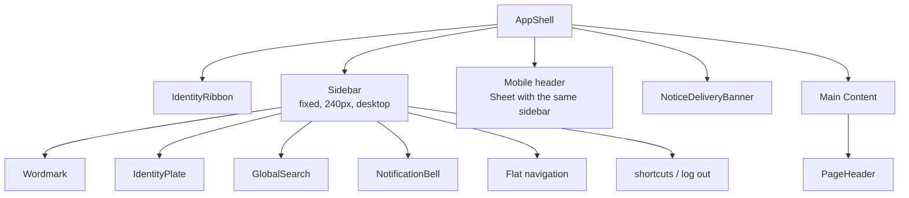
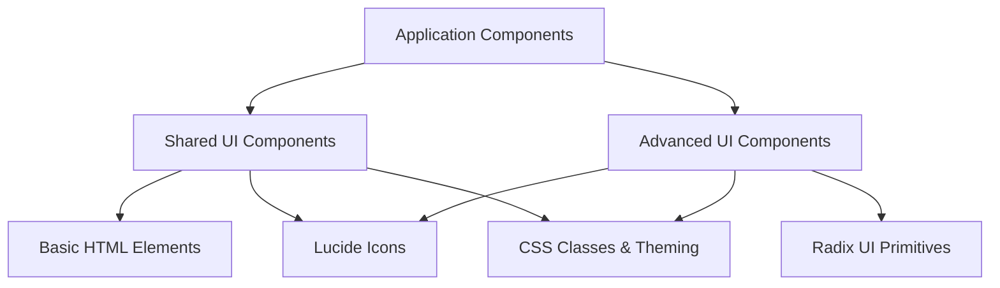

# UI Components

## Component Library

UI primitives live in `frontend/src/components/shared/ui/`:

| Component | Purpose |
|-----------|---------|
| `Button` | Primary action buttons with variants |
| `Card` | Content container with optional header/footer |
| `Input` | Text input with label and error state |
| `Badge` | Status indicators and labels |
| `Tabs` | Tab navigation component |
| `Alert` | Informational/warning/error alerts |
| `Spinner` | Loading indicator |
| `Select`, `Checkbox`, `Switch` | Form controls |
| `Dialog` | Modal dialog |
| `Table` | Table parts |
| `CopyButton` | Copy-to-clipboard button |
| `StreamRow` | Row of a live list (dashboard streams) |
| `formStyles.ts`, `pillStyles.ts` | Shared class strings for form fields and pills, so pages do not restyle them by hand |

## Usage

```typescript
import { Button } from '@/components/shared/ui/Button';
import { Card } from '@/components/shared/ui/Card';
import { Badge } from '@/components/shared/ui/Badge';

<Card>
  <Badge variant="success">Protected</Badge>
  <Button onClick={handleRun}>Execute Test</Button>
</Card>
```

## Theming

One dark theme — the f0 design language. All tokens live in
`frontend/src/styles/index.css`; there is no Tailwind config file (Tailwind v4
declares theme values in `@theme` / `@theme inline` blocks).

The palette is exposed in two layers so both component families wear it:

| Layer | Names | Used by |
|-------|-------|---------|
| **A — runtime tokens** | `--background`, `--card`, `--popover`, `--muted`, `--border`, `--primary`, `--destructive`, `--ring`, `--sidebar-*` | shadcn/cva primitives in `components/ui/` and every legacy component |
| **B — f0 semantics** | `--surface`, `--raised`, `--overlay`, `--faint`, `--border-strong`, `--accent`, `--accent-hover`, `--accent-dim`, `--danger`, `--warning`, `--info` (+ `-dim` variants) | new components, written straight from the design recipes (`bg-surface`, `text-faint`, `border-border-strong`) |

Overlapping names alias the same custom property, so `bg-card` and `bg-surface`
resolve identically.

### Core palette

| Token | Value | Role |
|-------|-------|------|
| `--background` | `#060906` | Page ground |
| `--surface` | `#0b100c` | Cards, sidebar |
| `--raised` | `#101713` | Inputs, hover wash, code blocks |
| `--overlay` | `#162019` | Popovers, dialogs |
| `--border` | `#1c261f` | Hairlines |
| `--border-strong` | `#2c3a30` | Emphasised edges |
| `--foreground` | `#dce8de` | Body text |
| `--muted` | `#8fa598` | Secondary text |
| `--faint` | `#5f7268` | Section labels, metadata |
| `--accent` | `#3ef08a` | Primary action, active nav, protected |
| `--danger` | `#f87171` | Failures, unprotected |
| `--warning` | `#fbbf24` | Stale, degraded |
| `--info` | `#38bdf8` | Secure Score, informational badges |

### Chart tokens are governed

Chart colours must be referenced as `var(--chart-*)` — never as hex or `oklch`
literals. `chartColorGuard.test.ts` fails the build on a literal in any file
listed in `CHART_FILES`; `chartTokens.css.test.ts` asserts every governed token
is declared; `contrast.test.ts` parses `index.css` live and enforces WCAG AA
(≥ 4.5:1) for label-on-fill pairs. Add new chart files to `CHART_FILES` in the
same commit that creates them.

---

## Layout System

All authenticated routes render inside one persistent shell, `AppShell` (`components/layout/AppShell.tsx`). `AppRouter` mounts it once through `AppLayout` and React Router's `<Outlet>`, so the sidebar stays mounted across page navigations.



### AppShell

- **Sidebar** -- fixed on large screens (`lg` and up). Below that, a header with a menu button opens the same sidebar in a `Sheet`. The sidebar does not collapse to icons and has no flyout panels.
- **Flat navigation** -- Dashboard, Tests, Analytics, Agents, Tasks, Settings. There are no nested modules. Campaigns and schedules are tabs of the Tasks page.
- **Role-based** -- `useCanAccessModule()` and `useHasPermission()` decide whether Agents, Tasks and Settings appear.
- **Locked items** -- Analytics shows a lock and a tooltip until Elasticsearch is configured. The link still works; the route guard explains.
- **Badges** -- the Agents item shows the number of outdated agents (`useOutdatedAgentCount`).
- **Console identity** -- `IdentityRibbon` (top of the page) and `IdentityPlate` (in the sidebar) show the console's code, name and colour when one is set (`components/layout/ConsoleIdentity.tsx`).
- **Keyboard shortcuts** -- `useAppHotkeys` handles app-level shortcuts (number keys jump to the navigation items, `/` focuses the page's search input, `?` opens the shortcuts dialog, `Cmd/Ctrl + K` opens search). `ShortcutsDialog` lists them.
- **Print** -- the sidebar and mobile header are hidden in print (`print:hidden`).

There is no top bar and no theme selector.

### PageHeader

Each page renders its own header with `PageHeader`:

```tsx
<PageHeader title="Tests" description="Security test library" titleAside={<Badge>42</Badge>}>
  <Button onClick={handleSync}>Sync</Button>
</PageHeader>
```

`children` are the page's actions (buttons, filters), shown on the right.

### GlobalSearch

Command palette-style search (`Cmd/Ctrl + K`) with multi-entity results:

| Feature | Detail |
|---------|--------|
| **Search scope** | Tests, agents, tasks across multiple APIs |
| **Debounce** | 200ms delay to prevent excessive API calls |
| **Keyboard** | Arrow keys to navigate, Enter to select, Escape to close |
| **Caching** | Avoids repeated API calls within a session |
| **Grouping** | Results grouped by entity type with icons and badges |

### NotificationBell

Real-time alert notifications with dropdown history:

- Connects to `alertsApi` for system alerts. When the backend reports `alerting: false` (Vercel), it skips those calls and shows flash notifications only
- Red dot indicator for unseen notifications
- Shows setup prompts when alerting is not configured
- Relative timestamps (e.g., "5 minutes ago")

---

## Two-Layer Component Architecture

The UI is organized into two distinct layers:



### Shared UI (`frontend/src/components/shared/ui/`)

Self-contained components built directly on HTML elements with custom styling. These are the base primitives used everywhere.

### Advanced UI (`frontend/src/components/ui/`)

More sophisticated components built on **Radix UI** primitives, providing enhanced accessibility and complex interactions (dropdown menus, sheets, charts).

## Shared UI Components (Full Catalog)

### Form Components

#### Button

5 visual variants, 4 sizes, built-in hover animations:

```typescript
<Button variant="primary" size="lg" onClick={handleClick}>
  Submit
</Button>
```

| Variant | Use case |
|---------|----------|
| `primary` | Primary actions |
| `secondary` | Secondary actions |
| `ghost` | Inline/subtle actions |
| `destructive` | Dangerous actions (delete, remove) |
| `outline` | Bordered neutral actions |

Sizes: `sm`, `md`, `lg`, `icon`

#### Input

Text input with label, error state, and icon support:

```typescript
<Input
  label="Email"
  error="Invalid email format"
  leftIcon={<Mail />}
  placeholder="Enter your email"
/>
```

#### Select

Dropdown selection component:

```typescript
<Select
  label="Platform"
  options={[
    { value: 'windows', label: 'Windows' },
    { value: 'linux', label: 'Linux' }
  ]}
/>
```

#### Checkbox & Switch

Boolean input components with custom styling and indeterminate state support.

### Layout Components

#### Card System

Flexible card layout with semantic sub-components:

```typescript
<Card>
  <CardHeader>
    <CardTitle>Task Details</CardTitle>
  </CardHeader>
  <CardContent>
    Content goes here
  </CardContent>
  <CardFooter>
    <Button>Action</Button>
  </CardFooter>
</Card>
```

#### Table Components

Complete table system: `Table`, `TableHeader`, `TableBody`, `TableRow`, `TableHead`, `TableCell`. Includes overflow handling, hover effects, and responsive design.

### Feedback Components

#### Alert

5 semantic variants with icon integration:

```typescript
<Alert variant="success" title="Success!" onClose={handleClose}>
  Task completed successfully
</Alert>
```

Variants: `default`, `success`, `warning`, `destructive`, `info`

#### Spinner & LoadingOverlay

Loading indicators with multiple sizes and an overlay variant:

```typescript
<LoadingOverlay message="Processing task..." />
```

### Navigation Components

#### Tabs

Context-based tab system supporting both controlled and uncontrolled modes:

```typescript
<Tabs defaultValue="details" onValueChange={setActiveTab}>
  <TabsList>
    <TabsTrigger value="details">Details</TabsTrigger>
    <TabsTrigger value="settings">Settings</TabsTrigger>
  </TabsList>
  <TabsContent value="details">Details content</TabsContent>
</Tabs>
```

#### Dialog

Modal dialog with backdrop, Escape key handling, and focus management:

```typescript
<Dialog open={isOpen} onClose={handleClose}>
  <DialogHeader onClose={handleClose}>
    <DialogTitle>Confirm Action</DialogTitle>
  </DialogHeader>
  <DialogContent>Are you sure?</DialogContent>
  <DialogFooter>
    <Button variant="outline" onClick={handleClose}>Cancel</Button>
    <Button onClick={handleConfirm}>Confirm</Button>
  </DialogFooter>
</Dialog>
```

### Specialized Components

| Component | Purpose |
|-----------|---------|
| `Badge` | Status indicators with variants (`default`, `primary`, `secondary`, `success`, `warning`, `destructive`, `outline`) |
| `PlatformBadge` | OS-specific badges (Windows, Linux, macOS) |
| `StatusDot` | Simple online/offline indicator |

## Advanced UI Components (Radix-based)

These components are built on [Radix UI](https://www.radix-ui.com/) primitives for enhanced accessibility and complex interactions.

### Avatar System

User representation with image, fallback initials, and badge:

```typescript
<Avatar size="lg">
  <AvatarImage src="/user.jpg" />
  <AvatarFallback>JD</AvatarFallback>
  <AvatarBadge>3</AvatarBadge>
</Avatar>
```

### DropdownMenu

Complex menu system with nested items and keyboard navigation:

```typescript
<DropdownMenu>
  <DropdownMenuTrigger asChild>
    <Button variant="outline">Options</Button>
  </DropdownMenuTrigger>
  <DropdownMenuContent>
    <DropdownMenuItem>Edit</DropdownMenuItem>
    <DropdownMenuSeparator />
    <DropdownMenuItem variant="destructive">Delete</DropdownMenuItem>
  </DropdownMenuContent>
</DropdownMenu>
```

### Sheet

Slide-out panel component:

```typescript
<Sheet>
  <SheetTrigger asChild>
    <Button>Open Panel</Button>
  </SheetTrigger>
  <SheetContent side="right">
    <SheetHeader>
      <SheetTitle>Panel Title</SheetTitle>
    </SheetHeader>
    Panel content
  </SheetContent>
</Sheet>
```

### Chart System

Chart colors are **governed**: all chart fills route through semantic chart tokens (resolved at runtime via the `chartTokens` util/hook) rather than hard-coded hex values. A drift-guard test (`chartColorGuard.test.ts`) fails CI if a chart component reintroduces raw colors, and label contrast is computed for WCAG AA across the heat ramp. When adding a chart, pick from the governed token palette instead of inventing colors.

Recharts integration with theme-aware configuration:

```typescript
<ChartContainer config={chartConfig}>
  <LineChart data={data}>
    <ChartTooltip content={<ChartTooltipContent />} />
  </LineChart>
</ChartContainer>
```

:::warning
When writing custom `content` renderers for Recharts components (Treemap, etc.), always set `stroke="none"` on `<text>` elements. Recharts sets `stroke` on the parent SVG container for cell borders, and SVG `stroke` inherits to text children -- causing visible dark outlines around glyphs on the dark theme.
:::

## Integration Patterns

### Styling with `cn()`

All components use the `cn()` utility (clsx + tailwind-merge) for class merging:

```typescript
<div className={cn("base-class", isActive && "active-class", className)}>
```

### Icon Integration

Components integrate with [Lucide React](https://lucide.dev/) icons:

```typescript
<Button>
  <Save className="w-4 h-4" />
  Save Changes
</Button>
```

### Variant System

Most components accept a `variant` prop following this pattern:

```typescript
type ButtonVariant = 'primary' | 'secondary' | 'ghost' | 'destructive' | 'outline';
type AlertVariant = 'default' | 'success' | 'warning' | 'destructive' | 'info';
```

## Composite Usage Examples

### Form Building

```typescript
function TaskForm() {
  return (
    <Card>
      <CardHeader>
        <CardTitle>Create Task</CardTitle>
      </CardHeader>
      <CardContent>
        <Input label="Task Name" />
        <Select label="Priority" options={priorityOptions} />
        <Checkbox label="Send notifications" />
      </CardContent>
      <CardFooter>
        <Button variant="outline">Cancel</Button>
        <Button>Create Task</Button>
      </CardFooter>
    </Card>
  );
}
```

### Data Display

```typescript
function TaskList({ tasks }) {
  return (
    <Table>
      <TableHeader>
        <TableRow>
          <TableHead>Name</TableHead>
          <TableHead>Status</TableHead>
          <TableHead>Platform</TableHead>
        </TableRow>
      </TableHeader>
      <TableBody>
        {tasks.map(task => (
          <TableRow key={task.id}>
            <TableCell>{task.name}</TableCell>
            <TableCell>
              <Badge variant={task.status === 'active' ? 'success' : 'default'}>
                {task.status}
              </Badge>
            </TableCell>
            <TableCell>
              <PlatformBadge platform={task.platform} />
            </TableCell>
          </TableRow>
        ))}
      </TableBody>
    </Table>
  );
}
```

## Performance Considerations

- **Search debouncing** -- GlobalSearch uses a 200ms delay to prevent excessive API calls
- **Memoized calculations** -- The navigation items and search results are memoized
- **Conditional rendering** -- Role-based components only render when the user has access

## Accessibility

- Full keyboard navigation for search, menus, dialogs, and tabs
- Proper ARIA labels and roles on all interactive elements
- Automatic focus management in overlays (dialogs, search, sheets)
- Semantic HTML (`<nav>`, `<header>`, `<main>`, `<table>`) throughout
