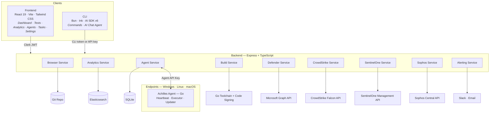
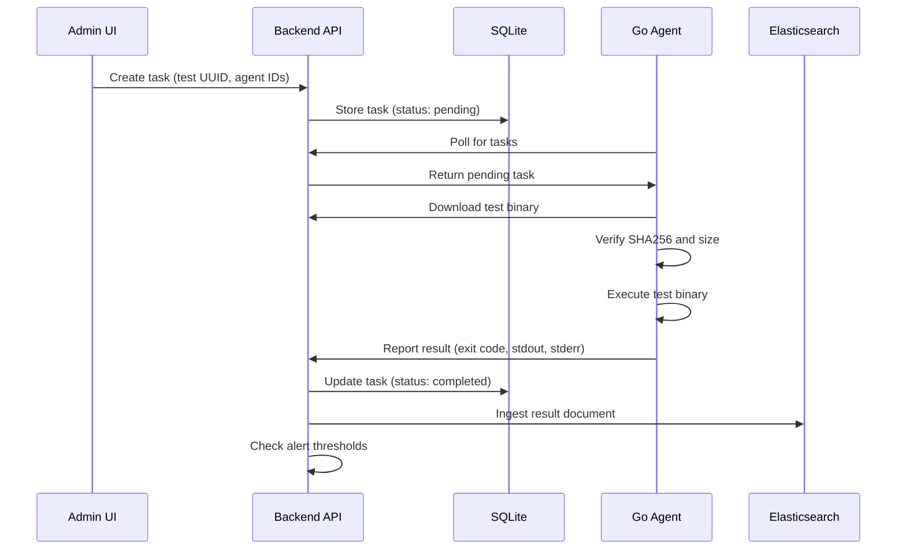
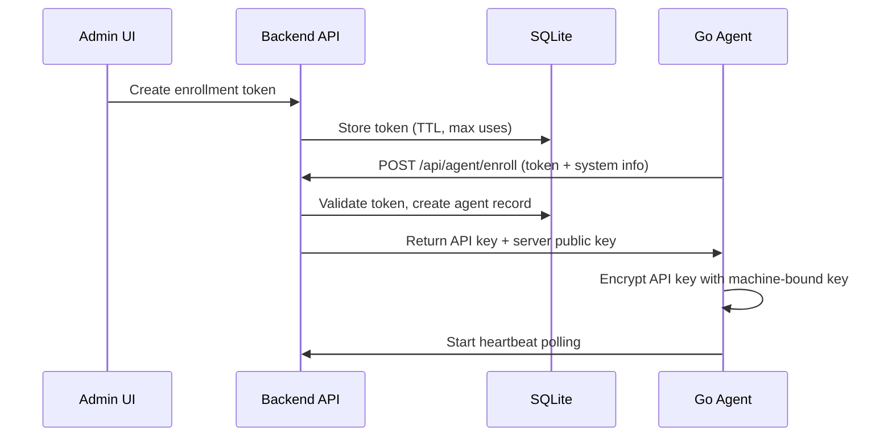
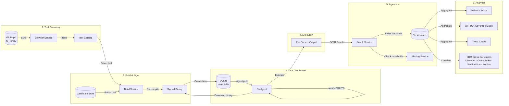
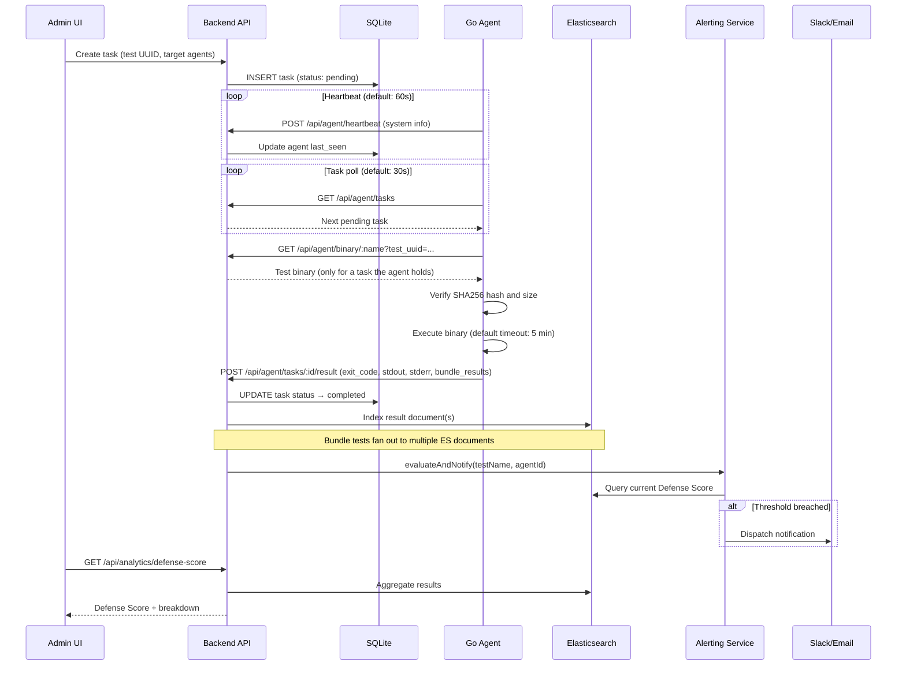

# Architecture

ProjectAchilles follows a three-tier architecture: a React SPA frontend, an Express API backend, and Go agents deployed to target endpoints. Elasticsearch stores test results for analytics, while SQLite manages agent state.

## System Overview



## Data Flow

### Test Execution Flow



### Agent Enrollment Flow



## Tech Stack

| Layer | Technology | Version | Purpose |
|-------|------------|---------|---------|
| **Frontend** | React | 19.3 | UI framework |
| | Vite | 8.3 | Build tool and dev server |
| | Tailwind CSS | 4.1 | Utility-first styling |
| | Redux Toolkit | 2.14 | State management |
| | React Router | 7.18 | Client-side routing |
| | Clerk | 5.x | Authentication |
| **Backend** | Express | 4.22 | HTTP framework |
| | TypeScript | 5.9 | Type-safe development |
| | better-sqlite3 | — | Agent database |
| | @elastic/elasticsearch | 8.x | Analytics queries |
| **Agent** | Go | 1.26 | Cross-platform binary |
| **Analytics** | Elasticsearch | 8.17 | Result storage and aggregation |
| **Signing** | osslsigncode | — | Windows Authenticode |
| | rcodesign | — | macOS ad-hoc signing |
| **CI** | GitHub Actions | — | Tests, CodeQL, Semgrep, dependency audit, releases |

## Project Structure

```
ProjectAchilles/
├── frontend/                  # React 19 + TypeScript + Vite
│   └── src/
│       ├── components/        # Layout shell and shared UI primitives (Button, Card, etc.)
│       ├── pages/             # Pages (dashboard, tests, analytics, endpoints, campaigns, settings)
│       ├── services/api/      # API client modules
│       ├── hooks/             # Custom hooks (useAuthenticatedApi, etc.)
│       └── store/             # Redux slices
├── backend/                   # Express + TypeScript (ES modules)
│   └── src/
│       ├── api/               # Route handlers (*.routes.ts)
│       ├── services/          # Business logic by module
│       │   ├── agent/         # Enrollment, heartbeat, tasks, schedules
│       │   ├── analytics/     # Elasticsearch queries, client factory
│       │   ├── browser/       # Git sync, test indexing
│       │   ├── tests/         # Go cross-compilation, cert management
│       │   ├── campaigns/     # Saved campaigns, runs, evidence matrix
│       │   ├── notices/       # Pre-execution notices
│       │   ├── outcomes/      # Verdict rules, EDR vendor registry
│       │   ├── reports/       # Execution report and export payloads
│       │   ├── edr/           # Vendor-neutral EDR enrichment and analytics
│       │   ├── defender/      # Microsoft Graph API client
│       │   ├── crowdstrike/   # CrowdStrike Falcon API client
│       │   ├── sentinelone/   # SentinelOne Management API client
│       │   ├── sophos/        # Sophos Central API client
│       │   └── alerts/        # Slack + email dispatch
│       ├── middleware/        # Auth, error handling, rate limiting
│       └── types/             # TypeScript definitions
├── backend-serverless/        # Vercel serverless fork (Turso + Blob)
├── agent/                     # Go agent source
│   ├── main.go                # CLI entry point (--enroll, --run, --install, --status)
│   └── internal/              # Agent modules
│       ├── config/            # Configuration management
│       ├── enrollment/        # Token-based registration
│       ├── executor/          # Test binary execution, leftover cleanup
│       ├── httpclient/        # HTTP client with auth
│       ├── poller/            # Task polling loop
│       ├── queue/             # On-disk queue for unsent results
│       ├── reporter/          # Result reporting
│       ├── service/           # OS service management
│       ├── store/             # Persistent agent state
│       ├── sysinfo/           # Platform-specific system info
│       └── updater/           # Self-update mechanism
├── installer/                 # achilles-installer (Go TUI wizard for server installs)
├── appliance/                 # Windows Hyper-V appliance image
├── cli/                       # Command-line client
├── scripts/                   # Start, deploy and install scripts
├── deploy/                    # Caddy config, lab endpoint, offline kit
├── docs/                      # Changelog, deployment guides, design notes
├── wiki/                      # This documentation site (Docusaurus)
├── blog/                      # Blog (Next.js)
└── docker-compose*.yml        # Local, single-server and lab deployments
```

## Deployment Architecture

ProjectAchilles supports several deployment targets, each with different trade-offs:

| Target | Backend | Database | File Storage | Agent Builds | Cost |
|--------|---------|----------|-------------|-------------|------|
| **Docker Compose** | `backend/` | SQLite (volume) | Filesystem (volume) | Yes | Free |
| **Public or on-prem server** (Caddy, one origin) | `backend/` | SQLite (volume) | Filesystem (volume) | Yes | Your server |
| **Windows Hyper-V appliance** | `backend/` | SQLite (volume) | Filesystem (volume) | Yes | Your host |
| **Render** | `backend/` | SQLite (persistent disk) | Filesystem (disk) | Partial | ~$14/mo |
| **Fly.io** | `backend/` | SQLite (volume) | Filesystem (volume) | Yes | ~$8/mo |
| **Vercel** | `backend-serverless/` | Turso (libSQL) | Vercel Blob | No | ~$20/mo |

The Vercel target uses a purpose-built serverless fork (`backend-serverless/`) that replaces SQLite with Turso, filesystem with Vercel Blob, and process-based scheduling with Vercel Cron jobs. It lacks several features: Go builds, campaigns, pre-execution notices, alerting, SentinelOne, Sophos, console identity, API keys and CLI sign-in. See [Deployment Overview](../deployment/overview) for detailed comparisons.

## End-to-End Data Flow

The following diagram shows the complete journey of data through the platform — from test discovery to defense metrics:



### Detailed Execution Sequence



### Integration Data Flows

Beyond the core test execution pipeline, several integration-specific flows run in parallel:

**Microsoft Defender Sync** (background, every 5 min / 6 hours):
```
Microsoft Graph API → Graph Client → Sync Service → achilles-defender index
```

**CrowdStrike Falcon Sync** (background, alerts every 5 min / ZTA every 6 hours):
```
CrowdStrike Falcon API → Falcon Client → Sync Service → achilles-crowdstrike index
```

**SentinelOne and Sophos Sync** (background, backend only; alerts every few minutes, posture every 6 hours):
```
SentinelOne Management API → S1 Client → Sync Service → achilles-sentinelone index
Sophos Central API → Sophos Client → Sync Service → achilles-sophos index
```

**EDR Evidence** (after every EDR poll): the enrichment pass matches alerts to the test runs that caused them and writes detection and prevention flags on the result documents. Two further passes turn an agent run that the EDR killed, and a test launch that the EDR blocked (exit 260), into Protected results when an alert proves it.

**Alert Evaluation** (triggered per result ingestion):
```
Result Ingestion → Defense Score Query → Threshold Check → Slack/Email Dispatch
```

**Risk Acceptance** (user-initiated):
```
Accept Risk → achilles-risk-acceptances index → Exclusion Filter Cache → Defense Score recalculation
```
