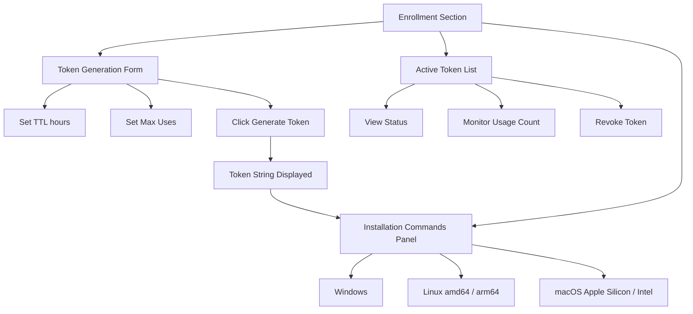

# Agent Enrollment

## Overview

Agent enrollment is a token-based registration process. An admin creates an enrollment token via the web UI, then provides it to the agent binary at install time.


## Creating Enrollment Tokens

1. Navigate to **Agents** and click **Enroll agent**
2. Configure:
   - **TTL (hours)** — How long the token is valid (default 24)
   - **Max Uses** — Maximum number of agents that can enroll with this token (default 1)
3. Click **Generate Token**

The token string is displayed once, with a ready-made install command per platform. Copy it and provide it to the person installing the agent.

## Enrolling an Agent

```bash
# Linux/macOS
sudo /opt/f0/achilles-agent --enroll <enrollment-token> --server https://your-backend.example.com --install

# Windows (PowerShell as Administrator)
C:\F0\achilles-agent.exe --enroll <enrollment-token> --server https://your-backend.example.com --install
```

`--install` copies the agent into `C:\F0` (Windows) or `/opt/f0` (Linux, macOS)
if it isn't there yet and registers it as a service from that folder. The
install commands the UI generates download it there directly.

During enrollment:
1. The agent sends system information (hostname, OS, architecture) to the backend
2. The backend validates the token (TTL, max uses, not revoked)
3. The backend creates an agent record and returns an API key + server public key
4. The agent encrypts the API key with a machine-bound key and saves it to disk
5. The agent starts its heartbeat loop

## Token Security

- Tokens use **constant-time bcrypt comparison** to prevent timing oracles
- A dummy hash is compared when no matching token exists (prevents distinguishing "no tokens" from "wrong token")
- Tokens are revocable through the admin UI
- Enrollment is rate-limited to **300 requests per 15 minutes** per IP (sized for large fleets enrolling from behind a shared NAT)

## Revoking Tokens

In the **Active Tokens** table of the Enroll agent dialog, click the trash icon on a token to invalidate it at once. Agents already enrolled are unaffected.

## Enrollment UI Walkthrough

The **Enroll agent** button on the Agents page opens a dialog with two areas: token generation and token management.



### Token Generation

1. Set the **TTL (hours)** -- how long the token remains valid
2. Set the **Max Uses** -- how many agents can enroll with this token
3. Click **Generate Token**
4. The token string and platform-specific installation commands appear immediately

:::warning[Copy the Token Immediately]
The full token string is displayed only once at creation time. Copy it before navigating away. You can still see the token's status and metadata in the token list, but the raw string is not shown again.
:::

### Installation Commands

When a token is generated, the **Install command** box shows one platform at a time. Pick the platform with the tabs:

- **Windows** -- PowerShell block for an elevated PowerShell. It refuses a `C:\F0` that a non-administrator created, locks the folder to SYSTEM and Administrators, downloads the agent into it, then enrolls and installs
- **Linux amd64** / **Linux arm64** -- `curl`-based download into `/opt/f0` with the token and server URL embedded
- **macOS Apple Silicon** / **macOS Intel** -- The same commands with the macOS binary

**Copy command** copies exactly what is shown. A platform only works when an agent binary for it has been registered in **Settings → Agent** ([Deploying Agents](./deploying-agents)).

The console checks this for you, because the install command downloads the agent from your own server:

- **No agent binary on this server** -- shown above the token form when no platform has one. You can still generate a token (it stays valid for its TTL) and build the agent afterwards.
- Each platform tab shows the agent version it would install, or **no binary**. A platform without one shows the reason and a link to **Settings → Agent** in place of the command, so there is nothing to copy that would fail at the download.
- A version that is registered but whose file is no longer on the server is reported as such: build or upload it again.

The check runs again when you come back to the browser tab, so a build finished in another tab shows up without a reload. It is not available on `backend-serverless`, where the commands are shown as before.

The **Create Task** dialog uses the same check: with no enrolled agent it lists what is still missing (agent binary, enrolled endpoint, built test) in place of the form.

### Token Status Indicators

The token list table shows a status badge for each token:

| Badge | Meaning |
|-------|---------|
| **Active** | Token is valid and has remaining uses |
| **Expired** | Token has passed its TTL expiration time |
| **Exhausted** | Token has reached its maximum use count |

The table lists each token's short ID, creation and expiry dates and uses (`1 / 5`).

:::tip[Bulk Enrollment]
For large deployments, create a token with a high **Max Uses** value and distribute the same installation command across your fleet using your configuration management tool (Ansible, SCCM, etc.).
:::

## After Enrollment

Enrolled agents appear on the **Agents** page. There is no separate agent dashboard: the fleet numbers are on the left rail of the Agents page (online, offline and stale counts, versions, tag groups) and in the **Fleet health** card of the main Dashboard (agents online, 7-day task success rate, mean time between failures, OS and version breakdown). See [Heartbeat & Monitoring](./heartbeat-monitoring#agent-management-ui).

A **stale** agent is an active agent that has completed no task in the last 7 days.

### Agent List

The main agent list supports:


- **Filtering** by hostname, OS, status (active, disabled, decommissioned, uninstalled), online state, tag group and stale agents. Decommissioned and uninstalled agents are hidden unless you pick that status
- **Bulk operations** on the selected rows: **Tags**, **Update Selected**, **Disable Selected**, **Uninstall Selected** and **Delete Selected**
- **Row menu** (**⋯**): Quick View, Disable or Enable, Update, Rotate API Key, Uninstall, Delete
- **Real-time polling** every 15 seconds for silent status updates
- **Version tracking** with an `outdated` chip per agent and an **Update all** row when agents are behind the newest registered version

### Agent Detail View

Click any agent to open its detail page with four tabs:

| Tab | Contents |
|-----|----------|
| **Overview** | System info, metadata, tags, recent tasks |
| **Task History** | Paginated execution history with status filtering |
| **Heartbeat** | Time-series charts for CPU, memory, and disk usage |
| **Event Log** | Chronological lifecycle events (enrollment, key rotation, updates) |

The detail view refreshes automatically every 30 seconds.

## Administrative Operations

### Key Rotation

Rotate an agent's API key with **Rotate API Key** in the agent's row menu, or let **automatic
rotation** do it on an interval (Agents → Key Rotation in the utility rail).

Rotation is two-phase. The new key is stored as *pending* and handed to the
agent in a heartbeat response; both keys authenticate until the agent shows
which one it holds.

**A rotation is resolved by evidence, never by a timer:**

| The agent presents | What happens |
|--------------------|--------------|
| The **new** key | Promoted to primary — the agent has proven it holds it |
| The **old** key, grace period still open | Nothing; the agent simply hasn't collected the new key yet |
| The **old** key, grace period expired | Rotation cancelled, current key kept, `key_rotation_cancelled` recorded in the event log |

The grace period (5 minutes) bounds *delivery* — how long a heartbeat will hand
the pending key out — not how long either key is accepted.

:::info[Why not decide at expiry]
When the grace period lapses the server cannot tell whether the agent received
the new key or was simply offline, and either guess locks an agent out for good.
Promoting strands an agent that was asleep through the window: the key it holds
is no longer valid. Cancelling strands the opposite case: an agent that did
collect the key, then went offline, returns holding one the server discarded.
Waiting for the agent to present a key resolves both correctly.
:::

**Automatic rotation is on by default**, every 90 days, and can be turned off
or re-intervalled from the Key Rotation card in the Agents utility rail. An
explicit choice is remembered: if you switch it off, upgrades will not turn it
back on.

**It only targets online agents.** An agent that hasn't heartbeat in the last
two minutes is skipped and picked up by a later sweep, because the heartbeat is
the delivery channel — arming a rotation on a sleeping laptop just creates a
pending key nobody can collect.

### Uninstall

Agents can be uninstalled individually or in bulk. The dialog asks whether to also delete the agent's files and queues one uninstall task per agent. See [Remote Uninstall](./remote-uninstall).

### Tag Management

Tags group agents. Each agent row shows its tags:

- **× on a tag** removes it from that agent.
- **+ tag** opens a menu of the tags already in use. Tick one to add it, or type a new name and choose **Create**.
- **Tags** in the selection bar edits every selected agent at once. A tag that only some of them carry shows a dash and a count (`2 of 5`); click it to add it to all, click again to remove it from all.
- After a change, the confirmation message offers **Undo**.

A tag is 1 to 32 characters: lowercase letters, digits and `. _ : -`, starting with a letter or digit. Names are lowercased as you type them.

The list is grouped by each agent's **first** tag, with untagged agents last. The **groups** list in the left rail filters the list to one tag, and the same tags filter the agent picker when you create a task, a schedule or a campaign.

## Permissions

Agent management actions are gated by role-based permissions:

| Action | Required Permission |
|--------|-------------------|
| Create enrollment tokens | `endpoints:tokens:create` |
| Revoke enrollment tokens | `endpoints:tokens:delete` |
| Modify agents (enable/disable, tag, automatic key rotation, rotate a key) | `endpoints:agents:write` |
| Delete or uninstall agents | `endpoints:agents:delete` |

The console lists **Rotate API Key** in the row menu only for users who can also delete agents.

UI elements are hidden when the current user lacks the required permission.
