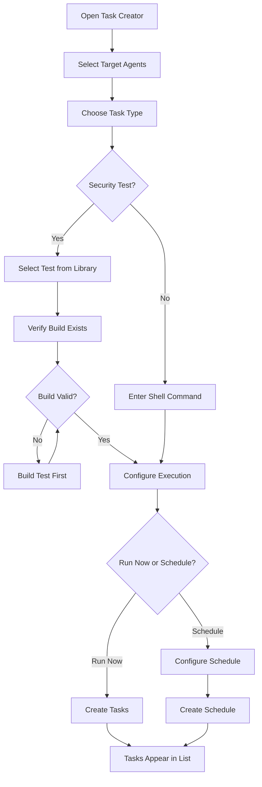

# Task Execution

## Creating a Task

1. Navigate to **Tasks** and click **Create Task**
2. Select the target **agents**
3. Select the **test** to execute
4. Optionally set the timeout and priority, and under **Advanced** a target **Elasticsearch index** (it must be an Achilles results index, named `achilles-results-…`)
5. Click **Create N Task(s)**

You can also start from the test: **Run on agents** on a test's page, or the run action on a row of the **Tests** list.

There is no platform to choose. Each agent receives the build for its own operating system, and a test with no build for that system is refused for that agent.

The task enters the pending queue and is picked up by the agent on its next poll.

## Task Lifecycle

```
pending → assigned → downloading → executing → completed/failed
```

1. **Pending** — Task created, waiting for agent to poll
2. **Assigned** — Agent picked up the task
3. **Downloading** — Agent downloading the test binary
4. **Executing** — Binary running on the endpoint
5. **Completed/Failed** — Final state with exit code and output

A task nobody picked up in time, or one you cancelled, ends as **Expired**.

### Automatic Task Retry

When a task fails because its agent went offline during execution, the system automatically creates a **retry task**:

- Retries target the **same agent** (it picks up the task when it reconnects)
- Default maximum retries: **2** (configurable per task via `max_retries`)
- Only `execute_test` tasks are retried (not update, uninstall, or command tasks)
- Each retry preserves the original task's payload, priority, and batch grouping

Retry tasks appear in the task list with a **"Retry 1/2"** badge. The `original_task_id` field links back to the root task for audit tracing.

:::info
Retries are created automatically by the `expireStaleTasks` background job. No manual intervention is needed. If you need to stop retries for a specific task, cancel the pending retry task.
:::

### Execution Timeout Expiry

Tasks can also be expired when they exceed the configured `execution_timeout` — even if the agent remains online. This catches cases where the agent-side timeout fails to kill a hung process (e.g., a child process escaped the Windows Job Object) but the heartbeat goroutine continues running.

The backend checks `assigned_at + execution_timeout + 120s` buffer on each task poll. Tasks that exceed this threshold are marked as **failed** with an execution timeout error. This runs alongside the existing stale task detection (agent offline) in `getNextTask()`.

### Local Result Queue

If the agent completes a task but cannot report the result (server unreachable, all retry attempts exhausted), the result is **persisted locally** as a JSON file in the agent's work directory:

```
{work_dir}/queue/{task_id}.json
```

The queue is drained automatically on the next successful heartbeat. Key details:
- Maximum queue size: **100 results** (oldest preserved, newest dropped if full)
- Queue files are written with restricted permissions (`0600`)
- Results are delivered in FIFO order and deleted after successful delivery
- If the drain encounters a delivery failure, it stops (server still unreachable) and retries on the next heartbeat

This ensures no test results are lost during extended server outages.

### Failure Reason Display

When a task fails, the failure reason is displayed in the Tasks page:

- **Detail panel** — A red banner shows the specific failure reason (e.g., "SHA256 mismatch: expected abc, got def", "download binary: connection timeout", "Agent went offline during execution")
- **Task row** — A security test that did not finish shows **run failed**; hover it for the reason
- **Exit code** — Failed tasks show exit code `-1` for pre-execution failures (download errors, verification failures) and `259` when the agent stopped a test that ran past its time limit

The agent sends failure context for all error types: binary download failures, SHA256/size mismatches, execution errors, update failures, and uninstall failures. For tasks that fail because the agent went offline, the backend generates a structured error result automatically.

## The Tasks Page

The header shows a one-line summary of the last 7 days: for example `last 7 days · 38 protected · 36 unprotected · 16 no verdict · 0 in progress`. The numbers use the same outcome rules as the task rows.

### Outcome breakdown

**Protected**, **Unprotected** and **No verdict** open a menu that lists the exit codes behind the number, for example `126 ExecutionPrevented` or `259 StillActive` (names come from the exit-code table), with a bar and a count for each. Runs that failed without an exit code get their own rows: **Agent offline**, **Timeout** and **Other failure**. **Timeout** means the server gave up waiting for a result (the task exceeded its execution timeout and the agent never reported back); a test the agent itself stopped at its time limit shows as `259 StillActive` instead. No verdict is split into groups (the test did not run, the run failed, the test reported an error, inconclusive).

Choosing a row filters the task list to that outcome. A chip next to the search box names the filter and its **x** clears it. Press **Esc** to close the menu without choosing. The filter covers security-test tasks from the last 7 days, the same window as the numbers, so the list shows exactly the tasks counted in that row. The pager counts runs, so its total can be lower than the number you clicked. A run shows only its matching tasks, and its header says how many of the run's agents are listed, for example `1 of 5 agents`.

If the list can't load while a filter is on (a network error, or the server is restarting), the filter stays and the list retries on its next refresh; rows fetched without the filter are never shown under its chip. Only if the server rejects the filter itself is it cleared, with a "Couldn't filter the task list." message.

### Sections: Runs, Schedules, Campaigns

Next to the **Tasks** title are three sections, the three ways tests reach agents:

- **Runs** (`/tasks`): the task list described on this page, with its type pills, status filter and search.
- **Schedules** (`/tasks/schedules`): the recurring and one-off schedules. It is always shown, even with no schedules yet. See [Managing Schedules](./task-scheduling#managing-schedules).
- **Campaigns** (`/tasks/campaigns`): saved tests × hosts plans and their evidence. Hidden on deployments without campaigns (Vercel). See [Campaigns](./campaigns).

The sections sit on the title row, so they take no space from the list. The 7-day numbers under the title stay on Runs and Schedules; choosing a breakdown row from Schedules switches to Runs with that filter.

### The run timeline

The list shows one entry per run. Each entry has the time, the name written once, and one mark per task. Entries are grouped by day, newest first.

A run is one of three things:

- **A test or command sent to one or more agents in one go.** This is the usual case.
- **A scheduled run.** Every task one schedule created for one day is a single entry, even when the tasks were created at different times. A schedule with a randomized time per machine reaches its agents one by one over hours; it is still one run. Its entry shows the time of its first and last task, for example `13:10:04 – 15:48:11`, and sits in the list at the time of its newest task (with a filter on, its newest matching task). A daily schedule is one entry per day. This does not depend on pre-execution notices.
- **An announced run.** For tasks no schedule created, with [pre-execution notices](../integrations/pre-execution-notices) on, every task that one notice announced for one test is a single entry. Two tests announced by the same notice stay two entries.

Tasks created separately by hand, without a notice, are separate entries: nothing is grouped by guessing from names or times.

**Runs from before this was recorded.** A task records its schedule from the release that introduced scheduled runs. When a server is upgraded to it, earlier tasks are attributed once: a task joins a schedule's run when it has no notice and matches a per-machine schedule on organization, creator, test and agent, and was created between that schedule's creation and its last run. A test you started by hand on one of the schedule's agents inside that window is counted in the scheduled run too. Runs of other kinds of schedule were already one entry.

A command run is named by its command, cut to one line (hover to read all of it). The detail of a command task shows the whole command with a copy button.

How the tasks of a run are drawn depends on how many there are:

| Tasks in the run | Drawn as |
|---|---|
| Up to 8 | A pill per task, with the hostname |
| 9 to 80 | One small square per task, with the counts below. Hover a square for its hostname |
| More than 80 | One bar split by result, with the counts below |

On a pill, a multi-stage test shows one small square per stage, read left to right:

| Square | Meaning |
|---|---|
| Green | The stage was blocked |
| Red | The stage ran without being blocked |
| Amber or grey | The stage did not produce a result (for example a test error) |
| Outline only | The stage was skipped, usually because an earlier stage was blocked |

Other tasks show one square in the colour of their result, the status while they are pending or running, or the exit code of a command. A run's dot on the left takes the colour of its worst result, and is blue while any of its tasks is still in progress.

Every run with more than one task has an arrow at the right of its header that opens its **host list**: the same tasks as rows, worst results first, with the hostname, result and duration in words and a checkbox on each row. On a run drawn as a bar, clicking a count under the bar (or a segment of the bar) opens the list on that result. The list shows 8 rows first; **Show n more** adds up to 100 more each time.

Clicking any task (a pill, a square or a row) shows its detail on the right. The left and right arrow keys move between tasks. A retry appears in its run as a second mark for the same host. Retries of a scheduled run always stay in it, whoever starts them. The one exception is a retry you start by hand of a run that no schedule created, where pre-execution notices are on: it is announced by a notice of its own, so it is a new entry at the top of the list with its own run tag, and the original run keeps its earlier mark.

To act on several tasks at once, tick the checkbox of a run (all of its tasks), rows in a host list, or **select all on page**.

### List and detail layout

On a large screen the task list and the detail of the selected task fill the rest of the window and scroll independently, so the detail never scrolls out of view while you move down the list. The list stays on screen while it reloads (after a retry, a cancel, a delete or a saved note), so the task you selected stays selected. Pagination sits at the bottom of the list pane. On a small screen the page scrolls as a whole.

## Task Results

Results include:
- **Exit code** — test-defined outcome code: `101` (attack succeeded — unprotected), `105`/`126`/`127` (blocked or quarantined — protected), `0` (normal exit — inconclusive, varies by test), `1` (binary not recognized / permission denied)
- **Stdout/Stderr** — Captured output from the test binary
- **Execution duration**
- **Timestamp**

Results are ingested into Elasticsearch for analytics.

## Binary Verification

Before execution, the agent verifies the downloaded binary against the task:
1. **SHA256 checksum** — Matches the hash the server recorded for the build
2. **File size** — Matches the recorded size

If either check fails, the task fails and the binary is not run. (The Ed25519 signature check applies to agent updates; see [Agent Self-Updates](./self-updates).)

An agent can download a test binary only while it holds a task for that test. Any other request gets `404`, the same answer as for a test that was never built.

## After the Run

Agents 0.7.3 and later remove a test's binaries from the endpoint when the run ends: the task folder, and the stage binaries the test extracted into `C:\F0` (Windows) or `/tmp/F0` (Linux, macOS). At startup the agent also removes task folders and test binaries left by runs that died more than an hour earlier, for example when an EDR killed the agent. Only files named after a test UUID are removed, never the agent, its config, logs or queued results.

## Task Creation Dialog


The task creation dialog supports two task types and multiple scheduling options. The **Task Type** switch is shown only to users who may send commands; everyone else creates security tests.



### Task Types

- **Security Tests** -- Select a pre-built test from the library. The dialog validates that a compiled binary exists before allowing submission.
- **Command** -- Run an arbitrary shell command across selected agents, as SYSTEM or root. Needs the `endpoints:tasks:command` permission (administrators). Commands run now; they cannot be scheduled.

### Agent Selection

The agent selector provides filtering and bulk operations:

- **Search** by hostname
- **Filter by tags** using multi-select dropdowns
- **Online-only toggle** to exclude offline agents
- **Not run** filter, with two parts:
  - *which test*: **this test** (the test you are about to send; with several tests selected, a host is kept when any of them is due) or **any test** (the host's last run of any test at all)
  - *period*: in 7, 30 or 90 days, or **ever** (hosts that never ran it)

  A host where a run is already queued is left out. Each row shows the host's last run for the chosen scope. In **Tasks → Create Task** the hosts come before the test, so only **any test** is available until you pick a test
- **Select All / Deselect All** for the currently filtered list
- Each agent row shows its online/offline status, hostname, OS, architecture, and tags

### Scheduling Options

| Schedule Type | Description |
|--------------|-------------|
| **Run Now** | Immediate execution on next agent poll |
| **Once** | One-time execution on a specific date, at a set time or a random time |
| **Daily** | Recurring daily at a fixed time, or randomized within business hours (09:00--17:00) |
| **Weekly** | Recurring on selected days of the week |
| **Monthly** | Recurring on a specific day of the month |

All schedule types support timezone selection, and every type can use a fixed time, one random time for the fleet, or a random time per machine. See [Task Scheduling](./task-scheduling#randomized-timing).

:::tip[Randomized Schedules]
Use randomized daily schedules for production environments. This prevents defenses from learning a predictable test execution pattern, giving you a more realistic measure of detection capability.
:::

### Integration Validation

Before submitting, the dialog checks for required integrations:

- Tests that target Azure/Entra ID validate that Azure credentials are configured
- Under **Advanced**, a target Elasticsearch index can be selected for result storage. Only Achilles results indices (`achilles-results-…`) are accepted

## Task Management Page

The Tasks page is the central control panel for all task activity.


### Type pills

The pills above the list choose which tasks it shows, each with its count:

| Pill | Tasks |
|------|-------|
| **Security tests** (default) | Test runs |
| **Commands** | Shell commands |
| **Maintenance** | Agent updates and uninstalls |
| **All** | Everything |

### Task stream

Tasks render as a chronological stream, described under [The run timeline](#the-run-timeline):

- **Date markers** separate days, so "when did this run" is answerable at a glance
- **One entry per run**: the time, the name, and a mark for each task. A task targeting several agents is one entry, not one row per agent. The entry also carries the run tag when a pre-execution notice was sent
- **A mark per task**: a security test shows its **outcome** by colour, and by stage for a multi-stage test (see [Status and outcome](#status-badges)); other tasks show `✓` / `✕` with `exit N`. Hover a mark, or open the run's host list, to read the result in words
- **A run of one task** is an entry with a single mark

Selecting a task opens the **detail panel** on the right: status, agent,
duration, exit code with its meaning, created time, batch id, and the full
`stdout` / `stderr`. For a multi-stage test the exit code is labelled **Final
exit**, because it is the last stage's code and can differ from the outcome; a
line under the title says what decided the outcome (for example
`Blocked at stage 2 (…), exit 126.`).

**Requested by** names who asked for the task: the user who clicked Run, the
creator of the schedule that ran it, or `API key · <name>`. Users who cannot
manage users see the name without the email address.

When the retention policy has removed a task's full output
(`TASK_OUTPUT_RETENTION_DAYS`, 90 days by default), the panel says so.

### Expanded output view

Click either output block — or focus it and press `Enter` — to open it in a
full-width dialog with a `70vh` scroll area. Long bundle output (a
cyber-hygiene run can emit hundreds of lines) is readable without scrolling a
200-pixel box. Each block has a copy button, and the dialog has **Copy all**.


### Retrying a task

Finished `execute_test` tasks (completed, failed or expired) carry a **Retry** action in the detail panel. It
re-dispatches the same test to the same agent as a new pending task and links
the two through `original_task_id`, so the retry chain stays auditable. The
detail panel of a retried task shows `retry n/m` under its name.

Manual retries are not capped by the task's `max_retries` budget — that governs
automatic retries only. Command tasks cannot be retried this way; re-issue them
from **Create Task** instead.

### Scheduled tasks

Schedules have their own section, **Schedules** (`/tasks/schedules`), next to
the **Tasks** title. It lists each schedule's cadence, next and last run and
agent count, with pause/resume and delete actions. See
[Schedule Management](#schedule-management).


### Status and outcome \{#status-badges}

While a task is in flight, its badge shows the lifecycle status:

| Status | Color | Description |
|--------|-------|-------------|
| Pending | Gray | Waiting for agent to poll |
| Assigned | Green | Agent picked up the task |
| Downloading | Green | Agent downloading binary |
| Executing | Amber | Binary running on endpoint |
| Expired | Gray | Agent did not pick up in time, or the task was cancelled |

A finished **security test** shows its outcome instead of Completed or Failed, because its exit code is the result: `126` is good news, not a failure.

| Outcome | Color | Meaning |
|---------|-------|---------|
| Protected | Green | Blocked: exit `105`, `126` or `127`, or a stage of a multi-stage test was blocked. Also a run the agent could not finish when an EDR alert proves the EDR killed it |
| Unprotected | Red | The attack ran: exit `101`, or at least one stage ran and none was blocked |
| Not run | Amber | Blocked before launch (exit `260`) |
| Run failed | Amber | The run did not finish (agent offline, timeout, download or verification error) |
| Test error | Amber | The test reported an error (exit `999` or `1`) |
| Inconclusive | Gray | Any other exit code, for example `0` or `259` |

Only **Unprotected** is red: a run that never happened says nothing about the endpoint. Hover an outcome for its one-line reason. The Tasks page reads the task's own result; Analytics can still show the same run as **Prevented** or **Detected** from EDR alerts. See [Exit Codes & Outcomes](../analytics/exit-codes-and-outcomes).

Commands, agent updates and uninstalls keep **Completed** (green) and **Failed** (red).

When [pre-execution notices](../integrations/pre-execution-notices) are on, a test task can also show:

| Status | Color | Description |
|--------|-------|-------------|
| Sending notice… | Amber | Held until the mail server accepts the notice email. Hover for the last send error. If it lasts more than a few seconds, sending is failing; see **Settings → Integrations → Pre-execution notices**, where the held run can also be released without notice |
| Starting soon | Green | The notice was accepted; the task is waiting out the lead time (0–5 minutes) |
| Not run | Gray | The task ended without running. Hover for the reason: `Not run: notice not delivered` (the email was never accepted within the max wait) or `Not run: host offline during notice window` (the host didn't pick the task up before the pickup window closed) |

:::info[Honest status]
For commands, updates and uninstalls, a task the agent marked `completed` whose result carries a non-zero exit code is displayed as **Failed**, not Completed. The stored status is unchanged, and the status filter above the list works on the stored status.
:::

### Filtering and Search

- Choose the task type with the [type pills](#type-pills)
- Filter by task status using the status dropdown
- Free-text search across task content (test names, hostnames, commands)
- Search is debounced to avoid excessive API calls while typing

### Bulk Operations

Select multiple tasks using checkboxes, then use bulk actions to:

- **Cancel** all selected pending/assigned tasks
- **Delete** the selected finished tasks (completed, failed or expired) from the list

Only finished tasks can be deleted; cancel an active one instead (the API answers `409` for a task that has not finished). A deleted task
leaves every list, but ProjectAchilles keeps an archived copy with who deleted it
and when. Results already in Analytics stay there, and a run that failed because
the agent went offline can still be recorded as **Protected** when an EDR's
alert later proves it stopped the test.

### Pagination

Choose 25, 50 or 100 rows per page at the bottom of the list, and move with **Newest**, **Newer**, **Older** and **Oldest**. A run counts as one row, however many tasks or batches it holds.

### Real-Time Updates

The task list polls every 10 seconds for status changes. Polling is silent -- it does not clear your current selection or scroll position.

## Schedule Management

The **Schedules** section of the Tasks page displays all schedules:

- Human-readable schedule descriptions (e.g., "Weekly Mon, Wed, at 09:30 UTC")
- Next and last run timestamps with relative formatting
- Status indicators: **Active**, **Paused**, or **Completed**
- Agent count per schedule
- Actions: **Pause/Resume** and **Delete**. A completed schedule can only be deleted

:::warning[Pausing vs. Deleting]
Pausing a schedule stops future executions but preserves the configuration. Deleting is permanent. Pause first if you are unsure.
:::

## Task Notes

Add annotations to any task with **Notes** in its detail panel (a dot marks a task that has a note). Earlier versions of a note are kept under **Edit history**. Notes are useful for documenting:

- Why a task failed and what was investigated
- Follow-up actions taken after a test result
- Context for other team members reviewing task history

## Permissions

Task-related actions are gated by role-based permissions:

| Action | Required Permission |
|--------|-------------------|
| Create tasks, retry | `endpoints:tasks:create` |
| Send shell commands | `endpoints:tasks:command` |
| Cancel tasks | `endpoints:tasks:cancel` |
| Delete tasks | `endpoints:tasks:delete` |
| Edit task notes | `endpoints:tasks:notes` |
| Create schedules | `endpoints:schedules:create` |
| Pause, resume, edit schedules | `endpoints:schedules:write` |
| Delete schedules | `endpoints:schedules:delete` |

Actions are hidden from the UI when the current user lacks the required permission.
