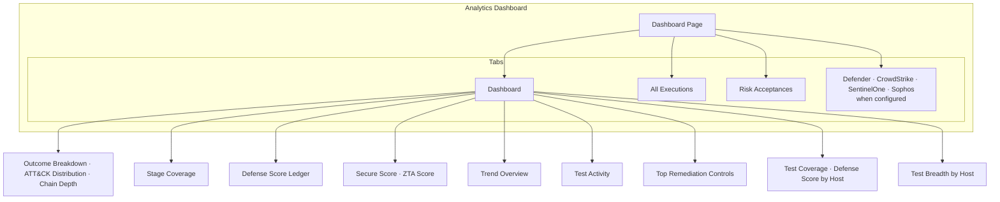

# Defense Score & Trends

The Defense Score is the primary metric for measuring your security posture.

## What Is the Defense Score?

The Defense Score is an aggregate percentage representing how many of your security tests were detected (or blocked) by your defenses. The Dashboard and Analytics headline, trend line, and the four breakdowns (category, host, technique, test coverage) use the **latest-result** score: a score of 85% means 85% of test × endpoint pairs were Protected on their most recent conclusive result. See [Latest-result score](#latest-result-score). Multi-stage bundles count as Protected when any stage of their latest run was stopped or detected. The ATT&CK technique breakdown is the exception: it scores each stage by its own result, so a technique whose stage got through shows as unprotected.

An **executions-based** score also exists: the share of individual executions that were Protected. It is what the API returns by default (`basis=executions`) and what the PDF execution report uses. Whichever basis you ask for, the API scores a multi-stage test by the any-stage rule unless you pass `scoringMode=all-stages`.

## Score Calculation (executions basis)

The formula below is the executions-based calculation; the latest-result score applies it to each pair's most recent result only.

```
Defense Score = (Protected Executions / Total Executions) × 100
```

Each test execution is classified by its exit code: conclusive outcomes are
`101` (attack succeeded — unprotected) and `105`/`126`/`127` (blocked or
quarantined — protected); error/inconclusive codes are excluded from the
score, with one exception: a stage that ended with an error code (for example
`999`) because the EDR's own alert on that stage killed, quarantined or blocked
it counts as protected (the Executions view labels it **Prevented**). EDR
correlation flags (`defender_detected`, `crowdstrike_detected`, …) count as
protected in the combined score. Bundle controls explicitly marked `skipped: true`
with exit code 0, and legacy skipped non-cyber-hygiene stages with exit code 0,
are excluded from both the score and error rate. An unmarked cyber-hygiene
exit 0 remains an inconclusive error rather than evidence that the control was
not assessed.

See **[Exit Codes & Outcomes](./exit-codes-and-outcomes)** for the canonical
reference covering every exit code, correlation flag, stage label, and SB
report outcome.

## Latest-result score

The dashboard headline uses the **latest-result** basis:

> Share of test × endpoint pairs whose most recent result in the selected window was blocked or detected.

A *pair* is one test on one endpoint (within one organization). Only the most recent conclusive result for each pair counts, so a test that failed last month but is blocked today shows as protected, and running a test many times does not weight it more heavily. Error and inconclusive results are skipped when finding the latest one.

**Freshness window.** The selected date range is the freshness window: a pair whose last conclusive result is older than the range is not counted. The window is capped at 365 days, so All time reads as "last 365d".

**Caption.** Under the score the dashboard shows `<n> pairs · ±d.d pts over <range>`: how many pairs were scored and how far the score moved across the range.

**Not enough data.** With fewer than 10 pairs the score is shown muted, in a neutral colour instead of red/amber/green, with the caption `n=<n> · not enough data` beneath it, because a handful of pairs swings the percentage too much to be meaningful.

**Trend.** The trend line is the same calculation as of each day. Day labels are UTC, ranges over 90 days use weekly points, and the last point always equals the headline score. A window with no pairs is drawn as a gap, not 0%.

The execution-count formula above still applies where noted: the PDF execution report and the test-vs-alert timeline cards stay on executions. The Defense Score [alert](../integrations/alerting) uses the latest-result score over a fixed 30 days, so it compares your threshold with the number the dashboard shows for 30d. Breakdowns by test, technique, severity, category, and organization also count executions. API users select the basis with `basis=latest|executions`; see the [Analytics API](../../api-reference/analytics#score-basis).

## What moved the score

The score can rise without anything being fixed. The **What moved the score** card on the Dashboard shows which part of a change is real. It appears when your backend supports it and Analytics is configured, and it follows the Dashboard's time range.

**Why the score can rise without a fix**

- **New tests that pass.** Twenty pairs with eight failing is 60%. Add eighty passing pairs and the score is 92%, with the same eight still failing.
- **Old results leaving the window.** A failing pair that is never run again drops out of the score once its last result is older than the range.
- **Risk acceptance.** An accepted failing pair is no longer counted.

The card does not change the score. It sorts the same results into what was fixed and what only left the score.

**Reading the card**

The line under the title gives the number of pairs in the score and the number of failing pairs at the start and at the end of the range. These are the score's own counts.

The **Failures dealt with** panel covers every pair that failed during the range, and every pair that was already failing when the range started, if it was still in the score then or was re-tested in the range. Cyber-hygiene controls are included here, because the score counts them:

- **Fixed**: the pair was run again and its latest result is protected.
- **Still failing**: the pair was run again after it failed and still gets through.
- **Not re-tested**: the pair failed and has not been run since.
- **Left the score untested**: the pair was failing before the range started and has not been run in it, so its old result is no longer counted. It is not fixed, only out of sight. The pill at the top right (**N failures not re-tested**) adds this group to **Not re-tested**.

The line under the rows explains where the failures came from: failures already open at the start of the range, older failures that were re-tested, new tests that got through, regressions (a pair that was protected and later got through) and first results on an endpoint (the first result of a pair that is not a new test: an existing test run for the first time on a machine, or any cyber-hygiene control, including those of a new bundle).

The **New tests · first run** panel covers tests the organization had never run before the range. It counts each test on each endpoint by its first result in the range: **Stopped on the first run** or **Got through on the first run**. A new test that got through and was fixed later still counts as got through here and as fixed in the other panel. Cyber-hygiene bundles are left out of this panel: their controls count under **Failures dealt with** if they fail, and their first results are counted under first time on an endpoint, never under new tests.

Each number has a **view** link that opens the list of tests and endpoints behind it, with the origin of each failure, when it started failing, when it was fixed and the date of its last result. A list shows at most 200 rows and says "Showing 200 of N" when there are more. **Still failing** and **Not re-tested** are the work lists.

The footer shows, only when they are not zero: pairs that regressed and how many of them are fixed since; pairs seen for the first time on an endpoint (an existing test run for the first time on a machine, or the first result of any cyber-hygiene control, counted apart from new tests; deploying a new cyber-hygiene bundle makes this figure large); failing pairs hidden by risk acceptances; and the two lines below.

**One test on one endpoint is one item.** The score can hold two pairs for the same test on the same endpoint: one for runs where the test's stages reported, and one for runs that ended before any stage (for example, the test was blocked at launch). The card merges them, so blocking a test at launch counts as fixing it. The score does not merge them, so it can disagree with the card. The footer says by how much:

- **N failures the score still counts were fixed by blocking the test before it started**: the card counts these as fixed and the score still holds their old failing result.
- **N open failures are counted twice by the score**: the score holds a failing pair for each of the two, the card holds one.

With these two numbers the failing count at the end of the range equals the open failures on the card (still failing plus not re-tested) plus the two footer figures.

**What to keep in mind**

- A pair that fails, passes and fails again counts once, by where it ended.
- For a standalone test or a cyber-hygiene control the card sees the first and the last result of each day, so a result in the middle of a day is not seen. Every run of a multi-stage test is seen.
- A risk acceptance on a single control can remove one stage from a multi-stage run. In the rare case where that removes a pair's whole earlier run, a later failure reads as a first result and not as a regression.
- When a failure was already open before the range, the day it began is not known. Its row says "before" and the first day of the range.
- "First run" is per endpoint. If a new test runs on 3 machines, is tuned, and then runs on 40 more, those 40 count as first runs.
- A test that only ever produced errors before, and gets its first conclusive result in the range, counts as new.
- A test last run more than 365 days before the range counts as new again.

## Breakdowns

The Defense Score can be broken down by:
- **Test** — Score per individual test
- **Technique** — Score per MITRE ATT&CK technique
- **Category** — Score per test category
- **Hostname** — Score per endpoint

## Trend Analysis

The trend line shows the score as of each UTC day, using the same freshness window as the headline tile. Its last point equals the tile, ranges over 90 days use weekly points, and a gap means no pairs fell in the window (not 0%).

A downward trend indicates deteriorating security posture and may trigger a [threshold alert](../integrations/alerting). The alert reads the latest-result score of the last 30 days, whatever range the dashboard shows; when no pair has a conclusive result there is no score and the check is skipped.

Via the API, the rolling `windowDays` option (1-90 days) applies only to the executions basis; under `basis=latest` it is ignored.

## Actual, EDR-only, and Risk-accepted Scores

The dashboard ledger reconciles the headline with an *Actual* score, an *EDR-only* score, and the effect of risk acceptances, so you can see both the current state and what is excluded:

- **Actual** is the raw score before risk acceptance: the same calculation with no exclusions applied. It shows a value only while acceptances exclude something (otherwise it would equal the headline, so the row shows —).
- **EDR-only** is the strict, blocked-only score: it counts only results the endpoint control blocked (`is_protected`), not detections from a connected EDR (Defender, CrowdStrike, SentinelOne or Sophos).
- **Risk-accepted** is how many test × endpoint pairs the active acceptances exclude.

## Time window

Analytics and the Security Dashboard share one time range, defaulting to
**30 days**. Change it on either page and the other page opens on the same
window: last 24 hours, 7, 30 or 90 days, all time, or a custom range (set from
the Analytics date picker; the Dashboard then shows a **Custom** chip).

The choice is remembered for the browser tab until it is closed, so it survives
reloads and moving between pages. It is also carried in the URL, so a filtered
view is shareable; a range in a link wins over the remembered one. If your
fleet runs bundles monthly, pick 90d: a 30-day window can look sparse between
runs.

## Dashboard Layout


The Analytics page has three tabs that are always there (**Dashboard**, **All Executions**, **Risk Acceptances**) and one tab per connected EDR (**Defender**, **CrowdStrike**, **SentinelOne**, **Sophos**). The **All Executions** tab shows its result count and **Risk Acceptances** its number of active acceptances.



### Dashboard Tab


The **Dashboard** tab is the primary visualization hub. Since 2.1 it is laid out
in analyst columns: a narrow left column carrying the numbers you quote, and a
wide right column carrying the shapes you read.

**Top row — three cards**

- **Outcome breakdown** — donut plus a legend list that splits the latest result
  of each test x host pair into Protected (blocked by a control), Prevented (the
  EDR stopped it), Detected only (it ran and the EDR alerted) and Silent (it ran
  with no alert). Cyber-hygiene bundles are left out, and the outcome filters do
  not narrow it. Pairs with no conclusive result yet, and risk-accepted pairs,
  are counted in a line under the legend and left out of the donut. Click an
  outcome in the legend to open the All Executions tab filtered to that
  outcome; an "Outcome: …" chip above the table removes the filter. On installs
  whose backend does not offer it (Vercel), the card shows Results by error type instead.
- **ATT&CK technique distribution** — one row per technique (the ten with the
  most results) with a stacked protected/unprotected bar and a percentage; a
  chip per connected EDR counts the listed techniques that also appear on its
  alerts (for example "3 with Defender alerts"). Click a row to open All
  Executions filtered to that technique
- **How deep attack chains get** — for each multi-stage (non-cyber-hygiene)
  chain, the latest run on each host: the stage where it was blocked (1, 2, 3,
  or 4+), or that nothing blocked it. Chains nothing blocked are split into
  "End to end · detected" (an EDR alerted but did not block) and "End to end ·
  undetected" (no alert at all), because the Defense Score counts a detection
  as protected while chain depth counts only a block. On a stage row, an amber
  segment means an EDR alerted on an earlier stage.
  "Stage not run · binary blocked" (blue) counts chains whose latest run had a stage
  blocked before it ran (exit 260), for example an ASR prevalence rule
  stopping the freshly built test binary. The technique was never evaluated,
  so this is not a protection result and is not counted as protected anywhere.
  A whole run an EDR's own alert proves it blocked at launch is different: it
  is Protected and counts as blocked at stage 1 (see
  [Exit Codes & Outcomes](./exit-codes-and-outcomes#7-test-blocked-at-launch-by-the-edr)).
  Chains whose latest run had a stage error (for example exit 999) before
  any block are noted in the footer, not in the rows; an error on a later
  stage than the block doesn't hide the block. The chip totals the rows. It follows the
  filter bar, and clicking a row filters Executions to those bundles. A chain
  counts at the first stage that blocked it, also for chains that keep running
  after a block (LockBit); the amber "alerted" segment then counts only
  detections on stages before that one.

**Stage coverage (full width, under the top row)**

The Defense Score counts a multi-stage test on a host as protected once **any**
stage is blocked or detected. That is the right headline, because one broken
link stops the attack, but it does not show how much of each chain rests on
that one link. The Stage coverage card shows it, for the same chains as "How
deep attack chains get" (the latest run of each multi-stage test on each host).
It does not change the Defense Score, and there is no setting: both numbers are
always shown.

- **The percentage** is the share of stages that were caught, out of the
  stages that ran: *blocked* (by the endpoint, or by the EDR's own action on
  an error-coded stage), *detected* (an EDR alert that names that stage, not
  blocked) and *got through* (neither). A stage is never credited for an alert
  that only named the test as a whole or a sibling stage.
- **Defense Score for these chains** is the any-stage score of these chains
  only, for comparison. It is not the page's Defense Score, which also counts
  single-stage tests and cyber-hygiene controls.
- **Four rows** sort the chains, and add up to the count in the corner:
  - **Rest on a single stage**: the chain ran every stage and exactly one was
    caught. If the attacker changes that one technique, nothing else stopped
    this chain. These are the chains to work on first.
  - **Depth not tested**: one stage was caught and the rest of the chain
    produced no result: the test stopped there and skipped its later stages,
    or those stages errored after the block. Nothing says whether they would
    have been caught. This is not a weakness; it is a gap in what was measured.
  - **Two or more stages caught**: more than one layer stopped or saw the chain.
  - **No stage caught**: the chain ran end to end with no stage caught on its
    own evidence.
- Runs the EDR stopped before any stage ran (it killed the agent, or blocked
  the test at launch) have no stages and are not counted here. They still
  count as protected in the Defense Score.
- The card follows the filter bar. Clicking a row opens Executions filtered to
  those chains.

The card is not shown on installs whose backend does not offer it (Vercel).

**Posture row — left column**

- **Defense Score ledger** — a ring gauge beside four reconciling lines:
  *Actual* (raw protected share), *EDR-only*, *Risk-accepted* (how many test × endpoint
  pairs are excluded), and *Inconclusive* (the share of test × endpoint pairs
  with results but no conclusive one yet, such as tests blocked before they
  ran). A footer strip carries endpoints, tests (a multi-stage test counts
  once), and the pair count behind the score. The ledger replaced the old hero card, which showed one
  big number and left the reconciliation implicit.
- **Secure Score** — Microsoft Defender's score and raw points, when configured
- **ZTA Score** — CrowdStrike's Zero Trust Assessment score, when configured
  and licensed

**Posture row — right column**

- **Trend Overview** — Defense Score, Actual Score, error rate, and (when
  configured) Secure Score and ZTA Score. The Defense Score line is the
  latest-result score as of each UTC day, over the same window as the ring, and
  the header shows the most recent value of each series. Actual Score renders as
  a neutral dashed reference line (shown only when risk acceptances are active)
  rather than a fourth green series.

**Lower rows** — Test activity (the latest runs with the same result label as
All Executions: a multi-stage run is one row), Top Remediation Controls (ranked
by Secure Score impact), Test Coverage and Defense Score by Host as flat bar
lists, and [Test Breadth by Host](#test-breadth-by-host).

:::note[Without Microsoft Defender]
The Secure Score and Top Remediation Controls cards are Defender-only. When the
integration is not configured they are omitted and the remaining cards reflow to
fill the row — the layout stays balanced rather than leaving a gap.
:::

### All Executions Tab \{#executions-tab}

The **All Executions** tab provides a full data table of individual test executions. Features include:

- **Master-detail layout** — grouped runs on the left, the selected run's
  per-control results on the right; `↑` / `↓` move the selection
- Bundle grouping -- related bundle controls are grouped under collapsible parent rows showing a "X/Y Protected" summary badge
- Multi-select with bulk operations (archive, accept risk)
- An **Export** menu: CSV, JSON, the [PDF report](./execution-report) and the SB Export (see [Data Export](#data-export))
- Deep-linkable — the selected run rides in `?expanded=<id>`, so a shared
  link opens straight to that result


### Risk Acceptances Tab

The **Risk Acceptances** tab tracks security exceptions:

1. Select unprotected executions in the All Executions table and choose **Accept risk**
2. Choose the scope: **All Hosts** or **This Host Only**
3. Provide a justification (minimum 10 characters)
4. Active acceptances are marked on the affected results and are excluded from the Defense Score

An acceptance is revoked from the same tab with a reason (minimum 10 characters), which re-includes those results in score calculations. See [Risk Acceptance](./risk-acceptance).

### EDR Tabs \{#defender-tab}

When Microsoft Defender is configured, a dedicated **Defender** tab appears
with an evidence-based detection rate, Secure Score, alert correlation, MITRE
technique overlap, and an alert drill-down drawer. See
[Microsoft Defender](./microsoft-defender) for the full tab walkthrough.

When CrowdStrike Falcon is configured, a parallel **CrowdStrike** tab appears
with the same shape — evidence-based detection rate, ZTA posture score, alert
correlation, technique overlap, and an alert drawer with Falcon console links.
See [CrowdStrike Falcon](./crowdstrike).

**SentinelOne** and **Sophos** tabs appear the same way when those
integrations are configured. See [SentinelOne](./sentinelone) and
[Sophos](./sophos). Neither integration is available on Vercel.

:::info[Detection Rate vs. Defense Score]
These are distinct metrics. The **Defense Score** measures whether a test's
*exit code* reported it as protected; the EDR tabs' **Detection Rate**
measures whether *that EDR detected the run*,
read from the per-run enrichment flags (a bundle stage by its own
`stage_detected` flag, a standalone test by its `detected` flag, and a
vendor-confirmed prevention always counts as detected). See the Detection Rate sections of
[Microsoft Defender](./microsoft-defender#detection-rate) and
[CrowdStrike Falcon](./crowdstrike#detection-rate); the SentinelOne and Sophos tabs use the same rule. The Defense Score counts cyber-hygiene controls; the Detection Rate
excludes them. Auto-resolve never affects either score.
:::

## Test Breadth by Host

The card shows one tile of equal size per tested host: how many of
the tests in use that host has run. Hosts with no result are listed below the
tiles. It is about how much was tested, not how
well the host defended, so it uses a neutral blue ramp and never green or red.

- **Test set.** The tests run anywhere in the last 90 days (toggle: 30 days, or
  only the tests run in the selected window), plus any test run in the window.
  With an organization selected, only that organization's tests count. A
  multi-stage test counts once.
- **Shade.** The share of the set the host ran in the window: under 25%,
  25–49%, 50–79%, 80% and over. The tile reads, for example, "17% · 1 of 6".
- **Not tested.** Active enrolled agents with no result in the window are
  listed by name in a "Not tested" group below the tiles (the first 40, then
  "Show all"). With filters other than date, organization or hostname
  applied, the group reads "No matching result", because a filtered view cannot
  show that the host was never tested. Disabled, decommissioned and uninstalled
  agents are left out.
- **Order.** Tiles run from the lowest breadth to the highest. Past 25 tested
  hosts the best-tested ones fold into "Others"; click it to see them. Hosts
  not tested never take a tile, so they cannot push results out of view.
- **Tooltip and drill-down.** The tooltip lists the tests the host is missing,
  and the host's Defense Score with its counts ("75% · 3 of 4 protected"), the
  same figure as the Defense Score by Host card. A host outside that card's 50
  most-tested hosts, or with no conclusive result, shows no score.
  Clicking a host, tested or not, shows one tile per test: filled with its run count when the
  host ran it, hollow when it did not.

Untested hosts come from the agent list, which needs the
`endpoints:agents:read` permission. Without it the card shows the tested hosts
only and says "enrolled hosts unavailable".


The other coverage cards are described in [Coverage Views](./heatmaps-treemaps).

## Filtering

The page header carries the date range and a **Filters** button. The button opens the filter bar, which applies to the Dashboard and All Executions tabs, and shows how many filters are active:

| Filter | Description |
|--------|-------------|
| **Date range** (page header) | Last 24 hours, 7, 30 or 90 days, all time, or a custom start and end date |
| **Result** | All results, or only Protected, Unprotected or Inconclusive |
| **Hostname** | Endpoint hostnames |
| **Category** | Test categories |
| **Threat Actor** | Threat actors the tests emulate |
| **Tags** | Test tags |
| **Error Name** / **Error Code** | Result names and exit codes |
| **Bundle** | Bundle and multi-stage test names |
| **Test** | Test names |
| **Technique** | MITRE ATT&CK technique IDs |

All but **Result** are multi-select. Several values in one filter match any of them; different filters combine, so each one narrows the results. Active filters are listed as removable chips under the bar, and **Clear All** removes them. Filters are carried in the URL, so a filtered view can be shared. There is no severity filter: test severity was removed from the console.

The EDR tabs follow the date range only.

:::tip[Trend granularity]
The trend chart uses daily points, and weekly points for ranges over 90 days.
:::

## Data Export

The **Export** menu on the **All Executions** tab offers:

- **Export CSV** -- Spreadsheet-compatible format with consistent timestamp formatting
- **Export JSON** -- Machine-readable format suitable for integration with other tools
- **Report (PDF)** -- the print-ready [execution report](./execution-report) for the same filters
- **SB Export** -- the SB-PC-2026-001 JSON report for the selected window

CSV and JSON hold **every result that matches** the current filters, sort order and outcome chip, not only the page on screen. A bundle or multi-stage run exports one row per control or stage. The export stops at 10,000 results; past that it keeps the newest and says so next to the table ("Exported the newest 10,000 of …").

The SB Export follows the organization, tags, hostname, test and bundle filters. It ignores the result and outcome filters on purpose, because they would misstate a compliance report. **All time** exports the last 90 days.

## Real-Time Updates

The dashboard automatically reloads data when you:

- Change any filter or date range
- Switch tabs
- Modify Elasticsearch settings (index pattern changes)
- Connect or disconnect an EDR integration
- Select **Refresh** in the page header

:::info[Conditional Loading]
Only the active tab's data is fetched, so switching tabs triggers a fresh load for that tab while keeping others cached.
:::
