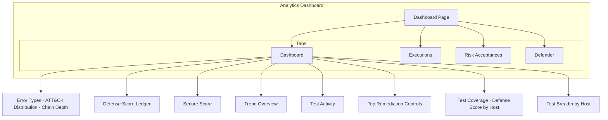

# Defense Score & Trends

The Defense Score is the primary metric for measuring your security posture.

## What Is the Defense Score?

The Defense Score is an aggregate percentage representing how many of your security tests were detected (or blocked) by your defenses. The Dashboard and Analytics headline, trend line, and the four breakdowns (category, host, technique, test coverage) use the **latest-result** score: a score of 85% means 85% of test × endpoint pairs were Protected on their most recent conclusive result. See [Latest-result score](#latest-result-score). Multi-stage bundles count as Protected when any stage of their latest run was stopped or detected. The ATT&CK technique breakdown is the exception: it scores each stage by its own result, so a technique whose stage got through shows as unprotected.

An **executions-based** score also exists: the share of individual executions that were Protected. It is what the API returns by default (`basis=executions`) and what the PDF execution report and score-drop alerts use.

## Score Calculation (executions basis)

The formula below is the executions-based calculation; the latest-result score applies it to each pair's most recent result only.

```
Defense Score = (Protected Executions / Total Executions) × 100
```

Each test execution is classified by its exit code: conclusive outcomes are
`101` (attack succeeded — unprotected) and `105`/`126`/`127` (blocked or
quarantined — protected); error/inconclusive codes are excluded from the
score. EDR correlation flags (`defender_detected`, `crowdstrike_detected`)
count as protected in the combined score.

See **[Exit Codes & Outcomes](./exit-codes-and-outcomes)** for the canonical
reference covering every exit code, correlation flag, stage label, and SB
report outcome.

## Latest-result score

The dashboard headline uses the **latest-result** basis:

> Share of test × endpoint pairs whose most recent result in the selected window was blocked or detected.

A *pair* is one test on one endpoint (within one organization). Only the most recent conclusive result for each pair counts, so a test that failed last month but is blocked today shows as protected, and running a test many times does not weight it more heavily. Error and inconclusive results are skipped when finding the latest one.

**Freshness window.** The selected date range is the freshness window: a pair whose last conclusive result is older than the range is not counted. The window is capped at 365 days, so All time reads as "last 365d".

**Caption.** Under the score the dashboard shows `<n> pairs · ±d.d pts over <range>`: how many pairs were scored and how far the score moved across the range.

**Not enough data.** With fewer than 10 pairs the score is shown muted, in a neutral colour instead of red/amber/green, with the caption `n=<n> · not enough data` beneath it, because a handful of pairs swings the percentage too much to be meaningful.

**Trend.** The trend line is the same calculation as of each day. Day labels are UTC, ranges over 90 days use weekly points, and the last point always equals the headline score. A window with no pairs is drawn as a gap, not 0%.

The execution-count formula above still applies where noted: the PDF execution report, score-drop alerts, and the test-vs-alert timeline cards stay on executions. Breakdowns by test, technique, severity, category, and organization also count executions. API users select the basis with `basis=latest|executions`; see the [Analytics API](../../api-reference/analytics#score-basis).

## Breakdowns

The Defense Score can be broken down by:
- **Test** — Score per individual test
- **Technique** — Score per MITRE ATT&CK technique
- **Category** — Score per test category
- **Hostname** — Score per endpoint
- **Severity** — Score per severity level

## Trend Analysis

The trend line shows the score as of each UTC day, using the same freshness window as the headline tile. Its last point equals the tile, ranges over 90 days use weekly points, and a gap means no pairs fell in the window (not 0%).

A downward trend indicates deteriorating security posture and may trigger [threshold alerts](../integrations/alerting), which are evaluated on executions.

Via the API, the rolling `windowDays` option (1-90 days) applies only to the executions basis; under `basis=latest` it is ignored.

## Actual, EDR-only, and Risk-accepted Scores

The dashboard ledger reconciles the headline with an *Actual* score, an *EDR-only* score, and the effect of risk acceptances, so you can see both the current state and what is excluded:

- **Actual** is the raw score before risk acceptance: the same calculation with no exclusions applied. It shows a value only while acceptances exclude something (otherwise it would equal the headline, so the row shows —).
- **EDR-only** is the strict, blocked-only score: it counts only results the endpoint control blocked (`is_protected`), not Defender or CrowdStrike detections.
- **Risk-accepted** is how many test × endpoint pairs the active acceptances exclude.

## Time window

Analytics and the Security Dashboard share one time range, defaulting to
**30 days**. Change it on either page and the other page opens on the same
window: last 24 hours, 7, 30 or 90 days, all time, or a custom range (set from
the Analytics date picker; the Dashboard then shows a **Custom** chip).

The choice is remembered for the browser tab until it is closed, so it survives
reloads and moving between pages. It is also carried in the URL, so a filtered
view is shareable; a range in a link wins over the remembered one. If your
fleet runs bundles monthly, pick 90d: a 30-day window can look sparse between
runs.

## Dashboard Layout


The Analytics Dashboard uses a multi-tab interface with four main areas:



### Dashboard Tab


The **Dashboard** tab is the primary visualization hub. Since 2.1 it is laid out
in analyst columns: a narrow left column carrying the numbers you quote, and a
wide right column carrying the shapes you read.

**Top row — three cards**

- **Results by error type** — donut plus a legend list of `name · count · pct`
- **ATT&CK technique distribution** — one row per technique with a stacked
  protected/unprotected bar and a percentage; a warning chip counts techniques
  that also raised Defender or CrowdStrike alerts
- **How deep attack chains get** — for each multi-stage (non-cyber-hygiene)
  chain, the latest run on each host: the stage where it was blocked (1, 2, 3,
  or 4+), or that nothing blocked it. Chains nothing blocked are split into
  "End to end · detected" (an EDR alerted but did not block) and "End to end ·
  undetected" (no alert at all), because the Defense Score counts a detection
  as protected while chain depth counts only a block. On a stage row, an amber
  segment means an EDR alerted on an earlier stage.
  "Stage not run · binary blocked" (blue) counts chains whose latest run had a stage
  blocked before it ran (exit 260), for example an ASR prevalence rule
  stopping the freshly built test binary. The technique was never evaluated,
  so this is not a protection result and is not counted as protected anywhere.
  Chains whose latest run had a stage error (for example exit 999) are noted
  in the footer, not in the rows. The chip totals the rows. It follows the
  filter bar, and clicking a row filters Executions to those bundles. A chain
  counts at the first stage that blocked it, also for chains that keep running
  after a block (LockBit); the amber "alerted" segment then counts only
  detections on stages before that one.

**Posture row — left column**

- **Defense Score ledger** — a ring gauge beside four reconciling lines:
  *Actual* (raw protected share), *EDR-only*, *Risk-accepted* (how many test × endpoint
  pairs are excluded), and *Inconclusive*. A footer strip carries endpoints, tests,
  and the pair count behind the score. The ledger replaced the old hero card, which showed one
  big number and left the reconciliation implicit.
- **Secure Score** — Microsoft Defender's score and raw points, when configured

**Posture row — right column**

- **Trend Overview** — Defense Score, Actual Score, error rate, and (when
  configured) Secure Score and ZTA Score. The Defense Score line is the
  latest-result score as of each UTC day, over the same window as the ring, and
  the header shows the most recent value of each series. Actual Score renders as
  a neutral dashed reference line (shown only when risk acceptances are active)
  rather than a fourth green series.

**Lower rows** — Test activity, Top Remediation Controls (ranked by Secure Score
impact), Test Coverage and Defense Score by Host as flat bar lists, and the
Test Breadth by Host treemap.

:::note Without Microsoft Defender
The Secure Score and Top Remediation Controls cards are Defender-only. When the
integration is not configured they are omitted and the remaining cards reflow to
fill the row — the layout stays balanced rather than leaving a gap.
:::

### Executions Tab

The **Executions** tab provides a full data table of individual test executions. Features include:

- **Master-detail layout** — grouped runs on the left, the selected run's
  per-control results on the right; `↑` / `↓` move the selection
- Bundle grouping -- related bundle controls are grouped under collapsible parent rows showing a "X/Y Protected" summary badge
- Multi-select with bulk operations (archive, accept risk)
- CSV and JSON export with consistent timestamp formatting
- Deep-linkable — the selected run rides in `?expanded=<id>`, so a dashboard
  "recent executions" row or a shared link opens straight to that result


### Risk Acceptances Tab

The **Risk Acceptances** tab tracks security exceptions:

1. Select failed executions from the Executions table
2. Provide a justification (minimum 10 characters)
3. Choose scope: test-specific, host-specific, or global
4. Active acceptances appear with badges throughout the dashboard and are factored into the Defense Score

Risk acceptances can be revoked with a single click, which re-includes those results in score calculations.

### Defender Tab

When Microsoft Defender is configured, a dedicated **Defender** tab appears
with an evidence-based detection rate, Secure Score, alert correlation, MITRE
technique overlap, and an alert drill-down drawer. See
[Microsoft Defender](./microsoft-defender) for the full tab walkthrough.

When CrowdStrike Falcon is configured, a parallel **CrowdStrike** tab appears
with the same shape — evidence-based detection rate, ZTA posture score, alert
correlation, technique overlap, and an alert drawer with Falcon console links.
See [CrowdStrike Falcon](./crowdstrike).

:::info Detection Rate vs. Defense Score
These are distinct metrics. The **Defense Score** measures whether a test's
*exit code* reported it as protected; the EDR tabs' **Detection Rate**
measures whether *Microsoft Defender or CrowdStrike detected the run*,
read from the per-run enrichment flags (a bundle stage by its own
`stage_detected` flag, a standalone test by its `detected` flag, and a
vendor-confirmed prevention always counts as detected). See the Detection Rate sections of
[Microsoft Defender](./microsoft-defender#detection-rate) and
[CrowdStrike Falcon](./crowdstrike#detection-rate). The Defense Score counts cyber-hygiene controls; the Detection Rate
excludes them. Auto-resolve never affects either score.
:::

## Coverage Treemap

The Coverage Treemap provides a drill-down view of test coverage per endpoint:

- Each cell represents a host, sized by the number of tests executed
- Cells are color-coded by coverage percentage:
  - **Green** (80%+) -- Strong coverage
  - **Amber** (50--79%) -- Partial coverage
  - **Red** (below 50%) -- Low coverage
- Click a host cell to drill down to individual test results on that endpoint


- Three baseline comparison modes control how "100% coverage" is defined:
  - **90-day baseline** -- Uses the total distinct tests seen in the last 90 days
  - **30-day baseline** -- Uses the total distinct tests seen in the last 30 days
  - **Current window** -- Uses only tests within the currently selected date range

## Filtering

The filter bar runs across the top of every tab and supports multiple simultaneous dimensions:

| Filter | Description |
|--------|-------------|
| **Date Range** | Preset ranges (24h, 7d, 30d, 90d, all time) or a custom start/end date |
| **Hosts** | Multi-select dropdown of endpoint hostnames |
| **Tests** | Multi-select dropdown of test names |
| **Techniques** | Multi-select dropdown of MITRE ATT&CK technique IDs |
| **Categories** | Multi-select dropdown of test categories |

Filters are additive -- selecting multiple values in the same dropdown narrows results. Each dropdown shows a count badge when filters are active. The filter bar is collapsible to save screen space.

:::tip Date Range Shortcuts
Use the preset date range buttons (24h, 7d, 30d, 90d) for quick time-window changes. The trend chart automatically adjusts its time axis granularity to match the selected range.
:::

## Data Export

From the **Executions** tab, you can export data in two formats:

- **CSV** -- Spreadsheet-compatible format with consistent timestamp formatting
- **JSON** -- Machine-readable format suitable for integration with other tools

The export respects all currently applied filters, so you can narrow the dataset before exporting.

## Real-Time Updates

The dashboard automatically reloads data when you:

- Change any filter or date range
- Switch tabs
- Modify Elasticsearch settings (index pattern changes)
- Toggle Defender or CrowdStrike integrations on or off

:::info Conditional Loading
Only the active tab's data is fetched, so switching tabs triggers a fresh load for that tab while keeping others cached.
:::
