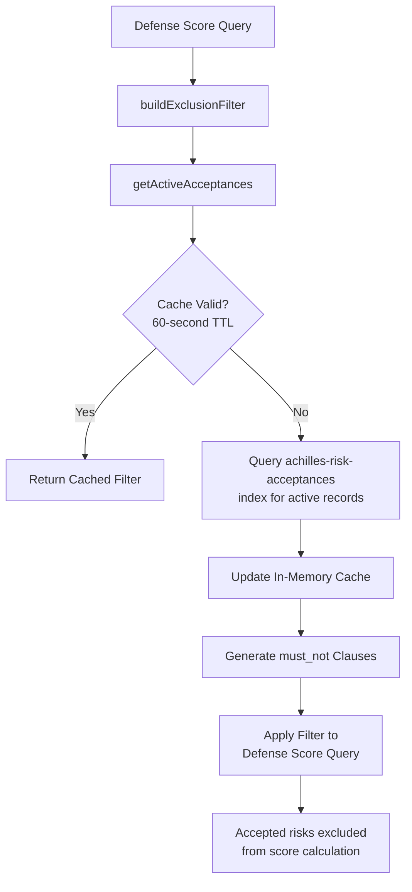
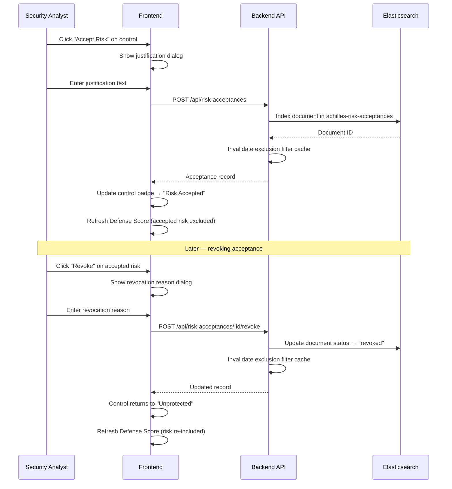

# Risk Acceptance

## Overview

Risk Acceptance allows you to formally acknowledge that certain security controls are not detected — and that this is an accepted risk rather than a gap to fix.

## Accepting Risk

1. In **Analytics → All Executions**, find the unprotected test, control or stage
2. Select **Accept risk** in its detail panel, or tick several runs and use **Accept risk** in the bulk bar
3. Choose the **scope** using the toggle:
   - **All Hosts** (default) — excludes the test/control from Defense Score across the entire organization
   - **This Host Only** — scopes the exclusion to the specific hostname where the failure occurred
4. Provide a justification (required, at least 10 characters)
5. The control is marked as "Risk Accepted" and excluded from the Defense Score calculation

## Audit Trail

All risk acceptance decisions are tracked with:
- **Who** accepted the risk (Clerk user ID)
- **When** the decision was made
- **Why** (the justification provided)

## Revoking Acceptance

Risk acceptance can be revoked at any time, from the result or from the **Risk Acceptances** tab. A reason of at least 10 characters is required. Revoking returns the control to the "Unprotected" category and recalculates the Defense Score.

Accepting and revoking need the `analytics:risk:write` permission.

## Acceptance Scope

The Accept Risk dialog provides a scope toggle with two options:

| Scope | Behavior | Example Use Case |
|-------|----------|------------------|
| **All Hosts** (global) | Excludes the test/control from Defense Score across all endpoints | A test that triggers false positives everywhere, or a CIS control that conflicts with business requirements |
| **This Host Only** (host) | Excludes only on the specific hostname where the failure occurred | A legacy server that cannot be patched, while other endpoints should still be tracked |

The hostname is always stored for audit trail regardless of scope. When choosing scope, prefer **This Host Only** unless the business justification applies organization-wide.

:::info[Legacy Records]
Risk acceptances created before the scope toggle was added fall back to current behavior: records with a hostname are treated as host-scoped, records without are treated as global.
:::

## Risk Scoring Model

Accepted risks are excluded from the Defense Score calculation through an Elasticsearch exclusion filter. The flow works as follows:

The exclusion filter generates Elasticsearch `must_not` clauses that match the `test_name`, `control_id`, and `hostname` fields of each active acceptance. This means:

- **Accepted tests** no longer count as "Unprotected" in the Defense Score
- The **Defense Score ledger** shows how many test × endpoint pairs are excluded (*Risk-accepted*) and the score without the exclusions (*Actual*)
- The **Outcome breakdown** card leaves accepted pairs out and says how many ("N risk-accepted pairs not counted")

:::info[Performance]
Active acceptances are cached in memory for 60 seconds to avoid hitting Elasticsearch on every Defense Score query. The cache is automatically invalidated when a new acceptance is created or revoked.
:::

## Where accepted risks show \{#heatmap-integration}

Accepted risks stay visible, so an exclusion never hides a gap silently:

| Place | What it shows |
|-------|---------------|
| **All Executions** | A **Revoke** button in place of **Accept risk** on the affected result. Hover it for the justification and who accepted the risk |
| **Risk Acceptances** tab | Every acceptance with its scope, justification and who accepted it. The tab shows the number of active acceptances |
| **Defense Score ledger** | *Risk-accepted: N excluded*, and the *Actual* score before exclusions |
| **Trend Overview** | A dashed *Actual Score* line while acceptances are active |
| **Execution report (PDF)** | The accepted risks in scope, for users allowed to read them, and the score before accepted risks |

## Acceptance Workflow

The full lifecycle of a risk acceptance:

## Data Model

Each risk acceptance is stored as an immutable document in the `achilles-risk-acceptances` Elasticsearch index:

| Field | Type | Description |
|-------|------|-------------|
| `acceptance_id` | keyword | Unique UUID |
| `test_name` | keyword | Security test name |
| `control_id` | keyword | Bundle control ID (optional) |
| `hostname` | keyword | Target hostname (always stored for audit) |
| `scope` | keyword | `global` (all hosts) or `host` (this host only) |
| `justification` | text | Business justification (required) |
| `accepted_by` | keyword | Clerk user ID |
| `accepted_by_name` | keyword | Display name |
| `accepted_at` | date | ISO timestamp |
| `status` | keyword | `active` or `revoked` |
| `revoked_at` | date | Revocation timestamp (if revoked) |
| `revoked_by` | keyword | Revoker user ID (if revoked) |
| `revoked_by_name` | keyword | Revoker display name (if revoked) |
| `revocation_reason` | text | Reason for revocation (if revoked) |

:::warning[Immutable Records]
Revoking an acceptance does **not** delete the original record. Instead, the document is updated with `status: 'revoked'` and the revocation metadata fields are populated. This preserves the complete audit trail for compliance reporting.
:::

## Audit Trail

The audit trail captures every risk decision with full context:

- **Who** accepted or revoked the risk (Clerk user ID and display name)
- **When** the action was taken (ISO timestamp)
- **What** was accepted (test name, control ID, hostname)
- **Why** the decision was made (justification or revocation reason)

Use the **Risk Acceptances** table in the Analytics dashboard to review all active and historical acceptances. Filter by status: `active`, `revoked` or `all`.
