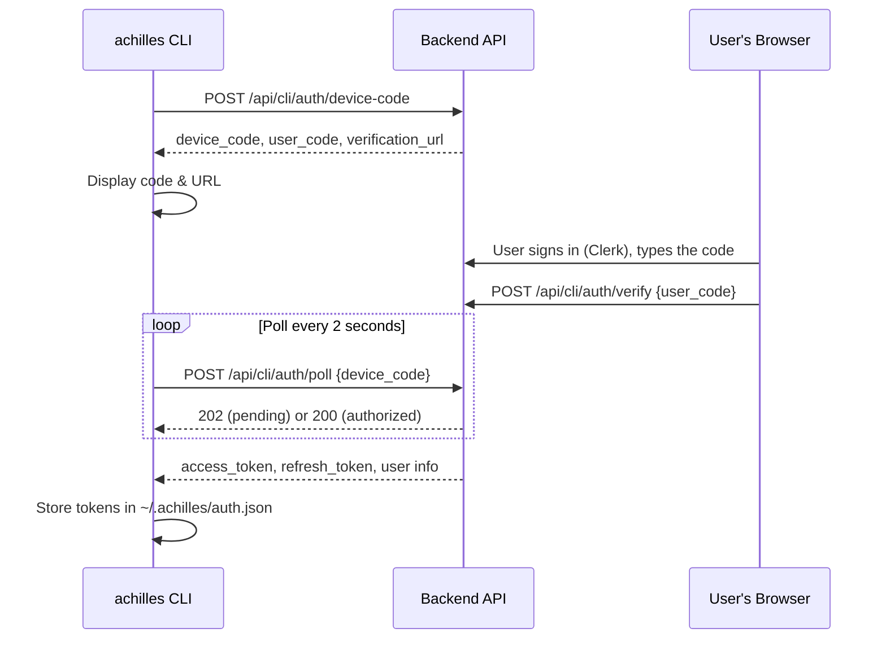

# Authentication

The CLI signs in with a device code flow modelled on the **OAuth2 Device Authorization Grant** ([RFC 8628](https://datatracker.ietf.org/doc/html/rfc8628)). The terminal shows a short code; you open the web console in a browser, sign in there, and type the code to approve the CLI.

:::info[Requirements]
The backend needs `CLI_AUTH_SECRET` set (generate one with `openssl rand -base64 32`); without it sign-in fails with a server error. CLI sign-in is not available on Vercel deployments (`backend-serverless/` has no CLI auth routes).
:::

## Login

```bash
achilles login
```

The login flow works in three steps:

1. The CLI requests a device code from the backend
2. You open the provided URL in a browser where you are signed in to the web console, type the displayed code by hand and select **Authorize CLI**
3. The CLI polls the backend until you authorize, then stores the tokens

The code is never passed in the URL: you always type it. Only a signed-in browser session can approve a code. A CLI session or an API key cannot approve one, so an existing CLI session can't be used to create another. The CLI gets the identity, organization and role of the user who approved it.

```
  Authenticating with http://localhost:3000

  Open this URL in your browser:
  https://your-deployment.example.com/cli-auth
  Enter code: ABCD-1234
  Expires: 10:35:00 PM

  Waiting for authorization.......

  ✓ Logged in successfully!
```



:::info
The device code expires after **10 minutes** and works for one sign-in. If you don't complete authorization in time, run `achilles login` again. The verification URL is built from the backend's `CORS_ORIGIN` (the web console address), with the path `/cli-auth`.
:::

If a valid session is already stored, `achilles login` says so and stops. Run `achilles logout` first to sign in as someone else.

Sign-in requests are rate limited: 10 device codes and 10 refreshes per 15 minutes, and 60 polls per minute.

### Profile-Aware Login

If you have multiple profiles configured, `achilles login` authenticates against the **active profile's** server URL. Each profile maintains its own authentication state.

```bash
# Switch to production profile, then login
achilles config use production
achilles login
```

## Token Storage

Tokens are stored as JSON files in the `~/.achilles/` directory:

| File | Description |
|------|-------------|
| `~/.achilles/auth.json` | Tokens for the `default` profile |
| `~/.achilles/auth-{profile}.json` | Tokens for named profiles (e.g., `auth-railway.json`) |

All auth files are created with **`0600` permissions** (owner read/write only).

The stored token contains:

| Field | Description |
|-------|-------------|
| `access_token` | JWT for API authentication (valid for 1 hour) |
| `refresh_token` | Token for obtaining new access tokens |
| `expires_at` | Expiration timestamp |
| `user_id` | Clerk user ID |
| `org_id` | Organization ID |
| `role` | User role (admin, operator, analyst, explorer) |
| `email` | User email address |
| `display_name` | Human-readable name |
| `issued_at` | When the token was issued |

## Automatic Token Refresh

The CLI automatically handles token lifecycle:

- **Before each API call**, the stored token is checked for expiration
- Tokens are considered expired **5 minutes before** their actual expiry time (refresh margin)
- If expired, the HTTP client attempts a transparent refresh using the `refresh_token`
- If refresh fails, you are prompted to run `achilles login` again

An access token lasts **1 hour**. A refresh issues a new access token and a new refresh token, each valid for another hour. Each refresh checks the account with Clerk and issues the new token with the role the user has now.

:::tip
The refresh token expires at the same time as the access token it was issued with. A refresh therefore only succeeds if you run a command during the last 5 minutes of the hour. After an idle period longer than that, run `achilles login` again.
:::

## Deployment Binding

A CLI token is bound to the deployment that issued it: its audience is the backend's `AGENT_SERVER_URL`, checked on every request. Two deployments that share a `CLI_AUTH_SECRET` do not accept each other's tokens. If an administrator changes `AGENT_SERVER_URL`, tokens issued before the change stop working; the CLI gets a new one on its next refresh, or you run `achilles login` again.

## When a Session Ends

The server ends every CLI session of a user when:

- an administrator changes or removes the user's role in **Settings → Users** (sign in again to get the new role)
- an administrator deletes the user in **Settings → Users**
- at the next sign-in or refresh, Clerk reports the user as deleted, banned, or no longer a member of the organization the session was approved in

Access tokens issued before that moment are refused, the refresh token is deleted, and a sign-in still waiting for its code to be collected is cancelled. A role changed directly in the Clerk dashboard applies at the next refresh, at most an hour later. A temporarily locked account can't sign in or refresh until the lock ends, but keeps its sessions.

## Logout

```bash
achilles logout
```

This deletes the token file for the active profile. It does not revoke the token on the server side; an access token that was copied elsewhere stays valid until it expires (up to 1 hour).

```
  ✓ Logged out. Tokens cleared.
```

## Checking Auth Status

Use the `status` command to verify your authentication state:

```bash
achilles status
```

```
  ProjectAchilles CLI v0.1.0

  Server:    http://localhost:3000
  User:      John Doe
  Org:       default
  Role:      admin

  ● Backend connected
  Fleet:     12 agents (10 online, 2 offline)

  Defense Score: 73.2% ████████████████████░░░░░░░░
  42 protected / 16 unprotected / 58 total
```

If you are not logged in, the status command shows:

```
  Auth:      Not logged in — run achilles login
```

## Error Handling

The CLI provides clear guidance when authentication issues occur:

| Error | Meaning | Solution |
|-------|---------|----------|
| `AuthError` | Token expired or invalid | Run `achilles login` |
| `NetworkError` | Cannot reach the backend | Check server URL with `achilles config get server_url` |
| HTTP 410 during login | Device code expired | Run `achilles login` again |
| `Server error (HTTP 500)` during login | `CLI_AUTH_SECRET` is not set on the backend | Ask the administrator to set it |
| `401` right after a role change | The session was ended on the server | Run `achilles login` |
| `403` on a command | Your role lacks the permission, or the action needs a browser session (user management, API keys) | Use the web console, or ask an administrator |

```bash
# If you see auth errors with any command:
  ✗ Authentication required
    Run achilles login to authenticate.
```
