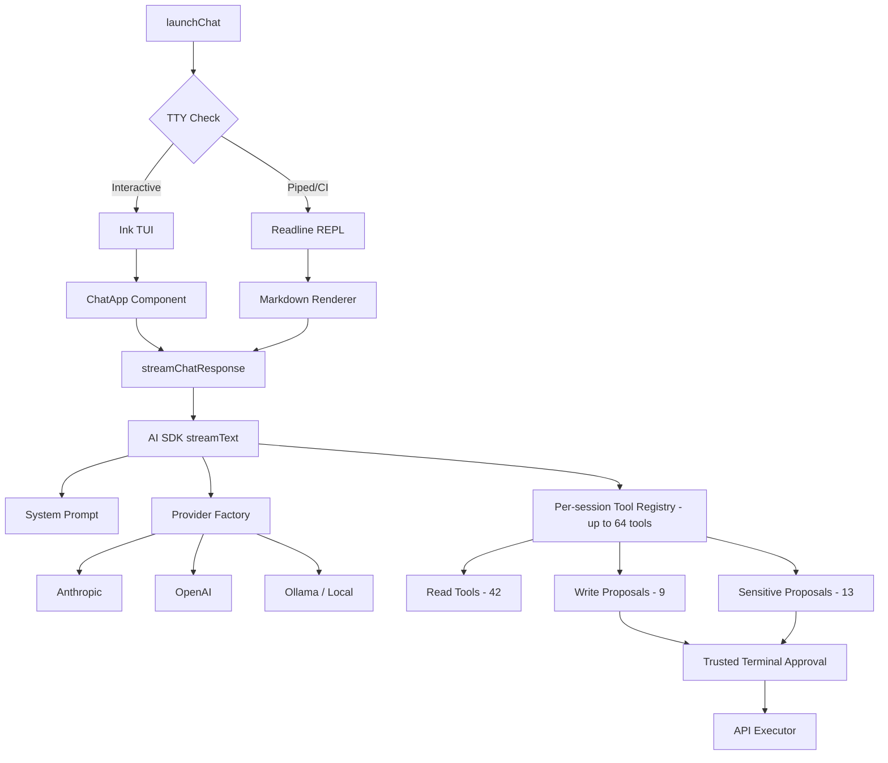

# AI Chat Agent

The chat agent (`achilles chat`) provides a natural language interface to the ProjectAchilles platform. Read operations run automatically. In an interactive terminal, the agent can propose a state-changing operation, but the CLI displays its exact parameters and calls the API only after you type the unique confirmation shown for that action.

```bash
achilles chat
```

## Architecture



## Two Interface Modes

The chat agent automatically detects your terminal environment and picks the best interface:

### Interactive Mode (Ink TUI)

When running in a real terminal with TTY support, you get a full-screen interface built with [Ink](https://github.com/vadimdemedes/ink) (React for the terminal):

- **ANSI Shadow ASCII art banner** — large block-character "PROJECT ACHILLES" title in green
- **Green terminal theme** — all UI elements use a hacker-green aesthetic (borders, labels, spinner, headers)
- **Scrollable message history** — user and assistant messages with role labels
- **Markdown rendering** — responses rendered with `marked-terminal` for proper box-drawn tables, styled headers, horizontal rules, and reflowed text. A post-processor handles bold/italic/code inside list items that `marked-terminal` misses
- **Streaming spinner** — animated dots while waiting for the first AI token
- **Bordered input area** — text input with placeholder text, green border (gray when streaming)
- **Dynamic status bar** — shows the active server URL and configured AI model (reads from config, not hardcoded)
- **Action approval panel** — shows the proposed operation and exact parameters, then requires the one-time code shown for it (for example `confirm K7RD`) before execution. The code is new for every proposal, is not case sensitive, and any other input cancels the action. When the agent proposes several actions, they are shown one at a time. What you type in the panel is never sent to the model
- **Keyboard hints** — `/clear reset` and `ctrl+c quit` displayed below the input

**Chat commands:**

| Command | Description |
|---------|-------------|
| `/clear` | Clear conversation history (interactive mode) |
| `/help` | Show available chat commands (interactive mode) |
| `/quit`, `/exit`, `/q` | Exit the chat |
| `Ctrl+C` | Quit immediately |

### Piped Mode (Readline)

When stdin is not a TTY (piped input, CI environments), the chat falls back to a readline REPL with full markdown-to-ANSI rendering via `marked-terminal`:

Piped mode exposes read tools only. State-changing proposals are unavailable because piped input is not a trusted approval channel.

```bash
# Piped mode — send a single query
echo "What's our current defense score?" | achilles chat

# The response includes rendered markdown:
# ┌─────────────────────┬───────┐
# │ Metric              │ Value │
# ├─────────────────────┼───────┤
# │ 🟢 Protected        │ 263   │
# │ 🔴 Unprotected      │ 313   │
# │ 📊 Total Executions │ 576   │
# └─────────────────────┴───────┘
```

:::info[Piped stdin handling]
When input is piped (`echo "..." | achilles chat`), the readline `close` event fires immediately after the line is read. The chat defers `process.exit()` until the streaming AI response completes, preventing truncated output.
:::

## AI Provider Configuration

The chat agent supports three AI providers. Configure via `achilles config set`:

### Anthropic (Default)

```bash
achilles config set ai.provider anthropic
achilles config set ai.model claude-sonnet-4-6
achilles config set ai.api_key sk-ant-...
```

:::info[The key is never printed]
`config set` confirms `ai.api_key = (set, hidden)`, and `config list` / `config get` show the same placeholder, so the key doesn't end up in terminal scrollback, CI logs or screen recordings. It is stored in `~/.achilles/config.json` (readable only by you). Typing the key on the command line still records it in your shell history; clear that entry if it matters.
:::

### OpenAI

```bash
achilles config set ai.provider openai
achilles config set ai.model gpt-4o
achilles config set ai.api_key sk-...
```

### Ollama (Local Models)

Run any model locally without API costs:

```bash
# 1. Start Ollama with your model
ollama run llama3

# 2. Configure the CLI
achilles config set ai.provider ollama
achilles config set ai.model llama3
achilles config set ai.base_url http://localhost:11434/v1
achilles config set ai.api_key ollama   # Required by SDK but ignored by Ollama
```

Works with any Ollama model: `llama3`, `qwen3`, `mistral`, `codellama`, etc.

:::tip[LM Studio and other local servers]
Any OpenAI-compatible local server works — just set `ai.provider ollama` and point `ai.base_url` to your server (e.g., `http://localhost:1234/v1` for LM Studio).
:::

:::note[Technical detail]
The provider factory uses `openai.chat(modelId)` (Chat Completions API) instead of the default `openai(modelId)` (Responses API) because Ollama and local servers don't support OpenAI's newer Responses API (`/v1/responses`) which uses `item_reference` message types.
:::

### Environment Variables

As an alternative to config, you can set environment variables:

```bash
ANTHROPIC_API_KEY=sk-ant-...  achilles chat
OPENAI_API_KEY=sk-...         achilles chat
```

## Available Tools

Interactive chat has access to **64 tools** in three groups: read tools, write tools and sensitive tools. Non-interactive chat receives only the 42 read tools.

### Read Tools (42 — No Confirmation Required)

These tools only query data and are executed immediately:

| Tool | Description |
|------|-------------|
| `list_agents` | List enrolled agents with filters |
| `get_agent` | Get detailed agent info |
| `get_agent_heartbeats` | Heartbeat history (CPU, memory, disk) |
| `get_agent_events` | Agent event log |
| `get_fleet_metrics` | Fleet-wide metrics |
| `get_fleet_health` | Health KPIs (uptime, success rate, MTBF) |
| `list_tokens` | List enrollment tokens |
| `list_tasks` | List tasks with filters |
| `get_task` | Get task details and results |
| `list_schedules` | List recurring schedules |
| `get_schedule` | Get schedule details |
| `list_versions` | List agent binary versions |
| `list_tests` | Search the test library |
| `get_test` | Get test details by UUID |
| `get_categories` | List test categories |
| `get_defense_score` | Current defense score |
| `get_score_trend` | Score trend over time |
| `get_score_by_test` | Score breakdown by test |
| `get_score_by_technique` | Score by MITRE technique |
| `get_score_by_hostname` | Score by hostname |
| `get_executions` | Recent test executions |
| `get_error_rate` | Test error rate |
| `get_test_coverage` | Coverage matrix |
| `get_technique_distribution` | MITRE technique distribution |
| `get_secure_score` | Microsoft Secure Score |
| `get_defender_alerts` | Defender alerts |
| `get_zta_score` | CrowdStrike ZTA posture score |
| `get_zta_score_trend` | CrowdStrike ZTA score trend |
| `get_crowdstrike_alerts` | CrowdStrike alerts |
| `get_crowdstrike_alert_trend` | CrowdStrike alert trend |
| `get_crowdstrike_score_correlation` | Defense Score vs ZTA score |
| `get_crowdstrike_technique_correlation` | Tests vs CrowdStrike alerts by technique |
| `get_score_correlation` | Defense Score vs Secure Score |
| `get_build_info` | Build info for a test |
| `get_dependencies` | Embed dependencies for a test |
| `list_certificates` | List signing certificates |
| `get_azure_config` | Azure AD config (masked) |
| `get_alert_config` | Alerting configuration |
| `get_alert_history` | Alert dispatch history |
| `list_risk_acceptances` | Risk acceptances |
| `list_users` | Team members |
| `list_invitations` | Pending invitations |

### Write Tools (9 — Exact Terminal Confirmation)

These tools modify data. The terminal shows the proposal under **Action approval required** with its exact parameters, and any input other than the displayed one-time confirmation cancels it:

| Tool | Description |
|------|-------------|
| `create_token` | Create enrollment token |
| `create_tasks` | Create test execution tasks |
| `create_update_tasks` | Push agent updates |
| `add_agent_tag` / `remove_agent_tag` | Manage agent tags |
| `update_task_notes` | Add notes to a task |
| `update_schedule` | Modify a schedule |
| `trigger_sync` | Trigger test library sync |
| `build_test` | Compile and sign a test binary |

### Sensitive Tools (13 — Exact Terminal Confirmation)

These tools are irreversible or have a wide effect. The panel is titled **Sensitive action approval required**; the confirmation works the same way:

| Tool | Description |
|------|-------------|
| `create_command_task` | Execute shell command on agents |
| `update_agent` | Update agent status |
| `accept_risk` | Create a risk acceptance |
| `delete_agent` | Decommission an agent |
| `rotate_agent_key` | Rotate an agent's API key |
| `revoke_token` | Revoke an enrollment token |
| `cancel_task` | Cancel a pending task |
| `delete_task` | Delete a completed task |
| `delete_schedule` | Delete a schedule |
| `create_uninstall_tasks` | Uninstall agents from endpoints |
| `delete_build` | Delete a build artifact |
| `delete_certificate` | Delete a signing certificate |
| `revoke_risk_acceptance` | Revoke a risk acceptance |

:::info[User management is browser-only]
The chat agent and the `users` command can list users and pending invitations, but can't invite, change roles or delete users. Those actions need a signed-in browser session (**Settings → Users**); the server refuses them for CLI tokens, so a stolen CLI session can't create or promote an administrator.
:::

## Visual Style

### Ink TUI Welcome Screen

The interactive mode opens with a styled welcome screen:

```
          ██████╗ ██████╗  ██████╗      ██╗███████╗ ██████╗████████╗
          ██╔══██╗██╔══██╗██╔═══██╗     ██║██╔════╝██╔════╝╚══██╔══╝
          ██████╔╝██████╔╝██║   ██║     ██║█████╗  ██║        ██║
          ██╔═══╝ ██╔══██╗██║   ██║██   ██║██╔══╝  ██║        ██║
          ██║     ██║  ██║╚██████╔╝╚█████╔╝███████╗╚██████╗   ██║
          ╚═╝     ╚═╝  ╚═╝ ╚═════╝  ╚════╝ ╚══════╝ ╚═════╝   ╚═╝

           █████╗  ██████╗██╗  ██╗██╗██╗     ██╗     ███████╗███████╗
          ██╔══██╗██╔════╝██║  ██║██║██║     ██║     ██╔════╝██╔════╝
          ███████║██║     ███████║██║██║     ██║     █████╗  ███████╗
          ██╔══██║██║     ██╔══██║██║██║     ██║     ██╔══╝  ╚════██║
          ██║  ██║╚██████╗██║  ██║██║███████╗███████╗███████╗███████║
          ╚═╝  ╚═╝ ╚═════╝╚═╝  ╚═╝╚═╝╚══════╝╚══════╝╚══════╝╚══════╝

┌──────────────────────────────────────────────────────────────────────────┐
│ ▸ Ask anything... "What's our defense score?"                            │
│                                                                          │
│ Server  https://acme.agent.projectachilles.io   ·  Model  qwen3 (ollama) │
└──────────────────────────────────────────────────────────────────────────┘
                           /clear reset  ctrl+c quit
```

### Markdown Rendering Pipeline

AI responses go through a rendering pipeline for terminal display:

1. **`marked` + `marked-terminal`** — Converts markdown to ANSI escape codes (box-drawn tables, colored headers, horizontal rules, reflowed text)
2. **`fixRemainingMarkdown()`** — Post-processor that handles inline formatting `marked-terminal` misses inside list items:
   - `**bold**` → ANSI bold (`\e[1m...\e[22m`)
   - `*italic*` → ANSI italic (`\e[3m...\e[23m`)
   - `` `code` `` → ANSI cyan (`\e[36m...\e[39m`)

This pipeline is used in both Ink TUI mode and readline fallback mode.

## Usage Examples

```bash
achilles chat
```

**Querying information:**

> What's our current defense score?

> Show me all Windows agents that are offline

> Which MITRE techniques have the lowest protection rate?

> How many tests were executed this week?

**Taking action:**

> Run the T1059 PowerShell test on all production agents

> Pause the "Daily Ransomware Check" schedule

> Rotate the API key for agent prod-web-01

> Create an enrollment token that expires in 48 hours

**Complex queries:**

> Compare our defense score trend over the last 30 days with the Microsoft Secure Score

> Find agents that haven't been updated to the latest version and create update tasks for them

> Show me the top 5 worst-performing tests by hostname

## Security Domain Knowledge

The AI agent understands ProjectAchilles-specific concepts:

- **Outcomes**: protected (the defense blocked the simulated attack) and unprotected (it did not)
- **Agent states**: active, disabled, decommissioned, uninstalled
- **Task flow**: pending, assigned, downloading, executing, completed/failed/expired
- **MITRE ATT&CK**: Technique IDs (T1059, T1486, etc.), tactics, and the kill chain
- **Defense scoring**: 0-100% scale where higher means better defense coverage
- **Bundle tests**: Multi-control tests that fan out into individual scored controls

:::warning[Exit codes in chat answers]
The built-in prompt tells the model that exit code 0 means unprotected and 1 means protected. That is not the platform's mapping: `101` is unprotected, `105`, `126` and `127` are protected, and other codes are errors or inconclusive. Check an exit-code explanation from the chat against the outcome the tools return.
:::

## Step Limit

The agent enforces a **10-step limit** per response to prevent infinite tool-calling loops. If the agent needs more steps to complete your request, it will explain what remains and you can follow up.

## Error Handling

| Error | What Happens |
|-------|-------------|
| Network failure | Retry suggestion displayed |
| Auth expired | Guidance to run `achilles login` |
| Tool execution failure | Detailed error with context |
| AI provider unavailable | Fallback suggestions and config help |

## Technical Implementation

| Component | Technology | Purpose |
|-----------|-----------|---------|
| TUI Framework | [Ink](https://github.com/vadimdemedes/ink) v6 | React for the terminal |
| Text Input | `ink-text-input` | Controlled text input component |
| Spinner | `ink-spinner` | Animated loading indicator |
| Markdown | `marked` + `marked-terminal` | ANSI terminal markdown rendering |
| AI SDK | `ai` v6 + `@ai-sdk/anthropic` / `@ai-sdk/openai` | Streaming text, tool calling |
| Tool Schemas | `zod` + `inputSchema` (MCP-aligned) | Type-safe tool parameter validation |
| Provider Factory | `provider.ts` | Creates proper model instances with API keys |

### Key Files

| File | Purpose |
|------|---------|
| `cli/src/chat/launch.ts` | Entry point — TTY detection, mode selection |
| `cli/src/chat/view.tsx` | Ink TUI components (ChatApp, Message, AsciiTitle) |
| `cli/src/chat/agent.ts` | AI SDK `streamText` with tool calling |
| `cli/src/chat/provider.ts` | Provider factory (Anthropic, OpenAI, Ollama) |
| `cli/src/chat/tools.ts` | 64 tool definitions (read/write/sensitive) |
| `cli/src/chat/approval.ts` | Confirmation codes and the approval step in front of every change |
| `cli/src/chat/system-prompt.ts` | Domain-specific system prompt builder |
