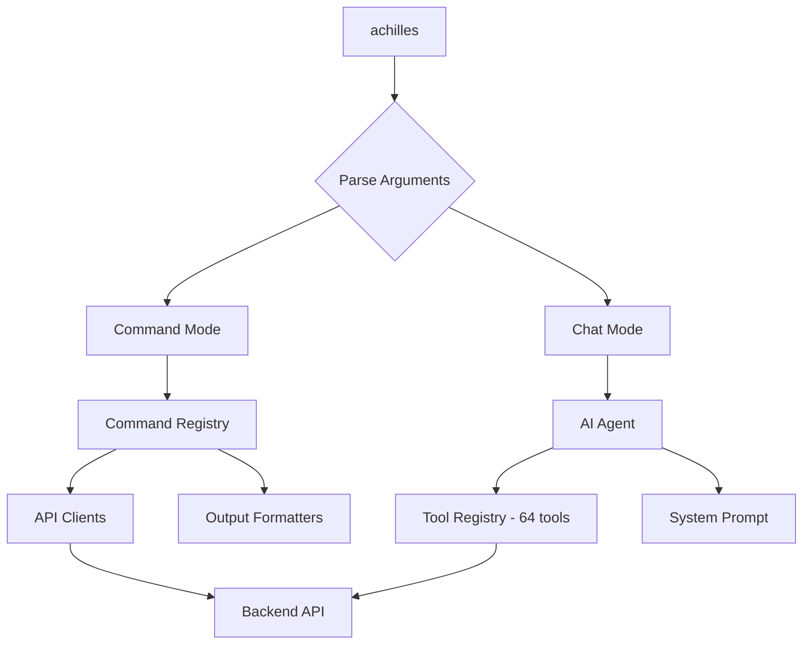

# Overview & Installation

The ProjectAchilles CLI (`achilles`) is a terminal-based management tool for the continuous security validation platform. It provides full control over agents, tasks, schedules, analytics, builds, certificates, and integrations -- all from the command line.

## Dual-Mode Architecture

The CLI operates in two modes:



- **Command Mode** (`achilles <command> [subcommand] [flags]`): Traditional CLI commands with structured output. Ideal for scripting, CI/CD pipelines, and quick operations.
- **Chat Mode** (`achilles chat`): AI-powered conversational interface that understands natural language. It reads platform data on its own. A change (running a test, deleting a task, rotating a key) runs only after you type the confirmation code shown for it, and only in an interactive terminal. See [AI Chat Agent](./chat-agent.md).

## Requirements

The CLI is built on **[Bun](https://bun.sh/)** -- a fast JavaScript runtime. Bun is required to run the CLI.

```bash
# Install Bun (if not already installed)
curl -fsSL https://bun.sh/install | bash
```

## Installation

```bash
# Clone the repository (if you haven't already)
git clone <repo-url> ProjectAchilles
cd ProjectAchilles/cli

# Install dependencies
bun install

# Run directly
bun run bin/achilles.ts

# Or use the dev script
bun run dev
```

:::tip
You can create a shell alias for convenience:

```bash
alias achilles="bun run /path/to/ProjectAchilles/cli/bin/achilles.ts"
```
:::

### Building a Bundle

```bash
cd cli
bun run build
# Output: dist/achilles.js (one bundled file; it still needs Bun to run)
bun dist/achilles.js --version
```

## Available Commands

| Command | Alias | Description |
|---------|-------|-------------|
| `status` | `st` | Health check -- backend connectivity, auth, and fleet summary |
| `login` | | Sign in to the backend with a device code approved in the browser |
| `logout` | | Clear stored authentication tokens |
| `config` | | View and modify CLI configuration and profiles |
| `agents` | `a` | Manage enrolled agents |
| `tokens` | | Manage enrollment tokens |
| `tasks` | `t` | Manage security test tasks |
| `schedules` | | Manage recurring test schedules |
| `versions` | | Manage agent binary versions |
| `browser` | `b` | Browse the security test library |
| `analytics` | `an` | Query security analytics from Elasticsearch |
| `defender` | | Microsoft Defender integration |
| `crowdstrike` | | CrowdStrike Falcon integration |
| `builds` | | Manage test builds and dependencies |
| `certs` | | Manage code signing certificates |
| `integrations` | `int` | Configure Azure AD, EDR integrations (Defender, CrowdStrike), and alerting |
| `risk` | | Risk acceptance workflow management |
| `users` | | List team members and pending invitations (changes are made in the web console) |
| `deploy` | | Unified deployment TUI — guided multi-target deploys (interactive or headless) |
| `help` | `h` | Show help |
| `chat` | | Launch AI conversational agent |

## Global Flags

These flags work with any command:

| Flag | Short | Description |
|------|-------|-------------|
| `--json` | | Output structured JSON instead of human-readable text. Useful for scripting, CI/CD, and LLM integration. |
| `--help` | `-h` | Show help for the current command or subcommand. |
| `--version` | `-V` | Show CLI version. |

### JSON Mode

Every command supports `--json` for machine-readable output. This is especially useful for:

- **Scripting**: Parse output with `jq` or other JSON tools
- **CI/CD pipelines**: Reliable structured data for automation
- **AI agents**: Consistent schema for LLM consumption

```bash
# Human-readable output
achilles agents list

# JSON output for scripting
achilles agents list --json

# Pipe to jq for filtering
achilles agents list --json | jq '.data[] | select(.status == "active")'
```

JSON output always has the same envelope: `data` (the rows or the object), `command`, `timestamp`, and `meta` (`total`, `limit`, `offset`) on paginated lists. Errors are written to stderr as `{"error": "...", "code": "AUTH_ERROR" | "NETWORK_ERROR" | "API_ERROR" | "CLI_ERROR"}` and the exit code is `1`.

## Other Commands

These commands have no page of their own. Run `achilles <command> --help` for the full flag list.

### tokens

Enrollment tokens for new agents. See [Agent Commands](./agent-commands.md#tokens).

### versions

Registered agent binaries. See [Agent Commands](./agent-commands.md#versions).

### browser

| Subcommand | Description |
|------------|-------------|
| `sync` | Trigger a git sync of the test library |
| `status` | Show the sync status |
| `list` | List tests. Flags: `--search` (`-s`), `--technique` (`-t`), `--category` (`-c`), `--severity` |
| `show <uuid>` | Show test details |
| `file <uuid> <path>` | Print one file of a test |
| `categories` | List test categories |

### defender and crowdstrike

Read-only queries against the Microsoft Defender and CrowdStrike Falcon data the backend has synced.

| Command | Subcommands |
|---------|-------------|
| `defender` | `score`, `score-trend [--days 30]`, `alerts [--severity --status --search --page --size]`, `alerts-trend [--days 30]`, `controls [--category]`, `controls-by-category`, `correlation <score\|techniques> [--days 30]` |
| `crowdstrike` | `zta-score`, `zta-trend [--days 30]`, `alerts [--severity --status --search --page --size]`, `alert-trend [--days 30]`, `correlation <score\|techniques> [--days 30]` |

There are no CLI commands for SentinelOne or Sophos. Use the web console or the API for those.

### integrations

| Group | Subcommands |
|-------|-------------|
| Azure AD | `azure-show`, `azure-set` (`--tenant-id`, `--client-id`, `--client-secret`, `--label`), `azure-delete`, `azure-test` |
| Microsoft Defender | `defender-show`, `defender-set` (`--tenant-id`, `--client-id`, `--client-secret`), `defender-delete`, `defender-test`, `defender-sync`, `defender-sync-status` |
| CrowdStrike | `crowdstrike-show`, `crowdstrike-set` (`--region`, `--client-id`, `--client-secret`, `--label`), `crowdstrike-delete`, `crowdstrike-test`, `crowdstrike-sync`, `crowdstrike-sync-status`, `crowdstrike-auto-resolve-status`, `crowdstrike-auto-resolve-mode --mode <disabled\|dry_run\|enabled>`, `crowdstrike-auto-resolve-receipts` |
| Alerting | `alerts-show`, `alerts-set` (`--score-drop`, `--score-floor`, `--cooldown`, `--slack-url`), `alerts-test`, `alerts-history` |

:::warning[Secrets on the command line]
`--client-secret` and `--slack-url` values are recorded in your shell history. Clear the entry afterwards, or set these in the web console.
:::

### risk

| Subcommand | Description |
|------------|-------------|
| `accept` | Create a risk acceptance. `--test` and `--justification` (`-j`) are required; `--control-id` and `--hostname` narrow the scope |
| `revoke <id>` | Revoke one. `--reason` (`-r`) is required |
| `list` | List acceptances. Flags: `--status <active\|revoked>`, `--test-name`, `--page`, `--size` |
| `show <id>` | Show one acceptance |

### users

`users list` and `users invitations` only. Inviting users, changing roles and deleting users need a signed-in browser session (**Settings → Users**); the server refuses them for CLI sessions, so the CLI has no commands for them.

### deploy

`achilles deploy` installs ProjectAchilles itself. In a terminal it opens a wizard (mode, target, prerequisites, inputs, run). With `--json`, or when there is no terminal, it runs headless and needs `--target`.

| Flag | Description |
|------|-------------|
| `--mode` | `operator` or `self-host` |
| `--target` | `digitalocean`, `server`, `docker`, `fly`, `render`, `vercel` or `railway` |
| `--<input>` | One flag per input of the chosen target (for example `--elasticsearch true` for `docker`). Invalid or missing inputs are listed and the command exits with code `2` |

```bash
achilles deploy
achilles deploy --target docker --elasticsearch true --json
```

## Quick Start

```bash
# 1. Check connectivity and status
achilles status

# 2. Authenticate
achilles login

# 3. List your agents
achilles agents list

# 4. Check defense score
achilles analytics score

# 5. Launch AI chat for natural language interaction
achilles chat
```

## Getting Help

```bash
# Global help
achilles --help

# Command-specific help
achilles agents --help

# JSON-formatted help (for tooling)
achilles agents --help --json
```

The help system is auto-generated from command definitions, so it always reflects the current state of available commands, flags, and arguments.
