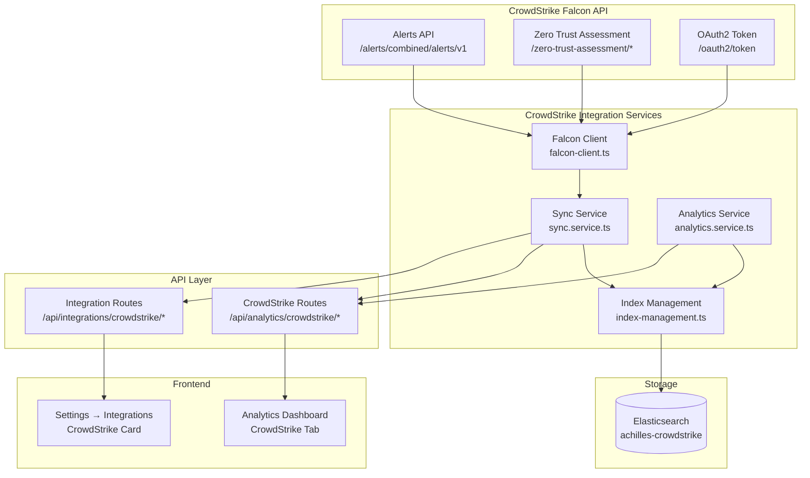
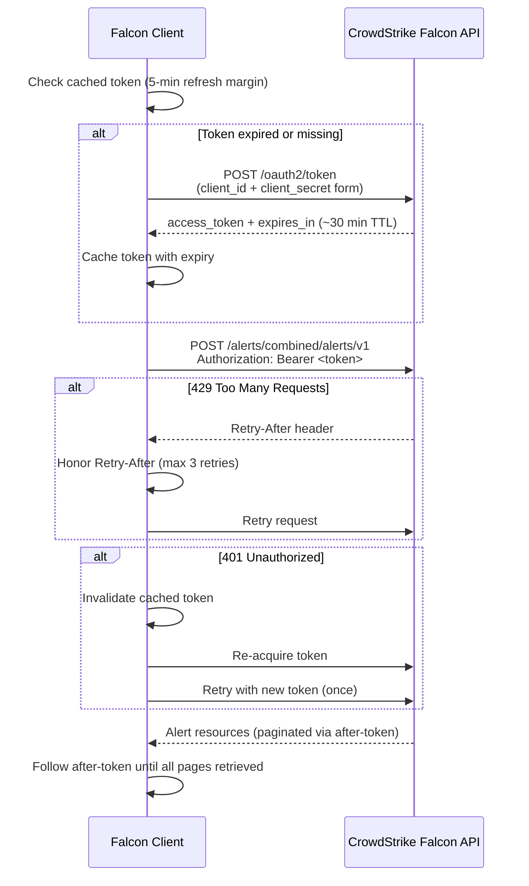
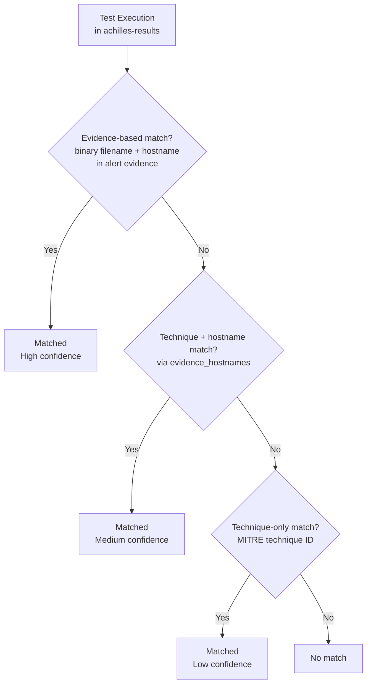

# CrowdStrike Falcon

## The Three-Pillar Model

The CrowdStrike integration mirrors the [Microsoft Defender](./microsoft-defender)
integration and is built from three pillars. The first two are read-only and
active as soon as credentials are saved; the third is an opt-in write pillar
documented separately.

| Pillar | Direction | Falcon API scope | Default |
|--------|-----------|------------------|---------|
| 1. **Analytics ingest** — ZTA posture score, alerts | Falcon API → ES | `Alerts: read`, `Zero Trust Assessment: read` (optional) | On once credentials are set |
| 2. **Evidence correlation** — test ↔ alert matching | ES ↔ ES | None extra | Automatic |
| 3. **[Auto-resolve](./crowdstrike-auto-resolve)** — close correlated alerts in Falcon | ES → Falcon API | `Alerts: write` | Opt-in, disabled by default |

This page covers pillars 1 and 2. Pillar 3 has its own setup walkthrough — see
[Auto-Resolve](./crowdstrike-auto-resolve).

## Prerequisites

- A CrowdStrike Falcon account with access to the Falcon console
- An API client created in the Falcon console (below)

## Falcon Console Setup

1. Log in to the Falcon console for your cloud region and go to
   **Support** → **API Clients and Keys** (also reachable via the hamburger
   menu → **Support and resources** → **API clients and keys**).
2. Click **Create API client**.
3. Name: "ProjectAchilles Integration".
4. Under **API Scopes**, enable:
   - **Alerts: read** — required for alert sync
   - **Alerts: write** — required only if you plan to enable
     [auto-resolve](./crowdstrike-auto-resolve) (can be added later by editing
     the client)
   - **Zero Trust Assessment: read** — optional; enables the ZTA posture score.
     Requires **Falcon Insight** licensing — see
     [ZTA licensing](#zta-licensing) below.
5. Click **Create** and note the **Client ID** and **Client Secret** — the
   secret is shown only once.

:::tip[Enabling auto-resolve later]
If you plan to enable [auto-resolve](./crowdstrike-auto-resolve), it requires
the additional `Alerts: write` scope. You can grant it now or edit the API
client later — the read-only integration runs fine without it.
:::

## Cloud Regions

The integration must point at the Falcon cloud that hosts your tenant. Pick
the region in Settings. Configuration is **region-only** — custom base URLs
are not accepted (this prevents SSRF through the integration's outbound HTTP
client).

| Region | Base URL |
|--------|----------|
| US-1 (default) | `https://api.crowdstrike.com` |
| US-2 | `https://api.us-2.crowdstrike.com` |
| EU-1 | `https://api.eu-1.crowdstrike.com` |
| US-GOV-1 | `https://api.laggar.gcw.crowdstrike.com` |

Choosing the wrong region is the most common cause of "Test Connection"
failures: a client created in US-2 does not authenticate against US-1.

## Configuration

1. Navigate to **Settings** → **Integrations** → **CrowdStrike Falcon**
2. Select your **cloud region** (US-1 by default)
3. Enter:
   - **Client ID** — the API client's Client ID
   - **Client Secret** — the API client's Client Secret
   - **Label** — optional display name (e.g. "Production Falcon")
4. Click **Save** and then **Test Connection**

Credentials are encrypted at rest with AES-256-GCM. Saving a configuration
kicks off an initial sync in the background.

### Environment Variable Alternative

Instead of the UI, the integration can be configured entirely via environment
variables. When set, they **override** the file-based settings (same pattern as
Defender):

| Variable | Description |
|----------|-------------|
| `CROWDSTRIKE_REGION` | Falcon cloud region: `us-1` (default), `us-2`, `eu-1`, or `us-gov-1` |
| `CROWDSTRIKE_CLIENT_ID` | API client Client ID |
| `CROWDSTRIKE_CLIENT_SECRET` | API client Client Secret |
| `CROWDSTRIKE_LABEL` | Optional display label |

## Sync Behavior

| Data | Sync Interval |
|------|--------------|
| Alerts | Every 5 minutes |
| ZTA posture score | Every 6 hours (one daily snapshot document) |

In Docker deployments, sync runs via `setInterval`. On Vercel, sync runs via
Cron at `/api/cron/crowdstrike-sync`.

**Initial sync behavior:** the first alert sync uses a **90-day lookback**
(`created_timestamp` filter) to fetch recent alerts without pulling the entire
tenant history. Subsequent syncs resume incrementally from a persisted
checkpoint (`last_alert_sync`). Timestamps are only advanced on successful
syncs — failed fetches do not move the watermark.

## ZTA Licensing

The **Zero Trust Assessment (ZTA)** posture score — CrowdStrike's
Secure-Score-equivalent — requires **Falcon Insight** licensing. The
integration degrades gracefully when it is not licensed:

- the ZTA sync records `zta_status: "not_licensed"` in the sync status instead
  of failing,
- the Analytics tab shows an empty state on the ZTA tile,
- alert sync, correlation, and auto-resolve are **unaffected**.

## When the EDR kills the agent

A CrowdStrike Falcon policy can terminate `achilles-agent.exe` (or the test binary's parent chain) in the middle of a test. The agent never reports, so the task fails with `Agent went offline during execution` or `Task exceeded execution timeout`. If CrowdStrike Falcon raised an alert on the same host in the run window, with techniques that overlap the test's, ProjectAchilles records the run as **Protected** with stages unknown. See [Exit Codes & Outcomes](../analytics/exit-codes-and-outcomes#6-agent-terminated-by-the-edr).

These alerts stay open in CrowdStrike Falcon: Achilles links them to the run but never auto-resolves them. Triage them like any other alert.

Do not add an agent exclusion in CrowdStrike Falcon to stop this. The agent launches the test binaries, so a child-process exclusion would exempt the tests too and the run would no longer measure your protection. See [Endpoint Prerequisites](../../deployment/endpoint-prerequisites#6-edr-expectations).

## Architecture

The CrowdStrike integration is composed of four backend services that pull
data from the CrowdStrike Falcon API, store it in Elasticsearch, and expose
analytics to the frontend.



### Falcon Client

The Falcon client (`falcon-client.ts`) is a lightweight, SDK-free HTTP client
for the CrowdStrike Falcon API. Unlike Defender (which supports certificate
auth), CrowdStrike uses **secret-only OAuth2** — there is no certificate
option.

**OAuth2 Client Credentials Flow:**



**Key behaviors:**
- **Token caching** with a 5-minute refresh margin before actual expiry
  (tokens live ~30 minutes)
- **After-token pagination** — follows the `after` token until all alert pages
  are retrieved (max 1000 per page)
- **429 retry** honoring the `Retry-After` header (max 3 retries)
- **401 recovery** — invalidates the cached token and re-authenticates once
- **200-with-errors envelopes** — CrowdStrike write APIs return HTTP 200 with a
  per-item `errors[]` array; the client inspects `errors[]` and
  `meta.writes.resources_affected`, not just the HTTP status

:::warning[Do not use the legacy Detects API]
The legacy `/detects/*` endpoints were decommissioned on 2025-09-30. All alert
reads use `POST /alerts/combined/alerts/v1` (FQL filter, `created_timestamp`
sorting, after-token pagination); alert updates use
`PATCH /alerts/entities/alerts/v3`.
:::

### Elasticsearch Storage Model

All CrowdStrike data is stored in a single index (`achilles-crowdstrike`)
using the same **sparse document** pattern as Defender, with a `doc_type`
discriminator:

| Field | Type | Used By | Description |
|-------|------|---------|-------------|
| `doc_type` | keyword | All | `alert` or `zta_score` |
| `timestamp` | date | All | Ingestion or event timestamp |
| `alert_id` | keyword | alert | CrowdStrike `composite_id` |
| `severity` | keyword | alert | `informational`, `low`, `medium`, `high`, `critical` (mapped from `severity_name`) |
| `status` | keyword | alert | `new`, `in_progress`, `reopened`, `closed` |
| `mitre_techniques` | keyword[] | alert | MITRE ATT&CK technique IDs from `mitre_attack[]` |
| `evidence_hostnames` | keyword[] | alert | Hostnames from `device.hostname` |
| `evidence_filenames` | keyword[] | alert | Filenames/paths from `filename` / `filepath` |
| `overall_score` | float | zta_score | Average ZTA `assessment.overall` (0–100) |
| `os_score` | float | zta_score | Average ZTA OS sub-score |
| `sensor_config_score` | float | zta_score | Average ZTA sensor-config sub-score |
| `device_count` | integer | zta_score | Devices included in the snapshot |
| `min_score` / `max_score` | float | zta_score | Per-device score spread |

ZTA snapshots are keyed `score-<YYYY-MM-DD>` — one document per day.

:::warning[Elasticsearch API key privileges]
If you connect to Elasticsearch with a scoped API key (rather than a
superuser), the key must include `read`, `write`, and `create_index` on the
`achilles-crowdstrike` index — the same grants you gave `achilles-defender`
when enabling the Defender integration. Without them the sync fails with an
HTTP 403 on the index existence check. (Defender can keep working while
CrowdStrike fails, because the key's index list is per-pattern.)
:::

### Cross-Correlation Logic

The analytics service provides four types of cross-correlation between
Achilles test results and CrowdStrike data:

**1. Detection Rate (evidence-based)**

The headline metric on the CrowdStrike tab. It is the share of conclusive
attack-simulation executions in the selected window that CrowdStrike detected,
read from the per-run flags the enrichment pass writes onto each test result,
with the prevented subset reported separately. A bundle stage counts only by
its own `f0rtika.crowdstrike_stage_detected` flag (never because a sibling stage
was caught), a standalone test by its own `f0rtika.crowdstrike_detected` flag, and
a vendor-confirmed prevention (`f0rtika.crowdstrike_prevented`) always counts as
detected:

```
detectionRate = (prevented + detectedOnly) / executions × 100
```

Cyber-hygiene controls and skipped bundle stages are excluded. The full
definition is in
[Analytics → CrowdStrike Falcon](../analytics/crowdstrike#detection-rate).

The legacy `/correlation/detection-rate` endpoint (technique plus time-window
matching, roll-up aware, used by the CLI) is still available; the tab no longer
uses it.

**2. Per-test evidence correlation (alert drawer)**

For a single test execution, the alert drawer correlates against CrowdStrike
alerts using the same **three-tier matching strategy** as Defender within a
**-5 min to +30 min** window relative to test completion:



- **Tier 1 — Evidence-based (most precise):** matches `evidence_filenames`
  containing the test binary's UUID filename AND `evidence_hostnames`
  containing the test endpoint's hostname. This proves the specific execution
  triggered the alert.
- **Tier 2 — Technique + hostname:** falls back to MITRE technique IDs scoped
  by `evidence_hostnames`. Used when alerts lack file-level evidence.
- **Tier 3 — Technique-only:** falls back to MITRE technique ID alone. Used
  for alerts with no evidence metadata.

The enrichment pass marks matched test documents with
`f0rtika.crowdstrike_detected` / `crowdstrike_stage_detected` and alert
documents with the vendor-neutral `f0rtika.achilles_correlated` /
`achilles_test_uuid` flags that the [auto-resolve](./crowdstrike-auto-resolve)
pillar reads.

**3. Technique Coverage Overlap**

Maps MITRE ATT&CK techniques present in both datasets to identify validated
coverage, detection gaps, and untested detections.

**4. Defense Score vs. ZTA Score Trending**

Compares the internal Defense Score with the ZTA posture score over time using
aligned date histograms — the CrowdStrike analog of Defender's Secure Score
correlation.

**Stages killed by the EDR**
See [Exit Codes & Outcomes](../analytics/exit-codes-and-outcomes) for the canonical mapping of exit codes, flags, labels, and outcomes.

A stage the EDR kills at launch or mid-run produces an error-category exit
code (`999`, `259`, or an unsigned NTSTATUS-style kill code coerced to `999`
at ingestion — the raw value is kept in `event.ERROR_raw`) rather than a
conclusive outcome. These stages are still scanned by the enrichment pass,
and when alert evidence matches (hostname + stage binary + time window) they
are flagged as detected and count toward the Defense Score like any other
detection. Genuine test errors with no matching alert stay untouched. The
exception is exit `260` (blocked before execution by an ASR/app-control
policy): those are never scanned, since a policy block — including the ASR
rule the platform excludes by design — is not a detection event.

**Vendor-confirmed prevention**

Falcon reports what it *did* about each alert via `pattern_disposition`
(e.g. "Prevention, process killed."). The sync extracts this into
`prevention_action` (`quarantined` / `process_killed` / `blocked` /
`kill_failed`) on the alert doc, and enrichment upgrades matched test stages
with `crowdstrike_prevented: true` (plus the action) under a deliberate
qualification rule: stage-binary matches always qualify, while bundle-level
matches qualify only when the stage never reached a conclusive outcome — a
sibling stage that already ran to completion was not prevented by the kill
of a later stage. Prevented stages render
as **Prevented** in the executions view — stronger than Detected — count as
protected in the Defense Score, and report as PREVENTED with
`preventedBy: ['CrowdStrike Falcon']` in the SB compliance report. A failed
kill (`kill_action_failed`) never qualifies. Alert rows also carry
`portal_url`, the exact per-alert Falcon console deep link.

The technique-only fallback in *alerts-for-test* is hostname-scoped whenever
the host is known, so simultaneous fleet-wide runs can't cross-associate one
host's alerts onto another host's stages.

### Conditional Frontend Display

All CrowdStrike dashboard elements are conditionally rendered based on the
`useCrowdStrikeConfig` hook:

```
useCrowdStrikeConfig() → { configured: boolean, loading: boolean }
```

When `configured` is `false`, CrowdStrike panels, tabs, and cross-correlation
widgets are hidden entirely — the dashboard shows only Achilles-native
analytics.

## Deployment Variants

| Aspect | Docker / Fly.io / Railway | Vercel (Serverless) |
|--------|--------------------------|---------------------|
| Backend path | `backend/src/services/crowdstrike/` | `backend-serverless/src/services/crowdstrike/` |
| Settings access | Synchronous file read | Async Vercel Blob read |
| Sync trigger | `setInterval` at server startup | Vercel Cron (`/api/cron/crowdstrike-sync`) |
| Credentials | Encrypted file or env vars | Env vars or encrypted blob |

Both variants expose identical API endpoints and analytics capabilities.

## Troubleshooting

:::warning[Common Issues]
- **"Test Connection" fails with 401**: Verify the Client ID / Client Secret,
  and that the selected **cloud region** matches the tenant where the API
  client was created. CrowdStrike scopes take effect per client — no admin
  consent step is required beyond saving the scope on the client.
- **No data after saving credentials**: The first sync runs in the background
  (alerts every 5 minutes, ZTA every 6 hours). Click **Sync Now** in the
  integration settings to trigger an immediate sync.
- **No alerts syncing**: Alert sync requires the `Alerts: read` scope. A 403
  from `/alerts/combined/alerts/v1` means the scope is missing on the API
  client.
- **ZTA tile shows "not licensed"**: ZTA requires Falcon Insight. The
  integration records `zta_status: "not_licensed"` and keeps everything else
  working; grant `Zero Trust Assessment: read` and confirm licensing if you
  want the posture score.
- **403 when enabling auto-resolve**: Auto-resolve needs the separate
  `Alerts: write` scope. See
  [Auto-Resolve → Troubleshooting](./crowdstrike-auto-resolve#troubleshooting).
:::
