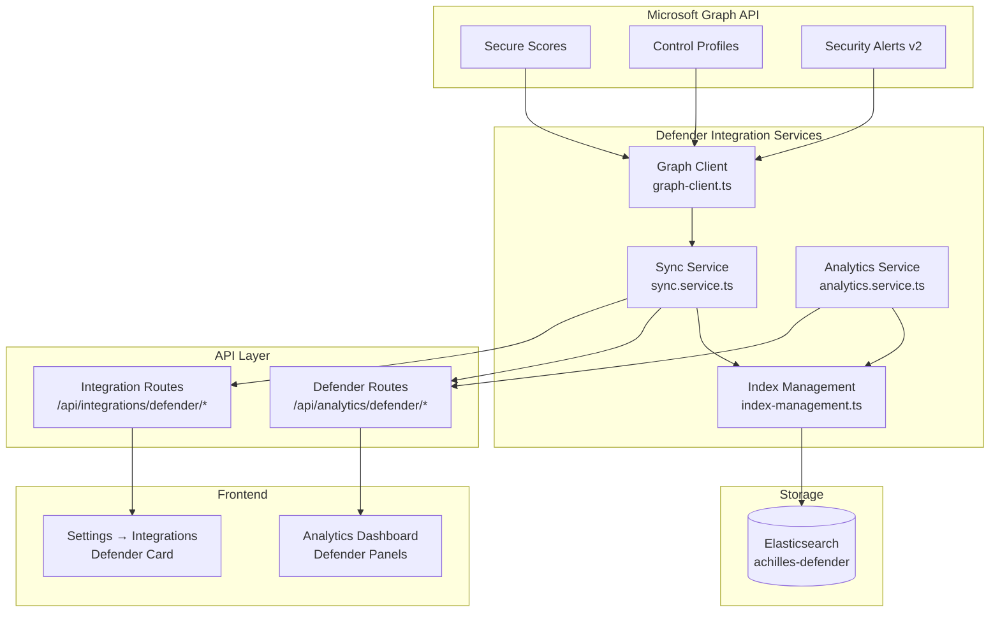
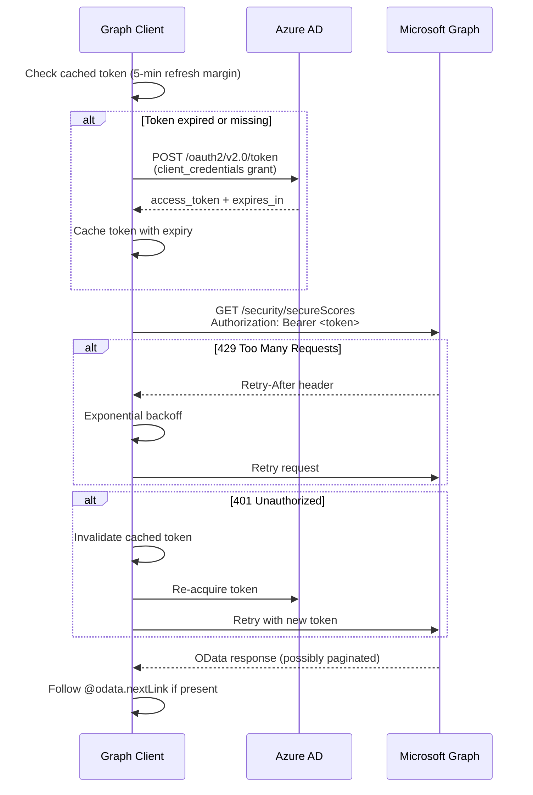
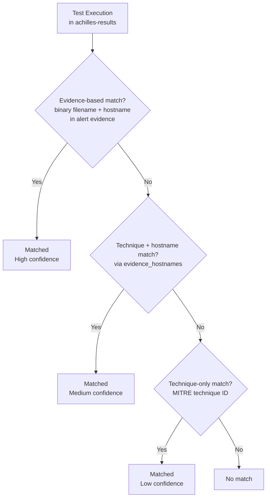

# Microsoft Defender

## The Three-Pillar Model

The Defender integration is built from three pillars. The first two are
read-only and active as soon as credentials are saved; the third is an opt-in
write pillar documented separately.

| Pillar | Direction | Graph permission | Default |
|--------|-----------|------------------|---------|
| 1. **Analytics ingest** — Secure Score, alerts, control profiles | Graph → ES | `SecurityEvents.Read.All` (Secure Score, control profiles) and `SecurityAlert.Read.All` (alerts) | On once credentials are set |
| 2. **Evidence correlation** — test ↔ alert matching | ES ↔ ES | None extra | Automatic |
| 3. **[Auto-resolve](./defender-auto-resolve)** — resolve correlated alerts in Defender | ES → Graph | `SecurityAlert.ReadWrite.All` | Opt-in, disabled by default |

This page covers pillars 1 and 2. Pillar 3 has its own setup walkthrough — see
[Auto-Resolve](./defender-auto-resolve).

## Prerequisites

- Microsoft 365 with Defender enabled
- Azure AD App Registration with `SecurityEvents.Read.All` and `SecurityAlert.Read.All` (Application type, admin consent)

## Azure AD Setup

1. Go to [Azure Portal](https://portal.azure.com) → App Registrations → New Registration
2. Name: "ProjectAchilles Defender Integration"
3. Under **API Permissions**, add:
   - `SecurityEvents.Read.All` (Application type) — Secure Score and control profiles (`/security/secureScores`, `/security/secureScoreControlProfiles`)
   - `SecurityAlert.Read.All` (Application type) — alerts (`/security/alerts_v2`)
   - Click **Grant admin consent**
4. Under **Certificates & Secrets**, create a client secret **or** upload a certificate (see [Certificate authentication](#certificate-authentication) below)
5. Note the **Application (client) ID**, **Directory (tenant) ID**, and **Client Secret** (or certificate thumbprint)

:::tip[Enabling auto-resolve later]
If you plan to enable [auto-resolve](./defender-auto-resolve), it requires the
additional `SecurityAlert.ReadWrite.All` scope. You can grant it now or add it
later — the read-only integration runs fine without it.
:::

## Configuration

1. Navigate to **Settings** → **Integrations** → **Microsoft Defender**
2. Choose an authentication method — **Client Secret** or **Certificate**
3. Enter:
   - **Tenant ID** — Azure AD Directory (tenant) ID
   - **Client ID (Application ID)** — Application (client) ID
   - **Client Secret** — The secret you created (client-secret method), *or* the certificate + private key (certificate method)
4. Click **Test Connection**, then **Save Settings**

Credentials are encrypted at rest with AES-256-GCM.

The credentials can also come from the `DEFENDER_TENANT_ID`, `DEFENDER_CLIENT_ID` and `DEFENDER_CLIENT_SECRET` environment variables. Settings saved in the UI take priority over them.

:::info[One Defender connection per deployment]
The Defender settings are deployment-wide: the sync, the correlation and auto-resolve run once for the whole install, whichever Clerk organization the admin who saved them belongs to. With `REQUIRE_ORG_ISOLATION=true` the settings are read-only in the UI (saving, disconnecting and changing the auto-resolve mode return 403), so one organization's admin can't change what runs for every organization. Configure Defender with the `DEFENDER_*` environment variables there.
:::

:::info[Elasticsearch API key]
With a scoped Elasticsearch API key, this integration needs grants on its own
index and `write` on the results index. Saving checks them and shows a red
**Saved, but not syncing** notice if one is missing. See
[API key privileges for EDR integrations](./elasticsearch.md#edr-api-key-privileges).
:::

### Certificate Authentication

Instead of a client secret, the integration can authenticate with a certificate uploaded to the App Registration. ProjectAchilles then signs an RS256 JWT **client assertion** with your private key (carrying the certificate thumbprint) for the OAuth2 token request — no shared secret is transmitted or stored in Azure, and there is no secret-expiry churn.

- **UI**: select **Certificate** in the Defender settings card and provide the certificate and private key
- **Environment variables**: set `DEFENDER_CERT_THUMBPRINT` and `DEFENDER_PRIVATE_KEY_PEM` (certificate auth takes precedence over `DEFENDER_CLIENT_SECRET` when both are present)

## Sync Behavior

| Data | Sync Interval |
|------|--------------|
| Secure Score + Control Profiles | Every 6 hours |
| Alerts | Every 5 minutes |

In Docker deployments, sync runs via `setInterval`. On Vercel, sync runs via Cron at `/api/cron/defender-sync`.

## When the EDR kills the agent

A Microsoft Defender policy can terminate `achilles-agent.exe` (or the test binary's parent chain) in the middle of a test. The agent never reports, so the task fails with `Agent went offline during execution` or `Task exceeded execution timeout`. If Microsoft Defender raised an alert on the same host in the run window, with techniques that overlap the test's, ProjectAchilles records the run as **Protected** with stages unknown. See [Exit Codes & Outcomes](../analytics/exit-codes-and-outcomes#6-agent-terminated-by-the-edr).

These alerts stay open in Microsoft Defender: Achilles links them to the run but never auto-resolves them. Triage them like any other alert.

Do not add an agent exclusion in Microsoft Defender to stop this. The agent launches the test binaries, so a child-process exclusion would exempt the tests too and the run would no longer measure your protection. This is why the only exclusion ProjectAchilles asks for is a per-rule one, for the ASR prevalence rule alone ([Endpoint Prerequisites](../../deployment/endpoint-prerequisites#3-defender-asr-per-rule-exclusion-for-cf0)).

## Architecture

The Defender integration is composed of four backend services that work together to pull data from Microsoft Graph, store it in Elasticsearch, and expose analytics to the frontend.



### Graph Client

The Graph client (`graph-client.ts`) is a lightweight, SDK-free HTTP client for Microsoft Graph API. It handles the full OAuth2 lifecycle internally.

**OAuth2 Client Credentials Flow:**



**Key behaviors:**
- **Token caching** with a 5-minute refresh margin before actual expiry
- **Automatic OData pagination** — follows `@odata.nextLink` until all pages are retrieved
- **429 retry** with exponential backoff using `Retry-After` header
- **401 recovery** — invalidates the cached token and re-authenticates on the next call

### Sync Service

The sync service (`sync.service.ts`) orchestrates data flow from Graph API to Elasticsearch using type-specific strategies:

| Data Type | Strategy | Frequency | Details |
|-----------|----------|-----------|---------|
| Secure Scores | Upsert by date | Every 6 hours | One document per day, keyed by date |
| Control Profiles | Full replacement | Every 6 hours | Relatively static; entire set is re-indexed |
| Alerts | Incremental | Every 5 minutes | Uses `lastUpdateDateTime` filter to fetch only new/updated alerts |

Each Graph API response is normalized into a consistent document structure with a `doc_type` discriminator field before indexing.

**Initial sync behavior:** The first alert sync uses a **90-day lookback** (`createdDateTime` filter) to fetch all relevant alerts without pulling the entire tenant history. Subsequent syncs resume incrementally from the last successful sync timestamp.

**Persisted sync timestamps:** `lastAlertSync` and `lastScoreSync` are persisted to `integrations.json` (Docker) or Vercel Blob (serverless). On server restart, the sync service loads persisted timestamps and resumes incremental syncs instead of re-fetching from scratch. Timestamps are only set on successful syncs — failed fetches do not advance the watermark.

**Evidence extraction:** During alert sync, the service extracts `evidence_hostnames` and `evidence_filenames` from the Graph API alert's evidence metadata (`deviceEvidence`, `processEvidence`, `fileEvidence`). These fields enable precise cross-correlation with test executions.

### Elasticsearch Storage Model

All Defender data is stored in a single index (`achilles-defender`) using a **sparse document** pattern with a `doc_type` discriminator:

| Field | Type | Used By | Description |
|-------|------|---------|-------------|
| `doc_type` | keyword | All | `secure_score`, `control_profile`, or `alert` |
| `timestamp` | date | All | Ingestion or event timestamp |
| `score_current` | float | secure_score | Current score value |
| `score_max` | float | secure_score | Maximum possible score |
| `score_percentage` | float | secure_score | `current / max * 100` |
| `control_name` | keyword | control_profile | Control display name |
| `control_category` | keyword | control_profile | Category grouping |
| `implementation_cost` | keyword | control_profile | `low`, `moderate`, `high` |
| `alert_id` | keyword | alert | Microsoft alert identifier |
| `severity` | keyword | alert | `low`, `medium`, `high`, `critical` |
| `status` | keyword | alert | `new`, `inProgress`, `resolved` |
| `mitre_techniques` | keyword[] | alert | MITRE ATT&CK technique IDs (e.g., `T1566.001`) |
| `evidence_hostnames` | keyword[] | alert | Hostnames extracted from alert evidence metadata |
| `evidence_filenames` | keyword[] | alert | Filenames extracted from alert evidence metadata |

:::info[Index Design Rationale]
A single sparse index is used instead of three separate indices because the total document volume is low (typically hundreds, not millions) and it simplifies cross-document queries and index lifecycle management.
:::

### Cross-Correlation Logic

The analytics service provides four types of cross-correlation between Achilles test results and Defender data:

**1. Detection Rate (evidence-based)**

The headline metric on the Defender tab. It is the share of conclusive
attack-simulation executions in the selected window that Defender detected,
read from the per-run flags the enrichment pass writes onto each test result,
with the prevented subset reported separately. A bundle stage counts only by
its own `f0rtika.defender_stage_detected` flag (never because a sibling stage
was caught), a standalone test by its own `f0rtika.defender_detected` flag, and
a vendor-confirmed prevention (`f0rtika.defender_prevented`) always counts as
detected:

```
detectionRate = (prevented + detectedOnly) / executions × 100
```

Cyber-hygiene controls and skipped bundle stages are excluded. The full
definition is in
[Analytics → Microsoft Defender](../analytics/microsoft-defender#detection-rate).

The legacy `/correlation/detection-rate` endpoint (technique plus time-window
matching, roll-up aware, used by the CLI) is still available; the tab no longer
uses it.

**2. Per-test evidence correlation (alert drawer)**

For a single test execution, the alert drawer correlates against Defender
alerts using a **three-tier matching strategy** within a **-5 min to +30 min**
window relative to test completion:



- **Tier 1 — Evidence-based (most precise):** matches `evidence_filenames`
  containing the test binary's UUID filename AND `evidence_hostnames`
  containing the test endpoint's hostname. This proves the specific execution
  triggered the alert.
- **Tier 2 — Technique + hostname:** falls back to MITRE technique IDs scoped
  by `evidence_hostnames`. Used when alerts lack file-level evidence.
- **Tier 3 — Technique-only:** falls back to MITRE technique ID alone. Used for
  alerts with no evidence metadata.

Technique IDs are compared through ATT&CK's revoked-by aliases, so an alert
that reports a renumbered technique still matches a test that carries the old
ID.

The drawer lists related alerts. It does not decide the verdict: a stage is
marked Detected or Prevented only by the evidence rules described under
*Vendor-confirmed prevention* below and in
[Exit Codes & Outcomes](../analytics/exit-codes-and-outcomes).

The **-5 min to +30 min** window accounts for Defender's real-time telemetry
generating alerts *during* test execution while excluding unrelated pre-test
alerts. This per-test correlation also feeds the `f0rtika.achilles_correlated`
flag that the [auto-resolve](./defender-auto-resolve) pillar reads.

**3. Technique Coverage Overlap**

Maps MITRE ATT&CK techniques present in both datasets to identify:
- Techniques tested by Achilles **and** detected by Defender (validated coverage)
- Techniques tested by Achilles but **not** detected (detection gaps)
- Techniques detected by Defender but **not** tested (untested detections)

**4. Defense Score vs. Secure Score Trending**

Compares the internal Defense Score (from test results) with Microsoft Secure Score over time using aligned date histograms, enabling teams to see whether improving their Secure Score configuration also improves real detection effectiveness.

**Stages killed by the EDR**
See [Exit Codes & Outcomes](../analytics/exit-codes-and-outcomes) for the canonical mapping of exit codes, flags, labels, and outcomes.

A stage the EDR kills at launch or mid-run produces an error-category exit
code (`999`, `259`, or an unsigned NTSTATUS-style kill code coerced to `999`
at ingestion — the raw value is kept in `event.ERROR_raw`) rather than a
conclusive outcome. These stages are still scanned by the enrichment pass,
and when alert evidence matches (hostname + stage binary + time window) they
are flagged as detected and count toward the Defense Score like any other
detection. Genuine test errors with no matching alert stay untouched. The
exception is exit `260` (blocked before execution by an EDR/AV or an
ASR/app-control policy): the enrichment pass never scans those, since a policy
block (including the ASR rule the platform excludes by design) is not a
detection event. A separate pass turns a `260` into Protected when a
CrowdStrike, SentinelOne or Sophos prevention alert names the run (never a
Defender alert); see
[Exit Codes & Outcomes](../analytics/exit-codes-and-outcomes#7-test-blocked-at-launch-by-the-edr).

Note: the technique-only fallback in *alerts-for-test* is hostname-scoped
whenever the host is known, so simultaneous fleet-wide runs can't
cross-associate one host's alerts onto another host's stages.

**Vendor-confirmed prevention**

Defender reports what it *did* about each alert via
`evidence[].remediationStatus` (`prevented` = blocked at launch, `blocked` =
killed while executing, `remediated` = quarantined/cleaned). The sync
normalizes this into `prevention_action` on the alert doc (shared vocabulary
with the other EDRs), and enrichment marks a matched test stage as prevented
under these rules (v2.10.0 and v2.10.1):

- **Own alert only.** A stage is credited by an alert that names its own
  binary, or a program it started (the sync stores parent process files as
  evidence). An alert that only names the bundle, or a sibling stage, does not
  mark the stage.
- **Own action only.** The sync stores Defender's verdict and action per
  evidence file and per child process. A stage is Prevented only when the
  action was on its own file or on a process it started, not when the alert
  carries a block for something else.
- **Exit code decides.** A stage that ran to completion (exit `101`) is never
  Prevented: Defender can mark a process as blocked after it has exited, so it
  reads **Detected**. Error-coded stages are Prevented on their own file's
  confirmed action (v2.10.0 and v2.10.1 judged this by time; since the
  exit-code rule they no longer do).
- **Alerts that list several tests' files** count for a test only when
  Defender's verdict on that test's own file is `malicious`, and prevention
  only from that file's own action. Listings where every file is merely
  `suspicious` count for nothing.

Prevented stages render as **Prevented**
in the executions view and report as PREVENTED with
`preventedBy: ['Microsoft Defender for Endpoint']` in the SB compliance
report. Alert rows also carry `portal_url` (the Graph `alertWebUrl`) for
exact per-alert console deep links.

### Conditional Frontend Display

All Defender dashboard elements are conditionally rendered based on the `useDefenderConfig` hook:

```
useDefenderConfig() → { configured: boolean, loading: boolean }
```

When `configured` is `false`, Defender panels, tabs, and cross-correlation widgets are hidden entirely — the dashboard shows only Achilles-native analytics. This prevents empty states and confusion for users who have not set up the integration.

## Deployment Variants

| Aspect | Docker / Fly.io | Vercel (Serverless) |
|--------|--------------------------|---------------------|
| Backend path | `backend/src/services/defender/` | `backend-serverless/src/services/defender/` |
| Settings access | Synchronous file read | Async Vercel Blob read |
| Sync trigger | `setInterval` at server startup | Vercel Cron (`/api/cron/defender-sync`) |
| Credentials | Encrypted file or env vars | Env vars or encrypted blob |

Both variants expose the same API endpoints. The evidence rules of v2.10.0 and v2.10.1 (own-alert credit, in-run prevention, multi-test alerts), EDR-killed agent runs and the Elasticsearch readiness check are in `backend/` only.

## Troubleshooting

:::warning[Common Issues]
- **"Test Connection" fails with 401**: Verify that admin consent has been granted for the `SecurityEvents.Read.All` and `SecurityAlert.Read.All` permissions in Azure AD. Application permissions (not delegated) are required.
- **No data after saving credentials**: The first sync runs on the next interval (up to 6 hours for scores, 5 minutes for alerts). Click **Sync Now** on the **Analytics → Defender** tab to trigger an immediate sync.
- **Missing alerts, scores, or controls**: Alerts are read with `SecurityAlert.Read.All`; Secure Score and control profiles with `SecurityEvents.Read.All`. A 403 on one of them means that permission is missing or admin consent was not granted.
- **Saving returns 403 "EDR integrations are shared by every organization"**: the install runs with `REQUIRE_ORG_ISOLATION=true`. Set the `DEFENDER_*` environment variables instead.
- **403 when enabling auto-resolve**: Auto-resolve needs the separate `SecurityAlert.ReadWrite.All` scope. See [Auto-Resolve → Troubleshooting](./defender-auto-resolve#troubleshooting).
:::
