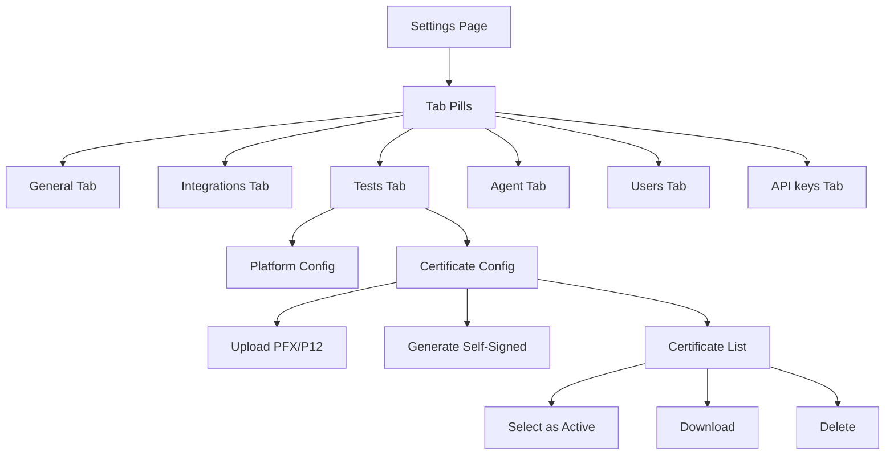

# Certificates & Signing

## Overview

ProjectAchilles supports up to **5 certificates** (uploaded + generated combined) for code signing Windows binaries.

Signing alone doesn't get a test past every endpoint control. Before the first run,
work through [Endpoint Prerequisites](../../deployment/endpoint-prerequisites):
which certificate to use, how to get its public part onto the endpoints, and the
Defender ASR exclusion that signing can't replace.

## Uploading a Certificate

1. Navigate to **Settings** → **Tests** → **Code Signing Certificate**
2. Choose the **Upload Certificate** tab
3. Select a PFX/P12 file
4. Enter the certificate password, and optionally a label
5. Click **Upload Certificate**

## Generating a Self-Signed Certificate

1. Navigate to **Settings** → **Tests** → **Code Signing Certificate**
2. Choose the **Generate Certificate** tab
3. Fill in Common Name, Organization and Country
4. Click **Generate**

:::info[Platform Differences]
- **Docker/Railway/Render/Fly.io**: Uses OpenSSL CLI for generation and `osslsigncode` for signing
- **Vercel**: Uses `node-forge` (pure JS) for generation; signing is not available (no osslsigncode)
:::

## Active Certificate

One certificate is marked as "active" at a time. The build service uses the active certificate for all Authenticode signing operations.

Select the radio button next to a certificate to make it the current signing certificate. The active one carries an **Active** badge.

## Storage

| Target | Storage Location |
|--------|-----------------|
| Docker/PaaS | `~/.projectachilles/certs/cert-<timestamp>/` |
| Vercel | Vercel Blob (`certs/` prefix) |

## Legacy Migration

If you have flat certificate files (from an older version), they are automatically migrated to the subdirectory structure on first access.

## Settings Page Layout

The Certificates section lives within the broader **Settings** page, which is organized into tabs shown as pills at the top: **General**, **Integrations**, **Tests**, **Agent**, **Users** and **API keys**. General is shown to administrators (not on Vercel), and Users and API keys to users who can manage users.

Navigate to **Settings** and select the **Tests** tab to access certificate management.

## Certificate Management Walkthrough

### Uploading a Certificate

1. In the **Tests** tab, open the **Code Signing Certificate** card
2. Choose the **Upload Certificate** tab
3. Select a PFX or P12 file from your file system
4. Enter the **Certificate Password**
5. Optionally enter a **Label** (for example `Production Cert`); it is the name shown in the list
6. Click **Upload Certificate**
7. The certificate appears in the certificate list with its subject details and expiration date

:::tip[PFX Compatibility]
Some PFX files use algorithms that the platform cannot parse for metadata extraction. In that case, the upload still succeeds, but the displayed subject and expiration fields may show "Unknown". The certificate itself remains fully functional for signing.
:::

### Generating a Self-Signed Certificate

1. Choose the **Generate Certificate** tab
2. Fill in:
   - **Common Name**
   - **Organization**
   - **Country (2-letter code)**
   - **Password (optional)**: leave blank for an auto-generated password
   - **Label (optional)**
3. Click **Generate**
4. The new certificate appears in the list and is ready for use

### Setting the Active Certificate

Only one certificate can be active at a time. The active certificate is used for all Windows Authenticode signing operations during test and agent builds.

1. Find the certificate you want to use in the certificate list
2. Select its radio button (tooltip **Set as active**)
3. The **Active** badge moves to the selected certificate
4. All subsequent builds use this certificate for signing

### Downloading and Deleting

- **Download** -- Retrieves the PFX file, **including the private key**, for backup or use in other tools. To give endpoints the public certificate only, export it from a signed binary ([Endpoint Prerequisites](../../deployment/endpoint-prerequisites#export-the-public-certificate))
- **Delete** -- Permanently removes the certificate (requires the `settings:certificates:delete` permission). The active certificate cannot be deleted; make another one active first

:::warning[5-Certificate Limit]
The platform enforces a maximum of 5 certificates (uploaded and generated combined). At the limit the upload and generate tabs are replaced by "Maximum of 5 certificates reached. Delete one to add another."
:::

## Other Settings Sections

The Settings page includes additional configuration areas relevant to the overall platform:

### Integrations Tab

Manages connections to external services through a card-based interface:

| Integration | Purpose |
|------------|---------|
| **Analytics (Elasticsearch)** | Connection to your Elasticsearch cluster for analytics data storage. Supports both Elastic Cloud (Cloud ID) and direct URL connections. Includes index management and connection testing. |
| **Azure / Entra ID** | Service principal credentials for tests that target Azure Active Directory. |
| **Microsoft Defender** | Tenant credentials for pulling Secure Score, alerts, and control profiles from Microsoft Graph. |
| **CrowdStrike Falcon** | API client for Falcon alerts and Zero Trust Assessment scores. |
| **SentinelOne** | Console URL and API token for threats, alerts and posture. Not on Vercel. |
| **Sophos Intercept X** | Sophos Central tenant credential for alerts, detections and Health Check. Not on Vercel. |
| **Alerts & Notifications** | Threshold-based alerts dispatched to Slack (webhook) or email (SMTP) when scores drop below configured levels. Not on Vercel. |
| **Pre-execution notices** | Email the security team before test runs and hold the tests until the notice is accepted. Not on Vercel. |

Each card shows a status badge and a **Configure** button that opens its settings in a dialog. See the [integration guides](../integrations/elasticsearch) for each one.

### Agent Tab

Manages agent binary distribution:

- **Build Agent Binary** -- Cross-compile the agent on the server. The version field is pre-filled with the next version, and Windows builds are signed with the active certificate
- **Upload Agent Binary** -- Upload a pre-compiled agent binary with its version, a signing certificate, release notes and the **Mandatory update** flag
- **Registered Versions** -- View all registered agent binaries with size, SHA-256 hash, signing status, and deletion controls

See [Deploying Agents](../agent-management/deploying-agents) and [Agent Self-Updates](../agent-management/self-updates).

### General Tab

The console's organization code, name and colour. See [Console Identity](./console-identity).

### Users Tab

User and role management (visible only to users with the `settings:users:manage` permission, and changes need a signed-in browser session; API keys and CLI tokens are refused):

- **User list** with role assignment
- **Invitation system** for onboarding new team members via email
- **Permission reference** showing the full permission matrix for each role

### API keys Tab

Create and revoke API keys for scripts and integrations. Same visibility as the Users tab. The Vercel deployment has no API keys. See [Programmatic Access](../../api-reference/programmatic-access).

### Platform Config

Located in the **Tests** tab alongside certificates, in the **Target Platform** card:

- Select the default target **operating system** and **architecture** for test builds. The operating system is used for tests whose source does not say which system they target
- Architecture options adjust based on OS compatibility (e.g., macOS does not support 386)
- Changes auto-save with visual confirmation

## Interface

The console ships a single dark theme (the f0 design language) — there is no
theme selector. See **[Console & Navigation](../console/navigation)** for the
layout, keyboard shortcuts, and how the palette is defined.
