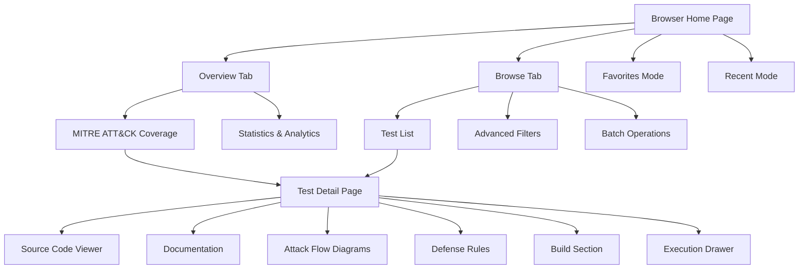

# Browsing & Filtering

The Test Browser is the primary interface for discovering and managing security tests.

## Overview Dashboard

The browser page opens with a 2-tab layout:

1. **Overview** — MITRE ATT&CK coverage chart, category legend, and summary statistics
2. **Browse** — Filterable test list

## Test Library List

The Tests page is a list with a filter rail on the left. Each row shows the test name, then `actor · subcategory` (or "No attributed actor" when the test has none), the fleet result, the test score, and the favorite and run actions. The score shows "—" when it is missing or zero.

Columns appear as the window gets wider:

| Width | Layout |
|-------|--------|
| Below 1280px | No header row. Each row stacks the name and `actor · subcategory`, with the fleet result line (and its bar) underneath; score and actions sit on the right |
| 1280px and up | A header row appears, and **Platform**, **Fleet result** and **Score** become columns |
| 1536px and up | Adds **Techniques** (the first two unique ATT&CK IDs, then `+n`) and **Stages** columns |

### Fleet result

The fleet result is the latest result per endpoint over the last 90 days, the same rule the Defense Score uses.

| Shows | Meaning |
|-------|---------|
| `N / M endpoints protected` | N of M endpoints protected on their latest result |
| `N / M checks passed` | The same count for cyber-hygiene tests, where each control is a check |
| `Not run yet` | The test has no recorded execution at all |
| `No conclusive result in 90 days` | The test may have run, but no endpoint returned protected or unprotected in the window. Errors, blocks before execution (exit 260), skipped stages and risk-accepted results don't count |
| `—` | Fleet results are loading, or analytics is not configured or unavailable |

Hover the cell for the window and the time of the last run. The data comes from `GET /api/analytics/test-results`; see the [Analytics API reference](../../api-reference/analytics).

## Filtering

The filter rail holds the facets as plain rows with counts, and the search box sits above the list. Filters are additive: combining several narrows the results.

| Filter | Description |
|--------|-------------|
| **Search** | Free-text search across test names, UUIDs, technique IDs and descriptions |
| **View** | All tests, Favorites, or Recently viewed |
| **Category** | Filter by test category (e.g., intel-driven, cyber-hygiene) |
| **Platform** | Filter by target platform (Windows, Linux, macOS) |
| **Threat actor** | Filter by attributed threat actor |
| **Not run yet** | Tests with no recorded executions (requires Elasticsearch) |
| **Has binary** | Tests that already have a compiled binary |

There is no severity facet. An old `?severity=` link still loads; the parameter is ignored.

## Favorites

Click the heart icon on any test row to favorite it. Favorites are stored per-user in the browser's local storage. Use the **Favorites** filter to show only favorited tests.

## Categories

Tests are organized into categories that map to MITRE ATT&CK tactics:
- Defense Evasion
- Persistence
- Privilege Escalation
- Credential Access
- Lateral Movement
- Discovery
- Collection
- Exfiltration
- And more...

The test list groups tests under a plain header for each category, with the number of tests in it.

## Browser Architecture

The test browser is organized around two main pages connected by navigation:

### Browse Modes

The browser home page has three top-level modes, selectable from the navigation:

- **Browse** (default) -- Full-featured browser with Overview and Browse sub-tabs
- **Favorites** -- Shows only tests you have favorited
- **Recent** -- Displays tests you have recently viewed, in chronological order

## MITRE ATT&CK Coverage

The **Overview** tab features an interactive MITRE ATT&CK Enterprise coverage chart:

- **14 enterprise tactics** displayed in kill-chain order
- Each tactic column contains a **bar chart** where bar height represents the number of tests mapped to each technique
- Color intensity indicates test coverage density -- darker bars mean more tests
- Click any tactic column to open a **detail panel** listing all techniques and their test counts
- From the detail panel, click a technique to filter the Browse tab to tests covering that technique
- Use the **empty tactic toggle** to show or hide tactics that have no mapped tests

Coverage density is rendered with the governed chart tokens — accent green at
varying opacity — so it stays legible against the console's dark surfaces.

:::tip Drill-Down Navigation
Click a technique in the coverage chart to jump directly to the Browse tab with that technique pre-filtered. This is the fastest way to find tests for a specific ATT&CK technique.
:::

## Advanced Filtering

The Browse tab provides multi-dimensional filtering with real-time results:

### Search

The search box matches across multiple fields simultaneously:

- Test names and descriptions
- UUIDs (partial matching supported)
- MITRE ATT&CK technique IDs (e.g., "T1059")

### Categorical Filters

| Filter | Options |
|--------|---------|
| **Category** | intel-driven, MITRE top 10, cyber hygiene, and more |
| **Platform** | Windows, Linux, macOS, Cloud |
| **Threat Actor** | Specific threat actor groups |
| **Not Run Yet** | Tests that have never been executed (requires Elasticsearch connection) |
| **Has Binary** | Tests that currently have a compiled binary available for download |

:::info "Not Run Yet" Filter
The "Not Run Yet" filter queries your Elasticsearch analytics data to identify tests that exist in the library but have no recorded executions. This is useful for expanding coverage to untested techniques.
:::

:::info "Has Binary" Filter
The **Has Binary** toggle narrows the list to tests that have already been
built. It loads the set of built test UUIDs once from
`GET /api/tests/builds` and filters client-side. On serverless (Vercel)
deployments the build system is stubbed, so the endpoint is unavailable and the
toggle has no effect — the filter degrades gracefully rather than erroring.
:::

### Sorting

Sort the test list by any of these dimensions:

- **Name** -- Alphabetical
- **Score** -- By test quality rating
- **Created** / **Modified** -- By date
- Ascending or descending direction for each option

## Test Detail Page

Click any test to open its detail page, which uses a dual-pane layout:

### Left Sidebar

The sidebar organizes the test's files into collapsible sections:

| Section | Contents |
|---------|----------|
| **Documentation** | README, info cards, safety notes |
| **Build** | Binary compilation controls (see [Building & Signing](./building-signing)) |
| **Visualizations** | Attack Flow diagrams, Kill Chain diagrams |
| **Defense Guidance** | Hardening rules and recommended mitigations |
| **Source Code** | Go source files |
| **Detection Rules** | KQL, YARA, Sigma, and Elastic detection rules |
| **Configuration** | Test metadata and configuration files |

### Right Panel — Content Viewer

Selecting a file in the sidebar opens it in the content viewer, which adapts based on file type:

- **Markdown files** render with GitHub-style formatting, including tables and code blocks
- **Code files** display with syntax highlighting (Go, PowerShell, Bash, JSON, KQL, YARA, YAML)
- **Attack Flow diagrams** render as interactive SVG visualizations in a sandboxed frame
- **Kill Chain diagrams** render as interactive network graphs using Cytoscape.js

The page starts in full-header mode showing the test title, metadata badges, and description. When you select a file to view, it switches to compact mode to maximize content area.

## Batch Operations

From the Browse tab, select multiple tests using checkboxes, then:

- **Execute selected** -- Opens the execution drawer to run all selected tests on chosen agents
- **Batch operations** are useful for running an entire test category at once

## Favorites and Recent Tests

### Favorites

- Click the **heart icon** on any test row to add it to your favorites
- Favorites are stored per-user in browser local storage
- Switch to **Favorites** mode to see only your favorited tests

### Recent Tests

- The browser automatically tracks tests you have viewed
- Switch to **Recent** mode to see them in reverse chronological order
- Useful for quickly returning to tests you were analyzing

## Git Sync Status

The browser shows the sync status of the test library in the top bar:

- A **sync indicator** shows when the library was last updated from the Git repository
- Click **Sync Now** to trigger a manual sync if you have the `tests:sync:execute` permission
- After syncing, the test list refreshes automatically with any new or updated tests
