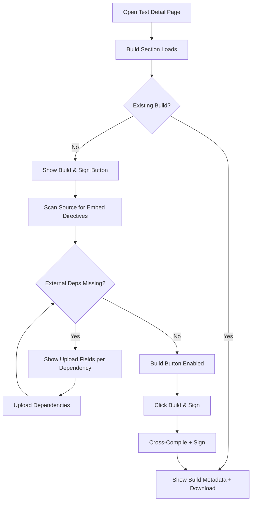

# Building & Signing Tests

ProjectAchilles can cross-compile test binaries directly from the web UI using the backend's Go toolchain.

## Build Process

1. Navigate to a test's detail page. The build controls are in the **Deploy** panel of the Overview tab
2. Check the **Target** shown in the panel (for example `windows/amd64`)
3. If the test has `//go:embed` directives, upload the required dependency files
4. Click **Build & Sign** to trigger cross-compilation
5. Once complete, click the file name (or **Download** in the page header) to get the signed binary

There is no platform picker per build. The operating system comes from the Go build tags in the test's source files; a test with no build tags, or with conflicting ones, uses the **Target Platform** set in **Settings → Tests**. The architecture always comes from that setting. A cross-platform test whose `build_all.sh` produces binaries for several operating systems keeps one binary per system, and each agent is sent the one for its own.

A build can take minutes. The page keeps polling while it runs, so you can leave it and come back. A second build of the same test is refused until the first one ends.

**Upload Binary** registers a binary you built elsewhere instead of building on the server.

## Platform & Architecture Support

| Platform | Architecture | Code Signing |
|----------|-------------|--------------|
| Windows | amd64, 386, arm64 | Authenticode (osslsigncode) |
| Linux | amd64, 386, arm64 | None |
| macOS | amd64, arm64 | Ad-hoc (rcodesign) |

These are the choices in **Settings → Tests → Target Platform**. Build for an architecture your agents run on.

## Code Signing

### Windows (Authenticode)
Windows binaries are signed with Authenticode using `osslsigncode` and a PFX certificate. Manage certificates in [Settings → Certificates](../settings/certificates). What signing does and doesn't get past on an endpoint, and what to set up there before the first run, is in [Endpoint Prerequisites](../../deployment/endpoint-prerequisites).

### macOS (Ad-Hoc)
macOS binaries receive ad-hoc signatures via `rcodesign`. No certificate is required. Apple silicon refuses to run code without a signature, and an ad-hoc one satisfies it.

### Linux
Linux binaries are not signed.

:::info[Signing Failures Are Non-Fatal]
If signing fails (missing certificate, tool error), the build continues and produces an unsigned binary.
:::

## Embed Dependencies

Some tests use Go's `//go:embed` directive to embed files into the binary. The UI detects these directives and shows upload fields for each required file.

- **Source-built dependencies** (compiled from Go source by `build_all.sh`) show a wrench icon and "Auto-built" label — no upload needed
- **External dependencies** (pre-compiled binaries) show an upload button — the Build button is disabled until all external deps are uploaded

## Stored Builds

A build is stored on the server and reused for every task until you rebuild or delete it. It is **not** rebuilt when the test source changes, for example after a library sync: use **Rebuild** in the Deploy panel to pick up new source. Changing the active certificate does not re-sign existing builds either.

## Build Environment

A build runs code from the test library (`go build`, and `build_all.sh` for multi-binary tests). These processes do not get the backend's environment: only an allowlist is passed on (`PATH`, `HOME`, the Go variables, proxy and CA settings, `JAVA_HOME`, `DOTNET_*`, `NUGET_*`, locale), so the backend's secrets are not readable from the build's environment.

If a build on your install needs another variable, name it in `BUILD_ENV_PASSTHROUGH` on the backend (comma-separated):

```bash
BUILD_ENV_PASSTHROUGH=MY_PROXY_TOKEN,CUSTOM_SDK_HOME
```

This is not a sandbox. Build scripts still run as the backend user, so only sync test libraries you trust.

## Availability by Deployment Target

| Target | Build from Source | Upload Binaries |
|--------|:-----------------:|:---------------:|
| Docker Compose | Yes | Yes |
| Railway | No | Yes |
| Render | Yes | Yes |
| Fly.io | Yes | Yes |
| Vercel | No | Yes |

## Build Section in the Test Detail Page

The build section is the **Deploy** panel on the Overview tab of a test's detail page. It is shown to users who can build tests, for tests that have source code. It manages the full compile-sign-download workflow.

### Build Status Display

When a build already exists, the Build section shows:

- **Filename** of the compiled binary; click it to download
- **Target platform** and architecture
- **Signature status**: Signed or Unsigned, or **Uploaded** for a binary you uploaded
- **File size**
- **Rebuild** and **Delete build** buttons

When no build exists, **Build & Sign** and **Upload Binary** are shown instead. A failed build shows the compiler output with **Retry Build**.

### Build Workflow



### Embed Dependency Handling

The UI scans Go source files for `//go:embed` directives and categorizes each dependency:

| Dependency Type | Icon | Action Required |
|----------------|------|----------------|
| **Source-built** (compiled from Go source by `build_all.sh`) | Wrench | None -- "Auto-built" label shown |
| **External** (pre-compiled binary) | Upload | Must upload before building |

The **Build & Sign** button remains disabled until all external dependencies are uploaded. Source-built dependencies are compiled automatically as part of the build process.

:::warning[Upload Validation]
When uploading a Windows executable dependency, the UI performs client-side validation by checking for the MZ header (the first two bytes of any PE executable). Invalid files are rejected before upload.
:::

### Multi-Binary Bundles

Some tests use a multi-binary architecture where each validator is a separate embedded binary. For these tests:

1. The `build_all.sh` script compiles all validators from source
2. The active signing certificate is passed to the build script for signing each validator
3. Validators are embedded into the final orchestrator binary
4. The entire process runs as a single build operation from the UI

The certificate reaches `build_all.sh` through two variables set for that build only: `F0_SIGN_CERT_PATH` and `F0_SIGN_CERT_PASS_FILE` (a temporary file, deleted after the build).

## Execution Drawer

The **Execution Drawer** is a slide-out panel that appears when you click **Run on agents** on a test's page or the run button on a row of the Tests list (or select several tests and click **Run N**). It orchestrates the full path from agent selection to task creation. It has the same agent picker and Run Now / Schedule options as the **Create Task** dialog on the Tasks page, shown here:


### Agent Selector

The drawer includes an agent selector with:

- **Search by hostname** -- Filter the agent list by typing
- **Filter by tags** -- Multi-select tag dropdown
- **Online-only toggle** -- Exclude agents that are not currently connected
- **Not run** -- Keep only hosts that have not run this test (or any test) in 7, 30 or 90 days, or ever. See [Agent Selection](../agent-management/task-execution#agent-selection)
- **Select All / Deselect All** -- Bulk selection for the currently filtered list
- Each agent row shows its status indicator (online/offline), hostname, OS/architecture, and tags

### Execution Configuration

Two tabs control how the test runs:

**Run Now tab:**
- **Timeout** -- Maximum execution time in seconds
- **Priority** -- Normal (1), Medium (2) or High (3)
- **Target Index** -- Under **Advanced**. Elasticsearch index for result storage; it must be an Achilles results index (`achilles-results-…`)

**Schedule tab:**
- **Once** -- Date and time picker
- **Daily** -- Every day
- **Weekly** -- Day selection with time configuration
- **Monthly** -- Day of month with time options
- **Timing**, for every frequency -- Fixed time, randomized (fleet together) or randomized per machine. See [Task Scheduling](../agent-management/task-scheduling#randomized-timing)
- Timezone selection from common zones

The button at the bottom reads **Execute (N)** or **Schedule (N)**, with the number of selected agents.

### Pre-Execution Validation

Before submission, the drawer validates:

- At least one agent is selected
- All tests have valid builds (the drawer offers to build missing tests inline). At dispatch, a test with no build for an agent's operating system is refused for that agent
- Azure credentials are configured for tests that require Entra ID integration
- Schedule configuration is valid (future dates, selected days, etc.)

### Batch Execution

When multiple tests are selected:

- The drawer shows a summary of all selected tests with their build statuses
- A **Build All** button compiles any tests that lack builds
- Individual test build failures are non-fatal -- the remaining tests can still be submitted
- Tasks are created for each test-agent combination

:::info[Build Before Execute]
The execution drawer checks build status automatically. If a test has not been built yet, you can trigger the build directly from the drawer without going back to the test detail page.
:::
